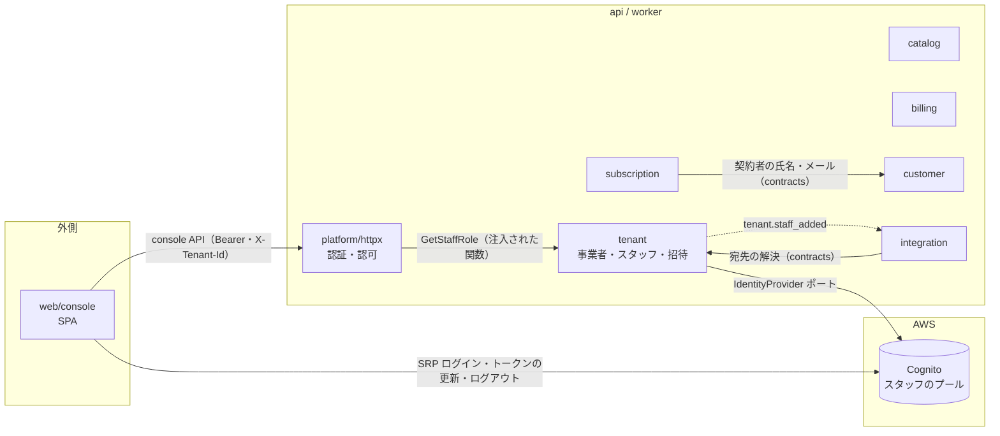
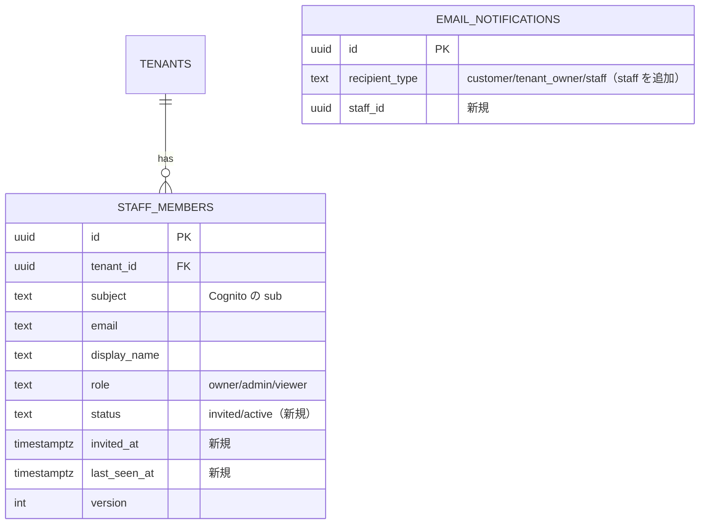
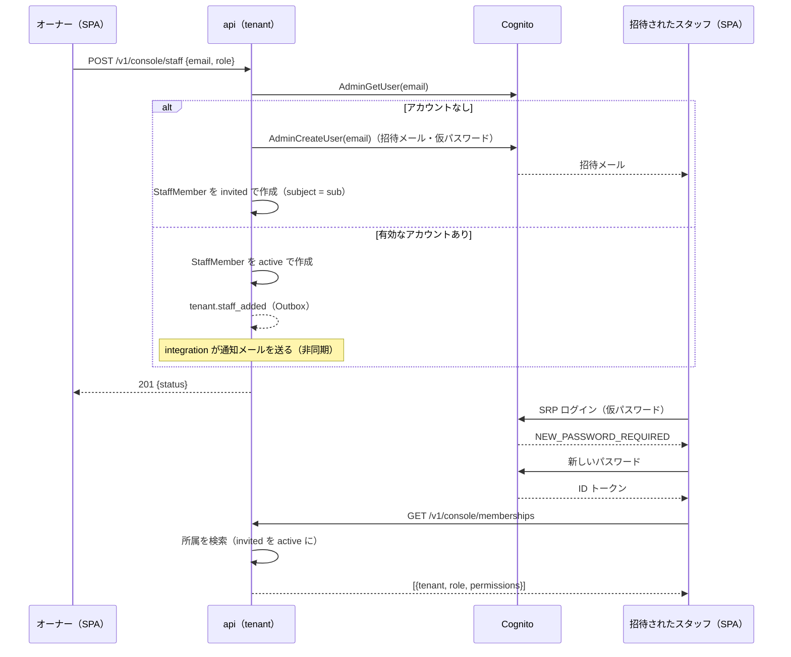
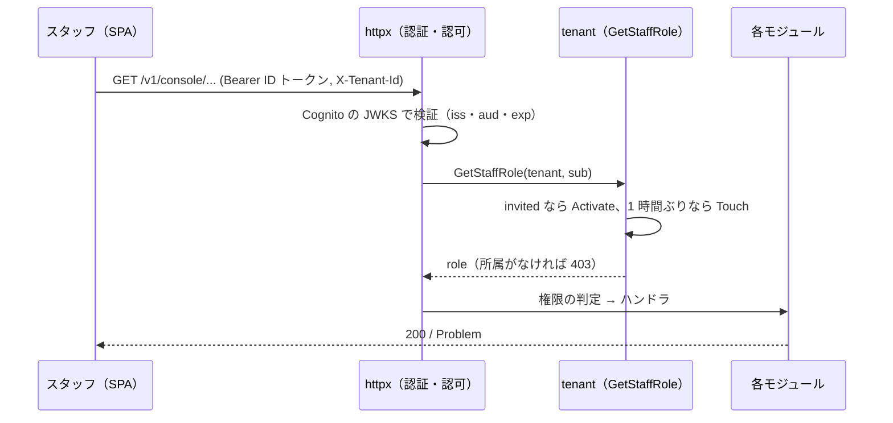
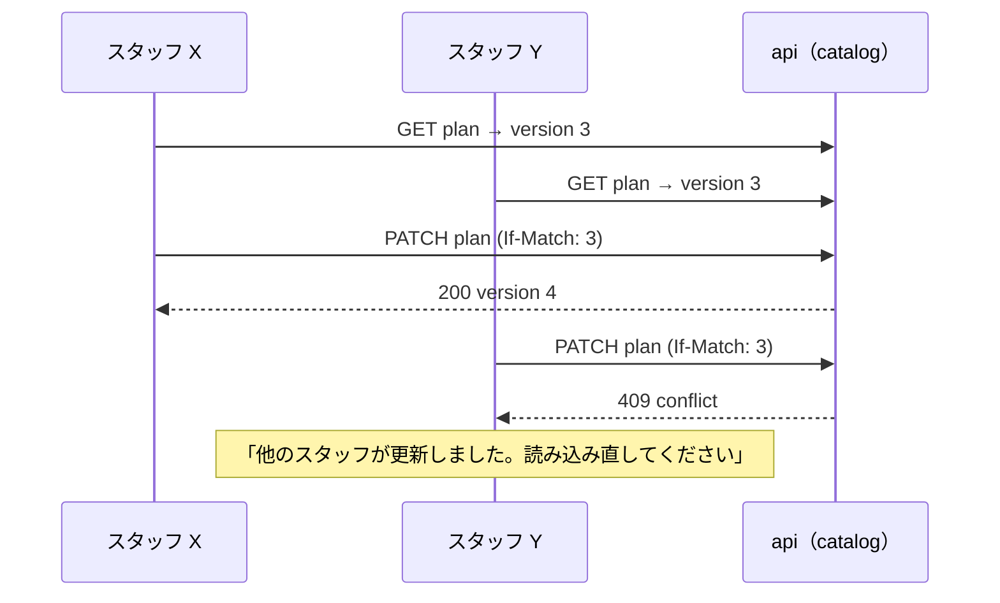
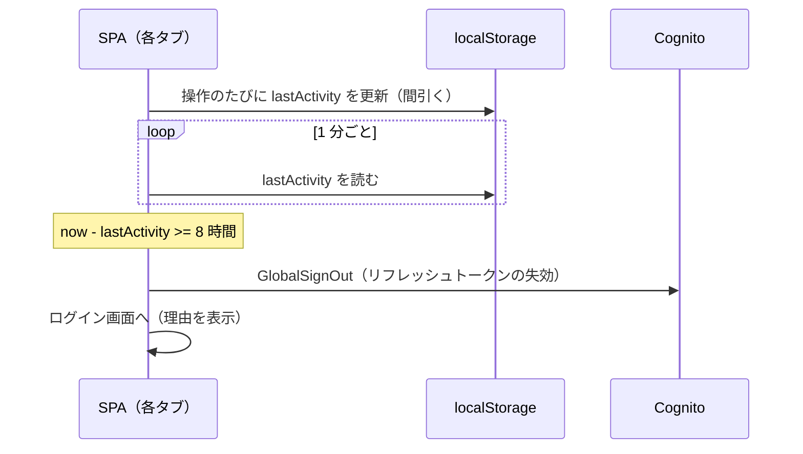

# 設計書: 事業者コンソール（Cognito ログインを含む）

| 項目 | 内容 |
|---|---|
| ステータス | Approved |
| 作成日 | 2026-10-26 |
| 要件定義書 | `docs/requirements/business-console.md`（Approved） |
| 上位の設計 | `docs/design/subscription-platform.md`（モジュラーモノリス、SPA の配信：CloudFront＋S3、ADR-001〜009）、`docs/poc/specs/identity.md`（ロールと権限 §3.4）、`docs/poc/specs/platform.md`（認証・認可・ルーター） |

本書の ADR は上位の設計書の ADR と区別するため `ADR-C01` から番号を振る。

## 1. 設計概要

- 事業者コンソールは TypeScript の SPA（`web/console`、React＋Vite）で、既存の console API を呼ぶ利用者として外側に置く。新しいモジュールは作らない。
- ログインは自前の画面から Amazon Cognito（スタッフ用のユーザープール）に対して行う（Amplify Auth、SRP 方式）。ID・パスワード、初回の仮パスワードの変更、パスワードの再設定（メールの確認コード）を扱う。
- 業務の知識として増えるのは「スタッフの招待と所属」だけで、Identity（`modules/tenant`）の StaffMember に招待の状態を足す。Cognito の操作は tenant の `IdentityProvider` ポートの裏に隠す。
- 画面のために既存の API を少し広げる：所属する事業者の一覧（事業者を選ぶ前に呼ぶ）、スタッフの招待・再送、契約者の氏名・メールアドレスの表示と検索、楽観ロック（version と `If-Match`）。
- 配信は本番が CloudFront＋S3、ローカル・CI が nginx のコンテナで、どちらも `/v1/*` を api に中継する同一オリジンの形にする。

## 2. コンテキストマップ

### コンテキスト間の連携一覧

| 発信元 | 宛先 | 経路 | 内容 |
|---|---|---|---|
| SPA | Cognito | Amplify Auth（HTTPS） | SRP のログイン、仮パスワードの変更、パスワードの再設定、トークンの更新、グローバルなログアウト |
| SPA | api | console API | 既存の API ＋ §5 の追加。Bearer に Cognito の ID トークン、`X-Tenant-Id` に選んだ事業者 |
| platform/httpx | tenant | 注入された関数（既存） | `GetStaffRole(tenant, subject)`。招待中のスタッフの最初の要求で有効にする処理と最終利用日時の更新を、この呼び出しの中で行う（§6.2） |
| platform/httpx | tenant | 注入された関数（新規） | `ListMemberships(subject)`（事業者を選ぶ前の API で使う） |
| tenant | Cognito | `IdentityProvider` ポート（新規） | ユーザーの検索（メールアドレス）・作成（招待メール）・招待の再送 |
| subscription | customer | contracts（既存の矢印） | `GetContacts(ids)`（一括）・`FindAccountByEmail(email)`（新規メソッド） |
| tenant | integration | ドメインイベント（新規） | `tenant.staff_added`（既存の Cognito アカウントの人を追加したときの通知メール） |
| integration | tenant | contracts（既存の矢印） | `GetStaffContact(tenant, staff)`（新規メソッド。送信時に宛先を解決） |

## 3. ドメインモデル

### 集約一覧

| 集約 | 集約ルート | 含まれるエンティティ/VO | 不変条件 |
|---|---|---|---|
| StaffMember（既存・変更） | StaffMember | `StaffStatus`（invited / active。新規）、`Role`、`Email`、`subject`（Cognito の sub）、`invitedAt`・`lastSeenAt`（新規） | 同じ事業者に同じメールアドレス・同じ subject は 1 つ（既存の一意制約）。最後の active なオーナーは降格・削除できない（既存。invited のオーナーは数えない）。invited のときだけ招待を再送できる。invited → active の一方向（戻らない） |
| Tenant（既存） | Tenant | 変更なし | suspended の事業者には招待できない（既存の「suspended では書き込めない」に含まれる） |
| Product・Plan（catalog）、DunningPolicy（billing） | 既存 | 変更なし（既存の `version` を API に出す） | 更新は `If-Match` の version と一致するときだけ（指定があれば） |

- 招待の期限切れ（7 日）は DB の状態にしない。仮パスワードの期限は Cognito（`TemporaryPasswordValidityDays=7`）が守り、画面の「期限切れ」の表示は `status=invited かつ invitedAt + 7 日 < now` で決める（API の応答に `invitation_expired` を出す）。
- Cognito のアカウント（人）と StaffMember（所属）は 1 対多。所属の削除・招待の取り消しは Cognito のアカウントを消さない。

**StaffMember のメソッド（追加・変更）**

| メソッド | 振る舞い |
|---|---|
| `InviteStaffMember(tenant, subject, email, name, role, accountState, now)` | `accountState` が「新規作成」または「仮パスワードのまま」なら invited、「有効なアカウント」なら active で作る |
| `Activate(now)` | invited → active。active なら何もしない |
| `MarkInvitationResent(now)` | invited のときだけ `invitedAt = now`。それ以外は `ErrNotInvited` |
| `Touch(now)` | `lastSeenAt` が 1 時間以上前なら更新する（書き込みを間引く） |
| `ChangeRole`・`Remove`（既存） | 「最後のオーナー」の数え方を active のオーナーに限る |

### ドメインイベント

| イベント名（過去形） | 発生タイミング | 購読者 |
|---|---|---|
| `tenant.staff_added`（新規） | 既存の Cognito アカウント（active）の人を事業者に追加したとき。payload：`tenant_id`・`staff_id`・`role`（メールアドレスは入れない） | integration（通知メール `staff_added`） |
| `tenant.staff_invited`（新規） | 新規の招待（invited で作成）・再送のとき。payload：`tenant_id`・`staff_id`・`resent` | なし（拡張口。招待メールは Cognito が送る） |

## 4. DB設計

### テーブル定義

**`tenant.staff_members`（変更。マイグレーション `00002_staff_invitation.sql`）**

| 列 | 型・制約 | 備考 |
|---|---|---|
| `status` | `text NOT NULL DEFAULT 'active' CHECK (status IN ('invited','active'))` | 既存の行は active |
| `invited_at` | `timestamptz NULL` | invited で作ったとき・再送のときに入れる |
| `last_seen_at` | `timestamptz NULL` | 1 時間に 1 回まで更新 |
| 追加の CHECK | `CHECK (status = 'active' OR invited_at IS NOT NULL)` | |

**`integration.email_notifications`（変更。マイグレーション `00002_staff_notification.sql`）**

| 列・制約 | 内容 |
|---|---|
| `recipient_type` の CHECK | `('customer','tenant_owner','staff')` に広げる |
| `staff_id uuid NULL` | 宛先のスタッフ。`CHECK (recipient_type <> 'staff' OR staff_id IS NOT NULL)` |

catalog・billing の表は変更しない（`version` 列は既存）。

### インデックス

| テーブル | インデックス | 根拠となる想定クエリ |
|---|---|---|
| `tenant.staff_members` | `(subject)`（新規） | `ListMemberships(subject)`：ログイン直後の所属する事業者の一覧（全事業者を横断。system スコープ） |
| `tenant.staff_members` | `(tenant_id, created_at, id)`（既存） | スタッフ一覧 |
| `customer.customer_accounts` | `(email)`（既存の一意制約を確認して流用。なければ追加） | `FindAccountByEmail`：契約のメールアドレス検索 |

## 5. API設計

### エンドポイント一覧

**追加・変更する API**（既存の console API 24 本は §5.1 の表のとおり画面から使う）

| メソッド | パス | 概要 | 権限 | 要件ID |
|---|---|---|---|---|
| GET | `/v1/console/memberships` | **新規**。ログイン中のスタッフが所属する事業者の一覧（`tenant_id`・`tenant_name`・`tenant_status`・`role`・`staff_status`・`permissions[]`）。`X-Tenant-Id` は不要（§5.4） | 認証済みのスタッフ | FR-004・FR-005 |
| POST | `/v1/console/staff` | **新規**。招待 `{email, display_name, role}` → 201 StaffMember（`status` が invited か active）。`Idempotency-Key` 必須 | `staff.manage` | FR-006 |
| POST | `/v1/console/staff/{id}/resend-invitation` | **新規**。招待の再送 → 202 | `staff.manage` | FR-006 |
| GET | `/v1/console/staff` | **変更**。`status`・`invitation_expired`・`invited_at`・`last_seen_at`・`version` を足す | `console.read` | FR-007 |
| PATCH | `/v1/console/staff/{id}` | **変更**。`If-Match` を受ける | `staff.manage` | FR-007・FR-015 |
| DELETE | `/v1/console/staff/{id}` | **変更なし**。invited なら招待の取り消し、active なら削除（どちらも所属の削除） | `staff.manage` | FR-006・FR-007 |
| POST | `/v1/ops/tenants/{id}/staff` | **変更**。`subject` を省略すると招待（Cognito でアカウントを作る）。`subject` の指定は devtools ビルドだけ受け付ける（既存の E2E の準備用） | operator | FR-006（最初のオーナー） |
| GET | `/v1/console/subscriptions` | **変更**。`email`（完全一致）の検索を足し、各契約に `customer{id, name, email, withdrawn}` を足す | `console.read` | FR-010 |
| GET | `/v1/console/subscriptions/{id}` | **変更**。`customer{…}` を足す | `console.read` | FR-010 |
| PATCH | `/v1/console/products/{id}`・`/v1/console/plans/{id}` | **変更**。応答に `version`、要求に `If-Match` | `catalog.write` | FR-008・FR-015 |
| GET・PUT | `/v1/console/dunning-policy` | **変更**。応答に `version`、PUT に `If-Match` | `console.read`・`dunning.write` | FR-011・FR-015 |
| POST | `/v1/console/client-errors` | **新規**。画面の JavaScript のエラーを受け取り、ログ（`console.client_error`）に書く。本文 8KB まで、1 分に 30 件まで | 認証済みのスタッフ（`X-Tenant-Id` 不要） | NFR-009 |

### 5.1 画面と API の対応

| 画面（ルート） | 使う API | 要件ID |
|---|---|---|
| `/console/login`・`/console/login/new-password`・`/console/forgot-password` | Cognito（Amplify Auth） | FR-001・FR-002 |
| `/console/tenants`（事業者の選択） | `GET /memberships` | FR-004 |
| `/console/t/:tenantId/subscriptions`（トップ）・`/subscriptions/:id` | `GET /subscriptions`・`/subscriptions/{id}`・`/subscriptions/{id}/invoices` | FR-010 |
| `/console/t/:tenantId/products`・`/products/:id`・`/plans/:id` | products・plans・price-versions・publish・unpublish | FR-008 |
| `/console/t/:tenantId/coupons` | coupons | FR-009 |
| `/console/t/:tenantId/settings/dunning` | dunning-policy | FR-011 |
| `/console/t/:tenantId/webhooks`・`/webhooks/:id`・`/webhook-deliveries`・`/webhook-deliveries/:id` | webhook-endpoints・rotate-secret・webhook-deliveries・redeliver | FR-012・FR-013 |
| `/console/t/:tenantId/settings/api-keys` | api-keys | FR-014 |
| `/console/t/:tenantId/settings/staff` | staff・resend-invitation | FR-006・FR-007 |

事業者の ID を URL に持たせる（`/t/:tenantId/`）。ブックマーク・複数タブで別の事業者を開けるようにするためで、API には `X-Tenant-Id` として渡す。

### エラーレスポンス規約

既存の Problem Details（`api/errors.yaml`、platform.md §7）に従う。追加するコード：

| code | status | 用途 |
|---|---|---|
| `staff_already_member` | 409 | 同じ事業者に同じメールアドレスのスタッフがいる |
| `staff_not_invited` | 409 | invited でないスタッフへの招待の再送 |
| `identity_provider_unavailable` | 503 | Cognito への要求が失敗した（招待・再送） |

楽観ロックの不一致は既存の `conflict`（409）。画面は code で文言を決め、`errors[].field` を入力欄に対応づける。

### ページネーション方針

既存どおりカーソル方式（`limit`・`starting_after`・`next_cursor`、既定 20・上限 100、総件数は返さない）。画面は「次へ・前へ」で、前のページはクライアントが持つカーソルの履歴で戻る。

### 5.2 認証（platform/httpx の変更）

| 項目 | 内容 |
|---|---|
| トークン | SPA は Cognito の **ID トークン**を Bearer に載せる（既存の `CognitoVerifier` は `aud = client_id` で検証するため。アクセストークンは `aud` を持たない） |
| JWKS の取得先 | 設定 `COGNITO_{POOL}_JWKS_URL` を足す（既存の `NewCognitoVerifier` の `jwksURLs` に渡す）。ローカルは MiniStack（`http://ministack:4566/<pool>/.well-known/jwks.json`）。本番は空（`iss` から作る） |
| devtools ビルド | `AUTH_MODE=dev` でも、`COGNITO_STAFF_ISSUER` が設定されていれば Cognito の ID トークンも受ける（`iss` で検証器を選ぶ `MultiVerifier`）。本番ビルドは `AUTH_MODE=cognito` だけ（ADR-C04） |
| スタッフの主体 | `subject = sub`。console の `X-Tenant-Id` の検証・`GetStaffRole` は既存どおり |

### 5.3 Cognito のユーザープール（Terraform。本番と local で同じ定義）

| 設定 | 値 |
|---|---|
| ユーザー名 | メールアドレス（`username_attributes = ["email"]`、大文字小文字を区別しない） |
| セルフサインアップ | 無効（`allow_admin_create_user_only = true`） |
| パスワードポリシー | 12 文字以上、英大文字・英小文字・数字・記号（NFR-003）。仮パスワードの有効期限 7 日 |
| 招待メッセージ | 日本語のテンプレート（件名・本文。コンソールの URL を含む） |
| アカウントの回復 | 確認済みのメールアドレスだけ（`verified_email`） |
| アプリクライアント | シークレットなし。`ALLOW_USER_SRP_AUTH`・`ALLOW_REFRESH_TOKEN_AUTH`。ID・アクセストークン 1 時間、リフレッシュトークン 24 時間（FR-003 の絶対上限）、トークンの失効を有効、`prevent_user_existence_errors = ENABLED` |
| メールの送信 | 本番は SES（自社ドメイン。§9 #1）。local は MiniStack の既定 |
| api の IAM | `cognito-idp:AdminGetUser`・`AdminCreateUser` をスタッフのプールに限って許す（`IdentityProvider` 用） |

### 5.4 事業者を選ぶ前の API（`X-Tenant-Id` なし）

console のルートに拡張属性 `x-sp-tenant: none` を足す。ルーターはこの属性のルートでは `X-Tenant-Id` を求めず、staff のトークンを検証して `subject` だけを持つ主体を置き、`x-sp-permission` の判定をしない（ハンドラが subject で絞る）。属性は `GET /v1/console/memberships` と `POST /v1/console/client-errors` だけに付け、起動時の検査で他のルートに付いていないことを確かめる（tenant の範囲を越える API が増えないようにする）。

### 5.5 SPA の構成（`web/console`）

| 層 | 内容 |
|---|---|
| ルーティング | React Router。`/console/t/:tenantId/*` の下は「ログイン済み かつ その事業者に所属」のガードを通す |
| 認証 | `src/auth`：Amplify Auth の設定（ランタイムの設定 `/console/config.json` から）、ログイン・初回のパスワード変更・再設定、無操作 8 時間の検知（最後の操作の時刻を localStorage に置いてタブ間で共有。1 分ごとに確認）、ログアウト（`signOut({ global: true })`） |
| API の呼び出し | `src/api`：`@sp/api-client` の型を使う fetch の薄い層。Bearer・`X-Tenant-Id`・`Idempotency-Key`（作成系）・`If-Match`（編集系）を付け、Problem を型付きのエラーにする。401 はトークンを更新して 1 回だけ再試行、403 は所属の一覧を取り直す、409 `conflict` は再読み込みを促す |
| サーバーの状態 | TanStack Query（一覧・詳細のキャッシュ、作成・更新後の無効化） |
| 権限 | `GET /memberships` の `permissions[]`（サーバーが identity §3.4 の表から計算）で、ボタンの有効・無効を決める（`<Can permission="catalog.write">`）。表を SPA に複製しない |
| フォーム | `@mantine/form`（Mantine と一体の検証・状態）。サーバーの `errors[].field` を入力欄に出す（API の項目名とフォームの項目名が違うときは対応表で写す） |
| UI 部品 | Mantine（ADR-C03）。共通部品：一覧表（カーソルのページング・空の状態）、確認ダイアログ、一度だけ表示する秘密（コピー付き）、エラーの帯（相関 ID 付き）、停止中の事業者の帯 |
| 表示 | 日時は JST・`2026年10月26日 10:00`、金額は `1,980円`（Intl）。文言は日本語だけ（i18n の仕組みは入れない） |
| 配信 | `vite build` の成果物（`/console/` 配下）。ランタイムの設定は `config.json` で、環境ごとに差し替える（ビルドは 1 つ） |

### 5.6 UI のデザインの方針（Stripe のダッシュボードを参考にする）

オーナーの指示：Stripe のダッシュボードを参考にしたモダンな見た目にする。Stripe のロゴ・名称・配色の完全な複製はせず、情報設計と見た目の原則を取り入れる。

| 原則 | 内容 |
|---|---|
| レイアウト | 左に固定のサイドバー（事業者の切り替え・主要メニュー・設定）、上部に薄いヘッダー（検索のない簡素なもの・ユーザーメニュー）、本文は最大幅 1200px。一覧 → 詳細のページ遷移を基本にし、作成・編集は右から出るドロワーまたはモーダル |
| 色 | 白と非常に薄いグレー（#F6F8FA）を基調に、アクセントはインディゴ（#635BFF 系）の 1 色。状態は控えめなバッジ（有効＝緑、支払い遅延＝橙、解約＝灰、失敗＝赤）。影は弱く、区切りは 1px の薄い罫線 |
| 文字 | 日本語は Noto Sans JP（システムフォントへのフォールバック）、数字・ID は等幅（`cus_…`・金額は桁をそろえる）。見出しは 20〜24px の太字、本文は 14px |
| 一覧 | 罫線の少ない表、行のホバーで薄い背景、行のクリックで詳細へ。上部にフィルター（状態のタブ・プラン）と検索。空の状態はアイコンと次の操作の案内 |
| 詳細 | 上部に主要な値（金額・状態バッジ・ID のコピー）、その下に「概要」のキーと値の 2 列、関連する一覧（請求の履歴など）を順に並べる |
| 秘密の値 | 一度だけ表示するもの（署名鍵・API キー）は、伏せ字＋表示・コピーのボタンと注意書きの枠で示す |
| フィードバック | 保存は右下のトースト、エラーはページ上部の帯（相関 ID 付き）、取り消せない操作は赤のボタンの確認ダイアログ |
| 動き | 控えめなトランジション（150ms 程度）。読み込みはスケルトン表示 |

### 5.7 配信と開発環境

| 環境 | 内容 |
|---|---|
| 本番 | S3＋CloudFront（上位の設計どおり）。`/console/*` は S3（存在しないパスは `index.html` を返す）、`/v1/*` は ALB。応答ヘッダーで CSP（`default-src 'self'`、`connect-src 'self' https://cognito-idp.<region>.amazonaws.com`）、`X-Frame-Options: DENY` |
| ローカル・CI | compose のサービス `console`（nginx。`web/console/dist` を配り、`/v1/` を `api:8080` に中継、ポート 8090）。開発中は `pnpm --filter @sp/console dev`（Vite のプロキシで `/v1` を `localhost:8080` に） |
| 設定 | `config.json`：`cognito.userPoolId`・`clientId`・`endpoint`（local は `http://localhost:4566`、本番は省略）・`region` |

## 6. 主要シーケンス

### 6.1 招待から初回ログインまで

### 6.2 事業者を選んでからの API の呼び出し

### 6.3 編集の衝突

### 6.4 無操作 8 時間の自動ログアウト

## 7. ADR（設計判断の記録）

### ADR-C01: ログイン画面は自前で作り、Amplify Auth（SRP）で Cognito に接続する

- **ステータス**: Accepted
- **コンテキスト**: FR-001〜003 は、日本語の具体的な文言（招待の期限切れ・再設定の結果でアカウントの有無を明かさない）と、コンソールと一体の画面を求める。要件定義書 §9 #3 の未解決事項。
- **決定**: ログイン・初回のパスワード変更・パスワードの再設定を SPA の画面として作り、Amplify Auth v6（`aws-amplify/auth`）で Cognito の API を呼ぶ。認証フローは SRP（`USER_SRP_AUTH`）で、パスワードを Cognito にも送らない。local は `userPoolEndpoint` を MiniStack に向ける。
- **検討した代替案**: (a) Cognito の Hosted UI（Managed Login）：OAuth の認可コード＋PKCE で標準的、MFA などの追加が設定だけで済み、画面の実装がいらない。ただし文言・見た目の自由度が低く、MiniStack の Hosted UI がパスワードの再設定・初回の変更まで再現するか未確認で、E2E がローカルで回らない恐れがある。(b) `USER_PASSWORD_AUTH` を自前で呼ぶ：実装は単純だが、パスワードを Cognito の API に平文で送る（TLS 内とはいえ SRP より露出が大きい）。
- **トレードオフ**: 画面と状態遷移（チャレンジの処理）を自分で保守する。将来 MFA を足すときは画面の追加が要る（Amplify Auth は TOTP のチャレンジに対応しているので、ライブラリの差し替えはいらない）。SRP が MiniStack で最後まで動くことは実装の最初に確かめる（`USER_SRP_AUTH` を受け付けることは確認済み）。動かなければ、local だけ `USER_PASSWORD_AUTH` に切り替える設定を持つ。

### ADR-C02: SPA は React＋Vite、サーバーの状態は TanStack Query

- **ステータス**: Accepted
- **コンテキスト**: 上位の ADR-006 で SPA は TypeScript。画面は一覧・詳細・フォームが中心の業務画面で、API の型は `@sp/api-client` に生成済み。
- **決定**: React 19＋Vite＋React Router＋TanStack Query＋`@mantine/form`（実装時に react-hook-form＋zod から変更：Mantine の入力部品とそのままつながり、依存が 2 つ減る。検証は画面ごとの関数で足り、スキーマの共有の必要がなかった）。
- **検討した代替案**: (a) Next.js：SSR・ルーティングが充実するが、配信が S3＋CloudFront の静的配信（上位の設計）で、サーバー側の描画はいらない。(b) Vue・Svelte：遜色はないが、業務画面の部品・人材の層が React のほうが厚い。
- **トレードオフ**: SSR を使わないので初回の表示は JS の読み込みに依存する（NFR-001 の 3 秒は、分割の読み込みとキャッシュで満たす）。

### ADR-C03: UI 部品は Mantine を使う

- **ステータス**: Accepted
- **コンテキスト**: NFR-007（キーボード操作・ラベル・コントラスト）を満たす部品を、業務画面の量（表・フォーム・ダイアログ・通知）に合わせて早くそろえたい。
- **決定**: Mantine v7（日付の入力・表・通知・モーダルを含む）。テーマで配色を決め、コントラストを確かめる。
- **検討した代替案**: (a) shadcn/ui（Radix＋Tailwind）：見た目の自由度が高いが、部品をコピーして自分で保守する量が多い。(b) MUI：成熟しているが、見た目を Material から外すのに手間がかかり、バンドルが大きい。
- **トレードオフ**: Mantine の版の更新に追従する。見た目の作り込みはテーマの範囲に留める。

### ADR-C04: devtools ビルドの api は、開発用 JWT と Cognito の ID トークンを両方受ける

- **ステータス**: Accepted
- **コンテキスト**: NFR-010 はコンソールの E2E を MiniStack の Cognito で流すことを求める。一方、既存の E2E 153 件は開発用 JWT（`POST /v1/dev/tokens`）で主体を作る。api の `AUTH_MODE` は 1 つ。
- **決定**: devtools ビルドに限り、`iss` で検証器を選ぶ `MultiVerifier`（`https://sp.local/dev` → 開発用 JWT、Cognito のプールの `iss` → `CognitoVerifier`）を使う。本番ビルドは `AUTH_MODE=cognito` だけで、開発用 JWT を受けない（既存の規則のまま）。
- **検討した代替案**: (a) 既存の E2E もすべて Cognito に移す：本番に近いが、テストごとのユーザー作成が遅く、大きな書き換えになる。(b) コンソールの E2E だけ別の api を立てる：環境が二重になり CI が重い。
- **トレードオフ**: devtools ビルドの認証の分岐が 1 つ増える（本番ビルドには入らないことを、既存の devtools の分離の検査で確かめる）。

### ADR-C05: スタッフの有効化は「最初の認証付きの要求」で行い、Cognito のトリガーは使わない

- **ステータス**: Accepted
- **コンテキスト**: FR-001 は初回のパスワード変更の後に「招待中」から「有効」にすることを求める。
- **決定**: 仮パスワードを変えないとトークンが発行されないので、招待中のスタッフからトークン付きの要求が届いた時点（`GetStaffRole`・`ListMemberships`）で active にする。
- **検討した代替案**: Cognito の Post Authentication / Post Confirmation の Lambda トリガー：ログインの瞬間に正確に反映できるが、Lambda の実行基盤を増やし（上位の ADR-001 で Lambda はやめた）、MiniStack での再現も不確か。
- **トレードオフ**: パスワードを変えただけで API を呼ばずに閉じた場合は「招待中」のまま残る（次の利用で active になる）。最終利用日時も同じ経路で更新するので、読み取りの経路に書き込みが入る（1 時間に 1 回に間引く）。

### ADR-C06: ローカル・CI の配信は nginx のコンテナで、本番と同じ同一オリジンにする

- **ステータス**: Accepted
- **コンテキスト**: 本番は CloudFront で `/console/*` と `/v1/*` を同じオリジンにする。CORS を使わない前提で SPA を作りたい。
- **決定**: compose に `console`（nginx）を足し、`web/console/dist` を配って `/v1/` を api に中継する。開発中は Vite のプロキシで同じ形にする。
- **検討した代替案**: (a) api プロセスが SPA を配る（申込ページと同じ embed）：簡単だが、本番の配信（S3）と形が違い、ビルドの成果物を Go に埋め込むことになる。(b) CORS を許して別オリジン：本番の形と違い、設定の誤りが本番まで見つからない。
- **トレードオフ**: compose のサービスと CI のビルドの手順（`pnpm --filter @sp/console build`）が増える。

### ADR-C07: トークンはブラウザの localStorage に置き、CSP と短い有効期限で守る

- **ステータス**: Accepted
- **コンテキスト**: FR-003（タブ間で共有するセッション、8 時間の無操作、24 時間の上限）と NFR-003。
- **決定**: Amplify Auth の既定（localStorage）に置く。外部のスクリプトを読み込まない CSP、ID・アクセストークン 1 時間、リフレッシュトークン 24 時間、ログアウトでの失効で被害を限る。
- **検討した代替案**: (a) BFF（サーバー側のセッションと HttpOnly の Cookie）：XSS でトークンを盗まれない点で強いが、セッションを持つサーバーと CSRF 対策が増え、上位の設計（静的配信＋API）から外れる。(b) メモリだけに置く：XSS に強いが、再読み込み・新しいタブのたびにログインが要る。
- **トレードオフ**: XSS があればトークンを読まれる。CSP と依存パッケージの管理（脆弱性の検査）で XSS の入口を減らすことを前提にする。

## 8. 要件トレーサビリティ

| 要件ID | 対応する設計項目 | 備考 |
|---|---|---|
| FR-001 | §5.1 ログインの画面、§5.3 Cognito、§6.1、ADR-C01・C05 | 連続失敗の制限は Cognito の標準 |
| FR-002 | §5.1 再設定の画面、§5.3（`verified_email`・`prevent_user_existence_errors`）、ADR-C01 | |
| FR-003 | §5.5 認証（無操作の検知・グローバルなログアウト）、§5.3（リフレッシュトークン 24 時間）、§6.4、ADR-C07 | |
| FR-004 | §5 `GET /memberships`、§5.4、§5.1 `/console/tenants`、URL の `/t/:tenantId/` | 停止中は `tenant_status` で帯と無効化 |
| FR-005 | §5.5 権限（`permissions[]` と `<Can>`）、§6.2（403 で所属を取り直す） | 判定は API（NFR-004） |
| FR-006 | §3 StaffMember（invited）、§4 `staff_members`、§5 `POST /staff`・`resend-invitation`・ops の変更、§6.1、`tenant.staff_added` | 期限切れは Cognito＋`invitation_expired` |
| FR-007 | §5 `GET/PATCH/DELETE /staff`、§3 最後の active なオーナー | Cognito のアカウントは消さない |
| FR-008 | §5.1 商品・プランの画面、§5 `If-Match` | 申込ページの URL のコピー |
| FR-009 | §5.1 クーポンの画面 | API は既存 |
| FR-010 | §5 `/subscriptions` の `email`・`customer{}`、§2 subscription → customer、§4 `customer_accounts(email)` | 退会済みは `withdrawn` |
| FR-011 | §5 `/dunning-policy` の `If-Match` | |
| FR-012 | §5.1 Webhook の画面、§5.5 一度だけ表示する秘密 | API は既存 |
| FR-013 | §5.1 配信履歴の画面 | API は既存 |
| FR-014 | §5.1 API キーの画面 | API は既存 |
| FR-015 | §5 `If-Match`（products・plans・dunning-policy・staff、webhook は既存）、§6.3 | |
| FR-016 | §5.5 API の呼び出し・UI 部品（確認ダイアログ・エラーの帯・相関 ID）、`Idempotency-Key` | |
| NFR-001 | §5.5 分割の読み込み、§5 カーソル方式、ADR-C02 | |
| NFR-002 | ADR-C02・C03（対応ブラウザは Vite の build target） | |
| NFR-003 | §5.3 パスワードポリシー、§5.7 CSP、ADR-C07 | |
| NFR-004 | §5.2・§5.4（tenant の範囲を越える API を 2 本に限る検査）、既存の認可 | |
| NFR-005 | 既存の監査ミドルウェア＋注釈 `staff.invite`・`staff.resend_invitation`（integration §3.6.1 に追記） | |
| NFR-006 | §5.7 本番の配信（CloudFront＋S3） | |
| NFR-007 | ADR-C03、§5.6 UI のデザインの方針 | |
| NFR-008 | §5.5 表示 | |
| NFR-009 | §5 `POST /client-errors`、§5.5 エラーの帯の相関 ID | |
| NFR-010 | ADR-C04・C06、E2E：`e2e/tests/console/*.spec.ts`（ブラウザ）、Cognito の fixture（console の API で招待し、MiniStack の SES に届いた招待メールから仮パスワードを、再設定のメールから確認コードを読む。AWS SDK の依存は足さない） | |

## 9. 未解決事項

| # | 論点 | 担当 | 期限 |
|---|---|---|---|
| 1 | 本番の招待メール・再設定メールの送信元ドメインと文面（Cognito の SES 連携。要件定義書 §9 #2） | PdM・インフラ | 本番の構築まで |
| ~~2~~ | ~~SRP 方式が MiniStack で最後まで動くか~~ → 解決：SRP のログイン・仮パスワードの変更・パスワードの再設定・グローバルなログアウトまで MiniStack 1.5.32 で動いた（E2E `e2e/tests/console/auth.spec.ts`）。`USER_PASSWORD_AUTH` の切り替えは作らない | 実装 | 2026-10-26 |
| ~~3~~ | ~~メールアドレスの検索用のインデックス~~ → 解決：既存の部分一意インデックス `customer_accounts_email_active_uq`（status = 'active'）で足りる。検索は有効な契約者だけを対象にする | 実装 | 2026-10-26 |

## 10. 変更履歴

| 日付 | 変更内容 | 変更者 |
|---|---|---|
| 2026-10-26 | 初版（Review）。ドメインの切り方（新しいモジュールは作らず、tenant の StaffMember に招待を足す。画面は API の利用者）はオーナーと合意済み | アーキテクト（Claude） |
| 2026-10-26 | オーナーの承認によりステータスを Approved に変更。UI のデザインの方針（Stripe のダッシュボードを参考にする）を §5.6 に追加 | アーキテクト（Claude） |
| 2026-10-26 | 実装を反映：フォームを `@mantine/form` に変更（§5.5・ADR-C02）、Cognito の fixture を SES のメールから読む形に変更（§8）、未解決事項 #2・#3 を解決 | アーキテクト（Claude） |
| 2026-10-26 | 事業者を選んだ後の遷移先を `/t/:tenantId/dashboard` に変更、ナビゲーションの先頭にダッシュボード、狭い幅のレイアウト（`docs/design/console-dashboard.md` §7） | アーキテクト（Claude） |
| 2026-10-26 | nginx の `console` サービスを `web` に改名（`deploy/local/web.conf`）。マイページも同じオリジンで配る（`docs/design/consumer-mypage.md` ADR-M04） | アーキテクト（Claude） |
