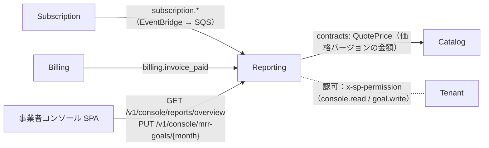
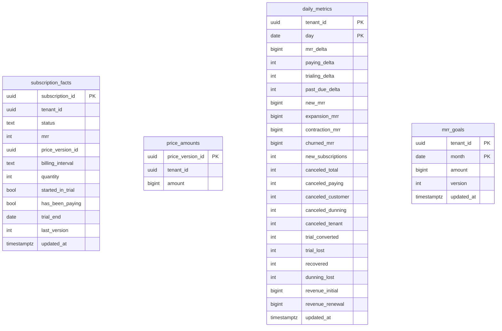
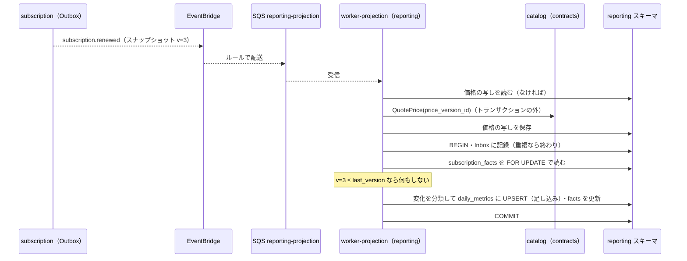

# 設計書: 事業者コンソールのダッシュボード（KGI・KPI）とスマートフォン対応

| 項目 | 内容 |
|---|---|
| ステータス | Approved（オーナーが判断を委任。2026-10-26） |
| 作成日 | 2026-10-26 |
| 要件定義書 | `docs/requirements/console-dashboard.md`（Approved） |
| 上位の設計 | `docs/design/subscription-platform.md`（Reporting コンテキスト、worker-projection、`reporting` スキーマ、ADR-001）、`docs/design/business-console.md`（SPA・UI の方針 §5.6） |

## 1. 概要

- 上位の設計で予定していた **Reporting コンテキスト**を、新しいモジュール `modules/reporting`（スキーマ `reporting`）として作る。契約・請求のドメインイベントを購読して**集計用の読み取りデータ**（契約ごとの集計の状態と、事業者×日の集計表）を更新し、console API で KGI・KPI を返す。
- 購読は新しいプロセス **worker-projection** で動かす（上位 P-PLT-4「Reporting を作るときに worker-projection を追加する」）。
- 日次の集計ジョブは作らない。日ごとの表に**増減（フロー）と状態の差分**をイベントのたびに足し込み、ある日の値（ストック）は差分の累積で求める（ADR-R02）。
- SPA に「ダッシュボード」画面を足し、事業者を選んだ後の最初の画面にする。コンソール全体をスマートフォンの幅に対応させる。

## 2. コンテキストマップ



- 依存は一方向：Reporting は他のモジュールのイベントと contracts だけに依存し、他のモジュールは Reporting を知らない。
- 新しいイベントは作らず、イベントの発行側も変えない（要件 NFR-005）。

## 3. ドメイン設計

Reporting は読み取りモデルで、ビジネスのルールは持たない。指標の定義（要件 §5）を、イベントから集計表への変換として実装する。

| 概念 | 説明 |
|---|---|
| SubscriptionFact | 契約ごとの集計の状態：状態、月額換算額（MRR への寄与。有料契約でなければ 0）、トライアルで始まったか、有料契約になったことがあるか、最後に反映した版（aggregate_version）、トライアルの終了日 |
| Transition | 1 つのイベントによる SubscriptionFact の変化（前 → 後）。ここから増減を分類する（§3.1） |
| DailyMetrics | 事業者 × 日（JST）の増減の合計。フロー（新規 MRR・新規契約数・解約数・入金額など）と、ストックの差分（MRR・有料契約数・トライアル中・支払い遅延の数の増減） |
| MrrGoal | 事業者 × 月の MRR の目標 |

### 3.1 変化の分類（要件 §5 の実装）

前の状態を `o`（初めて見る契約なら「なし」：状態なし・MRR 0）、後を `n` とする。有料 ＝ active / past_due。

| 条件 | 足し込む値 |
|---|---|
| イベントが `subscription.started` で、契約を初めて見た | 新規契約数 +1 |
| `o.mrr = 0` かつ `n.mrr > 0` | 新規 MRR += n.mrr |
| `o` も `n` も有料で `n.mrr > o.mrr` | 増額 MRR += 差 |
| `o` も `n` も有料で `n.mrr < o.mrr` | 減額 MRR += 差の絶対値 |
| `o` が有料で `n` が有料でない | 解約 MRR += o.mrr |
| `n.status = canceled` かつ `o.status ≠ canceled` | 解約数 +1、理由ごと +1。`o` が有料なら「有料契約の解約数」+1 |
| 上の解約で、トライアルで始まり一度も有料になっていない | トライアル不成立 +1 |
| 上の解約で、理由が `dunning` | 支払い回復の不成立 +1 |
| トライアルで始まった契約が初めて有料になった | トライアル転換 +1 |
| イベントが `subscription.recovered` | 支払い回復 +1 |
| 常に | MRR の差分 += n.mrr − o.mrr、有料・トライアル中・支払い遅延の数の差分 |
| `billing.invoice_paid` | 入金額 += amount（初回・更新の内訳） |

- 日付は `occurred_at` の JST の日付。期首の MRR ＝ 期首の前日までの MRR の差分の合計。
- 版が `o.last_version` 以下のイベントは状態を変えず、何も足さない（順序の入れ替わり。要件 NFR-003）。重複は Inbox で除く。

## 4. DB 設計



- すべての表に `tenant_id` を持たせ、`platform.enable_tenant_rls` で分離する（要件 NFR-004）。Inbox は `platform.create_messaging_tables('reporting')`（Outbox は使わない）。
- `price_amounts` は catalog の価格バージョンの金額の写し（価格バージョンは追記のみで変わらないので、写しは古くならない）。
- 制約：`mrr >= 0`、`quantity >= 1`、`mrr_goals.amount BETWEEN 1 AND 1000000000`、`status` の CHECK。

| インデックス | 想定クエリ |
|---|---|
| `daily_metrics` PK `(tenant_id, day)` | 事業者の日ごとの集計を期間で読む（ダッシュボード 1 回で 1 事業者の全期間。数百〜千数百行） |
| `subscription_facts (tenant_id, trial_end) WHERE status = 'trialing'` | トライアル終了間近（7 日以内）の数 |
| `mrr_goals` PK `(tenant_id, month)` | 月の目標 |

## 5. API 設計

console（主体はスタッフ、`X-Tenant-Id` 必須）。仕様は `api/openapi/console/reporting.yaml`。

| メソッド | パス | 内容 | 権限 |
|---|---|---|---|
| GET | `/v1/console/reports/overview?month=YYYY-MM` | 選んだ月の KGI・KPI・推移・要対応の件数（§5.1）。`month` の既定は業務時刻の当月。過去 24 か月より前・未来は 400 | `console.read` |
| PUT | `/v1/console/mrr-goals/{month}` | 目標の設定（`{"amount": 10000}`）。`If-Match` 任意 | `goal.write`（新規。owner・admin） |
| DELETE | `/v1/console/mrr-goals/{month}` | 目標の削除（なければ 204） | `goal.write` |

### 5.1 overview の応答

```json
{
  "month": "2026-10", "as_of": "2026-10-26T01:00:00Z", "today": "2026-10-26", "is_current": true,
  "kgi": {
    "mrr": 1960, "mrr_start": 1980, "arr": 23520, "net_new_mrr": -20,
    "breakdown": {"new": 1960, "expansion": 0, "contraction": 0, "churned": 1980},
    "goal": {"amount": 10000, "version": 1, "achievement_rate": 0.196}
  },
  "kpis": {
    "current":  {"new_subscriptions": 2, "new_mrr": 1960, "canceled": {"total": 1, "customer": 1, "dunning": 0, "tenant_suspended": 0},
                 "churn_rate": {"numerator": 1, "denominator": 1, "value": 1.0}, "revenue_churn_rate": {...},
                 "trial_conversion": {"numerator": 0, "denominator": 0, "value": null}, "recovery": {...},
                 "revenue": {"total": 1960, "initial": 1960, "renewal": 0}, "arpu": 980, "paying": 2, "trialing": 0, "past_due": 0},
    "previous": { "...": "前月の同じ項目" }
  },
  "trend": [{"month": "2025-11", "mrr": 0, "net_new_mrr": 0, "new_subscriptions": 0, "canceled": 0, "revenue": 0}, "... 12 件"],
  "daily": [{"date": "2026-10-01", "mrr": 1980, "new_subscriptions": 0, "canceled": 0}, "... 月初から今日（過去の月は月末）まで"],
  "attention": {"past_due": 0, "trials_ending_7d": 0}
}
```

- 率は `{numerator, denominator, value}`（分母 0 なら `value: null`。画面は「—」）。ARPU も有料契約 0 なら null。
- `as_of` はその事業者の集計表の最後の更新時刻（集計がまだなければ null）。
- 計算は API の中で 1 回のクエリ（その事業者の `daily_metrics` を全期間読み、Go で累積する）と、要対応の件数のクエリ 1 回で行う（要件 NFR-002）。

### 5.2 権限

- `goal.write` を tenant の権限の表に足す（owner・admin。`IsWrite`）。停止中の事業者は書けない（既存の規則）。
- `x-sp-isolation`：overview は `not_applicable`（X-Tenant-Id の事業者の集計表だけを RLS で読む）、mrr-goals も同じ。

## 6. 処理の流れ



- 他のモジュールの呼び出し（QuotePrice）はトランザクションの外で先に行う（既存の integration と同じ規約）。catalog が一時的に失敗したら ack せずに再配信。
- worker-projection は Outbox を持たず、Relay もジョブも動かさない（購読と /healthz・/readyz だけ）。

## 7. SPA

### 7.1 ダッシュボード（`/console/t/:tenantId/dashboard`）

- 事業者の選択の後の既定の画面にする（`/t/:tenantId` → `dashboard`。テナントの切り替え・選択の遷移先も同じ）。サイドバーの先頭に「ダッシュボード」。
- 配置（Stripe のダッシュボードを参考にする）：
  1. 見出し（月の選択・最終更新の時刻）。
  2. KGI の帯：MRR（大きな数字・前月末からの増減・ARR）、目標の達成率のバー（目標の設定はオーナー・管理者だけ）、純増 MRR の内訳（新規・増額・減額・解約）。MRR の 12 か月の推移を折れ線。
  3. 要対応：支払い遅延・トライアル終了間近（クリックで契約の一覧へ。一覧は URL の `?status=` を初期値にする）。
  4. KPI のカード（獲得・継続・転換・回収・売上）：当月の値・前月の値・増減。率は分子・分母も表示。
  5. 推移：日ごとの MRR（当月）、新規契約数と解約数の月ごとの棒、入金額の月ごとの棒。
- グラフは `@mantine/charts`（Recharts のラッパー。Mantine のテーマ・色と一体）。系列の色はテーマのトークンから取り、凡例とツールチップの数値で区別できるようにする（色だけに頼らない）。
- 集計の遅れを考え、画面は 60 秒ごとに読み直す（ウィンドウが見えているときだけ）。

### 7.2 スマートフォン対応（要件 FR-008）

| 部品 | 幅が狭いとき（`sm` = 768px 未満） |
|---|---|
| AppShell | ナビゲーションを隠し、ヘッダーにメニューボタン（Burger）。ナビゲーションの項目を押すと閉じる。ヘッダーのメールアドレスは隠し、アバターだけ |
| 本文 | 余白を `md` に縮める |
| PageHeader | 見出しと操作のボタンを縦に並べる（折り返す） |
| ListTable | `Table.ScrollContainer` で表の中だけを横スクロール（最小幅 640px） |
| Drawer・Modal | 幅いっぱい（`fullScreen` または `size="100%"`） |
| KeyValue・KPI のカード | 1 列 |
| フィルターの並び | 折り返し、入力欄は幅いっぱい |

## 8. 配置と運用

| 項目 | 内容 |
|---|---|
| プロセス | `cmd/worker-projection`（同じイメージ。HEALTH_ADDR :8083）。compose・`scripts/dev.sh`・`wait-ready.sh`・`procs` fixture・Terraform のロググループに追加 |
| キュー | `deploy/messaging.yaml` に `reporting-projection`（process worker-projection、consumer `reporting.projection`、events：`subscription.started`・`renewed`・`recovered`・`plan_changed`・`past_due`・`canceled`・`billing.invoice_paid`、concurrency 10、visibility 60 秒、max_receive 5） |
| DB のロール | `migrate.Modules` に `reporting` を足す（`sp_reporting`・`sp_reporting_sys` が自動で作られる） |
| 本番 | ECS のサービスを 1 つ追加（Fargate Spot 可。上位 §コスト最適化）。DLQ のアラームは既存の仕組み |

## 9. 設計判断（ADR）

### ADR-R01: 集計はイベントから作る読み取りモデルにする

- **ステータス**: Accepted
- **コンテキスト**: 指標は subscription・billing・catalog のデータにまたがる。モジュールはスキーマで分離し、他のスキーマを直接読まない規約がある。事業者あたり最大 10 万件の契約で 500ms 以内に返したい（要件 NFR-002）。
- **決定**: Reporting モジュールがドメインイベントを購読し、自分のスキーマに集計表を作る（上位の設計の Reporting コンテキストの方針どおり）。
- **検討した代替案**: (a) 表示のたびに各モジュールの contracts に集計を問い合わせる：各モジュールに集計の API が増え、毎回 10 万件を数える。過去の月の値（その時点の MRR）は現在の状態からは求められない。(b) 共有の読み取り用 DB ビューでスキーマをまたいで読む：モジュールの分離（スキーマ・ロール）を壊す。
- **トレードオフ**: 集計は結果整合（通常 1 分以内）。導入前の過去データは取り込まない（要件 §9 #1）。イベントの取りこぼしがあると数値がずれるが、Inbox・DLQ・再配信で防ぎ、将来は ops の再集計で直す。

### ADR-R02: 日次のスナップショットのジョブを作らず、差分を足し込む

- **ステータス**: Accepted
- **コンテキスト**: MRR・契約数のような「その時点の値」の推移が要る。上位の設計は `daily_tenant_metrics` を想定していた。
- **決定**: イベントのたびに、その日の行へフローとストックの差分を UPSERT で足し込む。ある日の値は、その日までの差分の合計で求める。
- **検討した代替案**: (a) 毎日 0 時に全事業者の契約を数えてスナップショットを保存するジョブ：当日の値は別に数える必要があり、ジョブの失敗・遅れで穴があく。dev clock で時刻を進める E2E とも相性が悪い。(b) イベントをすべて保存して表示のたびに再計算：保存量と計算量が大きい。
- **トレードオフ**: 差分の合計を表示のたびに計算する（1 事業者の全期間の行。数年でも千数百行で十分速い）。将来、行が増えたら月ごとの累積の表を足す。差分の不整合を検出するために、`subscription_facts` の合計と最新の累積が一致することを結合テストで確かめる。

### ADR-R03: 価格は catalog の contracts から引き、写しを持つ

- **ステータス**: Accepted
- **コンテキスト**: subscription のイベントのスナップショットは `price_version_id` を持つが金額を持たない。
- **決定**: Reporting が `catalog.QuotePrice` で金額を取得し、`price_amounts` に写す（価格バージョンは変わらないので、1 回取得すれば足りる）。
- **検討した代替案**: (a) subscription のスナップショットに金額を足す：発行側の変更になり（要件 NFR-005 に反する）、Webhook の payload の仕様（integration）にも影響を考える必要がある。(b) catalog の `price_version_added` を購読して写す：プランの作成時の最初の価格にはイベントがない。
- **トレードオフ**: 初めて見る価格のときだけ catalog を呼ぶ。catalog が落ちていると集計が遅れる（再配信で追いつく）。

### ADR-R04: 購読は新しいプロセス worker-projection で動かす

- **ステータス**: Accepted
- **コンテキスト**: 上位の決定 P-PLT-4。集計の遅れや失敗が、課金（worker-billing）・通知（worker-integration）に影響してはならない（要件 NFR-006）。
- **決定**: `cmd/worker-projection` を追加し、`reporting-projection` キューだけを受信する。
- **検討した代替案**: worker-integration に相乗りする：プロセスは増えないが、集計の再処理（大量の再配信）が Webhook・メールの送信と CPU・DB 接続を取り合う。上位の決定とも食い違う。
- **トレードオフ**: ローカル・CI で動かすプロセスが 4 つになる（起動の時間とメモリが少し増える）。

### ADR-R05: グラフは @mantine/charts

- **ステータス**: Accepted
- **コンテキスト**: 折れ線・棒のグラフが要る。UI は Mantine で作っている。
- **決定**: `@mantine/charts`（Recharts のラッパー）。
- **検討した代替案**: (a) ECharts：多機能だが大きく、テーマを別に合わせる必要がある。(b) 手書きの SVG：軸・ツールチップ・アクセシビリティを作り込む手間が大きい。
- **トレードオフ**: Recharts の分だけバンドルが大きくなる（ダッシュボードの画面を遅延読み込みにして、ほかの画面の初回表示に影響させない）。実装時に `AreaChart`（7.17.8）が系列を描かない事象があったため、MRR の推移は `LineChart` で描く。

## 10. テスト

| 種類 | 内容 |
|---|---|
| unit | 変化の分類（§3.1）の表駆動のテスト：開始（トライアルあり・なし）、転換、更新、プラン変更（増額・減額）、支払い遅延、回復、解約（理由ごと・トライアル中）、版の古いイベントの無視、初めて見る契約。月額換算（年払いの四捨五入）。overview の累積・率の計算（分母 0） |
| 結合 | Inbox による重複の無視、`daily_metrics` の UPSERT、RLS、累積と facts の合計の一致 |
| E2E（API・clock） | 要件 §6 の受け入れ条件：開始・解約・年払いの MRR、トライアル転換と不成立、支払い遅延の回復と不成立、入金額、目標の設定と権限、事業者の分離 |
| E2E（ブラウザ） | ダッシュボードの表示（KGI・目標の設定・要対応から契約の一覧へ）、幅 375px でメニューを開いて画面を移る・ページが横にはみ出さない |

## 11. トレーサビリティ

| 要件 | 設計 |
|---|---|
| FR-001 | §3.1、§4 `daily_metrics`、§5.1 `kgi`・`trend`、§7.1 |
| FR-002 | §4 `mrr_goals`、§5 PUT・DELETE `/mrr-goals/{month}`、§5.2 `goal.write`、§7.1 |
| FR-003 | §3.1、§5.1 `kpis`、§7.1 |
| FR-004 | §5.1 `trend`・`daily`、§7.1 |
| FR-005 | §5 `month` パラメーター、§7.1 |
| FR-006 | §4 facts のインデックス、§5.1 `attention`、§7.1（一覧の `?status=`） |
| FR-007 | §7.1 |
| FR-008 | §7.2 |
| FR-009 | §5.2、§4 RLS |
| NFR-001 | §6、§7.1（60 秒ごとの読み直し・最終更新） |
| NFR-002 | §4 のインデックス、§5.1 の計算、ADR-R02 |
| NFR-003 | §3.1 の版の比較、Inbox |
| NFR-004 | §4 RLS |
| NFR-005 | ADR-R01・R03 |
| NFR-006 | ADR-R04、§8 |
| NFR-007 | §7.1、ADR-R05 |

## 12. 未解決事項

| # | 論点 | 担当 | 期限 |
|---|---|---|---|
| 1 | 本番導入時の過去データの取り込み（要件 §9 #1）。各モジュールの contracts から現在の状態を読み、facts と「導入日の差分」を作る ops のコマンドを想定 | アーキテクト | 本番の構築まで |

## 13. 変更履歴

| 日付 | 変更内容 | 変更者 |
|---|---|---|
| 2026-10-26 | 初版 | アーキテクト（Claude） |
| 2026-10-26 | 実装を反映：MRR の推移を LineChart に（ADR-R05） | アーキテクト（Claude） |
