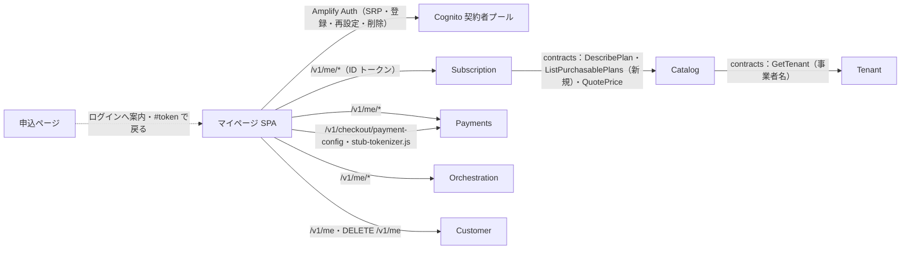
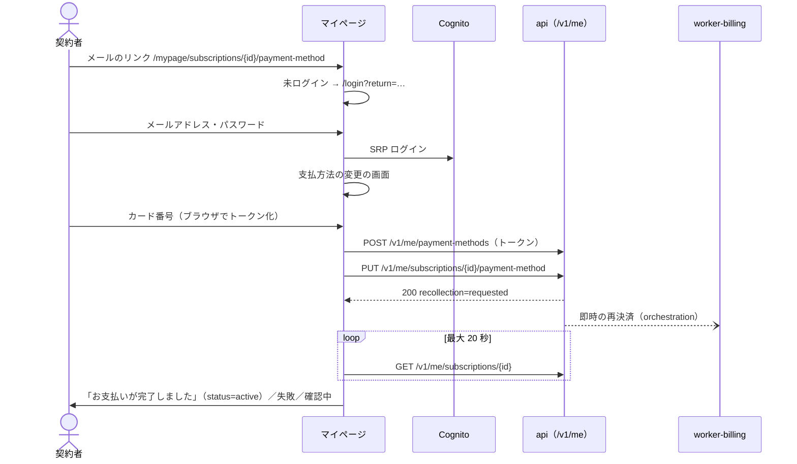
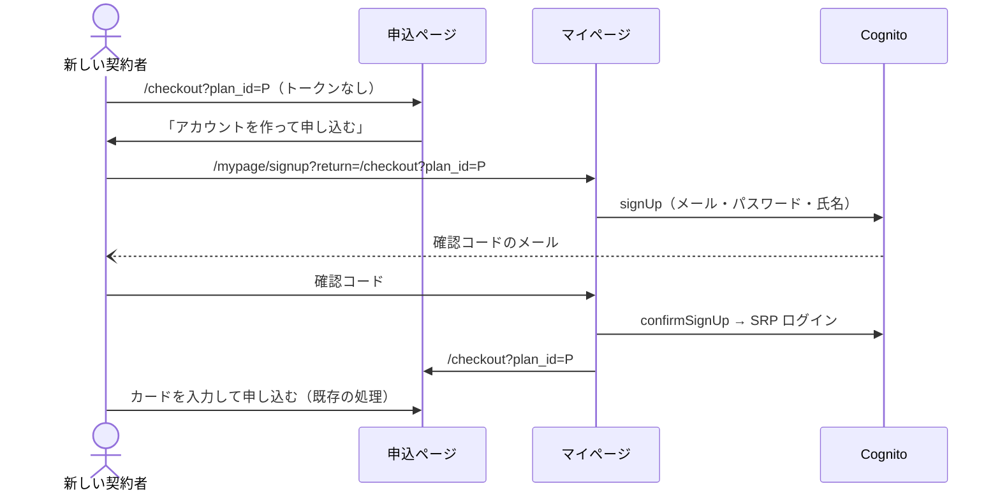

# 設計書: 契約者のマイページ（ログインを含む）

| 項目 | 内容 |
|---|---|
| ステータス | Approved（オーナーが判断を委任。2026-10-26） |
| 作成日 | 2026-10-26 |
| 要件定義書 | `docs/requirements/consumer-mypage.md`（Approved） |
| 上位の設計 | `docs/design/subscription-platform.md`、`docs/design/business-console.md`（SPA の構成・ログインの方式。ADR-C01〜C07 をそのまま流用する） |

## 1. 概要

- 新しい SPA `web/mypage`（React 19・Vite・Mantine・TanStack Query・Amplify Auth）を、事業者コンソールと同じ nginx から `/mypage/` で配る。事業者コンソールの構成（ADR-C01〜C07：自前のログイン画面と SRP、ID トークンを Bearer、トークンは localStorage・CSP で守る、同一オリジンで `/v1/` を api に渡す）をそのまま使う。
- 契約者の Cognito プールを、本番と同じ定義の Terraform モジュール `consumer_auth`（自己登録・メールの確認コード）にする。
- 画面のために足りない API を 2 つ足す：契約の表示用の情報（事業者名・商品名・プラン名・契約時の価格）を me の契約の応答に含める、変更先のプランの一覧。名前と価格の正本は catalog なので、catalog の contracts に読み取りのメソッドを足し、subscription がそれを呼ぶ（依存の向き subscription → catalog は既存）。
- 申込ページ（`web/checkout`）は、トークンがなければマイページのログインへ案内し、ログイン後にフラグメントでトークンを渡して戻す。
- 退会は、`DELETE /v1/me` の成功後に SPA が Cognito の自分のアカウントを削除する（ADR-M03）。

## 2. コンテキストマップ



- 新しいモジュールは作らない。依存の向きは既存のとおり（subscription → catalog → tenant）。
- マイページは API の利用者で、ビジネスのルールを持たない（操作の可否の表示は使いやすさのため。判定は API）。

## 3. ドメイン設計

新しい集約・イベントはない。catalog に「契約者に見せるプランの説明」の読み取りモデルを足す。

| 概念 | 所属 | 内容 |
|---|---|---|
| PlanDescription | catalog（contracts） | プラン名・商品 ID・商品名・事業者名・請求の周期・状態。状態に関係なく返す（非公開・削除前のプランの契約も名前を出すため） |
| PurchasablePlan | catalog（contracts） | 同じ商品の公開中のプラン（PlanSnapshot ＋ プラン名）。変更先の候補 |
| SubscriptionDisplay | subscription（me の応答） | 契約の表示用の値：事業者名・商品名・プラン名・単価（契約の価格バージョンの金額）・数量を掛けた金額 |

## 4. DB 設計

DB の変更はない（catalog の既存の表 `plans`・`products`・`price_versions` を読む）。

| クエリ（catalog、追加） | 想定クエリ | インデックス |
|---|---|---|
| `ListPublishedPlansByProduct` | 商品の公開中のプラン（変更先の候補。数件） | 既存の `plans (tenant_id, product_id, ...)` で足りる（1 事業者の 1 商品のプランは数件） |

## 5. API 設計

### 5.1 me（契約者。主体は consumer）

| メソッド | パス | 内容 | 変更 |
|---|---|---|---|
| GET | `/v1/me/subscriptions`・`/v1/me/subscriptions/{id}` | 応答に `display`：`{tenant_name, product_name, plan_name, unit_amount, amount, tax_included: true}` を足す。`amount` は契約の価格バージョンの金額 × 数量（価格の改定があっても契約時の価格。上位 FR-004 の据え置き） | **変更**（項目の追加のみ。互換） |
| GET | `/v1/me/subscriptions/{id}/plan-change-options` | 同じ商品の公開中のプランのうち、現在のプラン以外：`{data: [{plan_id, name, billing_interval, amount, effective_date}]}`。`effective_date` は適用日（次の更新日。更新の処理中ならその次）。他人の契約は 404 | **新規**（`x-sp-isolation: tested`） |

既存の me API（予約・取り消し・支払方法・請求・退会）はそのまま使う。

### 5.2 catalog の contracts（追加）

```go
// DescribePlan は契約者に見せるプランの説明（状態に関係なく返す）。
DescribePlan(ctx, tenantID, planID) (PlanDescription, error)
// ListPurchasablePlans は商品の公開中のプラン（作成順）。
ListPurchasablePlans(ctx, tenantID, productID) ([]PurchasablePlan, error)
```

subscription の me のハンドラーは、1 回の応答の中でプランごとに 1 回だけ呼ぶ（同じプランの契約が複数あっても重複して呼ばない）。契約者の契約は通常数件で、N+1 の影響は小さい（要件 NFR-001）。

### 5.3 画面のルート（`/mypage/...`）

| ルート | 画面 | 要件 |
|---|---|---|
| `/login`・`/signup`・`/signup/confirm`・`/forgot-password` | 認証 | FR-001・002 |
| `/`（契約の一覧） | 一覧・支払い遅延の案内 | FR-004 |
| `/subscriptions/:id` | 詳細・請求の履歴・解約・プラン変更 | FR-005〜007 |
| `/subscriptions/:id/payment-method` | 契約の支払方法の変更（新しいカードの登録を含む）・即時の再決済の結果 | FR-009・012 |
| `/payment-methods` | カードの一覧・登録・削除 | FR-008 |
| `/account` | アカウントの情報・パスワードの変更・ログアウト・退会 | FR-010・013 |

- `?return=<パス>` でログインの後に戻る（FR-003）。`return` は同一オリジンの相対パス（`/mypage/` か `/checkout` で始まる）だけを受け付ける（オープンリダイレクトを防ぐ）。
- `/checkout` に戻るときは `#token=<ID トークン>` を付ける（申込ページの既存の受け取り方。P-IMP-19）。

### 5.4 認証（契約者の Cognito プール）

| 項目 | 内容 |
|---|---|
| プール | 自己登録を許可。ユーザー名はメールアドレス（大文字小文字を区別しない）。属性 `email`（必須・確認）・`name`（必須）。確認は確認コード（メール） |
| パスワードの方針 | 8 文字以上・英字（小文字）と数字。記号・大文字は求めない（要件 FR-001） |
| クライアント | シークレットなし。`ALLOW_USER_SRP_AUTH`・`ALLOW_REFRESH_TOKEN_AUTH`。ID・アクセストークン 1 時間、リフレッシュトークン 30 日（要件 FR-003）、トークンの失効を有効、`prevent_user_existence_errors = ENABLED` |
| メール | 確認コード・再設定の日本語の文面。本番は SES（要件 §9 #2） |
| api | `COGNITO_CONSUMER_ISSUER`・`CLIENT_ID`・`JWKS_URL` を設定する。devtools では開発用 JWT と併用（ADR-C04 と同じ MultiVerifier。既存の E2E はそのまま） |

### 5.5 申込ページ（`web/checkout`）の変更

- フラグメントにトークンがなければ、カードの入力欄の代わりに「ログインして申し込む」（`/mypage/login?return=…`）と「アカウントを作って申し込む」（`/mypage/signup?return=…`）を表示する。`return` は今の URL（`/checkout?plan_id=…`）。
- 支払い遅延のメールの行き先は、マイページの `/mypage/subscriptions/{id}/payment-method` に変える（`PAYMENT_METHOD_UPDATE_URL_TEMPLATE`）。申込ページの支払方法の変更（`?subscription=`）は互換のために残す。

## 6. 処理の流れ

### 6.1 支払い失敗のメールから回復する



### 6.2 申込ページから登録して申し込む



## 7. SPA の構成

- `web/mypage`：事業者コンソールと同じ技術（React 19・Vite・react-router v7・TanStack Query・Mantine 7・`@mantine/form`・Amplify Auth v6）。共通化はせず、認証・API の呼び出し・書き込みの共通処理（`useWrite`）は同じ形で持つ（2 つ目のアプリなので、3 つ目ができたら共有のパッケージに切り出す。ADR-M02）。
- スマートフォンを主にする：幅 640px までの 1 カラム、下部のナビゲーション（契約・支払方法・アカウント）。PC では中央の 720px。
- カードのトークン化は、申込ページと同じく `GET /v1/checkout/payment-config` で手段を調べ、`/checkout/stub-tokenizer.js` を読み込む（本番は fincode の JS に差し替え。要件 §9 #3。トークン化のインターフェース `tokenize({number, exp}) → {token, last4}` は共通）。
- 即時の再決済の結果は、`GET /v1/me/subscriptions/{id}` を 1 秒ごとに最大 20 秒読む（`past_due` のまま `renewal_in_progress=false` で請求の試行が失敗していれば失敗、20 秒で決まらなければ「確認中」）。失敗の判定は請求の履歴（最新の請求の `status`・試行の回数の増加）で行う。
- 配信：nginx の `web` サービス（事業者コンソールの `console` サービスを改名。ポート 8090）が `/mypage/` に `web/mypage/dist` と `config.json` を配る。CSP は事業者コンソールと同じ（`connect-src 'self'` ＋ Cognito のエンドポイント）。

## 8. 設計判断（ADR）

### ADR-M01: 表示名は catalog の contracts から取り、me の契約の応答に含める

- **ステータス**: Accepted
- **コンテキスト**: 契約の一覧に事業者名・商品名・プラン名・金額が要る（要件 FR-004）。subscription は ID しか持たない。名前・価格の正本は catalog、事業者名は tenant。
- **決定**: catalog に `DescribePlan`（事業者名は catalog が tenant の contracts から取る）・`ListPurchasablePlans` を足し、subscription の me のハンドラーが呼んで `display` を付ける。金額は `QuotePrice(契約の価格バージョン)` × 数量。
- **検討した代替案**: (a) SPA が `GET /v1/checkout/plans/{id}` を契約ごとに呼ぶ：公開中のプランしか返さない（410）ので、非公開になったプランの契約の名前が出ない。価格も現在の価格で、契約時の価格（据え置き）と違う。(b) subscription に名前を写して持つ：名前の変更を追う仕組みが要る。(c) 画面用の BFF のモジュールを作る：モジュールが増え、今の規模では過剰。
- **トレードオフ**: me の契約の応答のたびに catalog を数回呼ぶ（プランごとに 1 回。契約者の契約は数件）。catalog が落ちると一覧が出ない → 表示名の取得に失敗したら `display` を null にして一覧は返す（名前の代わりに「—」）。

### ADR-M02: マイページは事業者コンソールと別の SPA にし、共通のパッケージにはまだ切り出さない

- **ステータス**: Accepted
- **コンテキスト**: 利用者（契約者とスタッフ）・認証のプール・画面の構成（スマートフォン中心）が違う。認証・API の呼び出しの作りは似ている。
- **決定**: `web/mypage` を別のアプリにし、同じ構成・同じ形のコードを持つ。共通化は 3 つ目のアプリ（運営者コンソール）を作るときに `web/packages/web-common` に切り出す。
- **検討した代替案**: (a) 事業者コンソールに相乗りして 1 つのアプリにする：プール・権限・ナビゲーションが混ざり、バンドルも大きくなる。(b) すぐに共通のパッケージを作る：2 つの例から抽象を決めると外しやすい。
- **トレードオフ**: 認証・API の呼び出しのコードが 2 か所にある（それぞれ 200 行ほど）。直すときは両方を直す。

### ADR-M03: 退会のときの Cognito のアカウントは SPA が削除する

- **ステータス**: Accepted（要件 §9 #1 を解決）
- **コンテキスト**: 退会したら同じアカウントでは使えず、同じメールアドレスで新しく登録できるようにしたい。customer の退会の処理は Cognito を知らない。
- **決定**: SPA が `DELETE /v1/me` の成功後に Amplify の `deleteUser`（本人のアクセストークンで自分を削除）を呼ぶ。ログインで `account_withdrawn` が返ったとき（削除の前に画面が閉じられた場合）は、「退会済みのアカウントです」と表示して削除を案内し、同じく削除する。
- **検討した代替案**: (a) customer の退会の処理で `AdminDeleteUser` を呼ぶ：customer に認証基盤の依存と管理者の権限が増える。DB の退会と認証基盤の削除が別のシステムで、どのみち片方だけ成功する場合の処理が要る。(b) アカウントを無効にするだけ：同じメールアドレスで登録できない。
- **トレードオフ**: 画面を経由しない退会（将来の ops からの強制退会など）では Cognito のアカウントが残る → そのときは ops の処理で削除する（今回の範囲外）。

### ADR-M04: nginx の `console` サービスを `web` に改名し、2 つの SPA を同じオリジンで配る

- **ステータス**: Accepted
- **コンテキスト**: マイページ・事業者コンソール・申込ページはどれも `/v1/` を呼ぶ。申込ページとマイページはトークンをフラグメントで受け渡す。
- **決定**: 1 つの nginx（ポート 8090）で `/console/`・`/mypage/`・`/checkout` を配り、`/v1/` を api に渡す。
- **検討した代替案**: SPA ごとに別のオリジン：CORS とトークンの受け渡しのために、別のしくみが要る。
- **トレードオフ**: 本番では 1 つの CloudFront で配る（パスで振り分ける）。localStorage はオリジン単位なので、2 つの SPA のトークンは同じオリジンに入るが、キーが Amplify のクライアント ID ごとに分かれるので混ざらない。

## 9. テスト

| 種類 | 内容 |
|---|---|
| unit | catalog：`DescribePlan`・`ListPurchasablePlans`（状態・他の事業者）。subscription：変更先の候補の適用日 |
| E2E（API） | `display`（事業者名・商品名・プラン名・契約時の価格。価格の改定の後も変わらない）、`plan-change-options`（同じ商品の公開中だけ・現在のプランを除く・他人の契約は 404） |
| E2E（ブラウザ・Cognito） | 登録（確認コードは MiniStack の SES から）→ 申込ページから申し込む → 一覧、解約の予約と取り消し、プラン変更の予約、カードの登録と削除（使用中は不可）、支払い遅延 → メールのリンク → カードの変更 → 回復、退会（契約が残っていると不可 → 解約後に退会 → 再ログインできない）、パスワードの再設定、幅 375px |

## 10. トレーサビリティ

| 要件 | 設計 |
|---|---|
| FR-001・002・003 | §5.4、§5.3 認証のルート・`?return` |
| FR-004・005 | §5.1 `display`、§5.3、ADR-M01 |
| FR-006 | 既存の API、§5.3 |
| FR-007 | §5.1 `plan-change-options`、§5.2 |
| FR-008・009 | §5.3、§6.1、§7（トークン化・再決済の結果） |
| FR-010 | ADR-M03 |
| FR-011 | §5.5、§6.2 |
| FR-012 | §5.5（メールのリンク） |
| FR-013 | §5.3 `/account` |
| FR-014 | §7（事業者コンソールと同じ共通の部品） |
| NFR-001 | ADR-M01、§7（遅延読み込み） |
| NFR-002 | ADR-M01（catalog の障害時は `display` を null） |
| NFR-003・006 | §5.3 `return` の検証、§7 CSP、トークン化 |
| NFR-004 | 既存の me の分離、§5.1 `x-sp-isolation: tested` |
| NFR-005 | §5.4 |
| NFR-007・008 | §7 |
| NFR-009 | §9 |

## 11. 未解決事項

| # | 論点 | 担当 | 期限 |
|---|---|---|---|
| 1 | 本番の確認コード・再設定のメールの送信元ドメイン（要件 §9 #2） | PdM・インフラ | 本番の構築まで |
| 2 | fincode の JS のトークン化の組み込み（要件 §9 #3。インターフェースは §7 で共通化済み） | アーキテクト | fincode の確認時 |

## 12. 変更履歴

| 日付 | 変更内容 | 変更者 |
|---|---|---|
| 2026-10-26 | 初版 | アーキテクト（Claude） |
