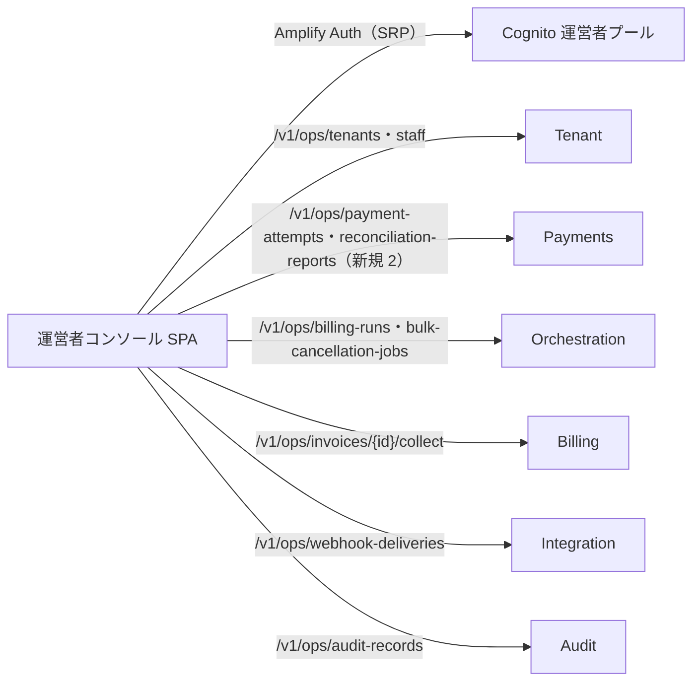
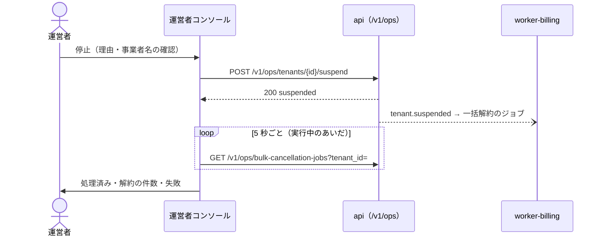

# 設計書: 運営者コンソール（ログインを含む）

| 項目 | 内容 |
|---|---|
| ステータス | Approved（オーナーが判断を委任。2026-10-26） |
| 作成日 | 2026-10-26 |
| 要件定義書 | `docs/requirements/operator-console.md`（Approved） |
| 上位の設計 | `docs/design/subscription-platform.md`、`docs/design/business-console.md`（SPA・ログインの方式。ADR-C01〜C07 を流用）、`docs/design/consumer-mypage.md`（ADR-M02・M04） |

## 1. 概要

- 新しい SPA `web/ops`（事業者コンソールと同じ技術）を、同じ nginx（`web` サービス）から `/ops/` で配る。認証は Amplify Auth（SRP）で、運営者の Cognito プールにログインする。
- 運営者のプールを、本番と同じ定義の Terraform モジュール `operator_auth`（管理者による作成のみ・グループ `operators`）にする。
- 画面のために足りない ops API を 2 つ payments に足す：確定していない決済の試行の一覧、照合の不整合を対応済みにする操作。その他は既存の ops API を呼ぶ。
- 新しいモジュール・集約・イベントはない。

## 2. コンテキストマップ

## 3. ドメイン設計

変更なし。照合の不整合（`payments.reconciliation_discrepancies`）の状態 `open → acknowledged` の遷移を、運営者の操作として公開する（表の CHECK は既存）。対応済みにしたときのメモと運営者は監査ログに残す（表には列を足さない。ADR-O02）。

## 4. DB 設計

DB の変更はない。

| クエリ（payments、追加） | 想定クエリ | インデックス |
|---|---|---|
| `ListUnresolvedAttemptsPage` | 確定していない試行（`processing`・`pending_async`・`unknown`）を依頼の古い順に、経過時間で絞ってカーソルで読む | 既存の `ix_attempt_unresolved (status, requested_at)` |
| `AcknowledgeDiscrepancy` | 不整合 1 件を `open → acknowledged` | 主キー |

## 5. API 設計

### 5.1 ops（追加。主体は operator、`x-sp-permission` なし＝operators グループ）

| メソッド | パス | 内容 |
|---|---|---|
| GET | `/v1/ops/payment-attempts?status=&older_than_seconds=&limit=&starting_after=` | 確定していない試行の一覧（依頼の古い順）。`status` は `unknown`・`processing`・`pending_async`（省略で 3 つすべて）。`older_than_seconds` の既定は 30（自動の確定の途中のものを除く）。項目は既存の `Attempt` |
| POST | `/v1/ops/reconciliation-reports/{id}/acknowledge` | `{note}`（1〜1,000 文字）。`open` なら `acknowledged` に、既に対応済みなら 200（何もしない）。監査 `reconciliation.acknowledge`（after：note） |

### 5.2 画面のルート（`/ops/...`）

| ルート | 画面 | 要件 | 呼ぶ API |
|---|---|---|---|
| `/login`・`/login/new-password`・`/forgot-password` | 認証 | FR-001 | Cognito |
| `/` | ホーム（要対応） | FR-002 | tenants（status 別）・payment-attempts・reconciliation-reports（open）・billing-runs（今日） |
| `/tenants`・`/tenants/:id` | 一覧・登録・詳細・承認・停止・オーナーの招待・一括解約 | FR-003〜005 | tenants・staff・bulk-cancellation-jobs |
| `/tenants/:id/webhooks` | 配信の検索・再送 | FR-010 | webhook-deliveries |
| `/payments/attempts`・`/payments/attempts/:id` | 確定していない決済・詳細・確定・請求の再決済 | FR-006・009 | payment-attempts・invoices/{id}/collect |
| `/payments/reconciliation` | 照合の不整合 | FR-007 | reconciliation-reports |
| `/billing-runs` | 課金日の更新処理・再実行 | FR-008 | billing-runs |
| `/audit` | 監査ログ | FR-011 | audit-records |

- 事業者名の表示：試行・不整合・監査は事業者 ID を返すので、画面は `GET /v1/ops/tenants/{id}` を事業者ごとに 1 回だけ呼んで名前を出す（キャッシュ）。
- ホームの件数は各一覧の 1 ページ目（100 件）で数え、100 件なら「100+」と表示する（件数の API は作らない。運営の規模では十分）。

### 5.3 認証（運営者の Cognito プール）

| 項目 | 内容 |
|---|---|
| プール | 自己登録なし（管理者が作成）。ユーザー名はメールアドレス。グループ `operators`（Terraform で作る） |
| パスワード | スタッフと同じ方針（12 文字以上・大小英字・数字・記号）。仮パスワードの有効期限 3 日 |
| クライアント | シークレットなし、SRP・リフレッシュ。ID・アクセストークン 1 時間、リフレッシュトークン 8 時間（ログインの上限）。トークンの失効を有効 |
| 画面 | 無操作 30 分で自動でログアウト（事業者コンソールの仕組みを流用し、上限の値だけ変える）。ログイン後に ID トークンの `cognito:groups` に `operators` がなければ「運営者の権限がありません」（API も 403） |
| アカウントの作成 | 本番：インフラの管理者が AWS CLI で作成し、グループに追加する（手順は runbook）。ローカル：`task demo:seed`・E2E の fixture が MiniStack の管理 API で作る |

## 6. 処理の流れ（事業者の停止）

## 7. SPA の構成

- `web/ops`：React 19・Vite・react-router v7・TanStack Query・Mantine 7・`@mantine/form`・Amplify Auth v6。レイアウト・一覧・共通の部品は事業者コンソールと同じ形（左のサイドバー：ホーム・事業者・決済・照合・更新処理・監査ログ）。PC 前提。
- 配信：nginx の `web` サービスが `/ops/` に `web/ops/dist` と `config.json` を配る。

## 8. 設計判断（ADR）

### ADR-O01: 3 つ目の SPA でも、共通のパッケージへの切り出しは後回しにする

- **ステータス**: Accepted（consumer-mypage ADR-M02 の「3 つ目で切り出す」を見直す）
- **コンテキスト**: 認証・API の呼び出し・共通の部品が、事業者コンソール・マイページ・運営者コンソールで似ている。ADR-M02 は 3 つ目のアプリで共通化するとしていた。
- **決定**: 今回は事業者コンソールの形を写して作り、共通化は 3 つの画面の作りが落ち着いた後（本番の構築の前）に、別の作業として行う。
- **検討した代替案**: 今回 `web/packages/web-common` を作り、3 つのアプリを移す：既存の 2 つのアプリの書き換えと E2E の確認が同じ変更に入り、変更が大きくなる。認証は 3 つとも少しずつ違う（新しいパスワード・登録・グループの確認・無操作の上限）ので、共通化の境目の検討に時間が要る。
- **トレードオフ**: 似たコードが 3 か所になる（API の呼び出し・書き込みの共通処理・書式は同じ内容）。共通化までは、直すときに 3 か所を直す。共通化の作業は未解決事項に残す。

### ADR-O02: 照合の不整合の対応のメモは監査ログに残し、表に列を足さない

- **ステータス**: Accepted
- **コンテキスト**: 対応済みにした人・日時・メモが要る（要件 FR-007）。
- **決定**: 状態だけを表で変え、メモ・運営者・日時は監査ログ（`reconciliation.acknowledge`）に残す。画面は監査ログを引いて表示する。
- **検討した代替案**: 表に `acknowledged_by`・`acknowledged_at`・`note` を足す：画面の表示は簡単になるが、監査ログと二重に持つ。
- **トレードオフ**: 一覧に「誰が対応したか」を出すには監査ログを引く必要がある（詳細を開いたときだけ引く）。

## 9. テスト

| 種類 | 内容 |
|---|---|
| unit | payments：不整合の対応済み（状態・冪等）。httpx：新しい ops ルートが operators だけに開いていること（既存の契約のテストで網羅） |
| 結合 | 確定していない試行の一覧（状態・経過時間・カーソル） |
| E2E（API） | `GET /v1/ops/payment-attempts`（unknown の試行が出る・確定すると消える・consumer / staff は 403）、acknowledge（状態・冪等・監査） |
| E2E（ブラウザ・Cognito） | ログイン（仮パスワード → 新しいパスワード）と、operators でないアカウントの拒否、事業者の登録 → 招待 → 承認、停止 → 一括解約の完了、結果が不明な決済の確定、照合の不整合を対応済みに、課金日の表示と再実行、Webhook の再送、監査ログの検索 |

## 10. トレーサビリティ

| 要件 | 設計 |
|---|---|
| FR-001 | §5.3 |
| FR-002 | §5.2 ホーム |
| FR-003〜005 | §5.2、§6 |
| FR-006 | §5.1 payment-attempts、§5.2 |
| FR-007 | §5.1 acknowledge、ADR-O02 |
| FR-008・009・010・011 | §5.2（既存の API） |
| FR-012 | §7 |
| NFR-001・002 | §5.3 |
| NFR-003 | §5.1（監査）、ADR-O02 |
| NFR-004 | §5.2（契約者は ID だけ） |
| NFR-005 | §4 のインデックス |
| NFR-006・007 | §7、§9 |

## 11. 未解決事項

| # | 論点 | 担当 | 期限 |
|---|---|---|---|
| 1 | 運営者の多要素認証（要件 §9 #1） | PdM・アーキテクト | 本番の構築まで |
| 2 | 接続元の制限（要件 §9 #2） | インフラ | 本番の構築まで |
| 3 | 3 つの SPA の共通のパッケージへの切り出し（ADR-O01） | アーキテクト | 本番の構築の前 |

## 12. 変更履歴

| 日付 | 変更内容 | 変更者 |
|---|---|---|
| 2026-10-26 | 初版 | アーキテクト（Claude） |
