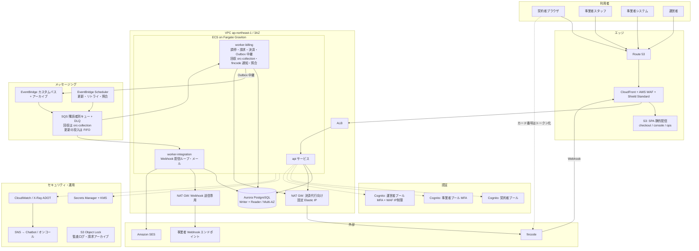
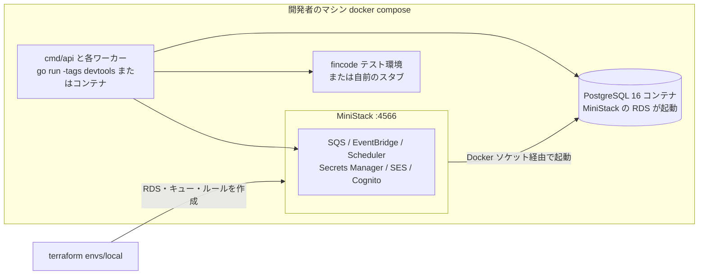
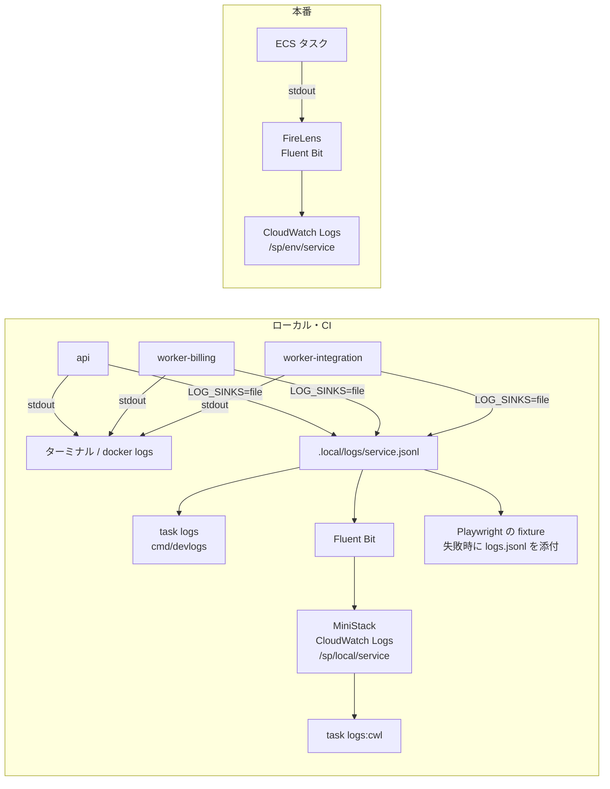
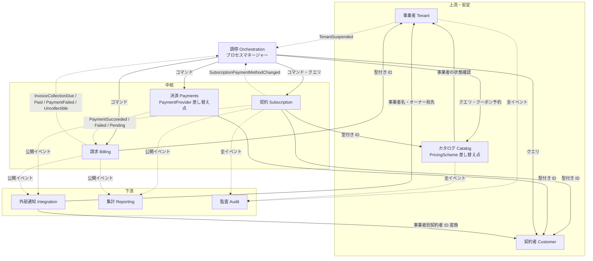
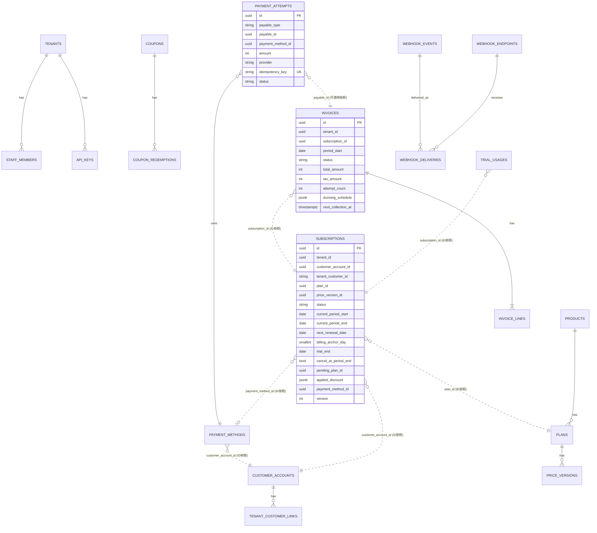
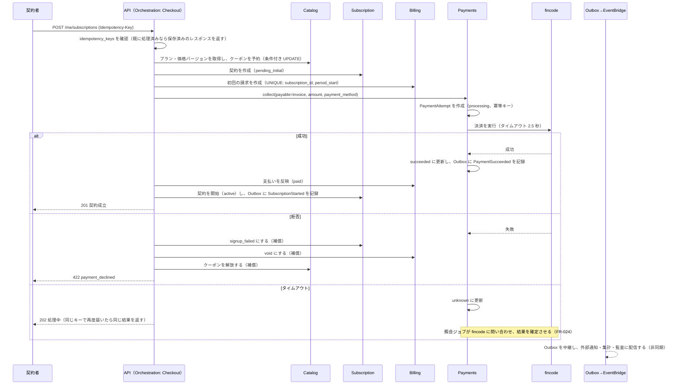
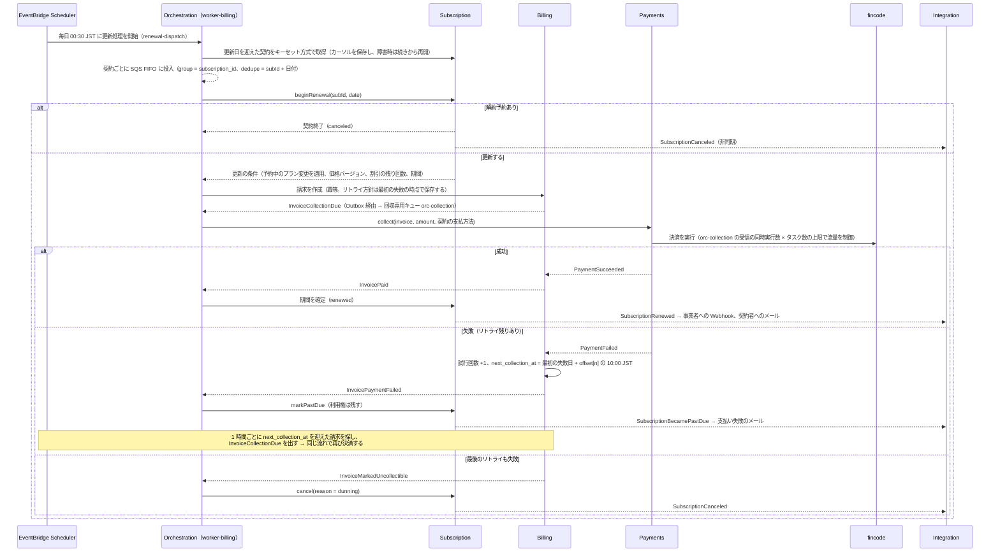
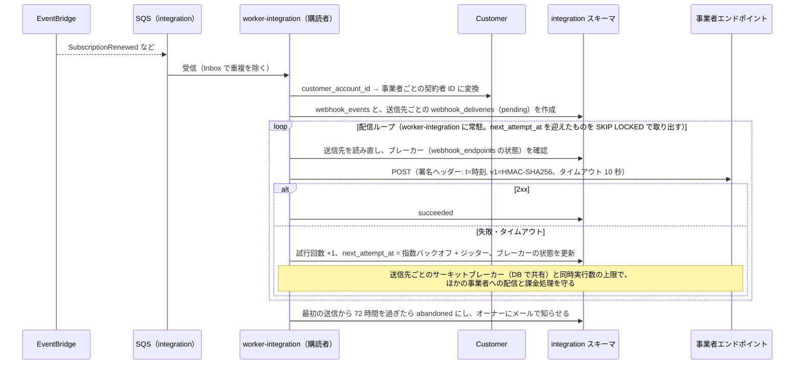
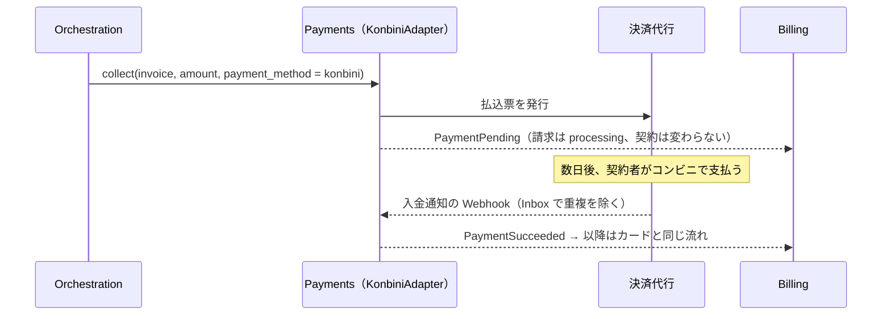

# 設計書: マルチテナント型サブスクリプション基盤

| 項目 | 内容 |
|---|---|
| ステータス | Approved |
| 作成日 | 2026-10-11 |
| 要件定義書 | docs/requirements/subscription-platform.md |

## 1. 設計概要

- コンテキストを9つに分け、**モジュラーモノリス**として 1 つのモノリポで実装する。バックエンドは **Go** で作る（ADR-006）。デプロイは、負荷の性質ごとに分けた **ECS on Fargate（Graviton）の 3 つのサービス**（API／課金ワーカー／外部通知ワーカー）で行う。本番で集計（Reporting）を作るときは、集計ワーカーを足す（ADR-001。Lambda 中心の案は検討して採用しなかった。ADR-007）。
- 申込・更新・リトライ・回収の流れは、**調停役（プロセスマネージャー）**が各コンテキストに命令して進める。契約・請求・決済の 3 つは、お互いを知らない（ADR-002）。
- 決済は **`PaymentProvider` ポートとアダプター**で抽象化する。請求は決済手段を参照しない。入金は非同期を前提とし、「処理中」の状態を正式に扱う。こうすることで、決済手段や決済代行を追加しても、中核のロジックを変えずに済む（ADR-003）。
- コンテキスト間は **Transactional Outbox → EventBridge → SQS** でつなぐ。Outbox は課金ワーカーの常駐ループが中継する。配信は少なくとも 1 回とし、受け取る側は冪等に処理する（ADR-004）。
- データは **Aurora PostgreSQL** に置く（接続は各プロセスの pgxpool で使い回す。RDS Proxy は必要になれば導入する）。コンテキストごとにスキーマを分け、事業者のデータは行レベルセキュリティ（RLS）で分離する（ADR-005）。
- ローカル開発では、DB（MiniStack の RDS）も含めて **MiniStack** で再現する（ADR-008）。
- 構成は **AWS Well-Architected Framework の6本柱**（§1.3）に沿って評価している。

### 1.1 AWS 全体構成



- **アカウント構成**：AWS Organizations と Control Tower を使い、management／security（ログアーカイブ・監査）／shared（CI/CD・ECR）／dev／stg／prod に分ける。
- **サービス**（ADR-001）：
  - `api`：全 HTTP（me / console / tenant / ops / checkout / webhooks/fincode）。申込の同期処理（Checkout）と監査の書き込みもここ。
  - `worker-billing`：調停・請求・決済の購読者、更新の投入（FIFO）、回収（`orc-collection`）、Outbox の中継ループ、fincode の通知処理、結果不明の決済の確定・照合、課金系のジョブ。
  - `worker-integration`：Webhook の配信ループ、メールの送信。
  - 本番で集計（Reporting）を作るときは `worker-projection` を足す（PoC では作らない。P-PLT-4）。
- **fincode への流量**：回収専用のキュー `orc-collection` を、worker-billing の中で**受信の同時実行数を固定して**処理する。全体の上限は「受信の同時実行数 × タスク数の上限（自動スケールの最大）」で決める（P-ARC-7・11）。
- **共有する状態**：Webhook のサーキットブレーカーの状態は DB（`webhook_endpoints`）に持ち、複数のタスクで共有する。
- **ネットワーク**：ECS と Aurora はプライベートサブネットに置く。外向きの通信は、用途ごとに NAT を分ける。
  - fincode 向けは固定 IP にする（決済代行側で IP 制限をかけられるようにするため）。
  - Webhook 送信は専用の経路にする。SSRF を防ぐため、名前解決した結果がプライベート IP なら送らない。
- **カード番号**：契約者のブラウザから fincode に直接送ってトークン化する（fincode の JS を使う）。自社のバックエンドには、トークンと参照 ID しか届かない。

### 1.2 モノリポ構成（Go）

バックエンドは **Go の単一モジュール**（`go.mod` は 1 つ）で作る。フロントエンド（SPA）は TypeScript で作り、インフラは Terraform で管理する。どちらも同じリポジトリの `web/` と `infra/` に置く（ADR-006）。ローカル開発では、AWS のサービスを MiniStack で再現する。

```
subscription-platform/
├── go.mod                          # バックエンド全体で 1 つの Go module
├── cmd/                            # デプロイ単位（main と組み立てだけ。ロジックは置かない）
│   ├── api/                        # HTTP: /v1/me, /v1/console, /v1/tenant, /v1/ops, /v1/checkout, /webhooks/fincode
│   ├── worker-billing/             # 調停・請求・決済の購読者、回収（orc-collection）、Outbox 中継、fincode 通知処理、課金系ジョブ
│   ├── worker-integration/         # 事業者 Webhook の配信ループ、メール送信
│   └── migrate/                    # モジュールごとのスキーマのマイグレーションを実行
│                                   # （worker-projection は本番で集計を作るときに追加する。P-PLT-4）
├── modules/                        # 境界づけられたコンテキスト（1 コンテキスト = 1 ディレクトリ）
│   ├── subscription/
│   │   ├── module.go               # 組み立て（依存の注入、ルート・購読者の登録）。cmd/ からだけ import できる
│   │   ├── contracts/              # 公開する部分: コマンド・クエリの interface、DTO、イベントのペイロード型
│   │   │   ├── service.go
│   │   │   └── events.go
│   │   ├── internal/               # ★ Go の internal ルールにより、ほかのモジュールからは import できない
│   │   │   ├── domain/             # 集約・値オブジェクト・ドメインイベント（標準ライブラリと sharedkernel だけに依存する）
│   │   │   ├── app/                # ユースケース（contracts の interface を実装する）
│   │   │   └── adapter/
│   │   │       ├── postgres/       # リポジトリの実装（sqlc で生成したコードをここに出力する）
│   │   │       ├── http/           # このモジュールの HTTP ハンドラ（oapi-codegen の interface を実装する）
│   │   │       └── consumer/       # イベントの購読ハンドラ
│   │   └── db/
│   │       ├── migrations/         # subscription スキーマのマイグレーションだけ
│   │       └── queries/            # sqlc が読む SQL
│   ├── payments/
│   │   └── internal/adapter/provider/
│   │       ├── provider.go         # PaymentProvider ポート（collect / getStatus / parseWebhook）
│   │       └── fincode/            # FincodeCardAdapter（将来の手段は、ここと同じ階層に追加する）
│   ├── tenant/  customer/  catalog/  billing/
│   └── orchestration/  integration/  reporting/  audit/
├── internal/                       # リポジトリの中だけで使う共通部分（外部には公開しない）
│   ├── sharedkernel/               # ID[T], Money(JPY), Date(JST の暦日), BillingPeriod の計算, Clock, EventEnvelope
│   └── platform/                   # 技術的な基盤。ドメインの知識は持たない。modules/ を import しない
│       ├── db/                     # pgxpool、トランザクション、RLS の設定（set_config）
│       ├── outbox/                 # Outbox への書き込みと、EventBridge への中継（worker-billing の常駐ループ。SKIP LOCKED）
│       ├── inbox/                  # 受け取ったメッセージの重複排除（processed_messages）
│       ├── messaging/              # EventBridge への送信、SQS の受信ループ（キューごとの同時実行数の上限・可視性タイムアウトの延長）
│       ├── httpx/                  # ミドルウェア（認証、テナントのコンテキスト、Idempotency-Key、Problem Details）
│       ├── scheduler/              # EventBridge Scheduler から来たジョブを受け取る（カーソルを保存し、障害時は続きから再開できる）
│       ├── devclock/               # ローカルの業務時刻（1 秒のキャッシュで読む。P-ARC-8）
│       ├── observability/          # slog（JSON）、OpenTelemetry
│       └── config/
├── api/openapi/                    # OpenAPI 3.1 の定義（me / console / tenant / ops）← API の仕様はここを正とする
├── sqlc.yaml                       # 各モジュールの queries/ と migrations/ を登録する
├── .golangci.yml                   # 静的解析と依存ルール（depguard）
├── Taskfile.yml                    # generate / lint / test / build のタスク
├── web/                            # pnpm workspace（TypeScript）
│   ├── checkout/  console/  ops/   # SPA
│   └── packages/api-client/        # api/openapi から生成した型付きのクライアント
├── infra/                          # Terraform（下の「インフラ（Terraform）」を参照）
├── deploy/                         # 配線の正本（messaging.yaml・schedules.yaml）。Terraform と Go の両方が読む
├── compose.yaml                    # ローカル開発: MiniStack（RDS は MiniStack が PostgreSQL のコンテナとして起動する）
└── docs/
```

#### 依存ルール（3段階で強制する）

| 段階 | 仕組み | 守ること |
|---|---|---|
| 1. コンパイラ | Go の `internal/` ルール | `modules/X/internal/**` は `modules/X` の外から import できない。ほかのモジュールに見えるのは `contracts/` と `module.go` だけになる |
| 2. lint（CI で失敗させる） | golangci-lint の `depguard` | ・`modules/X/**` から import できるのは、`modules/Y/contracts` と `internal/sharedkernel`・`internal/platform` だけ<br>・`modules/X`（module.go）を import できるのは `cmd/**` だけ<br>・`contracts` が import できるのは、標準ライブラリと `sharedkernel` だけ（`domain` の型を外に漏らさない）<br>・`internal/domain` は pgx・AWS SDK・net/http を import しない<br>・`internal/platform` は `modules/**` を import しない |
| 3. lint（コンテキストマップとの整合） | `depguard` でモジュールごとに許可リストを持つ | §2 の矢印どおりにだけ依存できる（例：`billing` → `payments/contracts` は許可する。`payments` → `billing/contracts` は禁止する）。矢印を足すときは、設計書の更新とセットでレビューする |

#### 主なライブラリ

| 用途 | 採用するもの | 理由・補足 |
|---|---|---|
| Go のバージョン | 最新の安定版。`go.mod` の `toolchain` 指定で固定する | 標準の `net/http` でルーティングでき、`log/slog` も使える |
| HTTP | 標準の `net/http`（ServeMux）＋ **oapi-codegen**（strict server） | OpenAPI から、サーバー側の interface と型を生成する。ハンドラが仕様からずれると、コンパイルが通らない |
| リクエストの検証 | kin-openapi の検証ミドルウェア ＋ ドメインの生成関数での検証 | 形の検証は OpenAPI で、業務ルールの検証は集約で行う |
| DB | **pgx v5** ＋ **sqlc** | SQL を明示的に書き、型の付いたコードを生成する。部分ユニーク・`SKIP LOCKED`・RLS の `set_config` をそのまま扱える |
| マイグレーション | **goose**（モジュールごとにバージョン管理テーブルを分ける） | モジュールが自分のスキーマだけを管理する、という形にしやすい |
| AWS | aws-sdk-go-v2（EventBridge, SQS, Secrets Manager, SES） | |
| メッセージング | **自前の薄い実装**（`internal/platform/outbox`・`messaging`・`inbox`） | Outbox の中継・SQS の受信・Inbox は、合わせて数百行の規模。フレームワーク（Watermill）には EventBridge への送信が標準でなく、抽象化が 1 層増えるので採用しない |
| リトライ・サーキットブレーカー | cenkalti/backoff、sony/gobreaker | fincode と事業者の Webhook 送信先の呼び出しに使う |
| JWT の検証 | lestrrat-go/jwx | Cognito の JWKS を使って検証する |
| ログ・トレース | `log/slog`（JSON）、OpenTelemetry Go SDK → ADOT Collector（サイドカー）→ X-Ray / CloudWatch | `request_id`・`tenant_id`・`correlation_id` を context で引き継ぐ |
| テスト | **E2E：Playwright（TypeScript、`e2e/`）**。UT：標準の `testing`（テーブル駆動）、go-cmp。結合：**testcontainers-go**（PostgreSQL） | E2E を中心にし、**モックは原則として使わない**（本物の DB・MiniStack・実際に起動したプロセス）。E2E からは読み取り専用のロールで DB の値も確かめる。例外は、制御できない外部だけ（fincode → StubAdapter、Webhook の送信先 → `webhook-sink`、認証 → 開発用 JWT、時刻 → dev clock）。UT は純粋なドメインロジックに、結合テストは RLS・並行処理・Outbox に絞る（docs/poc/02-pdm-decisions.md の P-TST-1〜7） |
| 静的解析 | golangci-lint（depguard, **exhaustive**, errcheck, gosec, wrapcheck など） | `exhaustive` で、状態の switch の漏れを検出する |
| コンテナ | マルチステージの Dockerfile → distroless/static（arm64）、`CGO_ENABLED=0` | Graviton 上の Fargate で動かす。イメージが小さく、攻撃される面も小さい |

#### Go でドメインモデルを書くときの規約

ドメインモデルの表現力が C# より控えめな点を、次の規約で補う。

- **集約**
  - フィールドは非公開にし、生成関数 `New…(…) (*X, error)` と、DB から復元する専用の関数でだけ作れるようにする。
  - 状態は、メソッドを通してしか変えられないようにする。メソッドは、起きたドメインイベントを集約の中に記録する。
- **状態**
  - `type SubscriptionStatus string` のように専用の型を作り、取りうる値を定数で列挙する。
  - 遷移は、`Activate()` や `MarkPastDue()` のようなメソッドに閉じ込め、許されない遷移はエラーにする。
  - switch での分岐の漏れは、`exhaustive` で検出する。
- **型付き ID**
  - `sharedkernel.ID[T]` をジェネリクスで定義し、`ID[Subscription]` と `ID[Invoice]` を取り違えたらコンパイルエラーになるようにする。
- **値オブジェクト**
  - `Money` は JPY の整数をラップする。端数の処理（税額の計算）は `Money` のメソッドにまとめ、丸め方を明示する。
  - `Date` は JST の暦日を表す型にする（Go の標準ライブラリには、日付だけを表す型がないため）。月末の補正は `BillingPeriod` が持つ。
- **エラー**
  - ドメインのエラーは、`ErrCouponExpired` のような型付きのエラーにする。
  - HTTP アダプターで Problem Details の `code` に対応づける。
  - ドメイン層は HTTP のステータスコードを知らない。
- **トランザクション**
  - `platform/db.InTx(ctx, fn)` の中で、集約の保存と Outbox への書き込みを同じトランザクションで行う。
  - トランザクションの最初に、`SELECT set_config('role', …, true), set_config('statement_timeout', …, true), set_config('app.tenant_id', …, true)` の 1 文を実行し、ロールの切り替えと RLS をかける（往復を 1 回にまとめる。`SET` 文を使わないので、将来 RDS Proxy を入れてもピン留めを起こしにくい。ADR-005）。
- **context**
  - テナント ID・操作者・`correlation_id` は `context.Context` で引き継ぐ。
  - ドメイン層には context を渡さず、必要な値は引数で渡す。

#### DB マイグレーションとコード生成

- 各モジュールの `db/migrations` は、自分のスキーマだけを変更する。`cmd/migrate` がモジュールごとに goose を実行する。
- `task generate` で、次の 3 つをまとめて生成する。生成されたコードはコミットする。
  - sqlc（DB アクセスのコード）
  - oapi-codegen（サーバー側の interface と型）
  - `web/packages/api-client`（SPA 用の TypeScript クライアント）
- CI では、もう一度生成して差分が出ないかを確認する（生成し忘れの検出）。

#### インフラ（Terraform）

```
infra/
├── modules/                        # 再利用する Terraform モジュール（環境に依存しない）
│   ├── network/                    # VPC、サブネット（3AZ）、用途別の NAT、VPC エンドポイント
│   ├── data/                       # Aurora PostgreSQL、KMS（RDS Proxy は変数で任意に作る）
│   │                               #   ローカルでは同じモジュールで RDS（postgres 16）を MiniStack に作る（ADR-008）
│   ├── messaging/                  # EventBridge バス・ルール・アーカイブ、SQS と DLQ、EventBridge Scheduler
│   ├── compute/                    # ECS クラスター、3 つのサービス、タスクロール（サービスごとに最小権限）、ALB
│   ├── edge/                       # CloudFront、WAF、S3（SPA）、Route 53
│   ├── auth/                       # Cognito（契約者・事業者・運営者の 3 つのプール）
│   ├── observability/              # CloudWatch のダッシュボード・アラーム、SNS
│   └── security/                   # Secrets Manager、GuardDuty・Security Hub の設定
├── envs/
│   ├── local/                      # MiniStack 向け（provider の endpoints を localhost:4566 に向ける）
│   ├── dev/  stg/  prod/           # 各 AWS アカウント向け（同じモジュールを、変数だけ変えて使う）
│   └── (各 env に backend.tf, providers.tf, main.tf, terraform.tfvars)
└── bootstrap/                      # state 用の S3 バケットと、CI 用の OIDC ロール（最初に 1 回だけ適用する）
```

- **state の管理**：アカウントごとの S3 バケットに保存する。ロックには S3 のネイティブロック（`use_lockfile`）を使い、暗号化には KMS を使う。
- **CI/CD**：
  - PR ごとに `terraform fmt` / `validate`、tflint、セキュリティの静的解析（Trivy または Checkov）、`plan` を実行し、plan の結果を PR にコメントする。
  - main ブランチにマージされたら、承認を経て `apply` する（prod は手動で承認する）。
  - AWS へは GitHub Actions の OIDC で認証し、長期間使えるアクセスキーは発行しない。
- **アプリのデプロイとの役割分担**：
  - Terraform が管理するのは、ECS のサービスとタスク定義の「枠」まで。
  - コンテナイメージの更新は、アプリの CI/CD（CodeDeploy の Blue/Green）が行う。
  - Terraform はイメージタグの差分を無視する（`lifecycle.ignore_changes`）。
- **配線の正本**：`deploy/messaging.yaml`（キューと購読者とサービスの対応、受信の同時実行数）と `deploy/schedules.yaml`（ジョブ）。Terraform が `yamldecode` で読み、Go も同じファイルを読む。

#### ローカル開発（MiniStack）（ADR-008）



- **AWS のマネージドサービス**（SQS・EventBridge・Scheduler・Secrets Manager・SES・Cognito）と **DB（RDS）** を MiniStack で再現する。リソースは `infra/envs/local` から、本番と同じ Terraform モジュールで作る（キューやルール、DB の定義が本番とずれないようにするため）。
- **DB**：`data` モジュールで `aws_db_instance`（engine `postgres`、engine_version 16 系）を作る。MiniStack が中で本物の PostgreSQL のコンテナを起動し、`host:port` を返すので、それを `DATABASE_URL` にする（`.env.local` に書き出す）。
  - RLS・部分ユニーク・`SKIP LOCKED` は PostgreSQL そのものの機能なので、そのまま確かめられる。`GRANT … WITH INHERIT FALSE` に PostgreSQL 16 が必要なので、16 のイメージが選ばれることを確かめた（2026-10-24。MiniStack は `postgres:16-alpine` を起動する。未解決事項 #9）。使えない環境では `DB_MODE=container`（compose の profile `db`。Terraform は `rds_enabled=false`）に戻す。
  - MiniStack の RDS のマスターユーザーは、コンテナの中ではスーパーユーザーになる見込み。本番の `rds_superuser` との差で権限の誤りを見逃さないように、`cmd/migrate bootstrap` は `rds_superuser` 相当に絞ったロールで実行する。
  - testcontainers-go を使ったテストは、MiniStack を経由せず `postgres:16` を直接起動する。MiniStack の RDS と同じイメージ（できればダイジェスト）に揃える。
- **アプリ**：`cmd/api`・`cmd/worker-billing`・`cmd/worker-integration` を、それぞれ普通のプロセスとして起動する（`task dev` で `go run -tags devtools` を並行起動。compose のコンテナとして動かしてもよい）。
- **アプリの設定**：aws-sdk-go-v2 の接続先（`BaseEndpoint`）は環境変数で切り替える。ローカルのときだけ MiniStack に向け、本番のコードと分岐させない。
- **fincode**：結合確認には fincode のテスト環境を使う。オフラインでの開発や CI には、`PaymentProvider` ポートの後ろに置くスタブのアダプターを使う。スタブでは、成功・拒否・タイムアウト・非同期での確定を切り替えられるようにする。
- **起動**：`task up` で次の 4 つを順に行う。
  1. docker compose で MiniStack を起動する（Docker のソケットをマウントし、`RDS_PERSIST=1`）
  2. `terraform -chdir=infra/envs/local apply` で RDS とリソースを作る
  3. `cmd/migrate` でマイグレーションを実行する
  4. `task verify:local` でスモークを流す
- **注意**：MiniStack はエミュレーターなので、本番の AWS と細かな動きが違うことがある。IAM の権限、EventBridge のルールの絞り込み、Aurora のリーダーの読み取り専用、Cognito の JWT などは、dev 環境（本物の AWS）での結合テストで確かめる（未解決事項 #9）。

### 1.3 AWS Well-Architected Framework 6本柱への対応

| 柱 | 主な設計 | 関連する要件 |
|---|---|---|
| **運用上の優秀性** | ・インフラ（Terraform）とアプリを同じモノリポで管理し、CI/CD でデプロイする（インフラは PR で plan、承認して apply する。ECS は CodeDeploy で Blue/Green）<br>・キューとルールは `deploy/*.yaml` から Terraform で作る<br>・ローカルでは MiniStack を使い、DB（RDS）も含めて本番と同じ Terraform モジュールでリソースを作る（ADR-008）<br>・ログは構造化し、`request_id`・`tenant_id`・`correlation_id` をイベントをまたいで引き継ぐ<br>・運営者の手動操作（再決済・結果の確定・再送・部分的な再実行）を管理画面と Runbook に用意する<br>・DLQ に溜まったら通知し、再投入する手順を用意する<br>・機能フラグは AppConfig で管理する<br>・定期的にゲームデイ（決済代行の障害や Webhook 先の障害を想定した訓練）を行う | NFR-013, NFR-014 |
| **セキュリティ** | ・アカウントを分け、ECS タスクごとに IAM ロールを最小権限で付ける<br>・WAF でマネージドルールとレートベースの制限をかける<br>・管理画面（事業者・運営者）は Cognito で MFA を必須にする<br>・API キーはハッシュにして保存する<br>・Secrets Manager で秘密情報をローテーションする<br>・Aurora・S3・SQS は KMS で暗号化する<br>・RLS で事業者のデータを分離し、自動テストで確かめる<br>・カード情報は持たない。決済ページは CSP と SRI で守り、改ざんを検知する（PCI DSS v4.0 の 6.4.3・11.6.1 を想定）<br>・GuardDuty・Security Hub・組織全体の CloudTrail を有効にする<br>・監査ログは S3 Object Lock で保管する<br>・Webhook の送信で SSRF を防ぐ | NFR-007, NFR-008, NFR-009, FR-025 |
| **信頼性** | ・すべて Multi-AZ で構成する<br>・**どの層も冪等にする**（API の Idempotency-Key、請求のユニーク制約、決済の試行の部分ユニーク、Inbox による重複排除）<br>・Outbox でイベントの取りこぼしをなくす<br>・Webhook 用のワーカーとキューを分けて、障害の影響を閉じ込める（バルクヘッド）<br>・Webhook のサーキットブレーカーの状態を DB に持ち、複数のタスクで共有する<br>・ジョブはカーソルを保存し、障害時は続きから再開する<br>・fincode の呼び出しにタイムアウト、ジッター付きのリトライ、サーキットブレーカーを入れる<br>・日次で照合する<br>・Aurora は PITR を35日分とる（運用ミスからデータを戻すため）<br>・災害対策（リージョン障害）はスコープ外 | NFR-004, NFR-005, NFR-006, FR-020, FR-024 |
| **パフォーマンス効率** | ・更新課金はキューに分けて流す。回収は専用のキュー `orc-collection` にし、「受信の同時実行数（固定）× worker-billing のタスク数の上限」で fincode への流量を制御する（10万件÷4時間＝約7件/秒）<br>・読み取りの API は Aurora のリーダーに流す<br>・一覧はキーセット方式でページングし、部分インデックスを使う<br>・請求と決済の試行のテーブルは、量が増えたら月ごとにパーティションに分ける<br>・公開しているプラン情報は CloudFront でキャッシュする | NFR-001, NFR-002, NFR-003 |
| **コスト最適化** | ・サービスを最小限に絞る（ADR-001）<br>・Fargate は Graviton にし、Compute Savings Plans を使う<br>・集計ワーカーを作るときは Fargate Spot で動かす（冪等なので中断されても困らない）<br>・本番の Aurora はリザーブドインスタンスにし、開発・検証環境は Serverless v2 にする<br>・EventBridge と SQS は使った分だけの課金で済む<br>・S3 はライフサイクルで Glacier に移す<br>・コンテキストごとにコスト配分タグを付け、コストの異常を検知する | — |
| **持続可能性** | ・Graviton を使い、課金バッチは深夜に実行する<br>・開発環境は夜間に止める<br>・データはライフサイクルで階層化する<br>・リソースの大きさを継続的に見直す | — |

### 1.4 ログと調査（コーディングエージェントが使える可観測性）

開発・デバッグ・テストのときに、**人とコーディングエージェントの両方が、ログを自分で取り出して不具合の調査・修正・テストに使える**ようにする（要件 NFR-017、決定 P-OBS-1〜8、ADR-009）。

#### ログの流れ



#### 相関 ID の引き継ぎ

| 起点 | 相関 ID | 引き継ぎ方 |
|---|---|---|
| API リクエスト | `X-Correlation-Id`（なければ作る） | context → Outbox の EventEnvelope の `correlation_id` → SQS → 購読者の context → 次のイベント（`causation_id` は直前のイベント ID） |
| E2E テスト | `e2e-<testId>-<乱数>` | Playwright の fixture が、そのテストのすべての API 呼び出し（dev のジョブ手動実行・dev clock を含む）に付ける |
| スケジュールのジョブ | `job:<job>:<run_id>` | ジョブが出すイベントとログに付ける |

レスポンスには、`X-Request-Id` と `X-Correlation-Id` を常に返す。エラーの Problem Details にも両方を入れるので、失敗したレスポンス 1 つから調査を始められる。

#### ログの項目（共通）

| 項目 | 内容 |
|---|---|
| `ts`, `level`, `msg` | 時刻（UTC、ミリ秒）、レベル、ログの種類（下の表） |
| `service`, `version`, `env` | プロセス名、git のコミット、環境 |
| `module`, `component` | モジュール（subscription など）、部品（http / consumer / job / outbox / provider） |
| `request_id`, `correlation_id`, `causation_id`, `trace_id`, `span_id` | 調査の鍵になる ID |
| `tenant_id`, `actor{type,id}` | 誰の操作か |
| `event_id`, `event_type`, `message_id`, `queue`, `job`, `job_run_id` | 非同期の処理の識別 |
| `subscription_id`, `invoice_id`, `attempt_id` など | 必要に応じたドメインの ID |
| `error{code, kind, message}`, `stack` | エラー。`stack` はローカルと CI だけ |
| `duration_ms` | 所要時間 |

#### 標準のログの種類（platform の共通部品が出す）

| msg | 出す場所 | 主な項目 |
|---|---|---|
| `http.request.completed` | API の入口（1 リクエストに 1 行） | method, route（テンプレート）, status, duration_ms, error.code, 本文（ローカルと CI だけ。マスキング済み） |
| `http.outbound.completed` | fincode・Webhook の送信先・SES への呼び出し | target, method, status, duration_ms, idempotency_key, attempt |
| `event.published` / `event.consumed` / `event.failed` / `event.dlq` | Outbox の中継・SQS の受信ループ | event_type, event_id, message_id, queue, 受信回数 |
| `job.started` / `job.completed` / `job.failed` | スケジュールのジョブ | job, job_run_id, 件数, カーソル |
| `domain.state_changed` | 集約の状態が変わったとき（リポジトリの保存時） | aggregate, id, from, to, 理由 |
| `db.slow_query` | 200ms を超えたクエリ | クエリ名（sqlc）, duration_ms |
| `panic.recovered` | panic を回収したとき | stack |

ログのレベルは、`LOG_LEVEL=info,payments=debug` のように、モジュールごとに変えられる。ローカルの既定は debug、本番の既定は info。

#### 秘密情報の扱い

- Authorization・Cookie・API キー・トークン・署名鍵は、どのレベルでも記録しない。
- カード番号らしき数字列（13〜19 桁で Luhn を満たすもの）は、どの項目でも `[PAN]` に置き換える。
- メールアドレスと氏名はマスキングする。
- リクエストとレスポンスの本文は、ローカルと CI でだけ、マスキングしたうえで記録する（`LOG_HTTP_BODY=redacted`。本番は `off`）。

#### エージェントが使う道具

| コマンド | 用途 |
|---|---|
| `task logs -- --corr <相関ID>` | 1 件の操作に関係するすべてのプロセスのログを、時系列に表示する。`--req`・`--tenant`・`--level`・`--service`・`--msg`・`--since` で絞り込める。`--format=timeline`（人とエージェント向けの要約）か `json` |
| `task logs -- --errors --since 10m` | 直近のエラーだけを表示する |
| `task logs:cwl -- '<Insights クエリ>'` | MiniStack の CloudWatch Logs に、本番と同じ形のクエリを流す（`fields / filter / sort / limit` の範囲） |
| `task db:reader` | `sp_e2e_reader` で psql を開き、DB の値を確かめる |
| Playwright のレポート | 失敗したテストには、そのテストの相関 ID で絞った `logs.jsonl` と `timeline.txt` が添付される |

調査の手順は `docs/runbooks/debugging.md` に書き、リポジトリの `CLAUDE.md` から参照する。

## 2. コンテキストマップ

**図の見方**
- 実線 `A --> B`：A が B に依存している（ID で参照する、または同期でコマンドやクエリを送る）。
- 点線 `A -.-> B`：B が A のイベントを購読している。依存の向きは B → A。

循環する依存はない。



- 将来追加するコンテキスト（いずれも既存を変更せずに追加できる）
  - **領収書（Receipts）**：`InvoicePaid` を購読する（NFR-012）。
  - **使用量（Usage）**：Catalog の `PricingScheme` に使用量を渡す（NFR-010）。
  - **新しい決済手段**：Payments のアダプターを追加する（NFR-011）。

### コンテキスト間の連携一覧

| 発信元 | 宛先 | 経路 | 内容 |
|---|---|---|---|
| Orchestration | Catalog | 同期クエリ／コマンド（プロセス内） | 申込できるプランと価格のバージョンを取得する。クーポンを予約・解放する |
| Orchestration | Customer | 同期クエリ／コマンド | 事業者ごとの契約者 ID を発行する。退会する |
| Orchestration | Subscription | 同期コマンド | 契約を作る、更新を始める・確定する、支払い遅延にする・回復させる、解約する |
| Orchestration | Billing | 同期コマンド | 請求を作る、すぐにリトライする、請求を無効にする |
| Orchestration | Payments | 同期コマンド | 決済を依頼する（`payable` は請求を指す、中身を知らない参照） |
| Payments | Billing | ドメインイベント | `PaymentSucceeded` / `PaymentFailed` / `PaymentPending`（決済の試行で、結果が確定したもの） |
| Billing | Orchestration | ドメインイベント | `InvoiceCollectionDue` / `InvoicePaid` / `InvoicePaymentFailed` / `InvoiceMarkedUncollectible` |
| Subscription | Orchestration | ドメインイベント | `SubscriptionPaymentMethodChanged`（支払い遅延中に即時の再決済を始めるきっかけ） |
| Tenant | Orchestration | ドメインイベント | `TenantSuspended`（全契約を一括で解約するきっかけ） |
| Subscription / Billing | Integration | ドメインイベント | 契約・請求の公開イベント → 事業者への Webhook、契約者へのメール |
| 全コンテキスト | Reporting / Audit | ドメインイベント | 集計用の読み取りデータを作る。監査ログに記録する |

## 3. ドメインモデル

### 集約一覧

| 集約 | 集約ルート | 含まれるエンティティ/VO | 不変条件 |
|---|---|---|---|
| Tenant | Tenant | 状態, FincodeShopRef(VO) | 「有効」でないとプランを公開できない。停止は運営者だけが行える |
| StaffMember | StaffMember | Role(VO: owner/admin/viewer) | 各事業者にオーナーが最低 1 名いる（Tenant 単位でチェックする） |
| ApiKey | ApiKey | KeyPrefix, KeyHash(VO) | 平文は発行するときに一度だけ返す。失効したら元に戻せない |
| CustomerAccount | CustomerAccount | Email(VO) | 退会したら個人情報をマスキングし、元に戻せない |
| TenantCustomerLink | TenantCustomerLink | TenantCustomerId(VO) | 1 つの (tenant, customer) に ID は 1 つだけ。ID から元の契約者を推測できない |
| Product | Product | — | — |
| Plan | Plan | PriceVersion(エンティティ), BillingInterval(VO), TrialDays(VO), **PricingScheme(VO: 今は fixed だけ)** | 価格のバージョンは追記だけで、既存のバージョンは変えない。公開中のプランには、有効な価格のバージョンが必ずある |
| Coupon | Coupon | Discount(VO: amount/percent, value, durationCycles), 有効期限, 上限 | 使われた数は上限を超えない。1 人が使えるのは 1 回まで（CouponRedemption のユニーク制約） |
| Subscription | Subscription | BillingPeriod(VO), PendingPlanChange(VO), CancellationSchedule(VO), AppliedDiscount(VO: 残り回数), PaymentMethodRef(型付き ID) | 状態の遷移は要件定義書 §7 に従う。解約が予約されたら、プラン変更の予約は消える。利用権の有無は状態から決まる |
| TrialUsage | TrialUsage | (customer, product) | 同じ人が同じ商品のトライアルを使えるのは 1 回まで |
| Invoice | Invoice | InvoiceLine(エンティティ), Money, TaxBreakdown(VO), DunningSchedule(VO: リトライが始まった時点の方針), 試行回数 | 1 つの契約の 1 つの期間に請求は 1 つ。金額は 0 円以上。「支払済」「回収不能」「無効」は終端で、変更できない。**決済手段は参照しない** |
| DunningPolicy | DunningPolicy | RetryOffsets(VO: 日数の配列) | 回数は 0〜5。日数は増えていく順に並ぶ |
| PaymentMethod | PaymentMethod | MethodType(VO: card / 将来 bank_debit, konbini…), ProviderRefs(VO: 決済代行・事業者ショップごとの参照), 表示用の情報 | 有効な契約で使っている支払方法は削除できない（Orchestration が契約に問い合わせて確認する） |
| PaymentAttempt | PaymentAttempt | PayableRef(VO: type＋id, 中身は知らない), Money, ProviderOrderRef, IdempotencyKey | 1 つの payable について、成功する試行は最大 1 つ。進行中の試行も最大 1 つ |
| BillingCycleProcess | BillingCycleProcess | kind(signup/renewal/retry/recovery), step | 1 つの請求に、同時に進むプロセスは 1 つだけ |
| BulkCancellationJob | BulkCancellationJob | 件数・進み具合 | 1 つの事業者の停止につき 1 つ |
| WebhookEndpoint | WebhookEndpoint | Url(VO: https のみ), EventTypes, SigningSecrets(現在と前の 2 つ) | 前の鍵は移行期間が過ぎたら無効になる |
| WebhookDelivery | WebhookDelivery | 試行の履歴 | 最初の送信から 72 時間を過ぎたら、自動では再送しない |

**PaymentMethod の ProviderRefs（未解決事項 #1 に両対応する設計）**
- PaymentMethod はプラットフォーム全体で持つ（契約者ごと）。決済代行側の参照は `{provider, tenant_shop_id?, customer_ref, card_ref}` のリストで持つ。
- fincode でカードを事業者間で共有できる場合は、`tenant_shop_id = null` の参照 1 つで済む。
- 共有できない場合は、事業者に初めて申し込んだときに、その事業者ショップ向けの参照を追加する（再入力が必要なら、申込画面でカードの再入力を求める）。
- どちらの場合も、変更は `FincodeCardAdapter` の中だけで済む。

### ドメインイベント

すべて共通のエンベロープ `{event_id, event_type, occurred_at, tenant_id, aggregate_id, aggregate_version, correlation_id, payload}` で包む。

| イベント名（過去形） | 発生タイミング | 購読者 |
|---|---|---|
| TenantApproved / TenantSuspended | 運営者が承認したとき／停止したとき | Orchestration（停止のみ）, Integration, Audit |
| PlanPublished / PlanUnpublished / PriceVersionAdded | プランを公開・非公開にしたとき、価格を改定したとき | Audit, Reporting |
| CouponRedeemed / CouponRedemptionReleased | クーポンを予約したとき／申込が不成立で解放したとき | Reporting, Audit |
| CustomerAccountWithdrawn | 契約者が退会したとき | Payments（支払方法を無効にする）, Audit |
| SubscriptionStarted | トライアルが始まったとき、または初回決済が成功して契約が始まったとき | Integration, Reporting, Audit |
| SubscriptionSignupFailed | 初回決済が失敗し、契約が不成立になったとき | Reporting |
| SubscriptionTrialWillEnd | トライアルが終わる 3 日前（日次スケジュール） | Integration |
| SubscriptionRenewed | 更新の請求が支払われ、期間が確定したとき | Integration, Reporting |
| SubscriptionBecamePastDue / SubscriptionRecovered | 支払い遅延になったとき／回復したとき | Integration, Reporting |
| PlanChangeScheduled / PlanChangeRevoked / PlanChanged | プラン変更を予約・取り消し・適用したとき | Integration, Audit |
| CancellationScheduled / CancellationRevoked | 解約を予約・取り消したとき | Integration, Reporting |
| SubscriptionCanceled | 解約済みになったとき（理由: customer / dunning / tenant_suspended） | Orchestration（残っている請求を無効にする）, Integration, Reporting |
| SubscriptionPaymentMethodChanged | 契約の支払方法を変えたとき | Orchestration |
| InvoiceIssued | 請求を作ったとき | Reporting, （将来）Receipts |
| InvoiceCollectionDue | 請求を作った直後、リトライの予定時刻になったとき、すぐにリトライするよう頼まれたとき | Orchestration |
| InvoicePaid | 請求が支払われたとき | Orchestration, Integration, Reporting, （将来）Receipts |
| InvoicePaymentFailed | 決済が失敗し、まだリトライが残っているとき | Orchestration, Integration |
| InvoiceMarkedUncollectible / InvoiceVoided | リトライの上限に達したとき／取り消したとき | Orchestration, Reporting |
| PaymentSucceeded / PaymentFailed / PaymentPending | 決済の試行の結果が決まったとき／非同期で受け付けられたとき | Billing |
| PaymentOutcomeUnknown | タイムアウトなどで結果がわからないとき | 照合ジョブ（Payments 内）, 監視 |

## 4. DB設計

1 つの Aurora PostgreSQL クラスタに、**コンテキストごとのスキーマ**を作る。

- スキーマをまたいだ外部キーや JOIN は禁止。他のコンテキストのデータは、型付き ID で参照するだけにする。
- 事業者に属するテーブルには `tenant_id` を持たせ、RLS ポリシー（`tenant_id = current_setting('app.tenant_id')`）をかける。
- ワーカーは、メッセージを処理するたびにテナントのコンテキストを設定する。
- 運営者向けの処理だけは、RLS を回避できる専用のロールを使う。



### テーブル定義

共通ルール：
- 金額は `integer`（JPY、税込）。
- 時刻は `timestamptz`（UTC で保存する）。業務上の日付は `date`（JST で解釈する）。
- 主キーは UUIDv7。
- 楽観ロック用の `version` を持たせる。
- `created_at` と `updated_at` を持たせる。

**共通（各スキーマに作る）**
- `outbox_events`
  - `id uuid PK`
  - `event_type text NOT NULL`
  - `aggregate_id uuid NOT NULL`
  - `payload jsonb NOT NULL`
  - `occurred_at`
  - `published_at timestamptz NULL`
- `processed_messages`（Inbox）
  - `consumer text`
  - `message_id uuid`
  - `PK(consumer, message_id)`

**tenant**
- `tenants`
  - `status CHECK IN ('pending_review','active','suspended')`
  - `fincode_shop_id text UNIQUE NULL`
- `staff_members`
  - `tenant_id FK`
  - `UNIQUE(tenant_id, subject)`（`subject` は IdP の sub。1 人が複数の事業者に所属できる。console では `X-Tenant-Id` で操作する事業者を指定する。P-IDN-1）
  - `role CHECK IN ('owner','admin','viewer')`
  - `UNIQUE(tenant_id, email)`
- `api_keys`
  - `key_prefix UNIQUE`
  - `key_hash NOT NULL`
  - `revoked_at NULL`

**customer**
- `customer_accounts`
  - `cognito_sub UNIQUE`
  - `email UNIQUE`（退会したらマスキングし、ユニークの対象から外す。部分ユニークインデックス）
  - `status CHECK IN ('active','withdrawn')`
- `tenant_customer_links`
  - `id text PK`（外部に出す `cus_` で始まるランダムな ID）
  - `UNIQUE(tenant_id, customer_account_id)`

**catalog**
- `products`
- `plans`
  - `billing_interval CHECK IN ('month','year')`
  - `trial_days CHECK >= 0`
  - `pricing_scheme CHECK IN ('fixed')`（従量課金などを足すときは、この CHECK を広げる）
  - `status CHECK IN ('draft','published','unpublished')`
- `price_versions`
  - `plan_id FK`
  - `amount integer NULL CHECK (amount > 0)`
  - `scheme_params jsonb NOT NULL`
  - `tax_rate numeric(4,3) NOT NULL`
  - `effective_from`
  - 更新・削除は禁止（トリガーで防ぐ）
- `coupons`
  - `UNIQUE(tenant_id, code)`
  - `discount_type CHECK IN ('amount','percent')`
  - `duration_cycles CHECK >= 1`
  - `redeemed_count CHECK (max_redemptions IS NULL OR redeemed_count <= max_redemptions)`
- `coupon_plans`
  - `PK(coupon_id, plan_id)`
- `coupon_redemptions`
  - `UNIQUE(coupon_id, customer_account_id) WHERE status IN ('reserved','confirmed')`（決済が失敗して解放されたクーポンは、再申込で使える。P-CAT-4）
  - `status CHECK IN ('reserved','confirmed','released')`

**subscription**
- `subscriptions`（上の ER 図を参照）
  - `status CHECK IN ('pending_initial','trialing','active','past_due','canceled','signup_failed')`
  - `cancel_reason CHECK IN ('customer','dunning','tenant_suspended') NULL`
  - `billing_anchor_day` で、月末の補正に使う「元の日」を持つ
- `trial_usages`
  - `PK(customer_account_id, product_id)`

**billing**
- `invoices`
  - `UNIQUE(subscription_id, period_start)` ← 二重課金を防ぐ最後の砦（FR-020）
  - `status CHECK IN ('open','processing','payment_unknown','paid','uncollectible','void')`
  - `total_amount CHECK >= 0`
  - `tax_rate`、`tax_amount`（NFR-012 のために税の内訳を残す）
- `invoice_lines`
  - `kind CHECK IN ('plan','discount')`（将来 'usage' を足す）
  - `price_version_id`
  - `quantity`
  - `unit_amount`
  - `amount`
- `dunning_policies`
  - `tenant_id PK`
  - `retry_offsets_days int[] NOT NULL CHECK (cardinality(retry_offsets_days) <= 5)`

**payments**
- `payment_methods`
  - `customer_account_id`
  - `method_type CHECK IN ('card')`
  - `display jsonb`（ブランド・下 4 桁・有効期限）
  - `status CHECK IN ('active','deleted')`
- `payment_method_provider_refs`
  - `payment_method_id FK`
  - `provider`
  - `tenant_shop_id NULL`
  - `customer_ref`
  - `method_ref`
  - `UNIQUE(payment_method_id, provider, tenant_shop_id)`
- `payment_attempts`
  - `payable_type CHECK IN ('invoice')`
  - `status CHECK IN ('processing','pending_async','succeeded','failed','unknown')`
  - `failure_code`、`failure_retryable bool`
  - `provider_order_ref UNIQUE`
  - `idempotency_key UNIQUE`
- `provider_events`（fincode から届く Webhook の Inbox）
  - `PK(provider, provider_event_id)`
  - `payload jsonb`

**orchestration**
- `billing_cycle_processes`
  - `UNIQUE(invoice_id) WHERE state NOT IN ('completed','failed')`
- `bulk_cancellation_jobs`
- （冪等キーの表は `platform.idempotency_keys` に移した。P-PLT-1）

**platform**
- `idempotency_keys`
  - `PK(scope, key)`
  - `request_hash`
  - `response jsonb`
  - `expires_at`（24 時間）

**integration**
- `webhook_endpoints`
  - `url CHECK (url LIKE 'https://%')`
  - `event_types text[]`
  - `secret_current_ref`、`secret_previous_ref`、`previous_expires_at`
- `webhook_events`
  - `id text PK`（`evt_` で始まる ID）
  - `payload jsonb`（事業者ごとの契約者 ID に変換したもの。プラットフォーム内部の ID は含めない）
- `webhook_deliveries`
  - `status CHECK IN ('pending','succeeded','failed','abandoned')`
  - `attempt_count`
  - `next_attempt_at`
  - `first_attempted_at`
- `email_notifications`
  - `dedupe_key UNIQUE`

**reporting**
- `daily_tenant_metrics`
  - `PK(tenant_id, date)`
- `subscription_projection`（集計用の読み取りデータ）

**audit**
- `audit_records`
  - アプリのロールから `UPDATE` と `DELETE` の権限を取り上げる（REVOKE）
  - 日次で S3 Object Lock に出力し、7 年保持する

### インデックス

| テーブル | インデックス | 根拠となる想定クエリ |
|---|---|---|
| subscriptions | `(next_renewal_date, id) WHERE status IN ('trialing','active')` | 更新日を迎えた契約をキーセット方式で順に取り出す（日次で最大 10 万件） |
| subscriptions | `(trial_end) WHERE status = 'trialing'` | トライアル終了 3 日前の予告を取り出す |
| subscriptions | `(tenant_id, status, created_at DESC, id)` | 事業者の管理画面で、状態で絞り込んで一覧を出す |
| subscriptions | `(tenant_id, tenant_customer_id)` | 事業者 API で、契約者ごとに契約を照会する |
| subscriptions | `(customer_account_id, created_at DESC)` | マイページの契約一覧 |
| subscriptions | `(tenant_id) WHERE status IN ('trialing','active','past_due')` | 事業者を停止したとき、一括解約の対象を取り出す |
| invoices | `UNIQUE(subscription_id, period_start)` | 二重請求の防止と、契約ごとの請求履歴 |
| invoices | `(next_collection_at) WHERE status = 'open'` | 1 時間ごとに、リトライの時刻を迎えた請求を探す |
| invoices | `(tenant_id, issued_at DESC, id)` | 事業者の管理画面の請求履歴 |
| payment_attempts | `UNIQUE(payable_type, payable_id) WHERE status = 'succeeded'` | 1 つの請求で成功する決済は 1 つまで（FR-020） |
| payment_attempts | `UNIQUE(payable_type, payable_id) WHERE status IN ('processing','pending_async','unknown')` | 進行中の決済は 1 つまで（同時に処理されるのを防ぐ） |
| payment_attempts | `(status, requested_at) WHERE status IN ('unknown','processing')` | 照合ジョブが、結果のわからない決済を探す |
| outbox_events | `(occurred_at) WHERE published_at IS NULL` | Outbox を中継するとき、未送信のイベントを取り出す（`FOR UPDATE SKIP LOCKED`） |
| webhook_deliveries | `(next_attempt_at) WHERE status = 'pending'` | 配信ワーカーが、送る時刻を迎えた配信を探す |
| webhook_deliveries | `(endpoint_id, created_at DESC)` | 事業者の管理画面の配信履歴 |
| coupons | `UNIQUE(tenant_id, code)` | 申込時にクーポンコードを検証する |
| audit_records | `(tenant_id, occurred_at DESC)` | 監査ログの閲覧 |

## 5. API設計

利用者ごとに入口を 4 つに分け、それぞれ別の認証をかける。すべて `/v1` でバージョンを管理する。

- `/v1/me`：契約者（Cognito 契約者プールの JWT）
- `/v1/console`：事業者スタッフ（Cognito 事業者プールの JWT とロールで認可）
- `/v1/tenant`：事業者のシステム（API キー）
- `/v1/ops`：運営者（Cognito 運営者プール、MFA、IP 制限）

### エンドポイント一覧

| メソッド | パス | 概要 | 要件ID |
|---|---|---|---|
| GET | /v1/checkout/plans/{planId} | 申込ページに出すプランの公開情報（キャッシュ可） | FR-004, FR-013 |
| GET | /v1/checkout/plans/{planId}/coupons/{code} | クーポンを検証し、割引後の金額をプレビューする | FR-005 |
| POST | /v1/me/payment-methods | fincode のトークンから支払方法を登録する | FR-012 |
| GET | /v1/me/payment-methods | 支払方法の一覧 | FR-012 |
| DELETE | /v1/me/payment-methods/{id} | 支払方法を削除する（使用中なら 409） | FR-012 |
| POST | /v1/me/subscriptions | 申込（`Idempotency-Key` ヘッダー必須）。結果がわからないときは 202 | FR-013, FR-014, FR-005 |
| GET | /v1/me/subscriptions | マイページの契約一覧（事業者をまたぐ） | FR-018 |
| GET | /v1/me/subscriptions/{id} | 契約の詳細 | FR-018 |
| PUT / DELETE | /v1/me/subscriptions/{id}/scheduled-plan-change | プラン変更を予約・上書きする／取り消す | FR-015 |
| PUT / DELETE | /v1/me/subscriptions/{id}/scheduled-cancellation | 解約を予約する／取り消す（支払い遅延中ならすぐに解約） | FR-016 |
| PUT | /v1/me/subscriptions/{id}/payment-method | 支払方法を変える（支払い遅延中ならすぐに再決済する） | FR-017 |
| GET | /v1/me/subscriptions/{id}/invoices | 請求の履歴 | FR-018 |
| DELETE | /v1/me | 退会（有効な契約があれば 409） | FR-011 |
| POST / GET / PATCH | /v1/console/products, /v1/console/plans | 商品・プランの作成、一覧、更新 | FR-003 |
| POST | /v1/console/plans/{id}/price-versions | 価格の改定（新しいバージョンを追加する） | FR-004 |
| POST | /v1/console/plans/{id}/publish ・ /unpublish | 公開状態を切り替える（状態の遷移なので動詞を使う） | FR-001, FR-004 |
| POST / GET / PATCH | /v1/console/coupons | クーポンの作成、一覧、無効化 | FR-005 |
| GET / PUT | /v1/console/dunning-policy | リトライ方針の取得・設定 | FR-006 |
| POST / GET / PATCH / DELETE | /v1/console/webhook-endpoints | Webhook 送信先の管理 | FR-007 |
| POST | /v1/console/webhook-endpoints/{id}/rotate-secret | 署名鍵のローテーション | FR-007 |
| GET | /v1/console/webhook-deliveries | 配信の履歴 | FR-022 |
| POST | /v1/console/webhook-deliveries/{id}/redeliver | 手動で再送する | FR-022 |
| GET | /v1/console/subscriptions | 契約一覧（絞り込み） | FR-009 |
| GET | /v1/console/subscriptions/{id} | 契約の詳細と請求の履歴 | FR-009 |
| GET | /v1/console/metrics/daily | 基本指標 | FR-010 |
| POST / GET / PATCH / DELETE | /v1/console/staff | スタッフの招待とロールの管理 | FR-002 |
| POST / GET / DELETE | /v1/console/api-keys | API キーの発行・一覧・失効 | FR-008, NFR-009 |
| GET | /v1/tenant/subscriptions?customer_id= | 契約者ごとの契約一覧 | FR-008 |
| GET | /v1/tenant/subscriptions/{id} | 契約の状態・利用権の有無・現在の期間・予約中の変更 | FR-008 |
| GET | /v1/tenant/customers/{customerId}/entitlements | 利用権があるかどうか（事業者のサービスが最もよく呼ぶ） | FR-008 |
| POST | /v1/ops/tenants/{id}/approve ・ /suspend | 事業者の承認・停止 | FR-001, FR-026 |
| GET | /v1/ops/bulk-cancellation-jobs/{id} | 一括解約の進み具合 | FR-026 |
| POST | /v1/ops/invoices/{id}/collect | 特定の請求を再決済する | NFR-014 |
| POST | /v1/ops/payment-attempts/{id}/resolve | 結果がわからない決済を手動で確定する | NFR-014, FR-024 |
| GET | /v1/ops/reconciliation-reports | 照合で見つかったずれの一覧 | FR-024 |
| POST | /v1/ops/billing-runs/{date}/rerun | 課金バッチを部分的に再実行する（冪等） | NFR-014, FR-020 |
| POST | /webhooks/fincode | fincode からの Webhook を受け取る（署名を検証し、Inbox に保存したら 200 を返す） | FR-024, NFR-011 |

### エラーレスポンス規約

RFC 9457（Problem Details）に準拠し、`Content-Type: application/problem+json` で返す。

```json
{
  "type": "https://docs.example.com/errors/coupon_expired",
  "title": "クーポンの有効期限が切れています",
  "status": 422,
  "code": "coupon_expired",
  "detail": "このクーポンは 2026-10-01 に期限切れになりました。",
  "request_id": "req_01J...",
  "errors": [{ "field": "coupon_code", "code": "expired" }]
}
```

- `code` は機械が読むための安定した識別子で、`snake_case` で書く。主なコードは次のとおり。
  - `validation_failed`
  - `plan_unavailable`
  - `coupon_expired`
  - `coupon_exhausted`
  - `coupon_already_used`
  - `trial_not_eligible`
  - `payment_declined`
  - `payment_method_in_use`
  - `tenant_not_active`
  - `idempotency_key_reused`（同じキーで中身の違うリクエストが来たとき）
  - `conflict`（楽観ロックの衝突）
  - `not_found`
- 別の事業者のリソースを指定されたときは、権限エラー（403）ではなく 404 を返す（リソースが存在するかどうかを知られないため。FR-008）。
- `payment_declined` には、カード会社の詳しい拒否理由を含めない。契約者に見せてよい分類（`card_expired` / `insufficient_funds` / `generic`）だけを返す。

### ページネーション方針

- **カーソル方式**（キーセット）に統一する。`?limit=20&starting_after=<opaque cursor>` の形で指定する。
- カーソルは `(created_at, id)` を暗号化した不透明な文字列にする。
- 件数のデフォルトは 20、上限は 100。
- レスポンスは `{ "data": [...], "has_more": true, "next_cursor": "..." }` の形で返す。
- 総件数は返さない。100 万件規模で COUNT を取るのを避けるため。件数が必要な画面には、集計（Reporting）の値を使う。

## 6. 主要シーケンス

### 6.1 申込（トライアルなし・カード）— FR-013

申込は API プロセスの中で、Orchestration の Checkout ユースケースが同期で進める。各モジュールは別々のトランザクションでコミットし、失敗したら補償処理で取り消す。



### 6.2 更新課金 → 支払い失敗 → リトライ → 回収または自動解約 — FR-019, FR-021



- 支払い遅延の間に契約者が支払方法を変えたら、次の順に進む。
  1. `SubscriptionPaymentMethodChanged` が出る。
  2. Orchestration が Billing に「すぐにリトライ」を命令する。
  3. Billing が `InvoiceCollectionDue` を出し、上と同じ流れで決済する（FR-017）。
- 回収（`billing.invoice_collection_due` の購読）は、専用のキュー `orc-collection` で受け取る。worker-billing の中で、このキューの受信の同時実行数を固定し、全体の上限は「受信の同時実行数 × タスク数の上限」で決める（P-ARC-7・11）。
- 更新処理のジョブ投入だけを FIFO キューにし、SDK から `MessageGroupId = subscription_id` を指定して直接送る。イベントで届く入力は標準のキューで受け取り、契約ごとの直列化は DB の楽観ロックと `billing_cycle_processes` の部分ユニーク制約で行う（PoC 憲章 C-01。EventBridge から FIFO キューに送るとき、MessageGroupId を契約ごとに動的に変えられないため）。

### 6.3 事業者への Webhook 配信 — FR-022



サーキットブレーカーの状態は DB（`webhook_endpoints`）に持つ。worker-integration のタスクが複数になっても、送信先ごとの状態を共有するため（P-ARC-11）。

ペイロードには、契約全体のスナップショットと `aggregate_version` を含める。事業者は、手元より古いバージョンを捨てればよいので、配信の順番が入れ替わっても影響を受けない。

### 6.4 （将来）非同期の決済手段の追加例 — NFR-011

コンビニ払いを追加する場合の流れ。**変わるのは Payments のアダプターと、決済手段を選ぶ画面だけ**である。



## 7. ADR（設計判断の記録）

### ADR-001: モジュラーモノリスとし、負荷の性質ごとにワーカーを分けてデプロイする（ECS Fargate）

- **ステータス**: Accepted（2026-10-12 に一時 ADR-007 で置き換えたが、P-ARC-10 で Accepted に戻した）
- **コンテキスト**: 疎結合が最重要。一方で、開発チームは 1〜2 つ（10 人以下）と小さい。課金処理は Webhook 配信の遅れに巻き込まれてはいけない（FR-022）。稼働率は 99.9%（NFR-004）。
- **決定**: 
  - 10 個のモジュールを 1 つのモノリポで開発する。
  - デプロイは `api` / `worker-billing` / `worker-integration` / `worker-projection` の 4 つのサービスにする。PoC と、集計を作るまでの本番は、`worker-projection` を除く 3 つ（P-PLT-4・P-ARC-11）。
  - 実行基盤は ECS on Fargate（Graviton）とする。
  - モジュールの境界は、スキーマの分離、`contracts` だけを import できるルール、CI での検査で守る。
- **検討した代替案**:
  - コンテキストごとのマイクロサービス：独立してデプロイ・スケールできる。しかし、10 個のサービスの運用、分散トランザクション、ネットワーク越しの呼び出しの失敗への対応が、小さなチームには重すぎる。
  - Lambda 中心のサーバーレス：アイドル時のコストは小さい。しかし、Outbox の中継や Webhook のディスパッチャーのような常駐処理に向かない。Aurora の接続も管理しにくい。2026-10-12 に改めて詳しく検討した（ADR-007、Rejected）。
- **追記（2026-10-12、P-ARC-10・11）**：Lambda 化の検討で得たもののうち、Fargate でも有効なものを取り入れる。
  - 回収専用のキュー `orc-collection`。worker-billing の中で受信の同時実行数を固定し、「受信の同時実行数 × タスク数の上限」で fincode への流量を制御する。
  - Webhook のサーキットブレーカーの状態を DB に持つ（複数タスクで共有する）。
  - ジョブはカーソルを保存し、障害時は続きから再開できるようにする。
  - dev clock は 1 秒のキャッシュで読む（P-ARC-8）。
- **トレードオフ**: 
  - 1 つのモジュールを変えても、サービス全体をデプロイし直すことになる。
  - 1 つのプロセスの中で境界を破る誘惑がある（CI の検査で防ぐ）。
  - 後でマイクロサービスに切り出すときは、スキーマを別の DB に移す必要がある。

### ADR-002: 課金サイクルを調停役（プロセスマネージャー）で動かす

- **コンテキスト**: 更新・リトライ・回収では、契約・請求・決済が順番に連携する。それぞれが他のイベントを購読し合うと、双方向の依存（実質的な同期結合）になる。
- **決定**: Orchestration コンテキストが流れを管理する。
  - Billing と Subscription のイベントを購読し、各コンテキストに同期でコマンドを送る（同じプロセスの中で呼ぶ）。
  - 契約・請求・決済の 3 つは、お互いを知らない。依存は Billing → Payments の 1 方向だけで、Payments が公開するイベントを Billing が購読する。
  - プロセスの状態は `billing_cycle_processes` に記録し、途中で止まったものを探せるようにする。
- **検討した代替案**:
  - コレオグラフィー（純粋にイベントだけでつなぐ）：中心となる部品はなくなるが、双方向の依存ができ、流れも追いにくくなる。
  - AWS Step Functions：流れが目に見え、リトライも組み込みで使える。しかし、業務ルールが ASL（Step Functions の定義言語）に漏れ出す。1 日 10 万件 × 約 10 回の状態遷移で、月に数百ドルかかる。
- **トレードオフ**: 
  - Orchestration が多くのコンテキストに依存するので、変更が集まりやすい。業務ルールは各集約に置き、Orchestration は「順番」だけを担うように守る。
  - 流れを図で見ることはできないので、`correlation_id` を使ったトレースで補う。

### ADR-003: 決済を「ポートとアダプター」で抽象化し、非同期の入金を前提にする

- **コンテキスト**: 決済手段を後から最大限に増やせること（NFR-011）。今はカードと fincode だけだが、将来は口座振替・コンビニ払い・キャリア決済や、fincode 以外の決済代行を追加する可能性がある。それらの多くは、結果が非同期で確定する。
- **決定**:
  - 請求（Invoice）は決済手段を参照しない。支払方法は契約が持つ。
  - Payments は、`PayableRef`（中身を知らない参照）に対して決済を試行する。
  - `PaymentProvider` ポート（`collect` / `getStatus` / `parseWebhook`）の後ろに、決済手段 × 決済代行ごとのアダプターを置く。
  - 決済の試行には `pending_async` と `unknown` の状態を正式に持たせ、結果はイベントで Billing に反映する。
- **検討した代替案**:
  - Billing から fincode を直接呼ぶ：コードは最も少ない。しかし、決済手段を増やすたびに請求のロジックを変える必要がある。
  - Invoice に支払方法を持たせる：作りは単純になる。しかし、支払方法の変更や、決済手段ごとの事情が請求に入り込んでくる。
- **トレードオフ**: 
  - カードだけの今は、状態と流れが必要以上に複雑になる（カードの決済も、イベントを経由して請求に反映される）。
  - 申込のように同期で応答したい場面では、Checkout が結果を待つ処理を別に持つ必要がある。

### ADR-004: Transactional Outbox → EventBridge → SQS（購読者ごと）で連携する

- **コンテキスト**: 集約の更新と、イベントの送信をどちらも確実に行いたい（二重書き込みの問題）。Webhook・メール・集計の遅れを、中核の処理から切り離したい。
- **決定**:
  - 各スキーマの `outbox_events` に、集約の更新と同じトランザクションでイベントを書き込む。
  - 中継ワーカーがそれを EventBridge のカスタムバスに送る。
  - ルールで購読者ごとの SQS（DLQ 付き）に振り分ける。Orchestration のコマンドだけは FIFO にする。
  - 受け取る側は Inbox（`processed_messages`）で重複を除く。
  - EventBridge のアーカイブで、イベントを再生できるようにする。
- **検討した代替案**:
  - SNS＋SQS：同じように使えるが、内容に基づく振り分けやアーカイブ・再生の機能が弱い。
  - Kinesis／MSK：順番を保証でき、処理量も大きい。しかし、今の規模（1 秒に数十件）では運用とコストが過剰。
  - コミットした後に直接送る：作りは単純だが、送信に失敗するとイベントがなくなる。
- **トレードオフ**: 
  - 配信は少なくとも 1 回で、全体の順番は保証されない。そのため、すべての受け手を冪等にし、バージョンで判定する必要がある。
  - 中継の分だけ数秒遅れる（目標の 60 秒以内には十分収まる）。
- **追記（2026-10-12、P-ARC-3 → P-ARC-10・11）**：
  - 中継は、worker-billing の常駐ループ（`FOR UPDATE SKIP LOCKED`）のままとする。一時、Lambda 化に合わせて「コミット直後の中継＋ 1 分ごとの掃除」に変えたが、実行基盤を Fargate に戻したので元に戻した。
  - 回収（`billing.invoice_collection_due`）だけは、専用のキュー `orc-collection` に流す（P-ARC-7）。
  - 検討して採用しなかった案（記録として残す）：論理レプリケーション（CDC。読む側の常駐とレプリケーションスロットの運用が重く、毎秒数十件の規模には過剰）、DynamoDB に Outbox を置いて Streams → EventBridge Pipes（業務の書き込みと同じトランザクションに入らない）、Aurora のトリガーから Lambda を呼ぶ（コミット前に呼ばれ、ロールバックされたイベントも送られる）。

### ADR-005: Aurora PostgreSQL の単一クラスタで、コンテキストごとにスキーマを分け、RLS で事業者を分離する（プール型）

- **コンテキスト**: お金に関わる処理には、強い整合性とトランザクションが必要。規模は契約 100 万件、事業者 1,000 社。事業者のデータを確実に分離する必要がある（NFR-008）。
- **決定**:
  - Aurora PostgreSQL の Multi-AZ 構成とし、RDS Proxy を経由して接続する。
  - コンテキストごとにスキーマを分け、モジュールごとに DB のロールを分ける（他のスキーマには権限を与えない）。
  - 事業者に属するテーブルには `tenant_id` と RLS をかける。
- **検討した代替案**:
  - DynamoDB：スケールと可用性は高い。しかし、請求・決済で必要な複数行の制約（部分ユニークなど）、管理画面の柔軟な検索、照合の集計を作るのが難しくなる。
  - コンテキストごとに別の DB：分離は最も強い。しかし、小さなチームには運用とコストが重い。
  - 事業者ごとにスキーマや DB を分ける（サイロ型）：分離は強いが、1,000 社分のマイグレーションと運用が成り立たない。
- **トレードオフ**: 
  - DB を共有するので、障害の影響範囲が広い。特定の事業者の負荷がほかに影響する（ノイジーネイバー）おそれもある。読み取りはリーダーに分け、API の流量制限で緩和する。
  - 後でマイクロサービスに切り出すときは、データを移行する必要がある。
- **追記（2026-10-12、P-ARC-11）**：
  - RDS Proxy は**任意**とする（必要になれば導入する）。各プロセスの pgxpool で接続を使い回す。
  - スコープの設定は、`SET LOCAL` 文ではなく `SELECT set_config('role', …, true), set_config('statement_timeout', …, true), set_config('app.tenant_id', …, true)` の 1 文で行う。往復が 1 回で済み、トランザクションが終われば消えるので分離の面でも安全。`SET` 文を使わないので、将来 RDS Proxy を入れてもピン留めを起こしにくい。
  - Data API は使わない（pgx・sqlc・トランザクションの使い方と合わず、往復が増える）。
  - DynamoDB を部分的に使う案（冪等キー・Inbox・ブレーカーの状態）は採用しない。Inbox は業務の書き込みと同じトランザクションに入れる必要があり、ほかはこの規模なら Aurora で足りる。

### ADR-006: バックエンドは Go、フロントエンドは TypeScript、インフラは Terraform で作る

- **ステータス**: Accepted
- **コンテキスト**: 開発チームは 1〜2 つ（10 人以下）と小さい。モジュラーモノリスで、モジュールの境界を守り続けることが最大のリスク（ADR-001）。お金を扱う処理なので、SQL の動きを明示的に把握したい。リポジトリはモノリポで、インフラも同じリポジトリで管理する。
- **決定**: 
  - バックエンドは Go の単一モジュールで作る。モジュールの境界は、`internal/` の仕組み（コンパイラが強制する）と depguard で守る。
  - DB アクセスは pgx＋sqlc、API は OpenAPI＋oapi-codegen で作る。
  - SPA は TypeScript で作る。
  - インフラは Terraform（HCL）で管理する。ローカル開発では MiniStack を使う。
- **検討した代替案**:
  - C#（.NET）：record やパターンマッチがあり、ドメインモデルを豊かに表現できる。標準で `decimal` と `DateOnly` を使える。Wolverine で Outbox などをフレームワークに任せられる。しかし、日本の Web・決済の領域では採用の母集団が小さい。モジュールの境界を守るには、プロジェクトを細かく分けて運用する必要がある。
  - AWS CDK（TypeScript）：アプリと同じ感覚のプログラミング言語でインフラを書ける。しかし、開発側の方針として Terraform を採用する。Terraform には、plan の差分をレビューしやすいことと、AWS 以外のリソース（監視 SaaS など）も同じツールで管理できるという利点もある。
- **トレードオフ**: 
  - ドメインモデルの表現力は下がる。§1.2 の規約（非公開フィールド、状態の専用型と exhaustive、`ID[T]`）で補う。
  - Outbox や Inbox の基盤は、自分たちで作って保守する。
  - リポジトリには Go・TypeScript・HCL が混ざる。API の型は OpenAPI から生成して共有するので、手作業で同期する必要はない。
  - ローカルの MiniStack は本番の AWS と細かな動きが違うことがある。dev 環境での結合テストで補う。

### ADR-007: 実行基盤を Lambda 中心のイベント駆動にする（検討の記録）

- **ステータス**: **Rejected（P-ARC-10）**。2026-10-12 にいったん Accepted（P-ARC-1〜4）としたが、同日に取り下げた。理由：「サーバーレスを中心に」は依頼者（オーナー）の好みであり、組織の標準ではなかった。このシステムは一定の負荷と DB 中心の処理が主なので、Fargate のほうが素直に作れて、リスクも小さい。以下の本文は、検討の記録として当時のまま残す。Fargate でも有効な部分は ADR-001 の追記に取り入れた（P-ARC-11）
- **コンテキスト**: 依頼者（オーナー）の方針として、サーバーレス・イベント駆動を中心にする。ADR-001 で Lambda を採らなかった理由は、Outbox の中継や Webhook の配信のような常駐処理に向かないこと、Aurora の接続を管理しにくいことだった。前者は「コミット直後のキック＋ 1 分ごとの掃除」に作り直せば常駐が不要になり、後者は RDS Proxy で解決できる。本番のコストは Fargate と同等で、開発・検証環境のアイドル時のコストと、常駐プロセスの運用（パッチ・台数・デプロイ）をなくせる。
- **決定**:
  - モジュラーモノリス（1 つのモノリポ・単一の Go モジュール・モジュールの境界を守る 3 段階の仕組み）は ADR-001 から引き継ぐ。
  - **1 つの Go バイナリ**（`bootstrap`、provided.al2023・arm64、zip）から、役割ごとの Lambda 関数を作る。関数ごとに `SP_HANDLER` で役割を選び、IAM ロール・同時実行・サブネット・タイムアウトを分ける。組み立ては `cmd/internal/wiring` に置く。
  - 入口は **CloudFront＋WAF → API Gateway HTTP API → Lambda `api`**（1 関数。ルーティングは net/http＋oapi-codegen のまま）。JWT の検証はアプリで行う（P-ARC-4）。
  - 購読者は**キューごとに 1 関数**とし、SQS のイベントソースで起動する。回収は専用のキュー `orc-collection` とし、その最大同時実行で fincode への流量を全体で制御する（P-ARC-7）。
  - スケジュールで動くジョブは、EventBridge Scheduler → SQS `scheduler` → Lambda `job-runner` で動かす。1 回の実行は 10 分で区切り、長いジョブ（`renewal-dispatch` など）はカーソルを保存して継続を再投入する（15 分の上限への対応）。
  - 常駐のループ（Outbox の中継・Webhook の配信・メールの送信・fincode の通知処理・dev clock の LISTEN）は持たない。「コミット直後のキック＋ 1 分ごとの掃除」に作り直す（ADR-004 の追記、P-ARC-2・3）。Webhook の配信は SQS FIFO（グループ = 送信先）で行い、サーキットブレーカーの状態は DB に持つ。
  - 課金サイクルの流れは ADR-002 のまま（Step Functions は使わない）。EventBridge Pipes も使わない。
- **検討した代替案**:
  - ECS Fargate の常駐サービス（ADR-001）：見通しはよいが、開発・検証環境も常に動き、常駐プロセスの運用が残る。本番のコストは同等。
  - Lambda と Fargate の併用（Outbox の中継・Webhook の配信だけ Fargate に残す）：作り直しは少ないが、実行基盤が 2 種類になる。
  - 関数ごとにバイナリを分ける：成果物とビルドが増える。権限の分離は IAM ロールで行うので、得るものが少ない。
- **トレードオフ**:
  - 関数とキューの数が 10 前後に増える。`deploy/*.yaml` から Terraform で機械的に作り、ずれを防ぐ。関数ごとのダッシュボードと DLQ のアラームが必要になる。
  - コールドスタートで API の p99 が伸びるおそれがある。必要なら `api` にプロビジョンド同時実行を付ける。
  - 15 分の上限があるので、長いジョブは継続の仕組みで区切る。
  - プロセスのメモリに持っていた状態（Webhook のブレーカー、fincode のトークンバケット）は、全体では効かなくなる。ブレーカーは DB に移し、流量はキューの最大同時実行で制御する（トークンバケットはインスタンスごとの安全網として残す）。
  - Webhook の再送の時刻の精度は 1 分になる。送信先ごとの同時送信は 1 になる（足りなければグループを分ける）。

### ADR-008: ローカルの DB は MiniStack の RDS で動かす

- **ステータス**: Accepted（2026-10-12、P-ARC-5・P-ARC-11。ADR-006 の「ローカル開発」の部分を詳しくする）
- **コンテキスト**: 依頼者（オーナー）の方針として、ローカルでは RDS も含めてすべてをコンテナで動かし、MiniStack を使う。MiniStack の RDS は、中で本物の PostgreSQL のコンテナを起動する（プロジェクトの公開情報による）。一方で、RLS・部分ユニーク・`SKIP LOCKED`・`GRANT … WITH INHERIT FALSE`（PostgreSQL 16 以上）は、本番と同じメジャーバージョンの本物の PostgreSQL で確かめる必要がある。
- **決定**:
  - DB は MiniStack の RDS（engine `postgres`、16 系）で作り、本番と同じ Terraform の `data` モジュールを使う。
  - アプリ（`cmd/api`・`cmd/worker-billing`・`cmd/worker-integration`）は、普通のプロセス（`go run`）か compose のコンテナとして起動する。
  - testcontainers-go は MiniStack を経由せず、MiniStack の RDS と同じイメージ（`postgres:16`）を直接使う。
  - `cmd/migrate bootstrap` は、`rds_superuser` 相当に絞ったロールで実行する。
  - MiniStack で PostgreSQL 16 が選べない場合は、`DB_MODE=container`（compose の `postgres:16`）に戻す。
- **検討した代替案**:
  - DB は今までどおり compose の PostgreSQL に直接つなぐ：精度は同じだが、方針に合わず、DB の定義が Terraform から外れる。
- **トレードオフ**:
  - MiniStack は新しいプロジェクトで、公開情報はプロジェクト自身の説明だけ。バージョンの指定などは、最初に `task verify:ministack` で確かめ、CI でも毎回流す（未解決事項 #9）。
  - IAM、Aurora のリーダーの読み取り専用、フェイルオーバーは再現されない。dev 環境で確かめる。
  - MiniStack が PostgreSQL のコンテナを起動するため、Docker のソケットのマウントが必要になる。

### ADR-009: ログはアプリから JSON で標準出力（とローカルではファイル）に出し、Fluent Bit で集める

- **ステータス**: Accepted
- **コンテキスト**: 開発・デバッグ・テストのときに、コーディングエージェントがログを自分で取り出して使える状態にしたい（NFR-017）。ローカルは MiniStack を使う。MiniStack の CloudWatch Logs は主要な API と Logs Insights の一部（fields / filter / sort / limit）に対応しているが、ECS の awslogs ドライバーからの転送に対応しているかは不明。
- **決定**:
  - アプリは `log/slog` で JSON を標準出力に出す。ローカルと CI では、同じ内容を `.local/logs/<service>.jsonl` にも書く。
  - ローカルでは Fluent Bit がそのファイルを読み、MiniStack の CloudWatch Logs に送る。本番は ECS の FireLens（Fluent Bit）で CloudWatch Logs に送る。
  - エージェントは、ふだんは `task logs`（ファイルを読む CLI）を使い、本番と同じ形のクエリを試すときだけ `task logs:cwl` を使う。
  - 相関 ID は、API・イベント・ジョブ・E2E のテストまで引き継ぐ。
- **検討した代替案**:
  - アプリから CloudWatch Logs に直接送る（PutLogEvents）：経路は単純だが、アプリが出力先を知ることになり、送信の失敗や遅延がアプリに影響する。
  - docker の awslogs ドライバーで送る：MiniStack が対応しているか不明で、go run で起動したときには使えない。
  - Grafana Loki などをローカルに置く：検索は強力だが、本番の CloudWatch Logs と別の仕組みになり、部品が増える。
  - docker compose logs だけで済ませる：手軽だが、プロセスをまたいだ相関 ID での絞り込みができず、go run で起動したときに使えない。
- **トレードオフ**:
  - ローカルでは、ファイルと CloudWatch Logs の 2 か所にログがある。正とするのはファイル（`task logs`）で、CloudWatch Logs は本番と同じクエリを確かめるためのものとする。
  - MiniStack の Logs Insights は一部の構文だけなので、`stats` などの集計クエリはローカルでは試せない。

## 8. 要件トレーサビリティ

| 要件ID | 対応する設計項目 | 備考 |
|---|---|---|
| FR-001 | §3 Tenant, §5 /ops/tenants/{id}/approve, /console/plans/{id}/publish | |
| FR-002 | §3 StaffMember, §5 /console/staff, §1.1 Cognito 事業者プール | |
| FR-003 | §3 Plan(PricingScheme), §4 plans/price_versions, §5 /console/plans | |
| FR-004 | §3 Plan.PriceVersion（追記のみ）, §4 price_versions, §5 price-versions / publish | 既存の契約は price_version_id で価格を固定する |
| FR-005 | §3 Coupon, §4 coupons/coupon_redemptions, §5 /checkout/.../coupons, §6.1 クーポンの予約と解放 | 最後の 1 枚の取り合いは、条件付き UPDATE と CHECK で防ぐ |
| FR-006 | §3 DunningPolicy / Invoice.DunningSchedule, §5 /console/dunning-policy | 方針はリトライが始まった時点の内容を保存する |
| FR-007 | §3 WebhookEndpoint, §5 webhook-endpoints / rotate-secret | |
| FR-008 | §5 /v1/tenant/*, エラー規約（別の事業者には 404）, §4 RLS | |
| FR-009 | §5 /console/subscriptions, §4 インデックス (tenant_id, status, created_at) | |
| FR-010 | §2 Reporting, §4 daily_tenant_metrics, §5 /console/metrics/daily | |
| FR-011 | §3 CustomerAccount / TenantCustomerLink, §5 DELETE /me | 事業者ごとの ID はランダムに発行する |
| FR-012 | §3 PaymentMethod(ProviderRefs), §1.1 カードのトークン化, §5 /me/payment-methods | 未解決事項 #1 の結果にかかわらず対応できる |
| FR-013 | §6.1, §4 platform.idempotency_keys, §5 POST /me/subscriptions | |
| FR-014 | §3 TrialUsage, §4 trial_usages PK | |
| FR-015 | §3 Subscription.PendingPlanChange, §6.2 beginRenewal, §5 scheduled-plan-change | FIFO で更新処理とぶつからないようにする |
| FR-016 | §3 Subscription.CancellationSchedule, §5 scheduled-cancellation, §6.2 | |
| FR-017 | §6.2 補足（SubscriptionPaymentMethodChanged → すぐにリトライ）, §5 PUT payment-method | |
| FR-018 | §5 /me/subscriptions, §4 インデックス (customer_account_id) | |
| FR-019 | §6.2, §4 subscriptions.billing_anchor_day / next_renewal_date | 月末の補正は BillingPeriod 値オブジェクトで行う |
| FR-020 | §4 invoices UNIQUE, payment_attempts の部分ユニーク, ADR-004 Inbox, §5 billing-runs/rerun | |
| FR-021 | §6.2, §3 Invoice.DunningSchedule, §4 invoices の next_collection_at インデックス | |
| FR-022 | §6.3, §4 webhook_deliveries, §1.1 Webhook 専用の NAT・SSRF 対策 | 配信は worker-integration の常駐ループ。ブレーカーの状態は DB で共有 |
| FR-023 | §2 Integration, §4 email_notifications.dedupe_key, §1.1 SES | |
| FR-024 | §3 PaymentAttempt(unknown), §4 照合用のインデックス, §5 /ops/payment-attempts/resolve, reconciliation-reports | |
| FR-025 | §2 Audit, §4 audit_records（追記のみ）, §1.3 セキュリティ | |
| FR-026 | §3 BulkCancellationJob, §2 TenantSuspended → Orchestration, §5 /ops/tenants/{id}/suspend | |
| NFR-001 | §6.2 SQS で分配・回収専用キュー `orc-collection` の受信の同時実行数 × タスク数の上限で制御, §4 更新対象のインデックス, §1.3 パフォーマンス効率 | 約 7 件/秒 |
| NFR-002 | §1.1 ALB/ECS の自動スケール, Aurora リーダー, §6.1 タイムアウト 2.5 秒 | |
| NFR-003 | §4 部分インデックス・パーティション分割, §5 カーソル方式のページング（COUNT を取らない） | |
| NFR-004 | §1.1 Multi-AZ, §1.3 信頼性（バックアップ・DR） | |
| NFR-005 | ADR-004, §1.3 信頼性（バルクヘッド・サーキットブレーカー）, §6.3 | |
| NFR-006 | §4 ユニーク制約, ADR-004 Inbox, idempotency_keys | |
| NFR-007 | §1.1 カードのトークン化, §1.3 セキュリティ（PCI DSS） | |
| NFR-008 | ADR-005 RLS, §5 別の事業者には 404, §1.3 セキュリティ | テナント分離の自動テストを CI に入れる |
| NFR-009 | §1.1 Cognito（MFA）・WAF, §3 ApiKey, §6.3 署名 | |
| NFR-010 | §3 Plan.PricingScheme, §4 scheme_params / pricing_scheme CHECK, §2 将来の使用量コンテキスト | |
| NFR-011 | ADR-003, §3 PaymentMethod / PaymentAttempt, §6.4 | |
| NFR-012 | §3 InvoiceIssued / InvoicePaid, §4 invoices.tax_rate / tax_amount, §2 将来の領収書コンテキスト | |
| NFR-013 | §1.3 運用上の優秀性, §1.1 CloudWatch / SNS | |
| NFR-014 | §5 /v1/ops/*, §1.3 運用上の優秀性 | すべて監査ログに残す |
| NFR-015 | §4 audit → S3 Object Lock, §1.3 コスト最適化（ライフサイクル）, CustomerAccount のマスキング | |
| NFR-016 | §4 共通ルール（timestamptz を UTC で保存、業務上の日付は JST の date） | |
| NFR-017 | §1.4 ログと調査、ADR-009、docs/runbooks/debugging.md | 決定 P-OBS-1〜8 |

## 9. 未解決事項

| # | 論点 | 担当 | 期限 |
|---|---|---|---|
| 1 | fincode のプラットフォーム型契約で、顧客やカードを複数の事業者ショップで共有できるか（設計はどちらにも対応済み。決まったら ProviderRefs の運用を確定する） | 開発 | 実装開始前 |
| 2 | fincode の API レート制限、冪等キーへの対応、最低決済金額、Webhook の仕様と署名の方式 | 開発 | 実装開始前 |
| ~~3~~ | ~~バックエンドの実装言語~~ → 解決：Go（ADR-006、2026-10-11） | - | - |
| 8 | fincode が OpenAPI の定義を公開しているか（公開していればクライアントを生成する。なければアダプターの中で手書きする） | 開発 | 実装開始前 |
| ~~4~~ | ~~リトライを実行する時刻~~ → 解決：10:00 JST（2026-10-11） | - | - |
| ~~5~~ | ~~DR の目標~~ → 解決：災害対策はスコープ外（2026-10-11） | - | - |
| ~~6~~ | ~~リトライ回数の上限~~ → 解決：5 回（2026-10-11） | - | - |
| ~~9~~ | ~~MiniStack がこの構成で使うサービスに対応しているか~~ → 確認済み（2026-10-24、MiniStack 1.5.32。`task verify:ministack`）：RDS は engine_version 16.4 で `postgres:16-alpine`（16.15）が起動し、PG16 の `GRANT … WITH INHERIT FALSE, SET TRUE` と BYPASSRLS のロールが `rds_superuser` 相当のロールで作れる。EventBridge の prefix の絞り込み → SQS、SQS の redrive（DLQ）、SES の送信と送ったメールの取り出し（`GET /_ministack/ses/messages`）は動く。**EventBridge Scheduler はタイムゾーンを無視して UTC で評価する → ローカルは `SCHEDULER_MODE=internal`（P-IMP-1）**。**CloudWatch Logs は保存とロググループの振り分けだけで、`filter` が効かない → 調査は `task logs`（P-OBS-10）**。存在しないバスへの PutEvents も成功する。Cognito の JWT の検証は単体テストで確かめる（`AUTH_MODE=dev` が標準） | - | - |
| 11 | Aurora の `rds_superuser` で `BYPASSRLS` のロール（`sp_<module>_sys`・`sp_relay`）を作れるか（作れなければ、マスターユーザーで作る手順を `cmd/migrate bootstrap` に用意する） | 開発 | dev 環境の構築時 |
| 7 | fincode の JS を埋め込む方式での PCI DSS の自己問診の区分（SAQ A か SAQ A-EP か）と、決済ページの改ざん検知の方式 | 開発・セキュリティ | 実装開始前 |

## 10. 変更履歴

| 日付 | 変更内容 | 変更者 |
|---|---|---|
| 2026-10-11 | 初版作成 | Claude |
| 2026-10-11 | リトライの実行時刻を確定。災害対策をスコープ外にし、別リージョンへのバックアップを削除 | Claude |
| 2026-10-11 | バックエンドを Go に決定。§1.2 を Go の構成に書き換え、ADR-006 を追加 | Claude |
| 2026-10-11 | インフラを Terraform、ローカル開発を MiniStack に決定（§1.2・ADR-006）。リトライの上限を 5 回に確定。ステータスを Approved に変更 | Claude |
| 2026-10-12 | PoC の PdM 決定を反映（docs/poc/02-pdm-decisions.md）：§2 に依存の矢印を追加（catalog・integration → tenant）、§4 の staff_members・coupon_redemptions・idempotency_keys、§6.2 の FIFO と、リトライ方針を保存するタイミング | Claude（PdM） |
| 2026-10-12 | 実行基盤を Lambda 中心のイベント駆動に変更（ADR-007・008）。docs/poc/03-architecture-review.md と PdM 決定 P-ARC-1〜7 を反映：§1・§1.1（構成図・実行基盤・入口・ネットワーク）・§1.2（cmd/・platform・ライブラリ・Terraform・ローカル開発）・§1.3・§6.2・§6.3・§8・§9 を変更。ADR-001 を Superseded にし、ADR-004・ADR-005 に追記 | Claude（PdM） |
| 2026-10-12 | 実行基盤を ECS Fargate に戻す（P-ARC-10・11）。ADR-001 を Accepted に戻し、ADR-007 を Rejected（検討の記録として残す）。ADR-008 はローカルの DB を MiniStack の RDS とする内容に絞る。ADR-004 は常駐ループの中継に戻し、ADR-005 は RDS Proxy を任意に戻す（`set_config` の 1 文は残す）。§1・§1.1・§1.2・§1.3・§6.2・§6.3・§8・§9 を Fargate の構成に戻し、`orc-collection`・ブレーカーの DB 化・ジョブの再開・dev clock のキャッシュは残す | Claude（PdM） |
| 2026-10-13 | テスト戦略を変更（Playwright の E2E を中心にし、モックは原則使わない。P-TST-1〜7）。§1.2 の「テスト」の行を更新 | Claude（PdM） |
| 2026-10-24 | §1.4（ログと調査）と ADR-009 を追加。NFR-017 を追跡表に追加（P-OBS-1〜8） | Claude（PdM） |
| 2026-10-24 | Platform の実装で MiniStack の対応範囲を確かめ、未解決事項 #9 を閉じた（Scheduler のタイムゾーンと CloudWatch Logs の filter は対応していない → P-IMP-1・P-OBS-10） | Claude（PdM） |
| 2026-10-26 | Reporting コンテキストを実装（`docs/design/console-dashboard.md`）。worker-projection を追加（P-PLT-4）。`reporting` スキーマの表は `subscription_facts`・`daily_metrics`（差分の足し込み。ADR-R02）・`price_amounts`・`mrr_goals` | アーキテクト（Claude） |
