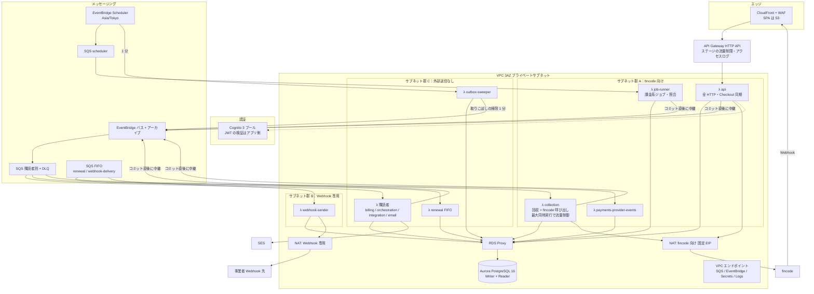

# アーキテクチャレビュー：サーバーレス／イベント駆動への見直しと MiniStack への集約

> **注記（2026-10-12）**：P-ARC-10 により、実行基盤は ECS Fargate に戻した。本書は検討の記録として残す。Fargate でも有効なため残したもの（ローカルの DB は MiniStack の RDS、回収専用キュー `orc-collection`、dev clock の 1 秒キャッシュ、ブレーカーの状態の DB 化、`set_config` の 1 文、ジョブの再開）は P-ARC-11 と設計書 ADR-001・ADR-008 を参照する。

| 項目 | 内容 |
|---|---|
| ステータス | **Superseded**（2026-10-12、P-ARC-10 で実行基盤を Fargate に戻した。当初の決定は §9 の P-ARC-1〜7） |
| 作成日 | 2026-10-12 |
| 作成者 | クラウドアーキテクト（Claude） |
| 対象 | `docs/design/subscription-platform.md` §1.1〜§1.3・ADR-001/004/005/006、`docs/poc/00-poc-charter.md`、`01-contracts-baseline.md`、`02-pdm-decisions.md`、`specs/platform.md`（ほかに orchestration / integration / payments / billing の非同期処理の節） |
| 前提（PdM の新方針） | ① サーバーレス、またはイベント駆動の構成を中心にする ② ローカルでは RDS も含めてすべてコンテナで動かし、MiniStack を使う |
| 変えないもの | 要件の目標値、コンテキストの境界と依存の向き、イベントの一覧、冪等キー `invoice:{invoice_id}:{collection_seq}`、Outbox／Inbox による少なくとも 1 回の配信、Go・モノリポ・Terraform・AWS、10 人以下のチーム |

---

## 1. 結論

- **推奨は「Lambda（Go・arm64）＋ SQS を中心にしたイベント駆動の構成で、DB は Aurora PostgreSQL ＋ RDS Proxy を続ける」**。ECS の常駐プロセスはなくす。ADR-001 の「デプロイ単位はワーカー」は、「デプロイ単位は Lambda 関数（キューごとに 1 つ）」に置き換える。
- 常駐のポーリングループ（Outbox の中継、Webhook・メールの配信、fincode の通知処理）は、**「コミット直後に起こす（キック）＋ 1 分ごとの掃除（スイープ）」**の形に作り直す。こうすると、常駐プロセスがなくても成り立つ。Lambda に**本当に向かない処理はない**。ただし、Webhook の配信だけは作り直しの量が多いので、Fargate に残す選択肢も残しておく（§9 の判断 2）。
- Outbox の中継を論理レプリケーションや DynamoDB Streams に替える案は**採用しない**。業務の書き込みとイベントの記録を 1 つのトランザクションに入れる、という Outbox の前提が崩れるか、常駐の CDC 基盤が必要になるため。
- ローカルでは、**MiniStack の RDS（中で本物の PostgreSQL 16 のコンテナが動く）に寄せる**。開発の速さを保つため、2 つのモードを用意する。普段は「同じハンドラを普通のプロセスとして動かす」モード、CI のスモークでは「MiniStack の Lambda に載せる」モード。testcontainers は今の `postgres:16` のまま使う（MiniStack と同じイメージに揃える）。
- コンテキスト間の契約（01-contracts-baseline）は**変わらない**。変更は `internal/platform`、`cmd/`、Terraform、それと各 spec の「ジョブ・非同期処理」の節に収まる。

---

## 2. 現状の評価

### 2.1 よい点（変えずに残す）

| 観点 | 評価 |
|---|---|
| モジュラーモノリス＋依存ルール | 実行基盤から独立している。Lambda に移っても、そのまま使える |
| Outbox → EventBridge → 購読者ごとの SQS ＋ Inbox | もともとイベント駆動。Lambda の SQS イベントソースと相性がよい |
| `deploy/messaging.yaml` を配線の正本にし、Terraform と Go の両方が読む | 関数の割り当てを足すだけで、Lambda の構成にも使える |
| 冪等性を各層に持たせている（業務キー・部分ユニーク・リース・collection_seq） | Lambda の「少なくとも 1 回の起動」と重複配信に、そのまま耐えられる |
| `SET LOCAL` だけで RLS を設定し、セッション単位の設定をしない | RDS Proxy のピン留めを抑えやすい（§3.4 で 1 点だけ直す） |
| ジョブを `job_runs` で重複排除し、Scheduler → SQS → Runner で動かす | 起動元が Lambda になっても、同じ経路で使える |

### 2.2 問題点（新方針から見て）

| # | 問題 | 影響 |
|---|---|---|
| P1 | 常駐のポーリングループが 5 種類ある（Outbox の中継・Webhook の配信 1 秒・メールの配信 5 秒・fincode の通知処理 2 秒・dev clock の LISTEN） | ADR-001 で Lambda を不採用にした主な理由。**作り直せば常駐は不要**（§3.2） |
| P2 | Webhook のサーキットブレーカー、fincode のレート制限（トークンバケット）が、プロセスのメモリに状態を持っている | 複数台（Lambda なら複数のインスタンス）になると、全体での上限として効かない。今の Fargate 構成でも、台数を増やした時点で同じ問題が出る（integration §8.6 にも記載あり） |
| P3 | fincode への流量を「ワーカーの同時実行数」で制御しているが、`orc-events` には回収以外のイベントも混ざっている | 回収だけの流量を調整できない。キューを分けるべき（§3.3） |
| P4 | `renewal-dispatch` は 10 万件を 1 回の実行で投入する | Lambda の 15 分の上限に近い。Fargate でも、途中で落ちたときに最初からやり直しになる |
| P5 | ローカルの DB が MiniStack の外にある（compose の PostgreSQL） | 新方針②と合わない。ただし、精度（バージョン・権限）の理由は正しいので、MiniStack に寄せるときも同じ精度を守る必要がある |
| P6 | 常に 3〜4 サービス × 複数 AZ が動き続ける | dev / stg でもアイドルのコストがかかる。本番では金額の差は小さい（§3.7） |

---

## 3. 推奨構成

### 3.1 全体の構成図

- 関数はすべて **1 つの Go バイナリ（`bootstrap`）** から作る。関数ごとに環境変数 `SP_HANDLER` で役割を選び、IAM ロール・同時実行数・サブネット・タイムアウトを分ける（§3.2.3）。
- 外向きの経路は、**関数を置くサブネットで分ける**。今の「用途別の NAT」と同じ考え方で、fincode を呼ぶ関数だけが NAT1（固定 IP）を通り、Webhook を送る関数だけが NAT2 を通る。

### 3.2 処理ごとの実行基盤

#### 3.2.1 一覧

| 処理 | 現状 | 推奨 | トリガーと同時実行 | 理由・注意 |
|---|---|---|---|---|
| HTTP API 全般（me / console / tenant / ops / checkout / webhooks/fincode） | Fargate `api` | **Lambda `api`（1 関数）** | API GW HTTP API。予約同時実行 200（DB の接続数の上限に合わせる） | ルーティングは今の `net/http`＋oapi-codegen のまま。API GW のイベントを `http.Request` に変換するアダプターだけを足す |
| 申込（Checkout の同期処理。fincode を 2.5 秒のタイムアウトで呼ぶ） | Fargate `api` | Lambda `api` に含める | 同上。関数のタイムアウトは 29 秒（HTTP API の上限は 30 秒） | p95 3 秒に収まる。コールドスタートは §3.4 |
| 購読者：`billing.payment_events`、`orc-events`、`integration.webhook`、`integration.email` | Fargate のワーカー内の受信ループ | **Lambda（キューごとに 1 関数）＋ SQS イベントソース** | バッチ 10、部分的なバッチ失敗を有効にする。最大同時実行はキューごとに設定（`messaging.yaml` の `concurrency` をそのまま使う） | キューごとに関数を分けるので、バルクヘッドが今より強くなる |
| 回収（`billing.invoice_collection_due` → Payments.Collect → fincode） | `orc-events` の中に混在 | **専用キュー `orc-collection` ＋ Lambda `collection`** | **最大同時実行 = fincode の流量の上限**（例：20。fincode の制限が分かったら決める。未解決 #2） | P3 の解消。ここが、fincode への流量を全体で制御するただ 1 つのつまみになる |
| 更新の投入（`orc-renewal.fifo`） | Fargate `worker-billing` | **Lambda `renewal` ＋ FIFO のイベントソース** | MessageGroupId = subscription_id。最大同時実行 10〜50 | FIFO のまま使う（C-01 は変えない）。部分的なバッチ失敗では、失敗したメッセージより後ろにある同じグループのメッセージも失敗として返す |
| Outbox の中継 | Fargate の常駐ループ（SKIP LOCKED） | **コミット直後の中継（同じ関数の中）＋ Lambda `outbox-sweeper`（1 分ごと）** | sweeper は予約同時実行 1 | §3.2.2。通常の遅延は数十ミリ秒になり、今（ポーリング間隔の分）より短くなる。取りこぼしは 1 分以内に掃除する |
| スケジュールで動くジョブ（renewal-dispatch、billing-collection-due、process-sweeper、bulk-cancellation、resolve_unknown、reconcile_daily、各 GC） | Fargate のワーカー内の Runner | **EventBridge Scheduler → SQS `scheduler` → Lambda `job-runner`** | 予約同時実行 5、タイムアウト 15 分、**1 回の実行は 10 分で区切る** | `job_runs` による重複排除はそのまま。長いジョブは、カーソルを保存して自分を再投入する（§3.2.4） |
| fincode の通知処理（`ProcessProviderEvents`。今は 2 秒ごとのポーリング） | Fargate `worker-billing` | **`/webhooks/fincode` が Inbox に保存した後、SQS `payments-provider-events` に送る → Lambda**。失敗分は 1 分ごとの掃除 | 最大同時実行 5 | ポーリングをなくす。Inbox（`provider_events`）は今のまま |
| 結果がわからない決済の確定（`ResolveUnknownAttempts`） | 1 分ごとのジョブ | job-runner（1 分ごと） | — | fincode を呼ぶので、サブネット群 A に置く |
| Webhook の配信（今は 1 秒ごとのポーリング、送信先ごとの同時送信数の上限） | Fargate `worker-integration` に常駐 | **推奨：配信を作ったコミットの直後に SQS FIFO `webhook-delivery`（MessageGroupId = endpoint_id）に送る → Lambda `webhook-sender`。再送は 1 分ごとの掃除が、時刻を迎えた配信を FIFO に投入する** | 全体の最大同時実行 64。送信先ごとの同時実行は FIFO のグループにより 1 | §3.2.5。作り直しの量が最も多い。代わりの案は Fargate を 1 タスクだけ残すこと（§9 の判断 2） |
| メールの送信（今は 5 秒ごとのポーリング） | Fargate `worker-integration` | `integration.email` の購読者の中で直接送る。失敗分は 1 分ごとの掃除で再送 | 最大同時実行 5（SES の送信レート） | 宛先は今と同じく送信時に解決する |
| 日次照合 | Fargate のジョブ | job-runner | — | 件数が多くなったら、日付とページで区切って再投入する |
| マイグレーション（`cmd/migrate`） | ECS のワンショット実行 | **Lambda `migrate`（VPC 内）を CI から 1 回だけ呼ぶ** | — | 15 分を超えそうな DDL（大きな索引の作成など）は、別の手順（`CREATE INDEX CONCURRENTLY` を段階に分ける）で行う |
| 課金サイクル全体の流れ | Orchestration（プロセスマネージャー） | **変えない**（Step Functions は採用しない） | — | ADR-002 の判断（業務ルールが ASL に漏れ出す、状態遷移の課金が月に数百ドル）は今も正しい |
| EventBridge Pipes | — | **採用しない** | — | SQS → Lambda はイベントソースで十分。Pipes で DynamoDB Streams から読む形は、Outbox を DynamoDB に置くことになり、原子性が崩れる |

#### 3.2.2 Outbox の中継をイベント駆動にする方法

| 案 | 内容 | 判定 | 理由 |
|---|---|---|---|
| A. **コミット直後に中継＋掃除**（推奨） | `outbox.Writer` が、書いた event_id を context に記録する。`InTx` がコミットした後、同じ Lambda の起動の中で `Relay.Flush(ids)` を呼ぶ（`UPDATE … WHERE id = ANY($1) AND published_at IS NULL … FOR UPDATE SKIP LOCKED` → PutEvents）。失敗しても業務は成功のまま。`outbox-sweeper` が 1 分ごとに、今と同じ SQL で残りを送る | ◎ | 常駐が不要。遅延は通常数十ミリ秒。Outbox の原子性と少なくとも 1 回の配信はそのまま。重複は今と同じく Inbox で除く |
| B. 論理レプリケーション（CDC） | `outbox_events` の INSERT を WAL から読み、EventBridge に送る | × | 読む側は常駐が必要（Debezium など）。Aurora のレプリケーションスロットの管理（読む側が止まると WAL が溜まる）が運用の負担になる。RDS Proxy 経由ではつなげない。10 人のチーム・毎秒数十件の規模には重すぎる |
| C. DynamoDB に Outbox を置き、Streams → Pipes | — | × | Aurora の業務の書き込みと、同じトランザクションに入らない（二重書き込みの問題に戻る） |
| D. Aurora からトリガーで Lambda を呼ぶ（`aws_lambda` 拡張） | — | × | コミット前に呼ばれる。同期で呼ぶとトランザクションが長くなり、ロールバックされたイベントも送られてしまう |

- 案 A の注意：API の応答の前に Flush が走るので、応答に数十ミリ秒足される。p95 500ms には十分収まる。Flush をバックグラウンドの goroutine にはしない（応答を返した後、Lambda の実行環境は凍結されるため）。

#### 3.2.3 Go を Lambda で動かす方法

| 項目 | 推奨 | 理由・トレードオフ |
|---|---|---|
| ランタイム | `provided.al2023`、arm64（Graviton）、`CGO_ENABLED=0` の静的バイナリ `bootstrap` を zip にする | `go1.x` ランタイムは廃止済み。arm64 は x86 より約 20% 安い。SnapStart は Go では使えない |
| パッケージ | zip（S3 経由）。コンテナイメージにはしない | zip のほうがコールドスタートが短く、ECR が不要になる |
| 関数の分け方 | **1 つのバイナリ・複数の関数**。`SP_HANDLER=api / consumer:<queue> / job-runner / outbox-sweeper / webhook-sender / migrate` で役割を選ぶ | ビルドと成果物が 1 つで済み、`messaging.yaml` から関数を機械的に作れる。最小権限は IAM ロールで関数ごとに分ける（バイナリを分けても、権限の分離にはならない）。欠点は、全モジュールをリンクするのでバイナリが大きくなること（30〜40MB の見込み）。コールドスタートへの影響は、初期化で組み立てるモジュールを `SP_HANDLER` に必要なものだけにすれば小さい |
| 関数ごとにバイナリを分ける案 | 採用しない | ビルドの時間と成果物の数が増える。モジュールの境界はすでにコンパイラと lint で守っているので、得るものが少ない |
| Lambda 用のライブラリ | `aws-lambda-go`（SQS・API GW のイベント型）。HTTP の変換は自前の薄いアダプター（または `aws-lambda-go-api-proxy/httpadapter`） | Lambda Web Adapter（拡張機能）は、MiniStack での動作が要検証なので最初は使わない |

#### 3.2.4 Lambda の 15 分の上限への対応

| ジョブ | 懸念 | 対応 |
|---|---|---|
| `renewal-dispatch`（10 万件を FIFO に投入） | SendMessageBatch で約 1 万回の呼び出し。最悪 10 分を超える | 今の「500 件ごとにカーソルを保存する」を使い、**実行時間が 10 分を超えたら、同じ run_id とカーソルを scheduler キューに入れ直して終わる**（`scheduler.Run` に継続の仕組みを足す）。途中で落ちても、続きから再開できる（P4 の解消） |
| `bulk-cancellation` | 1 回に最大 1,000 件 | 今のままで足りる（毎分の実行） |
| `reconcile_daily` | 本番の決済件数（最大で 1 日 10 万件） | 同じ継続の仕組みで、ページごとに区切る |
| メッセージの処理 | 1 件に数秒 | 関数のタイムアウトは 60 秒。可視性タイムアウトは関数のタイムアウトの 6 倍（360 秒、AWS の推奨）。処理中に可視性を延長する仕組みは不要になる |

#### 3.2.5 Webhook の配信を Lambda にする場合の設計

| 今の仕様（integration §8.1） | Lambda での実現 | 差 |
|---|---|---|
| 1 秒ごとに `next_attempt_at <= now` を取り出す | 初回：配信を作ったコミットの直後に FIFO に送る。再送：1 分ごとの掃除が、時刻を迎えた配信を FIFO に送る（リース `locked_until` は今のまま使う） | 再送の時刻の精度が「1 秒」から「1 分」になる。バックオフの最短は 1 分なので、要件（FR-022）には影響しない |
| 送信先ごとの同時送信数 4 | FIFO のグループ = endpoint_id なので、送信先ごとに 1 | 1 つの送信先への処理量が下がる。応答が 200ms なら毎秒 5 件で、大きな事業者の課金バッチの日（毎秒 1〜2 件の見込み）にも足りる。足りなければ、グループを `endpoint_id:{0..3}` に分ければ 4 並列にできる |
| サーキットブレーカー（メモリ） | `webhook_endpoints` に `consecutive_failures`・`open_until` を持たせ、DB で判定する | integration §10 の「複数台にしたら DB に移す」を前倒しする |
| 全体の同時送信数 64 | `webhook-sender` の最大同時実行 64 | 同じ |

### 3.3 データストア・メッセージング

| 項目 | 推奨 | 理由・トレードオフ |
|---|---|---|
| DB | **Aurora PostgreSQL 16 を続ける**。本番はプロビジョンド（Graviton、リザーブド）、dev / stg は **Serverless v2（最小 0 ACU）** | 二重課金を防ぐ部分ユニーク・RLS・SKIP LOCKED・スキーマの分離は、PostgreSQL が前提。本番の課金バッチは負荷が読めるので、プロビジョンドのほうが安い。Serverless v2 を本番にも使う案は、スケールの遅れと単価の高さから採用しない（判断を急がない。負荷試験の後に見直してよい） |
| 接続 | **RDS Proxy を必須にする**（今は「接続の多重化」として任意） | Lambda は同時実行の数だけ接続を作るため。関数ごとの予約同時実行 × プールの大きさ（Lambda では `MaxConns=2`）の合計を、Proxy の上限の中に収める |
| Data API | 採用しない | pgx・sqlc・`SET LOCAL` のトランザクションの使い方と合わない。1 リクエストごとに HTTP の往復になり遅い |
| DynamoDB | **採用しない** | Inbox は業務の書き込みと同じトランザクションに入れる必要がある。冪等キーの表を DynamoDB にしても、得るものがない（今も別トランザクション。E15）。ブレーカーの状態も、この規模なら Aurora で足りる |
| EventBridge → SQS | 今のまま | 購読者ごとのキュー・DLQ・アーカイブ |
| FIFO（C-01） | 今のまま。更新の投入に加えて、`webhook-delivery` も FIFO にする（SDK から直接送る。C-01 の考え方と同じ） | EventBridge から FIFO へは送らない、という C-01 の制約を守る |
| 新しいキュー | `orc-collection`（回収専用）、`payments-provider-events`、`webhook-delivery.fifo` | イベントの一覧は変えない。EventBridge のルールで `billing.invoice_collection_due` だけを `orc-collection` に流す |
| DLQ | 全キューに付ける。DLQ の滞留を CloudWatch アラームにする（本番） | 今と同じ |
| スケジューラー | EventBridge Scheduler（Asia/Tokyo）→ SQS `scheduler` → job-runner。outbox-sweeper だけは Scheduler から Lambda を直接呼ぶ | 再試行と DLQ と、dev のジョブ実行の経路を今のまま使える |

### 3.4 Lambda にしたときの論点と対応

| 論点 | 対応 | 要検証 |
|---|---|---|
| Aurora への接続 | RDS Proxy ＋ IAM 認証（パスワードを Secrets Manager から取る形でもよい）。プールは実行環境の初期化で作り、起動をまたいで使い回す | — |
| RLS の `SET LOCAL` と Proxy のピン留め | トランザクションの中の設定は、トランザクションが終われば消えるので、分離の面では安全。ただし `SET` 文はピン留めの条件にあたる。**`SET LOCAL ROLE …` と `SET LOCAL statement_timeout …` を、`SELECT set_config('role', …, true), set_config('statement_timeout', …, true), set_config('app.tenant_id', …, true)` の 1 文にまとめる**（往復も 1 回減る） | `set_config` がピン留めの条件にあたらないこと。pgx の既定（名前付きのプリペアドステートメントのキャッシュ）がピン留めを起こすか。起こすなら `QueryExecModeExec` にする |
| コールドスタート | Go＋arm64＋zip で、初期化は数百ミリ秒の見込み（VPC の ENI は事前に作られるので遅れない）。p95 500ms には、通常の負荷なら影響しない | 本番の負荷で p99 を計測する。足りなければ `api` にだけプロビジョンド同時実行（数個）を付ける |
| 15 分の上限 | §3.2.4 | — |
| SQS の同時実行数の制御 | イベントソースの**最大同時実行（2〜1000）**で、キューごとに上限を決める。関数の予約同時実行は、それより少し大きくする（スロットリングで再試行が増えるのを避ける） | — |
| fincode への流量の制御 | 更新・リトライの回収は `orc-collection` の最大同時実行で全体を制御する。申込（api）からの呼び出しは、利用者の操作の数で決まる。Payments のトークンバケットはインスタンスごとの安全網として残す | fincode のレート制限の値（未解決 #2） |
| 部分的なバッチ失敗 | `ReportBatchItemFailures` を有効にする。共通の `messaging.Dispatch` が、1 件ずつ Inbox のトランザクションで処理し、失敗した ID を返す。`Permanent` は自分で DLQ に送って成功扱いにする。バックオフは今と同じく、失敗を返す前に `ChangeMessageVisibility` で設定する | — |

### 3.5 API の入口

| 案 | 長所 | 短所 | 判定 |
|---|---|---|---|
| **CloudFront（WAF）→ API Gateway HTTP API → Lambda** | 安い（100 万リクエストあたり約 1.3 ドル）。ステージやルートごとの流量制限、アクセスログ、独自ドメイン。将来、ルートごとに関数を分けられる | HTTP API には WAF を直接付けられない（CloudFront に付ける）。CloudFront を通らない直接のアクセスを防ぐため、CloudFront が付ける秘密のヘッダーをアプリで検証する | **推奨** |
| CloudFront → API Gateway REST API | WAF を直接付けられる。使用量プラン | 単価が約 3 倍。機能の多くは今回いらない | 不採用 |
| CloudFront → ALB → Lambda | WAF を直接付けられる。今の構成に近い | 固定費（月 20 ドル以上）がかかる。Lambda のターゲットでは応答の大きさに制限がある | 不採用 |
| CloudFront（OAC）→ Lambda 関数 URL | 最も安く、単純 | 流量制限やアクセスログを自分で作ることになる | 次点 |

- **認証**：JWT の検証は、今のとおりアプリ（`httpx` の `TokenVerifier`）で行う。API Gateway の JWT オーソライザーは使わない。4 種類の主体のうち、API キーと staff のロールは DB が必要で、オーソライザーだけでは完結しない。また、ローカルでも同じコードで検証できる。
- **流量の制限**：IP や事業者ごとの制限は、CloudFront の WAF のレートベースルール（集計キーに `Authorization` や `X-Tenant-Id` を使う）で行う。全体の上限は HTTP API のステージの設定で行う。

### 3.6 ネットワーク

| 項目 | 推奨 | 理由 |
|---|---|---|
| Lambda を VPC に入れるか | **入れる**（DB に触る関数はすべて）。プライベートサブネットに置く | Aurora と RDS Proxy に届くため |
| fincode 向けの固定 IP | サブネット群 A のルートを NAT1（EIP）に向ける。fincode を呼ぶ関数（`api`・`collection`・`job-runner`）だけをここに置く | 今と同じ考え方。本番は 3 つの AZ のうち 2 つに NAT1 を置き、EIP 2 つを fincode に登録する案も、コスト削減の候補になる |
| Webhook 送信専用の経路 | サブネット群 B のルートを NAT2 に向ける。`webhook-sender` だけを置く | SSRF の対策（実際に接続する IP の検査）は、アプリ側で今のまま行う。Lambda には IMDS がないので、メタデータを盗まれる心配は Fargate より小さい |
| 外部に送らない関数 | サブネット群 C。NAT へのルートを持たせない | 外に出られないので、事故の影響範囲が小さくなる |
| AWS サービスへの通信 | SQS・EventBridge・Secrets Manager・CloudWatch Logs・STS のインターフェイス型 VPC エンドポイント | NAT の通信量の課金を減らし、外に出る経路も減らす |
| （将来の選択肢）VPC の外で Webhook を送る | 送信だけを VPC の外の関数で行い、結果を SQS で返す。SSRF で内部に届くことが構造的になくなる | 送信元の IP が固定でなくなる。キューが 1 つ増える。今回は採用しない |

### 3.7 コストの概算の比較（本番・東京リージョン・月額・桁が分かる程度）

前提：API 2,000 万リクエスト／月（平均 80ms・512MB）、メッセージ 1,500 万件／月（平均 150ms・512MB）。有効な契約 100 万件 → 1 日の更新は平均 3.3 万件、最大 10 万件。

| 項目 | 今の Fargate 構成 | 推奨のサーバーレス構成 | 備考 |
|---|---|---|---|
| コンピュート | 約 300 ドル（api 3 タスク・worker-billing 2・worker-integration 2・projection 1（Spot）。1 vCPU／2GB、arm） | 約 40〜100 ドル（Lambda の実行時間と回数。sweeper の毎分の起動を含む） | 負荷が 10 倍になると、Lambda のほうが先に高くなる。損益の分かれ目は、常時の使用率が 30〜40% のあたり |
| 入口 | ALB 約 30 ドル | HTTP API 約 26 ドル | |
| RDS Proxy | 約 100 ドル（設計に含まれている） | 同じ（必須になる） | |
| Aurora | 数百〜1,000 ドル程度 | 同じ | **全体の中で最も大きい** |
| NAT Gateway | 約 270 ドル（2 系統 × 3 AZ）＋ 通信量 | 同じ（VPC エンドポイントで通信量が減る。エンドポイントの固定費は 1 つあたり約 30 ドル） | 2 番目に大きい |
| SQS・EventBridge | 数十ドル | 同じ | |
| **合計（桁）** | **月 2,000 ドル前後** | **月 1,700〜1,900 ドル前後** | **本番の差は小さい** |
| dev / stg（2 環境） | 1 環境あたり数百ドル（常に動く） | 1 環境あたり 100 ドル前後（NAT 1 つ ＋ Aurora Serverless v2 の最小 0 ACU） | **差が出るのはここ** |

**結論：本番のコストは判断の決め手にならない**。効いてくるのは、dev / stg のアイドルのコスト、常駐プロセスの運用（パッチ・台数・デプロイ）がなくなること、キュー単位のスケールとバルクヘッド。

---

## 4. 実装構成への影響

### 4.1 `cmd/`

| 今 | 推奨 | 内容 |
|---|---|---|
| `cmd/api`・`cmd/worker-billing`・`cmd/worker-integration`・`cmd/migrate` | **`cmd/lambda`**（本番の唯一の成果物 `bootstrap`）、**`cmd/devserver`**（ローカル用、`-tags devtools`）、`cmd/migrate`（CLI 兼 Lambda） | プロセスの種類はなくなり、「役割（ハンドラ）」の種類になる |
| 組み立ては各 `cmd/*` の main | **`cmd/internal/wiring`** に移す。`SP_HANDLER` ごとに、必要なモジュールだけを組み立てる関数を持つ | Go の internal の規則で、`cmd/**` からしか import できない。**「`modules/X` を import できるのは `cmd/**` だけ」という依存ルールを変えずに済む** |
| — | `cmd/devserver` は、1 つのプロセスで ① HTTP サーバー ② 全キューのポーラー（MiniStack の SQS を読む）③ 内蔵のスケジューラー ④ outbox-sweeper を動かす。中で呼ぶハンドラは Lambda と同じ | `task dev` はこれ 1 つを起動する。デバッガをそのまま使える |

### 4.2 `internal/platform`

| パッケージ | 変更 |
|---|---|
| `messaging` | 受信ループ（`SQSConsumer`）を 2 つに分ける。① **`Dispatch(ctx, []Message) BatchResult`**（解析・振り分け・Inbox・エラーの分類・FIFO の失敗の後ろを失敗にする処理。実行基盤に依存しない）② 駆動部分：`lambdasqs`（SQS イベント → Dispatch → `SQSEventResponse`）と `sqspoll`（ローカルのロングポーリング → Dispatch）。可視性の延長は Lambda では使わない（ポーラーでは残す） |
| `outbox` | `Relay.Run`（常駐ループ）をやめて、**`Relay.Flush(ctx, ids)`**（コミット直後）と **`Relay.Sweep(ctx, budget)`**（掃除）にする。`db.InTx` にコミット後のフック（`AfterCommit`）を足し、Writer が書いた ID を Flush に渡す |
| `scheduler` | `Runner` はそのまま。`Run` に「継続」（カーソルと期限）を足し、10 分を超えたら同じ run を再投入できるようにする。`SCHEDULER_MODE=internal` は devserver の中で動かす |
| `httpx` | 変更なし。`lambdahttp`（API GW HTTP API の v2 イベント ↔ `http.Request`／`http.ResponseWriter`）を足す。`X-Request-ID` に API GW のリクエスト ID も記録する。CloudFront の秘密ヘッダーの検証ミドルウェアを足す |
| `db` | Lambda 用の設定（`MaxConns=2`、`MinConns=0`、初期化で 1 回だけ作る）。スコープの設定を `set_config` 1 文にまとめる（§3.4）。IAM 認証のトークンの取得（任意） |
| `devclock` | **LISTEN と、プロセスごとの ack をやめる**。各起動・各トランザクションの最初に `platform.dev_clock` を読む（1 秒キャッシュ）。Lambda には「常に動いているプロセス」がないため。`POST /v1/dev/clock` は、すべてのプロセスの適用を待たずにすぐ返せるようになる（単純になる） |
| `observability` | ログは標準出力の JSON（CloudWatch Logs）。本番のトレースは ADOT の Lambda レイヤー、または X-Ray のアクティブトレース |
| 新設 `lambdax` | `SP_HANDLER` の振り分け、初期化の計測、Lambda のコンテキストからの request_id の取り出し |

**モジュール（`modules/*`）への影響**：`module.go` の `Consumers()`・`Jobs()`・`MountHTTP()` という形は変えない。実行基盤の違いは platform のアダプターがすべて吸収するので、**domain・app・contracts は変更なし**。変わるのは次の 3 か所だけ。

| モジュール | 変更 |
|---|---|
| integration | 配信ワーカーを「FIFO の購読者＋掃除のジョブ」にする。ブレーカーの状態を DB に移す。メールは購読者の中で送り、掃除で再送する |
| payments | `/webhooks/fincode` の Inbox 保存の後に、SQS に送る。`ProcessProviderEvents` を購読者＋掃除にする |
| orchestration | `renewal-dispatch` を継続の仕組みに乗せる。`invoice_collection_due` の購読を `orc-collection` キューに移す |

### 4.3 `deploy/messaging.yaml`・Terraform のモジュール

| 項目 | 変更 |
|---|---|
| `messaging.yaml` | `process:` を **`function:`** に置き換える。`concurrency` は「イベントソースの最大同時実行」の意味になる。`batch_size`・`function_timeout_s` を足す。可視性タイムアウトは、関数のタイムアウトの 6 倍を既定にする |
| 新設 `deploy/functions.yaml` | 関数ごとの `handler`・メモリ・タイムアウト・予約同時実行・サブネット群（A / B / C）・IAM の許可（キュー・バス・シークレット）。Terraform がこれを `yamldecode` で読む |
| `infra/modules/compute`（ECS・ALB） | **廃止**し、`infra/modules/functions`（Lambda、イベントソース、IAM ロール、ロググループ）と `infra/modules/api`（HTTP API、ステージ、独自ドメイン）に置き換える |
| `infra/modules/data` | Aurora、RDS Proxy（必須にする）、KMS。変数 `engine_mode` で、プロビジョンドと Serverless v2 を切り替える。**ローカルでも同じモジュールで RDS を作る**（§5） |
| `infra/modules/network` | サブネット群を 3 つ（A：fincode、B：Webhook、C：外部なし）に分ける。VPC エンドポイント |
| `infra/modules/messaging` | 今のまま（新しいキューは YAML に足すだけ） |
| アプリのデプロイ | ECS の CodeDeploy（Blue/Green）をやめ、**Lambda のバージョンとエイリアス**にする。`api` だけ CodeDeploy のカナリア（10% を 5 分）にする。Terraform はコードのハッシュの差分を無視し（`ignore_changes`）、CI が `bootstrap.zip` を S3 に置いて関数を更新する |

### 4.4 テストへの影響

| レベル | 変更 |
|---|---|
| unit | 変更はほとんどない。`lambdasqs`・`lambdahttp` のアダプターは、イベントの JSON の固定データで検証する（Docker 不要） |
| integration | Relay のテスト（AC-PLT-019・020）を Flush・Sweep に合わせて書き換える。受信ループのテスト（AC-PLT-022・023）は `Dispatch`＋`sqspoll` で行う。可視性の延長のテスト（AC-PLT-023）は Lambda では対象外にし、関数のタイムアウトと可視性タイムアウトの関係を設定の検査（Terraform の plan の検査、または YAML の検証）で確かめる。`testcontainers`（`postgres:16`）は今のまま |
| e2e | **既定は devserver のモード**で、今の受け入れシナリオ（E2E-001〜022）をすべて回す。加えて、**MiniStack の Lambda モード**でスモーク（E2E-001・007・014 の 3 本程度）を CI で回し、パッケージ・イベントソース・IAM の配線を確かめる |
| dev clock | 単純になる（§4.2）。AC-PLT-039 の「全プロセスの適用を待つ」は、「次の起動から新しい時刻が使われる」に変える |
| ジョブの手動実行 | `POST /v1/dev/jobs/{job}/run` は今と同じく scheduler キューに入れる。devserver では内蔵の Runner が、Lambda モードでは `job-runner` が処理する |
| 流量の計測（D-07、E2E-020） | devserver では、Lambda の同時実行を再現できない。1 万件の計測は MiniStack の Lambda モードで行うか、dev 環境（本物の AWS）で行う |

---

## 5. ローカル環境（MiniStack に寄せる）

### 5.1 構成

| 要素 | 内容 |
|---|---|
| compose.yaml | **`ministack` だけ**（タグを固定）。Docker のソケットをマウントし、`DOCKER_NETWORK`（compose のネットワーク名）、`RDS_PERSIST=1`、`PERSIST_STATE=1` を設定する。メールを見たいときだけ `mailhog` を足す（`SMTP_HOST`） |
| infra/envs/local | 本番と同じ `data` モジュールで **`aws_db_instance`（engine `postgres`、engine_version `16.x`）** を作る（Aurora のクラスタの形は、ローカルでは使わない）。返ってきた `host:port` を `DATABASE_URL` にする（出力を `.env.local` に書き出す）。RDS Proxy・VPC・NAT は、変数で作らない |
| 2 つのモード | `LOCAL_PROFILE=fast`（既定）：Lambda とイベントソースを作らない。`cmd/devserver` が同じハンドラを動かす。`LOCAL_PROFILE=lambda`：`functions` モジュールで、MiniStack に Lambda（`provided.al2023`、Docker RIE）とイベントソースを作る |
| `task up` | ① `docker compose up -d --wait` ② `terraform apply`（RDS → MiniStack が PostgreSQL のコンテナを起動 → キュー・バス・スケジュール）③ `cmd/migrate bootstrap && up` ④ `task verify:local` |
| マイグレーションの権限 | MiniStack の RDS のマスターユーザーは、コンテナの中では本物のスーパーユーザーになる見込み（要検証）。本番の `rds_superuser` との差で、権限の誤りを見逃さないように、**`bootstrap` を、`rds_superuser` 相当の権限に絞ったロールで実行する**（ローカルだけの準備用スクリプトで作る） |
| testcontainers | 今のまま `postgres:16` を直接起動する。**MiniStack の RDS が使うイメージと同じタグ（できればダイジェスト）に揃える**。テストを MiniStack の RDS 経由にしないのは、テンプレート DB を使った並列化と、起動の速さを保つため |
| フォールバック | MiniStack の RDS が要件を満たさないときは、`DB_MODE=container` で compose の `postgres` サービス（profile）に戻す。Terraform は変数 `rds_enabled=false` |

### 5.2 PostgreSQL の機能が使えるか

MiniStack の RDS は、中で本物の PostgreSQL のコンテナを起動する（公開情報による）。したがって、PostgreSQL そのものの機能はそのまま使えるはず。確かめるべきなのは「バージョン」と「設定」と「権限」。

| 機能 | 見込み | 確かめ方 |
|---|---|---|
| RLS（ENABLE・FORCE・ポリシー） | ○ PostgreSQL の機能 | AC-PLT-015・017 を MiniStack の RDS に対して流す |
| 部分ユニーク・`SKIP LOCKED` | ○ | AC-PAY-011・012、AC-PLT-019 |
| `GRANT … WITH INHERIT FALSE, SET TRUE`（platform §6.1） | **PostgreSQL 16 以上が必要** | **要検証：`engine_version` で 16 のイメージが選ばれるか**。選ばれなければフォールバック |
| `BYPASSRLS` のロールの作成 | ローカルはスーパーユーザーなので作れる。本番の RDS／Aurora では `rds_superuser` が作れるかを確かめる必要がある | **要検証（dev 環境）** |
| 論理レプリケーション | 推奨案では使わない。使う場合は `wal_level=logical` が必要 | 要検証：パラメータグループが、コンテナの起動パラメータに反映されるか |
| Aurora 固有の動き（リーダーの読み取り専用、フェイルオーバー） | × 再現されない（公開情報で、リーダーは読み取り専用にならないと明記されている） | dev 環境で確かめる |

### 5.3 MiniStack で再現できない、または精度が怪しいもの

公開情報（PyPI の ministack 1.4.10 の説明）にもとづく。プロジェクト自身の説明しか情報がないので、**すべて `task verify:ministack` で最初に確かめる**。

| サービス・機能 | 公開情報 | 判定 | 代わりの方法 |
|---|---|---|---|
| RDS（PostgreSQL） | 本物のコンテナを起動し、`host:port` を返す。Aurora のクラスタは 1 つのコンテナを共有 | ○（バージョンは要検証） | `DB_MODE=container` |
| RDS Proxy | 記載なし | × とみなす | ローカルは直接つなぐ（アプリから見て違いはない）。ピン留めの確認は dev 環境 |
| Lambda `provided.al2023` | Docker RIE で Go が動く | ○ | `LOCAL_PROFILE=fast` |
| Lambda の arm64 | 記載なし | **要検証**（Apple Silicon では arm64 のほうが自然だが、RIE のイメージのアーキテクチャ次第） | ローカルだけ x86 でビルドする |
| SQS のイベントソース | SQS・Kinesis・DynamoDB Streams に対応 | ○ | — |
| 部分的なバッチ失敗（`ReportBatchItemFailures`）、最大同時実行（`ScalingConfig`）、FIFO の順序 | 記載なし | **要検証** | devserver の `sqspoll` で同じ `Dispatch` を検証し、本物の動きは dev 環境で確かめる |
| Lambda の VPC 設定 | 記載なし | 無視される見込み | 経路の分離（NAT）は dev 環境で確かめる |
| EventBridge のルール → SQS | 対応（ルール・ターゲット・アーカイブ・再生） | ○（`prefix` の絞り込みは要検証） | `MESSAGING_MODE=direct`（今のまま） |
| EventBridge Scheduler | `cron()`・`at()` に対応し、実際にターゲットを呼ぶ | ○（タイムゾーン `Asia/Tokyo` は要検証） | `SCHEDULER_MODE=internal`。dev clock とは連動しないので、E2E は `/v1/dev/jobs` を使う（今のまま） |
| API Gateway HTTP API | Lambda プロキシ、JWT オーソライザー | ○（本構成ではオーソライザーを使わない） | `fast` では devserver が直接 HTTP を受ける |
| Cognito | JWT は「構造として正しいスタブ」 | △ | `AUTH_MODE=dev`（今のまま） |
| SES | メモリに保存。`SMTP_HOST` で外に送れる | ○ | `MAIL_MODE=log` |
| IAM | 権限の強制は記載なし | × とみなす | dev 環境の結合テスト（未解決 #9 のとおり） |
| EventBridge Pipes | リージョン分離の対象として名前があるだけ | 使わない | — |

---

## 6. Well-Architected の再評価

| 柱 | 変更前（ECS Fargate の常駐 3〜4 サービス） | 変更後（Lambda＋SQS） | 差分の評価 |
|---|---|---|---|
| 運用上の優秀性 | サービス数が少なく、見通しがよい。コンテナのパッチ・台数・Blue/Green の運用が必要 | OS とランタイムの管理が不要。関数とキューの数は 10 前後に増える。`messaging.yaml`・`functions.yaml` から Terraform で機械的に作るので、ずれは起きにくい。ローカルの開発ループは devserver で今と同じ速さ | ＋。関数ごとのダッシュボードと DLQ のアラームが必須になる |
| セキュリティ | タスクロールはサービス単位（worker-billing は課金系のすべての権限を持つ） | **IAM ロールが関数単位**になり、最小権限が細かくなる。外に出られない関数（サブネット群 C）ができる。IMDS がない。WAF は CloudFront に付ける。HTTP API への直接アクセスを秘密ヘッダーで防ぐ必要がある | ＋。秘密ヘッダーの管理（ローテーション）が増える |
| 信頼性 | Multi-AZ の ECS と Aurora。常駐プロセスが落ちると、その間 Outbox・配信が止まる（台数で冗長化） | Lambda・SQS・API GW は、もともと複数の AZ で動く。常駐の単一障害点がなくなる。キューごとの関数でバルクヘッドが強くなる。Outbox は「コミット直後＋掃除」で二重に送る | ＋。新しいリスクは、Lambda の同時実行の上限（アカウント全体）と、RDS Proxy の接続数。予約同時実行で抑える |
| パフォーマンス効率 | 台数の自動スケールに数分かかる。fincode への流量は、ワーカーの同時実行数で制御（回収以外も混ざる） | キューの深さに応じて数秒でスケールする。**回収専用のキューの最大同時実行で、fincode への流量を全体で正確に制御できる**。コールドスタートで p99 が伸びる可能性がある | ＋（流量の制御）／−（p99）。p99 はプロビジョンド同時実行で補える |
| コスト最適化 | 本番は Savings Plans で安くできる。dev / stg も常に動く | 本番はほぼ同じ（§3.7）。dev / stg は Aurora Serverless v2 の最小 0 ACU と合わせて、アイドルがほぼ 0 になる | ＋（dev / stg）／±（本番） |
| 持続可能性 | 常に動くコンテナ | 使ったときだけ動く。Graviton は続ける | ＋ |

---

## 7. 設計書・PoC 文書への変更提案

### 7.1 設計書（`docs/design/subscription-platform.md`）

| 節 | 変更内容 |
|---|---|
| §1 設計概要（1 つ目の箇条） | 「4 つのサービス（ECS）でデプロイ」→「1 つのバイナリから作る Lambda 関数（キューごとに 1 つ）と、API Gateway HTTP API でデプロイ（ADR-007）」 |
| §1.1 AWS 全体構成 | 本書 §3.1 の図に置き換える。「ネットワーク」の箇条に、サブネット群 A / B / C と VPC エンドポイントを書く |
| §1.2 モノリポ構成 | `cmd/` を `lambda`・`devserver`・`migrate`・`internal/wiring` に変える。`internal/platform` の `outbox`・`messaging`・`scheduler`・`devclock` の説明を、本書 §4.2 に合わせる。「主なライブラリ」に `aws-lambda-go` を足し、「コンテナ」の行を「`bootstrap` の zip（provided.al2023・arm64）」に変える。ADOT はサイドカーから Lambda レイヤーに変える |
| §1.2 依存ルール | 「`modules/X` を import できるのは `cmd/**` だけ」はそのまま（`cmd/internal/wiring` に置くため）。表に注記を 1 行足す |
| §1.2 インフラ（Terraform） | `compute` を `functions`・`api` に置き換える。`data` に `engine_mode` と RDS Proxy（必須）。CI/CD の「ECS は CodeDeploy で Blue/Green」→「Lambda のエイリアスと CodeDeploy のカナリア（api）」 |
| §1.2 ローカル開発（MiniStack） | 図と説明を、本書 §5 に置き換える（DB は MiniStack の RDS、2 つのモード、testcontainers は同じイメージ） |
| §1.3 Well-Architected | 本書 §6 の「変更後」を反映する（Fargate Spot・Savings Plans の記述は削除し、Lambda の予約同時実行・プロビジョンド同時実行・関数単位の IAM を書く） |
| §6.2 更新課金のシーケンス | 参加者 `worker-billing` を「λ renewal／λ collection」に変える。「ワーカーの同時実行数で流量を制御」→「`orc-collection` の最大同時実行で制御」 |
| §6.3 Webhook の配信 | 「配信ワーカー（ループ）」を「掃除のジョブ → FIFO（group = endpoint_id）→ λ webhook-sender」に変える |
| §7 ADR | ADR-001 を **Superseded by ADR-007** にする。ADR-004・ADR-005 に追記する（下表） |
| §8 トレーサビリティ | NFR-001（「ワーカーの同時実行数」→「回収キューの最大同時実行」）、NFR-002（「ALB/ECS の自動スケール」→「API GW＋Lambda、必要ならプロビジョンド同時実行」）、NFR-005（「キューごとの関数でバルクヘッド」） |
| §9 未解決事項 | #9 を「MiniStack の RDS のバージョン指定・Lambda の arm64・イベントソースの部分的なバッチ失敗と最大同時実行・Scheduler のタイムゾーン」まで広げる。新しく #10「RDS Proxy のピン留め（`set_config`・pgx のプリペアドステートメント）」、#11「`rds_superuser` で `BYPASSRLS` のロールを作れるか」を足す |

### 7.2 ADR の追加・置き換え案

| ADR | 種別 | 要旨 |
|---|---|---|
| **ADR-007：実行基盤を Lambda 中心のイベント駆動にする** | 新規（ADR-001 を置き換える。モジュラーモノリスの部分は ADR-001 から引き継ぐ） | 決定：1 つの Go バイナリ（provided.al2023・arm64）から、役割ごとの Lambda 関数を作る。入口は CloudFront＋WAF → HTTP API。購読者はキューごとの関数と SQS のイベントソース。常駐のループは「キック＋掃除」に作り直す。代替案：ECS Fargate（今の構成。本番のコストは同等、dev / stg のアイドルと常駐の運用で劣る）、Fargate との併用（Webhook の配信だけ残す。§9 の判断 2 で B を選んだ場合はこちら）、Step Functions（ADR-002 の理由で不採用）。トレードオフ：関数の数が増える、コールドスタート、15 分の上限への対応（ジョブの継続）、同時実行と DB の接続数の管理 |
| ADR-004 | 追記 | 「中継ワーカー」→「コミット直後の中継（`Relay.Flush`）と、1 分ごとの掃除（`Relay.Sweep`）」。論理レプリケーション・DynamoDB Streams・Pipes を代替案として記録し、不採用の理由を書く |
| ADR-005 | 追記 | RDS Proxy を必須にする。スコープの設定を `set_config` の 1 文にする。dev / stg は Serverless v2（最小 0 ACU）。DynamoDB を部分的に使う案は不採用（Inbox の原子性） |
| **ADR-008：ローカル環境は MiniStack に寄せる（RDS を含む）** | 新規（ADR-006 の「ローカル開発」の部分を詳しくする） | 決定：DB も MiniStack の RDS で作り、本番と同じ `data` モジュールを使う。普段は devserver のモード、CI のスモークは MiniStack の Lambda のモード。testcontainers は同じイメージ。フォールバックは `DB_MODE=container`。トレードオフ：MiniStack のバージョン指定と権限の再現が要検証、Docker ソケットのマウントが必要 |

### 7.3 PoC 文書

| 文書・節 | 変更内容 |
|---|---|
| `00-poc-charter.md` §3 | **C-05** を足す：実行基盤を Lambda 中心に変える（ADR-007）。PoC では、ローカルの devserver のモードを完了条件にし、MiniStack の Lambda のモードはスモーク 3 本だけにする。**C-06** を足す：ローカルの DB は MiniStack の RDS（ADR-008） |
| `00-poc-charter.md` §4「インフラ」の行 | 「`compose.yaml` と `infra/envs/local`（Terraform → MiniStack。RDS と、任意で Lambda を含む）」 |
| `01-contracts-baseline.md` | **変更なし**（契約・イベント・冪等キーに影響しない）。§5 にも追記しない |
| `02-pdm-decisions.md` | 本書 §9 の決定を、P-ARC-1〜5 として記録する |
| `specs/platform.md` | §2（用語：トポロジーの `process` → `function`）、§3.2（messaging・outbox・scheduler・devclock・db）、§4（`Relay.Run` → `Flush`／`Sweep`、`SQSConsumer` → `Dispatch`＋駆動部分、`db` の `AfterCommit`、`Run` の継続）、§5（FIFO の部分的な失敗の扱い）、§8.1（YAML の項目）、§8.2（プロセスの表 → 関数の表）、§8.4（compose・envs/local・2 つのモード・MiniStack の確認項目）、§8.5（`DB_MAX_CONNS`、`SP_HANDLER`、`LOCAL_PROFILE`、`DB_MODE`）、§9（E9・E10 を Lambda の前提に直す）、§10（RDS Proxy を必須に）、§10.2・§11（AC-PLT-019・020・022・023・039・046・047 を直し、Lambda のアダプターの AC を足す） |
| `specs/orchestration.md` | §4.2（`renewal-dispatch` の継続）、§8 のキューの表に `orc-collection` を足し、`invoice_collection_due` の購読をそちらに移す。§11b の E2E-020 の計測環境 |
| `specs/integration.md` | §5.2 の手順 5（コミット直後に FIFO へ送る）、§8.1（配信ワーカー → FIFO＋掃除。送信先ごとの同時実行は 1）、§8.3（メールは購読者の中で送り、掃除で再送）、§8.6（ブレーカーを DB に移す）、§6 に `webhook_endpoints` のブレーカーの列を足す |
| `specs/payments.md` | §4.4（トークンバケットはインスタンスごとの安全網。全体の制御は回収キューの最大同時実行）、§7.9（Inbox に保存した後に SQS へ送る）、§8.2（ポーリング → 購読者＋掃除） |
| `specs/billing.md` | §8 の `billing-collection-due` は変更なし（実行するのが job-runner になるだけ）。記述の注記のみ |

---

## 8. リスクと要検証の点

| # | 内容 | 影響 | 確かめ方・時期 | 外れたときの代わり |
|---|---|---|---|---|
| R1 | MiniStack の RDS で `engine_version` 16 が選ばれるか（`WITH INHERIT FALSE` に PostgreSQL 16 が必要） | 高 | `task verify:ministack`、PoC の最初の週 | `DB_MODE=container`（今の構成に戻す） |
| R2 | RDS Proxy のピン留め（`set_config`、pgx のプリペアドステートメント） | 中（接続の多重化が効かず、接続数が増える） | dev 環境で `DatabaseConnectionsCurrentlySessionPinned` を見る | pgx を `QueryExecModeExec` にする。Lambda の予約同時実行を下げる |
| R3 | MiniStack の Lambda のイベントソース：部分的なバッチ失敗・最大同時実行・FIFO の順序 | 中（ローカルの Lambda モードでの再現度） | スモーク | devserver の `Dispatch` で振る舞いを検証し、本物は dev 環境で確かめる |
| R4 | MiniStack の Lambda の arm64（Apple Silicon） | 低 | スモーク | ローカルだけ x86 でビルド |
| R5 | Scheduler のタイムゾーン（`Asia/Tokyo`） | 低 | スモーク | `SCHEDULER_MODE=internal` |
| R6 | コールドスタートによる API の p99 の悪化（NFR-002 は p95 500ms） | 中 | dev 環境で負荷をかけて計測する | `api` にプロビジョンド同時実行（数個。月数十ドル） |
| R7 | Lambda の同時実行が増えたときの、Aurora の接続数 | 高 | 関数ごとの予約同時実行の合計 × 2 ≦ Proxy の上限、を CI で検査する | 予約同時実行を下げる |
| R8 | fincode のレート制限が分からない（未解決 #2） | 中 | 実装開始前 | `orc-collection` の最大同時実行を低め（10）から始める |
| R9 | Webhook の配信を FIFO にしたときの、送信先ごとの処理量 | 低 | 負荷試験 | グループを `endpoint_id:{0..3}` に分ける、または Fargate に残す（§9 の判断 2） |
| R10 | `rds_superuser` で `BYPASSRLS` のロールを作れるか | 中（platform §6.1 のロール設計） | dev 環境 | Aurora のマスターユーザーで作る手順を `bootstrap` に用意する |
| R11 | 確定済み（Fixed）の spec を直す手間 | 中 | — | 影響は platform と integration の非同期処理の節に集中する。契約（baseline）は変わらない |
| R12 | MiniStack は新しいプロジェクトで、公開情報はプロジェクト自身の説明だけ | 中 | 最初にバージョンを固定し、`task verify:ministack` を CI で毎回流す | 再現できない機能は、今あるフォールバック（direct・internal・dev）に戻す |

---

## 9. PdM に判断してほしいこと（→ 決定済み）

| # | 論点 | 選択肢 | アーキテクトの推奨 | **決定（2026-10-12）** |
|---|---|---|---|---|
| 判断 1 | 実行基盤 | **A. Lambda 中心**（本書の構成）／B. API と購読者は Lambda、常駐ループ（Outbox の中継・Webhook の配信）は Fargate を 1 つだけ残す／C. 今の ECS Fargate のまま | **A**。常駐ループは「キック＋掃除」で作り直せる。本番のコストは同等で、dev / stg のアイドル・関数単位の IAM・回収の流量の制御で A が勝る | **A（P-ARC-1）** |
| 判断 2 | Webhook の配信 | **A. SQS FIFO（group = endpoint_id）＋ 1 分の掃除＋ブレーカーを DB に**／B. Fargate の常駐ワーカーを 1 タスクだけ残す（integration §8.1 をそのまま使う） | **A**。ただし、integration の spec の手直しが最も大きい部分。PoC の日程を優先するなら B でもよい（判断 1 は B 扱いになる） | **A（P-ARC-2）**。ブレーカーの状態は webhook_endpoints に持つ |
| 判断 3 | Outbox の中継 | **A. コミット直後の中継＋ 1 分の掃除**／B. 常駐の中継（Fargate）／C. 論理レプリケーション（CDC） | **A**。B は常駐が残る。C は Outbox の原子性は保てるが、常駐の CDC とスロットの運用が重い | **A（P-ARC-3）** |
| 判断 4 | API の入口 | **A. CloudFront＋WAF → HTTP API**／B. ALB／C. Lambda 関数 URL＋OAC | **A**。JWT の検証はアプリで続ける（オーソライザーは使わない） | **A（P-ARC-4）** |
| 判断 5 | ローカル環境 | **A. MiniStack の RDS ＋ 2 つのモード（普段は devserver、CI のスモークは MiniStack の Lambda）**／B. 常に MiniStack の Lambda で動かす／C. DB は今のまま compose の PostgreSQL | **A**。B は開発のたびにビルドとデプロイが必要で、デバッガも使いにくい。C は方針②と合わない。ただし R1 が外れたら C に戻す | **A（P-ARC-5）**。PostgreSQL 16 が選べなければ `DB_MODE=container` |
| 判断 6 | 反映の時期 | **A. 今すぐ PoC に反映する**（コードはまだないので、spec の手直しだけで済む）／B. PoC は今の構成で作り、本番の設計だけ変える | **A**。後から変えると、platform の受信ループ・Relay・devclock を作り直すことになる。PoC の目的（中核の業務の検証）には影響しない | **A（P-ARC-6）** |
| 追加 | 回収専用のキュー（§3.2.1・§3.3） | — | `orc-collection` を新設 | **採用（P-ARC-7）**。`billing.invoice_collection_due` の購読をこのキューに移し、最大同時実行で fincode への流量を全体で制御する |

**決定を受けた作業の状況（2026-10-12）**：① 設計書に ADR-007・008 を追加し、ADR-001 を Superseded にした（ADR-004・005 に追記。§1・§1.1・§1.2・§1.3・§6.2・§6.3・§8・§9 を改訂）**済み** ② 憲章に C-05・C-06 を追加 **済み**（PdM） ③ 各 spec の手直しは各 TL に依頼済み ④ `task verify:ministack` による R1・R3〜R5 の確認は PoC の最初の週（設計書の未解決事項 #9）。

**当初の作業案（判断 6 が A の場合）**：① 設計書に ADR-007・008 を足し、ADR-001 を置き換える ② 憲章に C-05・C-06 を足す ③ TL-Platform が platform.md を、TL-Integration が integration.md §5.2・§8 を、TL-Payments と TL-Orchestration が該当の節を直す ④ PoC の最初の週に `task verify:ministack` で R1・R3〜R5 を確かめ、結果を未解決 #9 に記録する。

---

## 参考（MiniStack の公開情報）

- [PyPI: ministack 1.4.10](https://pypi.org/project/ministack/1.4.10/)（サービス一覧、RDS が本物の PostgreSQL・MySQL のコンテナを起動すること、Lambda の `provided.al2023`（Docker RIE）、イベントソース、Scheduler、API Gateway v2、制限事項）
- Docker Hub：`ministackorg/ministack`（Docker のソケットのマウントが必要）
- 上の情報はすべてプロジェクト自身の説明で、本書では検証していない。

## 変更履歴

| 日付 | 変更内容 | 変更者 |
|---|---|---|
| 2026-10-12 | 初版（Draft） | クラウドアーキテクト（Claude） |
| 2026-10-12 | §9 に PdM の決定（P-ARC-1〜7。すべて案 A）を記入し、ステータスを Decided に変更。設計書の改訂を反映 | クラウドアーキテクト（Claude） |
| 2026-10-12 | P-ARC-10 により実行基盤を Fargate に戻したことを冒頭に注記し、ステータスを Superseded に変更（本書は検討の記録として残す） | クラウドアーキテクト（Claude） |
