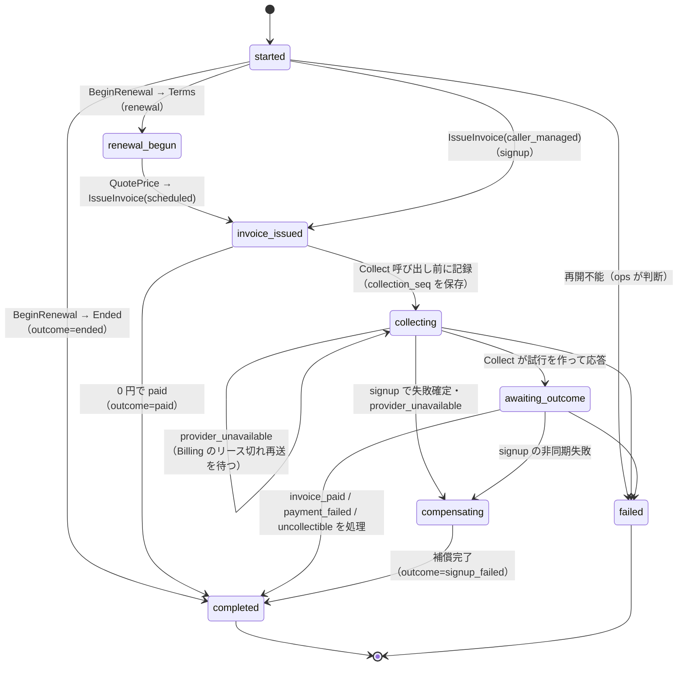
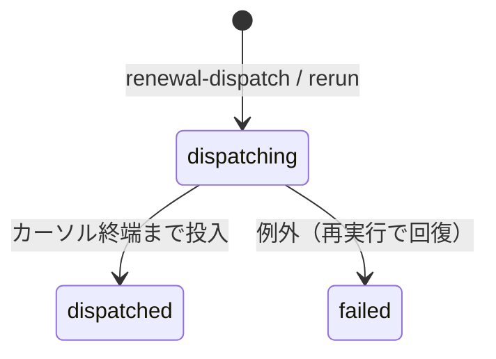
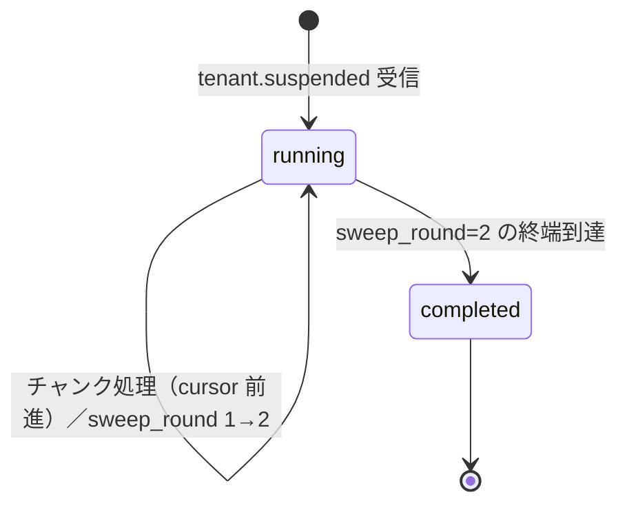

# 詳細要件: Orchestration（調停役）と PoC の E2E 受け入れシナリオ

| 項目 | 内容 |
|---|---|
| ステータス | **Fixed**（2026-10-13 PdM 承認。テスト戦略：Playwright の E2E が中心） |
| 担当 | TL-Orchestration |
| 作成日 | 2026-10-12 |
| 上位文書 | `docs/poc/00-poc-charter.md`（最優先。C-05 改訂版）、`docs/poc/02-pdm-decisions.md`（決定ログ。P-ARC-10・11）、`docs/poc/01-contracts-baseline.md`（§5 改訂 v1.1 を含む）、`docs/design/subscription-platform.md`（ADR-002、§6.1・6.2）、`docs/requirements/subscription-platform.md` |
| 対象モジュール | `modules/orchestration` |

---

## 1. 概要と PoC の範囲

Orchestration は課金サイクルの**順番だけ**を持つプロセスマネージャー（ADR-002）。業務ルール（状態遷移・金額・リトライ間隔・回収要求の連番）は各集約に置き、Orchestration は contracts を呼ぶ順番・補償・冪等性・再開に責任を持つ。

| 対象要件 | 本書での扱い |
|---|---|
| FR-013, FR-014, FR-005 | Checkout（申込）ユースケース |
| FR-017, FR-012 | 支払方法の変更 → 即時再決済、支払方法の削除 |
| FR-016（支払い遅延中の解約）, D-03 | 請求の無効化の連携（§4.6、P-ORC-1） |
| FR-019, FR-020, FR-021 | 更新処理・回収・自動解約・再実行 |
| FR-024 | 結果不明の決済が確定したあとの反映（照合そのものは Payments） |
| FR-026, D-01 | 事業者の停止に伴う一括解約 |
| FR-011, D-05 | 退会 |
| NFR-006, NFR-014 | 二重課金の防止、課金バッチの再実行 |
| 憲章 §5 | PoC 全体の E2E 受け入れシナリオ（§11b） |

| 作るもの | 作らないもの |
|---|---|
| Checkout / 支払方法の変更・削除 / 退会 の各ユースケースと API | 画面（申込ページ HTML は Platform／Payments の範囲） |
| BillingCycleProcess（状態の記録・停止検知・再開） | Step Functions 等のワークフローエンジン |
| CheckoutSaga（申込の途中経過。P-PLT-1） | HTTP の冪等キーの保存と再生（`platform.idempotency_keys`。Platform の担当） |
| BillingRun（日次の投入記録）と再実行 API | 課金バッチの進み具合ダッシュボード（GET API のみ） |
| BulkCancellationJob と照会 API | 一括解約の取り消し・一時停止 |
| イベント購読ハンドラ（標準 SQS、C-01） | Orchestration 独自のドメインイベント発行（拡張口として outbox は用意のみ） |
| ジョブ：`renewal-dispatch`、`process-sweeper`、`bulk-cancellation`、`checkout-saga-gc`（Scheduler → SQS `scheduler` → worker-billing で動くスケジュールジョブ。P-ARC-11） | トライアル終了予告のジョブ（Subscription の担当。P-ORC-3） |
| worker-billing（ECS Fargate の常駐プロセス）が受信するキューのハンドラ：`orc-events`、`orc-collection`、`orc-renewal.fifo`、`scheduler`（ADR-001、P-ARC-10） | 独自のプロセス・デプロイ単位（Orchestration は worker-billing と api に組み込まれる） |

---

## 2. 用語

| 用語 | 意味 |
|---|---|
| プロセス | 1 つの請求に対する回収の試みを追う記録（BillingCycleProcess）。種類は signup / renewal / retry / recovery |
| 課金日（run_date） | 更新処理の対象日（JST の暦日）。`renewal-dispatch` の引数 |
| BillingRun | 1 つの課金日に対する投入の実行記録。定時実行と再実行（rerun）で別の行になる |
| collection_seq | Billing が払い出す回収要求の連番（P-X-1）。定時の試行・即時の再決済・ops の再決済のすべてで増え、リース切れの再送では同じ値。`billing.invoice_collection_due` の payload で届く。caller_managed の初回請求は 1 |
| 回収キー | `Collect` に渡す idempotency_key。**`invoice:{invoice_id}:{collection_seq}`**（P-X-3）。同じ回収要求の再送・再試行は同じキーになる |
| リース | Billing が回収要求を出してから結果が届くまで、同じ請求に新しい要求を出さない期限（既定 6 時間、ローカルは短縮可）。切れたら同じ collection_seq で再送する |
| CheckoutSaga | Checkout の途中経過（作った ID と進んだ段階）。`orchestration.checkout_sagas` に持つ |
| open（開いた契約） | pending_initial / trialing / active / past_due（P-SUB-3）。退会の判定・支払方法の使用中判定・一括解約の対象に使う |
| 実行基盤 | ECS Fargate のモジュラーモノリス（ADR-001、P-ARC-10）。`cmd/` は api・worker-billing・worker-integration・migrate。Orchestration のハンドラは worker-billing の SQS 受信ループ（キューごとに受信の同時実行数を設定）で動き、Checkout などの API は api で動く。スケジュールジョブは EventBridge Scheduler → SQS `scheduler` → worker-billing の Runner |
| 削除 / 再配信 | 削除 = 処理に成功したメッセージを SQS から消す（DeleteMessage）。再配信 = メッセージを**消さずに残し**、可視性タイムアウトが切れたら SQS が再び配る。**「60 秒後に再配信」**は、`ChangeMessageVisibility(60 秒)` を呼んでから消さずに残すことを指す |
| カーソルからの再開 | 長いジョブ（renewal-dispatch など）が、チャンクごとにカーソルを DB に保存しておき、プロセスが落ちても続きから再開できる仕組み（P-ARC-11 ⑥。時間で区切ることはしない） |
| 不整合アラート | 起こってはいけない、または運用対応が要る組み合わせ（解約済みの契約の請求が支払われた等）。構造化ログ `level=ERROR, alert=true` で出す |

---

## 3. モデル

### 3.1 BillingCycleProcess

| 項目 | 内容 |
|---|---|
| 粒度 | 1 プロセス = 1 つの請求に対する回収の試み（renewal は請求の作成前から始まる）。結果（paid / payment_failed / uncollectible）を契約に反映したら閉じる |
| 不変条件 1 | 1 つの請求に、終端でないプロセスは 1 つだけ（`UNIQUE(invoice_id) WHERE 非終端`） |
| 不変条件 2 | **1 つの契約に、終端でないプロセスは 1 つだけ**（`UNIQUE(subscription_id) WHERE 非終端`）← C-01 の直列化 |
| 正 | 契約・請求の状態は各集約が正。プロセスは「どこまで進めたか」の記録で、イベント処理の分岐は契約の状態で行う（§4.3） |

| kind | 開始のきっかけ | 開始時の state |
|---|---|---|
| signup | Checkout で初回請求を作る直前 | started |
| renewal | `orc-renewal.fifo` のメッセージ（BeginRenewal の前） | started |
| retry | `invoice_collection_due` を受けたが、その請求に進行中のプロセスがないとき | invoice_issued |
| recovery | `payment_method_changed`（past_due）を受けたとき（`RequestImmediateCollection` の前） | invoice_issued |



| outcome（completed 時） | 意味 |
|---|---|
| paid / payment_failed / uncollectible | 請求の結果を契約に反映した |
| ended | 解約予約により更新せずに解約済みになった |
| signup_failed | 申込不成立の補償を終えた |
| skipped | 契約・請求が既に終端で何もしなかった |

### 3.2 BillingRun



| 項目 | 内容 |
|---|---|
| 一意性 | `UNIQUE(run_date, seq)`。同じ課金日で `dispatching` は同時に 1 つだけ（部分ユニーク） |
| 進み具合 | `enqueued_count`、`cursor`（途中で落ちたら cursor から再開） |
| 処理結果の集計 | プロセスの outcome を run_date で集計して GET で返す（BillingRun には持たない） |

### 3.3 BulkCancellationJob



| 項目 | 内容 |
|---|---|
| 一意性 | 1 つの停止につき 1 つ（`UNIQUE(source_event_id)`）。同じ事業者で running は 1 つ（部分ユニーク） |
| 対象 | open の契約（P-SUB-3。`ListOpenByTenant`） |
| sweep_round | 1 周目で全件処理し、終端に着いたら**もう 1 周**する。停止と並行して作られた契約（Checkout の競合）を拾うため。2 周目は冪等な命令の再送なので件数は増えない |
| 進み具合 | processed / scheduled_at_period_end / canceled_immediately / skipped / failed の件数。総件数は持たない（COUNT を取らない方針） |
| 失敗 | 1 件ごとに 3 回まで再試行し、それでも失敗したら `bulk_cancellation_failures` に記録して先に進む |

### 3.4 CheckoutSaga（P-PLT-1）

HTTP の冪等キー（ハッシュ照合・処理中の排他・完了応答の再生）は Platform の `platform.idempotency_keys` が行う。Orchestration は、**Platform が応答を保存しない場合（5xx と `MarkTransient` を付けた 202）にハンドラが再実行されたとき**、途中から再開・作り直しをするための記録を自分のスキーマに持つ。

| status | 意味 | 同じキーで再実行されたとき |
|---|---|---|
| in_progress | 処理中。`step` と、作った ID（subscription_id / redemption_id / invoice_id）を持つ | `step` から再開（同じ subscription_id・回収キー） |
| pending_outcome | 202 を返した（決済結果待ち） | `subscription.Get` で応答を作り直す（§4.1） |
| completed | 201 / 422 を返した（以後は Platform が保存応答を返すので、通常ここには来ない） | 保存した応答の要約から同じ応答を返す |
| aborted | 補償済み（503 `provider_unavailable`、または sweeper による中断） | 新しい subscription_id で**最初からやり直す**（attempt を +1） |

---

## 4. ユースケースの詳細

**共通**：モジュールをまたぐ呼び出しはそれぞれ別トランザクション（各モジュールが自分のスキーマでコミット）。Orchestration は自分のスキーマ（プロセス・サガ）を各段階の**前**に更新し、落ちたら記録から再開する。契約の楽観ロック衝突（`conflict`）は、Orchestration 内で最大 3 回（50ms・200ms・800ms）再試行し、それでも失敗したら API は 409、ハンドラは SQS の再配信に任せる。ハンドラはメモリに状態を持たず、メッセージをまたぐ状態はすべて DB（プロセス・サガ・BillingRun・ジョブ）に持つ（タスクの入れ替え・複数タスクでも同じ動き）。

### 4.1 Checkout（POST /v1/me/subscriptions）

前段で Platform のミドルウェアが `Idempotency-Key` を処理する（キーなし 400、ハッシュ不一致 422 `idempotency_key_reused`、処理中 409 `request_in_progress`、完了済みは保存応答）。

| # | 処理 | 呼び出す contracts | 失敗時 |
|---|---|---|---|
| 0 | サガの確認。`(customer_account_id, idempotency_key)` の行がなければ作り、subscription_id（UUIDv7）を**ここで採番して保存**。あれば §3.4 の表に従う | （orchestration DB） | 本文のハッシュがサガと不一致 → 422 `idempotency_key_reused` |
| 1 | 事業者の状態と事業者ショップ ID の取得 | `tenant.GetTenant` → `TenantInfo{status, fincode_shop_id}` | status≠active → 422 `tenant_not_active` |
| 2 | プランの取得（非公開・別事業者は不可） | `catalog.GetPurchasablePlan(tenant_id, plan_id)` | 422 `plan_unavailable` |
| 3 | 支払方法の確認（本人のもの・有効） | `payments.GetPaymentMethod` | 422 `payment_method_unavailable` |
| 4 | 事業者別の契約者 ID（`cus_…`） | `customer.EnsureTenantCustomerID` | 500（再送で再開） |
| 5 | 事業者ショップ向けの参照 | `payments.EnsureProviderRef(EnsureProviderRefCmd{pm, tenant_id, TenantShopID=fincode_shop_id})`（P-PAY-1） | 422 `payment_method_reentry_required`（スタブでは起きない） |
| 6 | クーポンの予約（指定時） | `catalog.ReserveCoupon(…, subscription_id)` | 422 `coupon_expired` / `coupon_exhausted` / `coupon_already_used` / `coupon_not_applicable`。redemption_id をサガへ |
| 7 | 契約の作成（TrialUsage 判定込み） | `subscription.CreateForSignup(CreateSignupCmd{subscription_id, …, TenantCustomerID=手順 4 の cus_})`（P-SUB-1） | `expect_trial=true` なのにトライアル対象外 → 6 を解放し 422 `trial_not_eligible`（課金しない） |
| 8a | **trialing**：クーポンを**この時点で確定**（P-ORC-4。トライアル中に解約しても使用済みのまま）→ 201 | `catalog.ConfirmCouponRedemption` | 500（再送で再開。確定は冪等） |
| 8b | **pending_initial**：プロセス（signup, started）を作る → 金額の取得 → 初回請求 | `catalog.QuotePrice(price_version_id, nil)` → `billing.IssueInvoice(kind=initial, CollectionMode=caller_managed)` | 500（再送 or sweeper で再開） |
| 9 | 請求が 0 円で paid → 10 の成功処理へ（決済しない） | — | — |
| 10 | プロセスを collecting（collection_seq=InvoiceView の値＝1）にして決済。回収キー = `invoice:{invoice_id}:1` | `payments.Collect(CollectCmd{tenant_id, TenantShopID, CustomerAccountID, payable, amount, pm, idempotency_key})` | 下表 |

| Collect の結果 | 処理（C-02） | 応答 |
|---|---|---|
| succeeded | `billing.RecordPaymentOutcome(invoice, attempt, succeeded)` → `subscription.Activate(sub, invoice)` → `catalog.ConfirmCouponRedemption` → プロセス completed(paid)、サガ completed | 201 |
| failed | `RecordPaymentOutcome(failed)` → **補償**：`subscription.MarkSignupFailed` → `billing.VoidOpenInvoices(sub, "signup_failed")` → `catalog.ReleaseCouponRedemption` → プロセス completed(signup_failed)、サガ completed | 422 `payment_declined`（`decline_category`: card_expired / insufficient_funds / generic） |
| unknown / pending_async | プロセス awaiting_outcome、サガ pending_outcome。`MarkTransient` を付ける | 202（`Location: /v1/me/subscriptions/{id}`） |
| `ErrProviderUnavailable`（P-PAY-4。試行は作られていない） | **補償**（failed と同じ 3 手順）→ プロセス completed(signup_failed)、サガ aborted | **503 `provider_unavailable`**（`Retry-After: 30`）。同じキーで再送すると最初からやり直す |
| その他のエラー（Payments 到達不能など） | プロセスは collecting のまま。同じ回収キーで再送すれば Payments が冪等に扱う | 500（Platform は保存しない → 再送で手順 10 から再開） |

**再実行時（Platform が保存していない応答のキーで再送された場合）**

| サガの status | 応答 |
|---|---|
| in_progress | `step` から再開（Platform の 60 秒リースが切れた後だけ届く） |
| pending_outcome | `subscription.Get` で作り直す：pending_initial → 202（再び `MarkTransient`）、active → 201、signup_failed → 422 `payment_declined`。確定したらサガ completed |
| aborted | 新しい subscription_id で手順 1 からやり直す |

**結果不明の後の確定**：照合（Payments）→ `payments.payment_*` → Billing → `billing.invoice_paid` / `billing.invoice_payment_failed`（`next_collection_at=null`、`collection_mode=caller_managed`。P-ORC-2）→ §4.3 のハンドラが契約状態 pending_initial を見て Activate または補償を行う。

**途中で落ちたとき**（`process-sweeper` が in_progress のまま 5 分を超えたサガを拾う）

| 契約の状態（`subscription.Get`） | 処理 |
|---|---|
| 存在しない | 予約済みクーポンを解放し、サガ aborted |
| pending_initial・請求なし | 補償（MarkSignupFailed・解放）→ サガ aborted |
| pending_initial・請求あり | プロセスの state から再開（collecting なら同じ回収キー `invoice:{id}:1` で Collect） |
| trialing / active | サガ completed |
| signup_failed | 補償の残り（Void・解放）を実行 → サガ completed |

### 4.2 更新処理（renewal）

| 段階 | 実行場所 | 処理 | 冪等性 |
|---|---|---|---|
| 投入 | `renewal-dispatch`（日次 00:30 JST、worker-billing の Runner） | BillingRun 作成 → `subscription.ListDueForRenewal(run_date, cursor, 500)` をキーセットで回し、`SendMessageBatch`（10 件ずつ）で `orc-renewal.fifo` に送る（`MessageGroupId=subscription_id`、`MessageDeduplicationId={subscription_id}:{run_date}:{run_seq}`）。500 件ごとに cursor と enqueued_count を保存 | 再投入しても下の各段階が冪等 |
| 再開 | 同上 | 下表「renewal-dispatch のカーソルからの再開」 | 同じ billing_run_id・cursor で続きから。重複投入は FIFO の重複排除と下の各段階の冪等性で吸収 |
| 開始 | worker-billing の `orc-renewal.fifo` 受信ループ | プロセス（renewal, started）を INSERT。部分ユニーク違反（同じ契約に進行中プロセスあり）→ 既存が同じ run_date の renewal なら**それを再開**、それ以外は 60 秒後に再配信（FIFO なので、同じグループの後続メッセージはこのメッセージが消えるまで配られない） | 不変条件 2 |
| 条件確定 | 同上 | `subscription.BeginRenewal(sub, run_date)` → Ended なら completed(ended) / Terms なら renewal_begun | Subscription が (sub, date) で冪等 |
| 請求 | 同上 | `catalog.QuotePrice(Terms.price_version_id, nil)` → `billing.IssueInvoice(kind=renewal, CollectionMode=scheduled, period=Terms.period, discount=Terms.discount)` → invoice_issued（invoice_id を設定） | Billing が (sub, period.start) で冪等。既存を返したときもイベントは出さない |
| 回収 | `invoice_collection_due` ハンドラ（§4.3） | Billing が作成時に collection_due（collection_seq=1）を出す。失われても Billing のリース切れ・毎時ジョブで同じ seq が再送される | 回収キーが同じなので決済は 1 回 |
| 反映 | `invoice_paid` 等のハンドラ（§4.3） | ConfirmRenewal / MarkPastDue | Subscription が invoice_id で冪等 |

**renewal-dispatch のカーソルからの再開**（障害時の再開のため。時間で区切ることはしない。P-ARC-11 ⑥）

| # | 処理 |
|---|---|
| 1 | ジョブ開始時に、同じ run_date で `status=dispatching` の BillingRun があれば（前回のプロセスが途中で落ちた）、新しく作らずにその cursor を引き継ぐ。なければ新しく作る |
| 2 | 500 件のチャンクごとに「取得 → 投入 → cursor・enqueued_count の保存（1 トランザクション）」を繰り返す。保存はチャンクの投入が**終わってから**行う（落ちたらそのチャンクを再投入。重複は FIFO の重複排除と冪等性で吸収） |
| 3 | 1 回の実行で終端まで投入する（10 万件でも分割しない）。実行中は Runner がジョブのリースを延長する |
| 4 | カーソルが終端に着いたら dispatched にする |
| 5 | プロセスが途中で落ちた（タスクの停止・デプロイ・例外）場合：`scheduler` キューのメッセージは消されていないので、可視性タイムアウト後に別のタスクが受け取り、保存済みの cursor から再開する。3 回失敗したら BillingRun を failed にしてアラート（ops は rerun で回復。§4.9） |
| 6 | `GET /v1/ops/billing-runs/{date}` で enqueued_count と再開の回数（`resume_count`）を見られる |

- トライアル終了時の初回課金も同じ流れ（BeginRenewal が trialing の契約を扱う）。成功時は `ConfirmRenewal` で active になる。トライアル開始時に確定したクーポンの割引は Terms.discount で届く。
- past_due の契約は投入対象外（D-02。`ListDueForRenewal` が返さない）。回復後に更新日を過ぎていれば、翌日の投入で拾う（`next_renewal_date <= run_date`。§4.10）。

### 4.3 回収（Billing イベントの購読）

**`billing.invoice_collection_due`**（キュー `orc-collection`、worker-billing の回収専用の受信ループ。P-ARC-7・P-ARC-11 ②。payload：invoice_id, subscription_id, tenant_id, amount, **collection_seq**, dunning_stage, reason）

| # | 処理 |
|---|---|
| ① | 請求の進行中プロセスを探す：なし → retry プロセスを作る（契約に別の進行中プロセスがあれば 60 秒後に再配信）／ started・invoice_issued → 取得する／ 進行中プロセスの collection_seq と**同じ** → 同じ回収キーで Collect を再呼び出し（リース切れの再送・前回の途中停止。Payments が冪等）／ **大きい** → collection_seq を更新して新しいキーで Collect／ **小さい** → 古い要求なので何もしない |
| ② | `subscription.Get`：canceled / signup_failed → completed(skipped)。`billing.GetOpenInvoice(sub)` がこの請求を返さない（paid / void 済み）→ completed(skipped) |
| ③ | `tenant.GetTenant` で TenantShopID を得て（P-PAY-1）、契約の**現在の** payment_method_id で `payments.Collect(CollectCmd{…, amount=payload.amount, idempotency_key=invoice:{invoice_id}:{collection_seq}})`。直前に state=collecting・collection_seq を保存 |
| ④ | 応答：succeeded / failed / unknown / pending_async → awaiting_outcome（結果は Payments → Billing → イベントで届く）／ `ErrAttemptInProgress` → awaiting_outcome（進行中の試行の結果を待つ）／ `ErrPayableAlreadyPaid` → awaiting_outcome（invoice_paid を待つ）／ **`ErrProviderUnavailable` → 何もせず collecting のまま、メッセージを消す**（P-PAY-4。試行がないので段数を消費しない。Billing のリース切れで同じ collection_seq が再送され、① の「同じ」で再試行する） |

**結果のイベント**（いずれも最後にプロセスを completed にする）

| イベント | 契約状態ごとの処理 |
|---|---|
| `billing.invoice_paid` | pending_initial → `Activate` → `ConfirmCouponRedemption`（→ 事業者が停止中なら続けて `ScheduleSystemCancellation(tenant_suspended)`）／ trialing・active → `ConfirmRenewal` ／ past_due → `Recover` ／ **canceled → 不整合アラート `paid_after_cancel`、命令なし**（P-BIL-3・P-SUB-5。Billing が無効化の要求を記録していた請求で成功が確定した。契約は解約済みのまま、返金は運用）／ signup_failed → 不整合アラート |
| `billing.invoice_payment_failed` | pending_initial → signup の補償（§4.1）／ trialing・active → `MarkPastDue(sub, invoice)` ／ past_due → 何もしない ／ canceled → 何もしない（P-BIL-3：Billing が請求を void にする） |
| `billing.invoice_marked_uncollectible` | trialing・active・past_due → `Cancel(sub, dunning)` ／ pending_initial → signup の補償 ／ 終端 → 何もしない |

### 4.4 支払方法の変更（PUT /v1/me/subscriptions/{id}/payment-method。C-04）

| # | 処理 | contracts | 失敗時 |
|---|---|---|---|
| 1 | 契約を取得し、本人の契約か確認 | `subscription.Get` | 他人・不存在 → 404 |
| 2 | 終端（canceled / signup_failed）なら拒否 | — | 409 `subscription_not_modifiable` |
| 3 | 支払方法が本人の有効なものか | `payments.GetPaymentMethod` | 422 `payment_method_unavailable` |
| 4 | 事業者ショップ向け参照 | `tenant.GetTenant` → `payments.EnsureProviderRef(…, TenantShopID)` | 422 `payment_method_reentry_required` |
| 5 | 変更（同じ値なら no-op でイベントなし） | `subscription.ChangePaymentMethod` | 楽観ロック → 再試行 → 409 `conflict` |
| 6 | 応答 200（`recollection`：status=past_due なら `requested`、それ以外 `none`） | — | — |

**`subscription.payment_method_changed` ハンドラ**（非同期・すぐに再決済）

| 条件 | 処理 |
|---|---|
| payload.status ≠ past_due | 何もしない（次の回収で新しい支払方法が使われる。§4.3 ③） |
| past_due | `billing.GetOpenInvoice(sub)` → nil なら何もしない → recovery プロセスを INSERT（契約に進行中プロセスがあれば 60 秒後に再配信。進行中の回収が終わってから即時再決済する）→ `billing.RequestImmediateCollection(invoice, reason=payment_method_changed, requested_by=consumer)`。Billing が collection_seq を +1 して collection_due を出す → §4.3 で新しい回収キーで決済。`ErrCollectionInProgress`（結果待ち）なら recovery プロセスを completed(skipped) にして 60 秒後に再配信 |

- 即時再決済が失敗しても past_due のまま、元のリトライ予定を維持する（FR-017。Billing の責務）。

### 4.5 支払方法の削除（DELETE /v1/me/payment-methods/{id}。C-04）

| # | 処理 | contracts | 失敗時 |
|---|---|---|---|
| 1 | 本人の支払方法か | `payments.GetPaymentMethod` | 不存在・他人 → 404。削除済み → 204（冪等） |
| 2 | open の契約（P-SUB-3：pending_initial を含む）で使用中か | `subscription.IsPaymentMethodInUse` | true → 409 `payment_method_in_use` |
| 3 | 削除 | `payments.DeletePaymentMethod` | — |

- 2 と 3 の間に同じ支払方法で申込・変更が入る競合は**許容**する（§9 C-08）。

### 4.6 支払い遅延中の解約（D-03）— P-ORC-1 で決定

| 担当 | 処理 |
|---|---|
| Subscription | `PUT /v1/me/subscriptions/{id}/scheduled-cancellation` は Subscription の API のまま。past_due なら即時に canceled にし、`subscription.canceled(reason=customer)` を出す |
| Orchestration（本書） | `subscription.canceled` を購読し、理由（customer / dunning / tenant_suspended）に関わらず `billing.VoidOpenInvoices(sub, "subscription_canceled")` を呼ぶ |
| Billing（P-BIL-3） | open の請求は void。**結果待ち（processing / payment_unknown）の請求は無効化の要求を記録して待ち**、結果が失敗なら void、成功なら paid ＋ 監査・アラート |

| 競合 | 扱い |
|---|---|
| 解約〜Void の間に collection_due が来た | §4.3 ② で skipped |
| 結果待ちの決済があとで成功 | Billing が paid にし `invoice_paid` を出す → §4.3 で canceled を見て不整合アラート、契約は戻さない（P-SUB-5） |
| 結果待ちの決済があとで失敗 | Billing が void。`invoice_payment_failed` が届いても canceled なので何もしない |

### 4.7 事業者の停止に伴う一括解約（FR-026・D-01）

| # | 処理 |
|---|---|
| 1 | `tenant.suspended` ハンドラ：BulkCancellationJob（running, sweep_round=1）を INSERT（`source_event_id` で冪等） |
| 2 | `bulk-cancellation` ジョブ（毎分。running を `FOR UPDATE SKIP LOCKED` で 1 件取る）：`subscription.ListOpenByTenant(tenant, cursor, 100)` |
| 3 | 1 件ごと：past_due → `Cancel(tenant_suspended)`（Void は §4.6 のハンドラ）／ trialing・active → `ScheduleSystemCancellation(tenant_suspended)` ／ pending_initial → skipped（確定時に §4.3 の invoice_paid で処理）／ 既に予約済み → no-op（skipped に計上） |
| 4 | チャンクごとに cursor と件数を 1 トランザクションで保存。途中で落ちたら cursor から再開（命令は冪等なので、同じチャンクの再処理は無害） |
| 5 | 終端到達：sweep_round=1 → cursor を戻して 2 周目 ／ sweep_round=2 → completed |

- 停止後の新規申込は §4.1 の 1 で拒否。期間終了時の解約は Subscription（BeginRenewal → Ended）。停止中の事業者の契約でも、期間終了までの回収（past_due 以外）は通常どおり TenantShopID を渡して行う。

### 4.8 退会（DELETE /v1/me。D-05）

| # | 処理 | contracts | 失敗時 |
|---|---|---|---|
| 1 | open の契約があるか（P-SUB-3。解約予約中も active なので含む） | `subscription.HasOpenSubscriptions` | true → 409 `has_open_subscriptions`（一覧はクライアントが `GET /v1/me/subscriptions` で取得） |
| 2 | 退会（マスキング、`customer.withdrawn` 発行 → Payments が支払方法を無効化） | `customer.Withdraw` | — |
| 3 | 204 | — | — |

### 4.9 ops：課金バッチの再実行（POST /v1/ops/billing-runs/{date}/rerun）

| # | 処理 |
|---|---|
| 1 | date ≤ 今日（Clock）を検証。同じ date の BillingRun が dispatching なら 409 |
| 2 | BillingRun（trigger=rerun, seq=最大+1）を作り、`scheduler` キューに `renewal-dispatch` のジョブとして入れる（api のリクエストの中では投入しない）。worker-billing の Runner が §4.2 の投入とカーソルからの再開を同じ処理で実行する（`tenant_id` 指定時はその事業者だけ） |
| 3 | 二重課金しない根拠：更新済みの契約は `ListDueForRenewal` に出ない ／ BeginRenewal・IssueInvoice は冪等で、既存の請求には新しい回収要求を出さない ／ 契約ごとの進行中プロセスは 1 つ ／ 回収キーは Billing の collection_seq 由来で再送でも同じ ／ Payments は 1 請求につき成功 1 件（部分ユニーク） |
| 4 | 監査は Platform の監査ミドルウェアとユースケースの注釈で記録する（P-X-2。操作者・date・tenant_id・run_id） |

### 4.10 他 TL への期待事項（contracts の意味の詳細化。名前・向きは変えない）

| 相手 | 期待 |
|---|---|
| Subscription | 命令（Activate / ConfirmRenewal / MarkPastDue / Recover / Cancel / ScheduleSystemCancellation / MarkSignupFailed）は同じ引数の再呼び出しで no-op。終端の契約への命令は `ErrInvalidTransition` を返す（Orchestration は記録してスキップ） |
| Subscription | `BeginRenewal(sub, date)` は同じ date で冪等（進行中なら同じ Terms）。`ListDueForRenewal` は `next_renewal_date <= date` の trialing / active を返す（取りこぼしの回復） |
| Subscription | `payment_method_changed.status` は変更時点の契約状態 |
| Billing | `IssueInvoice` の戻り値（InvoiceView）に status・total・collection_seq を含める（caller_managed の初回は 1）。`collection_mode=caller_managed` で `RecordPaymentOutcome(failed)` してもリトライを始めない |
| Billing | `RequestImmediateCollection` の失敗では元のリトライ予定を変えない |
| Payments | `Collect` は idempotency_key で冪等（同じキー → 同じ attempt）。`ErrAttemptInProgress` / `ErrPayableAlreadyPaid` / `ErrProviderUnavailable` を区別して返す |
| Payments | E2E は StubAdapter を payments.md §11.2 の fixture `stub` で操作する（トークン・特別な金額・dev API の 3 経路。シナリオ名は Payments を正とする。P-X-9）。決済代行の障害は `setBehavior(pm, 'provider_down', N)` で起こす |
| Catalog | ReserveCoupon は同じ subscription_id で冪等。Confirm / Release は redemption_id で冪等 |
| Platform | Runner はジョブのペイロード（billing_run_id など）を受け渡し、実行中はジョブと SQS メッセージのリース（可視性タイムアウト）を延長する。rerun は `job_runs` の重複排除にかけない |
| Platform | E2E の環境では EventBridge Scheduler の定時起動を作らず、ジョブは `POST /v1/dev/jobs/{job}/run` だけで動かす。E2E-020 用に dev の一括シード API を提供する（§12 Q5） |
| Platform | Checkout の 202 は `MarkTransient` で保存しない。5xx も保存しない（再送でハンドラが再実行され、CheckoutSaga から再開する） |

---

## 5. 購読するイベントと処理

キュー：`orc-events` と `orc-collection`（どちらも標準 SQS、DLQ 付き、maxReceiveCount=5）。C-01 により FIFO は使わない。EventBridge のルールで `billing.invoice_collection_due` だけを `orc-collection` に、それ以外を `orc-events` に流す（P-ARC-7）。worker-billing の受信ループは 1 回に最大 10 件を受け取り、1 件ずつ処理して成功したものだけ消す。可視性タイムアウトは 60 秒で、処理が長引く場合は受信ループが延長する（Platform の messaging）。

| event_type | ハンドラの処理 | 冪等性 |
|---|---|---|
| `billing.invoice_collection_due`（**`orc-collection`**） | §4.3 | 請求ごとの進行中プロセス 1 つ ＋ 回収キー `invoice:{invoice_id}:{collection_seq}`（Payments 側で冪等） |
| `billing.invoice_paid` | §4.3 | Subscription の命令が invoice_id で冪等 |
| `billing.invoice_payment_failed` | §4.3（caller_managed は signup の補償） | 同上。past_due への MarkPastDue は no-op |
| `billing.invoice_marked_uncollectible` | §4.3 | Cancel は終端なら no-op |
| `subscription.payment_method_changed` | §4.4 | 契約ごとの進行中プロセス 1 つ。Billing はリース中に新しい要求を出さない |
| `subscription.canceled` | §4.6：VoidOpenInvoices | Void は対象がなければ空で成功 |
| `tenant.suspended` | §4.7：ジョブ作成 | `UNIQUE(source_event_id)` |

**共通の手順**
1. `processed_messages(consumer='orchestration.<handler>', message_id=event_id)` に既にあれば、メッセージを消して終わる。
2. RLS 用に `app.tenant_id = envelope.tenant_id` を設定し、`correlation_id` を引き継ぐ（呼び出す命令の causation_id = event_id、actor = system）。
3. 処理を実行する（他モジュールの呼び出しは別トランザクション）。Outbox の中継は worker-billing の常駐ループ（SKIP LOCKED）が行う（P-ARC-11 戻す②）。
4. 最後に processed_messages を INSERT して、メッセージを消す。3 の途中で落ちたら（タスクの停止を含む）、消されていないメッセージが可視性タイムアウト後に再配信され、最初からやり直す。受け取った 10 件のうち失敗したものだけを残す。**Inbox は最適化で、正しさは下流の冪等性で守る**。
5. 一時的な失敗（楽観ロック・タイムアウト）は消さずに残して再配信。業務的に処理できない（`ErrInvalidTransition` 等）は WARN ログを出して消す。5 回失敗したら DLQ → アラート。`ErrProviderUnavailable` は再配信せずに消す（Billing のリースに任せる）。
6. 順序の入れ替わり：例えば `invoice_paid` が collection_due の処理完了前に届いても、ハンドラは契約状態で判断するので問題ない。遅れて来た collection_due は §4.3 ② で skipped になる（最後の砦は Payments の「1 請求に成功 1 件」）。

---

## 6. 永続化（orchestration スキーマ）

```sql
CREATE TABLE orchestration.billing_cycle_processes (
  id                uuid PRIMARY KEY,                 -- UUIDv7
  tenant_id         uuid NOT NULL,
  subscription_id   uuid NOT NULL,
  invoice_id        uuid NULL,                         -- renewal は IssueInvoice 後に設定
  kind              text NOT NULL CHECK (kind IN ('signup','renewal','retry','recovery')),
  state             text NOT NULL CHECK (state IN ('started','renewal_begun','invoice_issued','collecting',
                                                   'awaiting_outcome','compensating','completed','failed')),
  outcome           text NULL CHECK (outcome IN ('paid','payment_failed','uncollectible','ended','signup_failed','skipped')),
  run_date          date NULL,                         -- renewal のみ
  billing_run_id    uuid NULL,
  collection_seq    int  NULL CHECK (collection_seq >= 1), -- 回収キー = 'invoice:{invoice_id}:{collection_seq}'（P-X-3）
  attempt_id        uuid NULL,
  attempt_status    text NULL,                         -- Collect の応答（provider_unavailable を含む。記録用）
  last_error        text NULL,
  resume_count      int  NOT NULL DEFAULT 0,           -- sweeper による再開回数
  correlation_id    uuid NOT NULL,
  version           int  NOT NULL DEFAULT 1,
  created_at        timestamptz NOT NULL,
  updated_at        timestamptz NOT NULL,
  completed_at      timestamptz NULL,
  CHECK ((state = 'completed') = (outcome IS NOT NULL)),
  CHECK (state NOT IN ('collecting','awaiting_outcome') OR (invoice_id IS NOT NULL AND collection_seq IS NOT NULL))
);
CREATE UNIQUE INDEX bcp_active_invoice ON orchestration.billing_cycle_processes (invoice_id)
  WHERE state NOT IN ('completed','failed') AND invoice_id IS NOT NULL;
CREATE UNIQUE INDEX bcp_active_subscription ON orchestration.billing_cycle_processes (subscription_id)
  WHERE state NOT IN ('completed','failed');
CREATE INDEX bcp_stalled ON orchestration.billing_cycle_processes (updated_at)
  WHERE state NOT IN ('completed','failed');
CREATE INDEX bcp_run ON orchestration.billing_cycle_processes (run_date, outcome);
-- RLS: tenant_id = current_setting('app.tenant_id')。sweeper は運営者ロールで横断する

CREATE TABLE orchestration.checkout_sagas (           -- P-PLT-1。HTTP の冪等キー表は platform.idempotency_keys
  customer_account_id uuid NOT NULL,
  idempotency_key     text NOT NULL,
  request_hash        bytea NOT NULL,                -- 本文の SHA-256（Platform 側の行が消えた後の再送を照合）
  attempt             int  NOT NULL DEFAULT 1,       -- aborted からやり直すたびに +1
  status              text NOT NULL CHECK (status IN ('in_progress','pending_outcome','completed','aborted')),
  step                text NOT NULL,                 -- §4.1 の # に対応（'tenant_checked' … 'collecting'）
  tenant_id           uuid NULL,
  subscription_id     uuid NOT NULL,                 -- 手順 0 で採番（attempt ごとに新しい値）
  redemption_id       uuid NULL,
  invoice_id          uuid NULL,
  result_status       smallint NULL,                 -- 201 / 422（completed 時）
  result_code         text NULL,                     -- payment_declined 等
  created_at          timestamptz NOT NULL,
  updated_at          timestamptz NOT NULL,
  PRIMARY KEY (customer_account_id, idempotency_key)
);
CREATE INDEX cs_in_progress ON orchestration.checkout_sagas (updated_at) WHERE status = 'in_progress';
-- 契約者は事業者をまたぐので RLS 対象外。主キーに customer_account_id を含めて分離する

CREATE TABLE orchestration.billing_runs (
  id              uuid PRIMARY KEY,
  run_date        date NOT NULL,
  seq             int  NOT NULL,                       -- 1 = 定時、2〜 = rerun
  trigger         text NOT NULL CHECK (trigger IN ('scheduled','rerun')),
  tenant_id       uuid NULL,                           -- rerun の絞り込み
  status          text NOT NULL CHECK (status IN ('dispatching','dispatched','failed')),
  cursor          text NULL,
  enqueued_count  int  NOT NULL DEFAULT 0,
  resume_count    int  NOT NULL DEFAULT 0,           -- 途中停止から cursor で再開した回数
  requested_by    text NULL,                           -- operator subject
  started_at      timestamptz NOT NULL,
  finished_at     timestamptz NULL,
  UNIQUE (run_date, seq)
);
CREATE UNIQUE INDEX br_one_dispatching ON orchestration.billing_runs (run_date) WHERE status = 'dispatching';

CREATE TABLE orchestration.bulk_cancellation_jobs (
  id                       uuid PRIMARY KEY,
  tenant_id                uuid NOT NULL,
  source_event_id          uuid NOT NULL UNIQUE,
  status                   text NOT NULL CHECK (status IN ('running','completed')),
  sweep_round              smallint NOT NULL DEFAULT 1 CHECK (sweep_round IN (1,2)),
  cursor                   text NULL,
  processed_count          int NOT NULL DEFAULT 0,
  scheduled_count          int NOT NULL DEFAULT 0,   -- 期間終了で解約（D-01）
  canceled_count           int NOT NULL DEFAULT 0,   -- 即時解約（past_due）
  skipped_count            int NOT NULL DEFAULT 0,
  failed_count             int NOT NULL DEFAULT 0,
  lease_until              timestamptz NULL,
  started_at               timestamptz NOT NULL,
  completed_at             timestamptz NULL,
  version                  int NOT NULL DEFAULT 1
);
CREATE UNIQUE INDEX bcj_one_running ON orchestration.bulk_cancellation_jobs (tenant_id) WHERE status = 'running';

CREATE TABLE orchestration.bulk_cancellation_failures (
  job_id           uuid NOT NULL REFERENCES orchestration.bulk_cancellation_jobs(id),
  subscription_id  uuid NOT NULL,
  error            text NOT NULL,
  occurred_at      timestamptz NOT NULL,
  PRIMARY KEY (job_id, subscription_id)
);

-- 共通: orchestration.processed_messages (consumer, message_id) PK
-- 共通: orchestration.outbox_events（PoC では発行しない。拡張口として作る）
```

---

## 7. API

| メソッド・パス | 主体 | 冪等性 |
|---|---|---|
| POST /v1/me/subscriptions | consumer | `Idempotency-Key` 必須（`x-sp-idempotency: required`。Platform が 24 時間保存）＋ CheckoutSaga |
| PUT /v1/me/subscriptions/{id}/payment-method | consumer | PUT として冪等（同じ値は no-op） |
| DELETE /v1/me/payment-methods/{id} | consumer | 削除済みは 204 |
| DELETE /v1/me | consumer | 退会後の `/v1/me` は 403 `account_withdrawn`（P-X-8・P-IDN-2） |
| GET /v1/ops/bulk-cancellation-jobs/{id}、GET /v1/ops/bulk-cancellation-jobs?tenant_id= | operator | — |
| POST /v1/ops/billing-runs/{date}/rerun | operator | 何度呼んでも課金は冪等（BillingRun は毎回作る） |
| GET /v1/ops/billing-runs/{date} | operator | —（NFR-013 の進み具合。E2E でも使う） |

### 7.1 POST /v1/me/subscriptions

| リクエスト項目 | 型 | 必須 | 説明 |
|---|---|---|---|
| tenant_id | uuid | ✅ | `GET /v1/checkout/plans/{planId}` の応答に含まれる値。plan と不一致なら `plan_unavailable` |
| plan_id | uuid | ✅ | |
| payment_method_id | uuid | ✅ | トライアルありでも必須（FR-013） |
| coupon_code | string | | |
| expect_trial | bool | | true のときトライアル対象外なら 422 `trial_not_eligible`（意図しない即時課金を防ぐ）。省略時 false＝対象外なら即時課金（FR-014） |

| 応答 | 本文 |
|---|---|
| 201 | `{subscription: {id, tenant_id, plan_id, status: trialing|active, trial_applied, trial_end, current_period{start,end}, next_renewal_date}, invoice: {id, total, tax, status} | null}` |
| 202 | `{subscription: {id, status: "pending_initial"}, processing: true}` ＋ `Location`（`MarkTransient`） |

| エラー | HTTP | 条件 |
|---|---|---|
| validation_failed | 400 | 項目の欠落・形式、`Idempotency-Key` なし（Platform） |
| tenant_not_active | 422 | 事業者が active でない |
| plan_unavailable | 422 | 非公開・不存在・tenant_id 不一致 |
| payment_method_unavailable | 422 | 本人のものでない・削除済み |
| payment_method_reentry_required | 422 | 事業者ショップ向けの参照を作れない |
| coupon_expired / coupon_exhausted / coupon_already_used / coupon_not_applicable | 422 | Catalog の判定 |
| trial_not_eligible | 422 | `expect_trial=true` かつ対象外 |
| payment_declined | 422 | 初回決済の拒否（`decline_category` 付き） |
| idempotency_key_reused | 422 | 同じキーで本文が違う（Platform、またはサガの照合） |
| request_in_progress | 409 | 同じキーが処理中（Platform） |
| provider_unavailable | 503 | 決済代行の障害で試行を作れなかった（P-PAY-4）。補償済み。`Retry-After: 30` |
| unauthenticated | 401 | |

### 7.2 PUT /v1/me/subscriptions/{id}/payment-method

| 項目 | 内容 |
|---|---|
| リクエスト | `{payment_method_id: uuid}` |
| 200 | `{subscription_id, payment_method_id, status, recollection: "requested" | "none"}` |
| エラー | 400 `validation_failed` / 404 `not_found`（他人・不存在）/ 409 `subscription_not_modifiable` / 409 `conflict` / 422 `payment_method_unavailable` / 422 `payment_method_reentry_required` |

### 7.3 DELETE /v1/me/payment-methods/{id}

| 項目 | 内容 |
|---|---|
| 204 | 削除した、または削除済み |
| エラー | 404 `not_found` / 409 `payment_method_in_use` |

### 7.4 DELETE /v1/me

| 項目 | 内容 |
|---|---|
| 204 | 退会した |
| エラー | 409 `has_open_subscriptions` |

### 7.5 GET /v1/ops/bulk-cancellation-jobs/{id}

| 項目 | 内容 |
|---|---|
| 200 | `{id, tenant_id, status, sweep_round, counts: {processed, scheduled_at_period_end, canceled_immediately, skipped, failed}, failures: [{subscription_id, error}]（先頭 100 件）, started_at, completed_at}` |
| エラー | 404 `not_found` |
| 補足 | ジョブ ID は `POST /v1/ops/tenants/{id}/suspend` の応答には出ない（イベント経由で非同期に作るため）。`GET /v1/ops/bulk-cancellation-jobs?tenant_id=` で引けるようにする（一覧はこの 1 条件のみ） |

### 7.6 POST /v1/ops/billing-runs/{date}/rerun

| 項目 | 内容 |
|---|---|
| パス | date = `YYYY-MM-DD`（JST） |
| リクエスト | `{tenant_id?: uuid}` |
| 202 | `{billing_run_id, run_date, seq, trigger: "rerun", status: "dispatching"}` |
| エラー | 400 `validation_failed`（形式・未来日）/ 409 `billing_run_in_progress` |

### 7.7 GET /v1/ops/billing-runs/{date}

| 項目 | 内容 |
|---|---|
| 200 | `{run_date, runs: [{id, seq, trigger, status, enqueued_count, resume_count, started_at, finished_at}], outcomes: {paid, payment_failed, ended, in_progress, failed}}` |

---

## 8. ジョブ・非同期処理

すべてのスケジュールジョブは **EventBridge Scheduler（Asia/Tokyo）→ SQS `scheduler` → worker-billing の Runner** で動く（P-ARC-11）。`job_runs` で重複起動を防ぎ、長いジョブはカーソルを保存して途中停止から再開する。ローカルでは `POST /v1/dev/jobs/{job}/run` が同じ `scheduler` キューに入れ、起動中の worker-billing が処理する。

| 名前（`POST /v1/dev/jobs/{job}/run`） | 起動 | 担当 | 処理 |
|---|---|---|---|
| `renewal-dispatch` | 毎日 00:30 JST | Orchestration | §4.2 の投入。引数 `as_of`（省略時 Clock.Today）。1 回の実行で終端まで投入し、途中停止はカーソルから再開 |
| `process-sweeper` | 10 分ごと | Orchestration | 停止したプロセス・サガの再開（下表）。1 回の実行で最大 500 件、残りは次回 |
| `bulk-cancellation` | 毎分 | Orchestration | §4.7。1 回の実行で最大 1,000 件（PoC の目安）。cursor は DB にあるので、次の毎分の実行で続ける |
| `checkout-saga-gc` | 毎日 03:30 JST | Orchestration | 30 日を超えた completed / aborted のサガを削除 |
| （参照）`billing-collection-due` | 毎時 | Billing | next_collection_at を迎えた請求・リース切れの請求に collection_due を出す |
| （参照）照合 | 5 分ごと | Payments | `ResolveUnknownAttempts` |
| （参照）`platform-idempotency-gc`・Outbox 中継・Webhook 配信 | 常駐ループ／毎日 | Platform / Integration | Outbox の中継は worker-billing、Webhook の配信は worker-integration の常駐ループ（P-ARC-11 戻す②③） |

| キュー | 種類 | 用途 | 受信するプロセス | 受信の同時実行数（1 タスクあたり） |
|---|---|---|---|---|
| `orc-renewal.fifo` | FIFO | 更新処理の投入（C-01）。SDK から直接送る | worker-billing | 10（設定値） |
| `orc-events` | 標準 | §5 のイベントのうち `invoice_collection_due` 以外 | worker-billing | 10（設定値） |
| **`orc-collection`** | 標準 | `billing.invoice_collection_due` 専用（P-ARC-7） | worker-billing（回収専用の受信ループ） | **固定値**（PoC 既定 5）。fincode への流量の上限 = **この値 × worker-billing のタスク数の上限**（P-ARC-11 ②。例：5 × 4 タスク = 同時 20 件。fincode のレート制限が分かったら決める。設計書 未解決 #2）。更新・リトライ・即時再決済の回収はすべてここを通る。申込（api）からの Collect は対象外 |
| `scheduler` | 標準 | スケジュールジョブ・rerun（Platform 所有） | worker-billing（Runner） | 2 |

- 回収の受信の同時実行数は自動調整しない（固定）。worker-billing のオートスケールの上限を変えるときは、fincode への流量の上限が変わることを確認する。DB 接続は pgxpool で使い回す（RDS Proxy は必須にしない。P-ARC-11 戻す⑤）。
- `orc-collection` で流量制限によりメッセージが待っても、Billing のリース（6 時間）より十分短い想定。最古メッセージの滞留（ApproximateAgeOfOldestMessage）が 1 時間を超えたらアラート。

**process-sweeper の再開ルール**（停止の判定：`updated_at` が 15 分以上前。設定可能）

| 対象 | 再開方法 |
|---|---|
| renewal の started / renewal_begun | `orc-renewal.fifo` に再投入（`DeduplicationId` に resume_count を含める） |
| signup 以外の invoice_issued / collecting / awaiting_outcome | **何もしない**。Billing のリース切れで同じ collection_seq の collection_due が再送され、§4.3 ① で再開する。24 時間を超えたらアラート（unknown のまま残るものは P-PAY-2 の手動確定へ） |
| signup の collecting | 同じ回収キー `invoice:{id}:1` で Collect を再呼び出し（caller_managed は Billing のリースがないため） |
| compensating | 補償の残りを実行 |
| in_progress のサガ（5 分超） | §4.1「途中で落ちたとき」 |
| resume_count ≥ 5 | failed にしてアラート（ops が `/v1/ops/invoices/{id}/collect` 等で対処） |

**dev 専用（ローカルビルドのみ）**：ローカル・CI では api・worker-billing・worker-integration を起動する（go run、または compose のコンテナ。P-ARC-11）。E2E（Playwright）はジョブを `POST /v1/dev/jobs/{job}/run` で実行し、非同期の完了は `expect.poll` で API と DB（`sp_e2e_reader`）を見て待つ（§11b.1）。Billing のリース（`BILLING_COLLECTION_LEASE`）はローカルで 1 分に短縮する。

---

## 9. 異常系・境界値・競合

### 9.1 並行制御（C-01）

| # | 競合 | 仕組み | 結果 |
|---|---|---|---|
| C-01 | 更新処理と解約予約 | Subscription の楽観ロック。当日の日次処理前の予約は、その日の更新で解約（P-SUB-4） | どちらかが 409 / 再試行。二重にはならない |
| C-02 | 更新処理と支払方法の変更 | 楽観ロック。Collect は**回収時点**の payment_method_id を使う | 新しいカードで回収される場合がある（期待どおり） |
| C-03 | リトライ回収中に支払方法の変更（past_due） | 契約ごとの進行中プロセス 1 つ ＋ Billing のリース。recovery は 60 秒後に再配信 | 進行中の回収が終わってから即時再決済。同時に 2 回決済しない |
| C-04 | 同じ回収要求の collection_due が重複・リース切れで再送 | collection_seq が同じ → 同じ回収キー | 決済は 1 回 |
| C-05 | past_due の解約と結果待ちの決済 | P-BIL-3：Billing が無効化の要求を記録 | 失敗 → void ／ 成功 → paid ＋ 不整合アラート、契約は解約済みのまま |
| C-06 | 同じキーの申込が同時に 2 件 | Platform の `platform.idempotency_keys`（リース 60 秒） | 片方 409 `request_in_progress` |
| C-07 | 2 つの worker-billing タスクが同じ更新メッセージを処理（重複配信） | FIFO の group ＋ 進行中プロセスの部分ユニーク ＋ 回収キー ＋ Payments の部分ユニーク | 請求 1・成功決済 1 |
| C-08 | 支払方法の削除と、同じ支払方法での申込 | 検査〜削除の間の競合は許容 | 次の回収が `failed(payment_method_unavailable, retryable=true)` → past_due → 契約者が変更（P-PAY-3） |
| C-09 | 事業者の停止と申込 | sweep_round=2、invoice_paid 時の停止確認 | 取りこぼしなし |
| C-10 | 退会と申込 | 認証が withdrawn を拒否。残る窓は許容し、Withdraw 後に HasOpenSubscriptions を再確認して true なら不整合アラート | 検知のみ |

### 9.2 異常系・境界値

| 事象 | 扱い |
|---|---|
| Collect が 2.5 秒でタイムアウト | Payments が unknown を返す → 202 |
| 決済代行の障害（サーキットブレーカー開） | 申込：補償して 503 `provider_unavailable` ／ 更新・リトライ：何もせず Billing のリース切れを待つ。段数を消費しない（P-PAY-4） |
| 0 円の初回請求（100% クーポン） | Collect しない。201、invoice.total=0 |
| 0 円の更新請求 | IssueInvoice が paid → invoice_paid → ConfirmRenewal |
| トライアル 0 日のプラン | トライアルなしと同じ（CreateForSignup が pending_initial） |
| worker-billing のタスクの停止・デプロイ中の終了 | メッセージをまたぐ状態は DB にしかないので、消されずに残ったメッセージの再配信とカーソルからの再開で続ける。外部呼び出しはすべて冪等キー付き。停止時は受信をやめ、処理中のメッセージを終えてから終了する（graceful shutdown） |
| `orc-collection` の滞留（流量制限） | 回収が遅れるだけで、二重にはならない。リース切れの再送は同じ collection_seq なので同じキー |
| 月末起点・うるう年 | Subscription（BillingPeriod）の責務。E2E-004 で確認 |
| リトライ方針 0 回 | 初回失敗で Billing が uncollectible → `Cancel(dunning)` |
| 更新日を過ぎて回復 | 翌日の投入で拾う（`<= date`） |
| 解約済み契約への collection_due | completed(skipped) |
| unknown が 24 時間確定しない | unknown のまま残し、アラート → 手動確定（P-PAY-2） |
| DLQ に入ったメッセージ | アラート。原因修正後に再投入（SQS の redrive） |
| 同じ契約者が同じプランを重複申込（別キー） | 許可（FR-013）。トライアルは 1 回まで |

---

## 10. 拡張ポイント

**非同期の決済手段（コンビニ払い・口座振替。NFR-011）が来たとき**

| 流れの部分 | 変わるか | 理由 |
|---|---|---|
| BillingCycleProcess の状態遷移 | **変わらない** | Collect の応答は awaiting_outcome に進み、結果は Billing のイベントで閉じる。pending_async は unknown と同じ扱い |
| §5 の購読ハンドラ | **変わらない** | 契約状態で分岐するだけで、決済手段を見ない |
| 更新処理・リトライ・再実行 | **変わらない** | 回収キー（collection_seq）・進行中プロセスの一意性は手段に依存しない |
| Subscription / Billing への命令 | **変わらない** | Invoice は決済手段を参照しない（ADR-003）。processing は Billing が pending で入る（P-BIL-1） |
| Checkout の 202 応答 | 項目を**追加**するだけ | `next_action{type: redirect|display_voucher, url}` を任意項目で足す（後方互換） |
| awaiting_outcome の停止判定 | 設定値だけ | 手段ごとに待つ上限（例：コンビニ 7 日）を設定で持つ |
| 変わるもの | Payments のアダプターと申込ページ | 設計書 §6.4 のとおり |

| その他の拡張 | 差し替え口 |
|---|---|
| 従量課金（NFR-010） | 更新処理で `QuotePrice(price_version_id, usage)` に渡す `UsageInput` を返す `UsageSource` ポートを Orchestration に置く（PoC は常に nil を返す実装） |
| 領収書（NFR-012） | `billing.invoice_paid` を新しいモジュールが購読するだけ。Orchestration は変えない |
| fincode 以外の決済代行の追加 | 代行ごとに流量を分けたくなったら、`orc-collection` を代行ごとのキューに分ける（ルールの条件を足すだけで、ハンドラは同じ） |
| Orchestration のイベント発行 | outbox_events を作ってあるので、`orchestration.bulk_cancellation_completed` 等を後から足せる |

---

## 11. 受け入れ条件

テストのレベル（P-TST-2・5・6・8。**モック・フェイクの contracts は使わない**）

| レベル | 書き方 | Orchestration での対象 |
|---|---|---|
| **unit** | Go のテーブル駆動テスト。DB も外部も使わない純粋な関数だけ | 判定表（イベント × 契約状態 → 命令、collection_seq の比較 → 動作、サガの状態 → 再実行時の動作）、回収キーの組み立て |
| **integration** | Go ＋ 本物の PostgreSQL（testcontainers-go、MiniStack の RDS と同じイメージ）。全モジュールを本物で組み立て、決済は StubAdapter。SQS が要るものは MiniStack | E2E で狙って起こせない競合・途中停止（テスト用のフックで落とす）・重複配信・部分ユニーク・配線 |
| **e2e** | Playwright（`e2e/`）。3 プロセス ＋ MiniStack ＋ `webhook-sink` を起動して API・DB（`sp_e2e_reader`）・sink で確かめる | 課金の流れはシナリオ（`e2e/tests/scenarios/`、§11b の E2E 番号）、ドメイン単体の API 確認は `e2e/tests/orchestration/*.spec.ts` |

「確認場所」列：E2E 番号は §11b のシナリオ、`orchestration/…` は `e2e/tests/orchestration/` の spec、`int:` は Go の結合テストの名前の案（`modules/orchestration/internal/app/*_integration_test.go`）、`unit:` は単体テストの名前の案。

| ID | Given | When | Then | 要件 | レベル | 確認場所 |
|---|---|---|---|---|---|---|
| AC-ORC-001 | 公開中・トライアルなし 980 円のプラン、カード ok | 申込む | 201 active、請求 paid、試行 1 件（キー `invoice:{invoice_id}:1`）。`invoice_payment_records.source='sync'`（C-02 の直接反映） | FR-013, C-02, P-X-3 | e2e | E2E-001 |
| AC-ORC-002 | トライアル 14 日のプラン、未使用、クーポンあり | 申込む | 201 trialing、請求なし、試行 0、クーポン confirmed | FR-013, D-12, P-ORC-4 | e2e | E2E-003 |
| AC-ORC-003 | トライアル利用済みの商品、`expect_trial=true` | 申込む | 422 `trial_not_eligible`、試行 0、クーポン予約は released | FR-014 | e2e | `orchestration/checkout-validation.spec.ts` |
| AC-ORC-004 | 同上、`expect_trial` 省略 | 申込む | 201 active（即時課金） | FR-014 | e2e | `orchestration/checkout-validation.spec.ts` |
| AC-ORC-005 | 事業者が suspended | 申込む | 422 `tenant_not_active`、契約なし | FR-026 | e2e | E2E-012 |
| AC-ORC-006 | プランが非公開 | 申込む | 422 `plan_unavailable`、契約なし | FR-004 | e2e | `orchestration/checkout-validation.spec.ts` |
| AC-ORC-007 | カード decline | 申込む | 422 `payment_declined`（`decline_category=generic`）、契約 signup_failed、請求 void、クーポン released、sink に `subscription.started` なし | FR-013 | e2e | `orchestration/checkout-declined.spec.ts` |
| AC-ORC-008 | カード timeout | 申込む | 202、契約 pending_initial、プロセス awaiting_outcome、サガ pending_outcome | FR-013 | e2e | E2E-011 |
| AC-ORC-009 | AC-ORC-008 の後 | 照合ジョブ（代行側は成功） | 契約 active、クーポン confirmed。同じキーの再送は 201 | FR-024 | e2e | E2E-011 |
| AC-ORC-010 | カード timeout_fail で 202 | 照合ジョブ | 契約 signup_failed、請求 void、クーポン released。同じキーの再送は 422 `payment_declined` | FR-024, P-ORC-2 | e2e | `orchestration/checkout-unknown-fail.spec.ts` |
| AC-ORC-011 | 同じ Idempotency-Key・同じ本文 | 2 回続けて送る | 2 回目は同じ応答（`Idempotent-Replayed: true`）。契約 1・試行 1 | FR-013, NFR-006 | e2e | E2E-013 |
| AC-ORC-012 | 同じキーで並行に 2 件 | 同時に送る | 片方 201、片方 409 `request_in_progress`（または同じ 201）。契約 1 | FR-013 | e2e ＋ integration | E2E-013 ／ `int: TestCheckout_ConcurrentSameKey`（リース中の 409 を確定的に起こす） |
| AC-ORC-013 | 決済代行が使えない（stub の `provider_down`） | 申込む → 回復後に同じキーで再送 | 503 `provider_unavailable`、契約 signup_failed、請求 void、クーポン released、サガ aborted、試行 0 → 再送は新しい subscription_id で 201 | P-PAY-4 | e2e | E2E-021 |
| AC-ORC-014 | Checkout が IssueInvoice の直後に落ちる（テスト用フック） | `process-sweeper`、または同じキーで再送 | 同じ subscription_id・キー `invoice:{id}:1` で再開。試行は最大 1 件 | NFR-006 | integration | `int: TestCheckout_ResumeAfterCrash` |
| AC-ORC-015 | 100% 引きクーポン | 申込む | 201、請求 total=0 paid、試行 0 | FR-005 | e2e | `orchestration/checkout-zero-amount.spec.ts` |
| AC-ORC-016 | 2 つの事業者に申込 | 申込む | 契約の `tenant_customer_id` が `tenant_customer_links` の値と一致し事業者ごとに異なる。`payment_method_provider_refs.tenant_shop_id` が `tenants.fincode_shop_id` と一致 | P-PAY-1, P-SUB-1, FR-011 | e2e | E2E-016 |
| AC-ORC-017 | 更新日を迎えた active 契約 | `renewal-dispatch` | renewal プロセスが completed(paid)、請求 1 件（kind=renewal、collection_mode=scheduled） | FR-019 | e2e | E2E-005 |
| AC-ORC-018 | 解約予約済みで更新日 | `renewal-dispatch` | 請求なし、プロセス completed(ended)、契約 canceled | FR-016, FR-019 | e2e | E2E-006 |
| AC-ORC-019 | 同じ契約の更新メッセージを 2 回投入 | 処理 | 請求 1、成功した試行 1、プロセス 1 | FR-020 | integration | `int: TestRenewal_DuplicateMessage` |
| AC-ORC-020 | 2 回失敗後に回収 | リトライ | 試行のキーが `invoice:{id}:1`〜`:3` で重複なし、成功は `:3` の 1 件 | FR-019, P-X-3 | e2e | E2E-007 |
| AC-ORC-021 | collecting（seq=3）のプロセス | 同じ seq の collection_due を再送 | 試行・stub_charges は増えない（同じ attempt） | FR-020 | integration | `int: TestCollection_SameSeqRedelivery` |
| AC-ORC-022 | awaiting_outcome（seq=3） | seq=2 の collection_due が遅れて届く | 試行は増えない、プロセスは変わらない | FR-020 | integration | `int: TestCollection_StaleSeq` |
| AC-ORC-023 | 更新の回収時に決済代行が使えない（`provider_down`） | 回収 → 回復後にリース切れ | 試行 0・dunning の段数 0・契約 active のまま → 同じキー `…:1` で paid | P-PAY-4 | e2e | E2E-021 |
| AC-ORC-024 | 契約状態 trialing / active / past_due | `invoice_paid` | ConfirmRenewal / ConfirmRenewal / Recover | FR-019, FR-021 | unit ＋ e2e | `unit: TestDecideOnInvoiceEvent` ／ E2E-002・007 |
| AC-ORC-025 | active / past_due | `invoice_payment_failed` | MarkPastDue ／ 何もしない | FR-021 | unit ＋ e2e | `unit: TestDecideOnInvoiceEvent` ／ E2E-007 |
| AC-ORC-026 | past_due | `invoice_marked_uncollectible` | `Cancel(dunning)` | FR-021 | unit ＋ e2e | `unit: TestDecideOnInvoiceEvent` ／ E2E-008 |
| AC-ORC-027 | canceled の契約に open の請求が残っている状態で | 回収時刻 | 試行なし、プロセス completed(skipped) または作られない | D-03 | e2e | E2E-010 |
| AC-ORC-028 | canceled の契約（結果待ちの請求に無効化の要求あり） | 結果が成功 ／ 失敗 | 成功：請求 paid、`anomaly='paid_after_void_request'`、契約 canceled のまま ／ 失敗：請求 void | P-BIL-3, P-SUB-5 | unit ＋ e2e | `unit: TestDecideOnInvoiceEvent` ／ E2E-022 |
| AC-ORC-029 | past_due の契約 | 支払方法を変更 | 200 `recollection=requested`、collection_seq=2 の試行で paid | FR-017, C-04 | e2e | E2E-009 |
| AC-ORC-030 | 回収中のプロセスがある past_due 契約 | `payment_method_changed` | 進行中の回収が終わってから即時再決済。同時に 2 つの試行が進行しない | C-01 | integration | `int: TestRecovery_WaitsForInFlight` |
| AC-ORC-031 | open の契約（pending_initial を含む）で使用中の支払方法 | 削除 | 409 `payment_method_in_use` | FR-012, P-SUB-3 | e2e | E2E-019 ／ `orchestration/payment-method-delete.spec.ts`（pending_initial） |
| AC-ORC-032 | 使われていない支払方法 | 削除を 2 回 | 204、204 | FR-012 | e2e | `orchestration/payment-method-delete.spec.ts` |
| AC-ORC-033 | 他人の契約 ID・支払方法 ID | 変更・削除・請求履歴 | 404（請求履歴は他人の契約で 404） | NFR-008 | e2e | E2E-016 |
| AC-ORC-034 | 解約（理由 customer / dunning / tenant_suspended） | `subscription.canceled` | open の請求が void（dunning は既に uncollectible で変化なし） | D-03, P-ORC-1 | e2e | E2E-010・008・012 |
| AC-ORC-035 | 事業者に active・trialing・past_due・pending_initial が 1 件ずつ | 停止 → `bulk-cancellation` | scheduled 2、canceled 1、skipped 1、job completed（sweep_round=2） | FR-026, D-01, P-SUB-3 | e2e ＋ integration | E2E-012（pending_initial を除く 3 件）／ `int: TestBulkCancellation_AllStatuses` |
| AC-ORC-036 | ジョブがチャンク途中で落ちる（フック） | 再実行 | cursor から再開、件数の二重計上なし | FR-026 | integration | `int: TestBulkCancellation_ResumeFromCursor` |
| AC-ORC-037 | 同じ `tenant.suspended` を 2 回配信 | 処理 | ジョブは 1 つ | FR-026 | integration | `int: TestBulkCancellation_DuplicateEvent` |
| AC-ORC-038 | 停止中の事業者の pending_initial 契約 | 照合で成功 | active かつ `cancel_at_period_end=true`（tenant_suspended） | D-01 | integration | `int: TestActivate_SuspendedTenant` |
| AC-ORC-039 | open の契約（解約予約中を含む）がある | 退会 | 409 `has_open_subscriptions`、`customer_accounts.status='active'` のまま | D-05, P-SUB-3 | e2e | E2E-018 |
| AC-ORC-040 | open の契約がない | 退会 | 204、以後の `/v1/me` は 403 `account_withdrawn`（P-X-8）、`customer.withdrawn` が送信済み | FR-011 | e2e | E2E-018 |
| AC-ORC-041 | 更新の一部が paid、一部が未処理 | `rerun` | 未処理分だけ請求・決済。各請求の成功した試行は 1 件 | FR-020, NFR-014 | e2e | E2E-014 |
| AC-ORC-042 | 同じ date の BillingRun が dispatching | `rerun` | 409 `billing_run_in_progress` | NFR-014 | integration | `int: TestRerun_InProgress` |
| AC-ORC-043 | 未来の date・不正な形式 | `rerun` | 400 `validation_failed`。operator 以外は 403 | NFR-014 | e2e | `orchestration/ops-billing-runs.spec.ts` |
| AC-ORC-044 | signup の collecting で止まったプロセス（フック） | `process-sweeper` | 同じキーで Collect、resume_count+1。5 回で failed とアラート | NFR-013 | integration | `int: TestSweeper_SignupCollecting` |
| AC-ORC-045 | 同じ event_id を 2 回配信 | 処理 | 2 回目は命令が呼ばれず（契約の version が変わらない）メッセージが消される | NFR-006 | integration | `int: TestInbox_Duplicate` |
| AC-ORC-046 | 同じ契約に進行中プロセスがある | 別 kind のプロセスを作る | 部分ユニーク違反、メッセージは消されずに残る | C-01 | integration | `int: TestProcess_OneActivePerSubscription` |
| AC-ORC-047 | 投入対象 1,200 件 | 700 件投入した時点で落とす（フック）→ 再実行 | 同じ billing_run_id の cursor から再開、dispatched、enqueued_count=1,200、resume_count=1 | NFR-001, FR-020 | integration | `int: TestRenewalDispatch_ResumeFromCursor` |
| AC-ORC-048 | チャンク投入後・cursor 保存前に落ちる（フック） | 再実行 | 保存済みの cursor から再開。重複投入の契約も請求 1・成功 1 | FR-020 | integration | `int: TestRenewalDispatch_CrashBeforeCursorSave` |
| AC-ORC-049 | 配線（`deploy/messaging.yaml`、MiniStack） | `invoice_collection_due` と `invoice_paid` を発行 | 前者は `orc-collection` だけ、後者は `orc-events` だけに届く | P-ARC-7 | integration | `int: TestRouting_CollectionQueue` |
| AC-ORC-050 | `orc-collection` の受信の同時実行数 2、collection_due 20 件 | 処理 | stub への同時 Collect は常に 2 以下（`STUB_LATENCY_MS` で重ねて計測） | P-ARC-11, NFR-001 | integration | `int: TestCollection_ConcurrencyLimit` |
| AC-ORC-051 | 10 件受信のうち 1 件が楽観ロックで失敗 | 受信ループ終了 | 失敗した 1 件だけ残り、9 件は消される | C-01 | integration | `int: TestConsumer_PartialFailure` |
| AC-ORC-052 | 進行中プロセスの seq と届いた seq（同じ・大きい・小さい・プロセスなし） | 判定 | 再呼び出し・新キーで回収・何もしない・retry を作る | FR-020 | unit | `unit: TestDecideOnCollectionDue` |
| AC-ORC-053 | invoice_id と collection_seq | 回収キーを組み立てる | `invoice:{uuid}:{seq}`。seq<1 はエラー | P-X-3 | unit | `unit: TestCollectKey` |
| AC-ORC-054 | サガの状態（in_progress・pending_outcome・aborted）と契約状態 | 再実行時の判定 | §4.1 の表どおり（再開・202/201/422 の作り直し・最初から） | FR-013 | unit | `unit: TestDecideCheckoutReplay` |

---

## 11b. PoC の E2E 受け入れシナリオ（PoC の完了条件）

PoC の完了条件（憲章 §5、P-TST-7・8）：E2E-001〜022（`e2e/tests/scenarios/`）と、各ドメインの API テスト（`e2e/tests/<module>/`。Orchestration は §11 の `orchestration/…`）が CI の E2E ジョブで通ること（E2E-020 は計測のみで、二重課金 0 件だけを合否とする）。

### 11b.1 実行環境と Playwright の構成

| 項目 | 内容 |
|---|---|
| 起動するもの | compose で MiniStack（SQS・EventBridge・RDS（PostgreSQL 16）・SES）、api・worker-billing・worker-integration（devtools ビルド、`AUTH_MODE=dev`、決済は StubAdapter）、`webhook-sink` → Terraform（local）→ マイグレーション（devtools で `sp_e2e_reader` を作る）→ Playwright |
| 外部の代わり（P-TST-2 の例外だけ） | fincode → StubAdapter、Webhook の送信先 → `webhook-sink`、認証 → 開発用 JWT（`POST /v1/dev/tokens`）、時刻 → dev clock |
| 前提の設定 | E2E の環境では EventBridge Scheduler の定時起動を作らず、ジョブはすべて `POST /v1/dev/jobs/{job}/run` で手動実行する（§4.10）。Billing のリース（`BILLING_COLLECTION_LEASE`）は 1 分 |
| project `parallel` | dev clock を動かさないテスト。workers は CPU 数。`e2e/tests/scenarios/` のうち表の `parallel` と、`e2e/tests/<module>/` の大部分 |
| project `clock` | dev clock を動かすテスト。ファイル名の末尾を `.clock.spec.ts` にし、project はファイル名で拾う（`testMatch: '**/*.clock.spec.ts'`。`parallel` は `testIgnore` で除く。P-TST-9）。時刻を進めるテストと進めないテストを同じファイルに混ぜない。workers=1、`dependencies: ['parallel']`（時刻を動かす間に並列のテストが走らないようにする）。dev clock は戻せない（`clock_backward_not_allowed`）ので、各テストは**現在の dev clock より後の基準日 D** に進めてから始める |
| データの分離 | 各テストは fixture で自分専用のテナント・契約者を作る（P-TST-4）。ジョブは全テナントを処理するので、確認は必ず自分のテナント・契約の ID で絞る |
| 失敗時 | トレース・レポート・各プロセスのログを CI の成果物に残す（P-TST-7） |

**fixture**（`e2e/fixtures/`）

| fixture | 範囲 | 内容 |
|---|---|---|
| `api` | test | APIRequestContext。`asConsumer(c)`・`asStaff(t)`（`X-Tenant-Id` 付き）・`asTenantApi(t)`・`asOperator()` で認証ヘッダーを付ける。Problem Details の `code` を確かめる `expectProblem(res, status, code)` |
| `tenant` | test | 新しい事業者を作る：ops で申請・承認（`fincode_shop_id` 付き）→ オーナーのスタッフ・API キー → 商品 P1 とプラン M980（月額 980 円）・M1980（月額 1,980 円）・TR14（月額 980 円・トライアル 14 日）を作成・公開 → Webhook 送信先 `https://webhook-sink/t/{testId}`（全種類）。オプション：`dunning: number[]`、`coupons: [{code, type, value, duration_cycles}]` |
| `consumer` | test | 新しい契約者（`sub=e2e-{uuid}` の開発用 JWT）。支払方法の登録は `stub.registerMethod(consumer, scenario)` を使う。`checkout(plan, opts)`：毎回新しい Idempotency-Key（`opts.key` で固定可） |
| `stub` | test | payments.md §11.2 の fixture（名前は Payments を正とする。P-X-9）：`card(scenario)`（ブラウザ用のテストカード番号）、`token(scenario)`、`registerMethod(consumer, scenario)`（`POST /v1/me/payment-methods`）、`amount(scenario)`（特別な金額）、`setBehavior(pmId, scenario, remaining)`（dev API。`remaining: 0` で解除）、`settleByInvoice(invoiceId, result?)`、`charges(invoiceId)`。シナリオ名は §4.5 の表（`ok`・`decline`・`timeout`・`timeout_fail`・`provider_down` など） |
| `sink` | test | `webhook-sink` の制御：`events(testId)`（受信した本文・ヘッダー・`evt_` ID・署名の検証結果）、`failNext(testId, n, status)`、`down(testId)`／`up(testId)` |
| `jobs` | test | `run(job, {as_of?, force: true})`。応答 200 `status=succeeded` を確かめる（`wait_seconds=60`）。後続の非同期処理は `eventually` で待つ |
| `clock` | test（`clock` のみ） | `toNextDay(dayOfMonth, 'HH:MM')`（次のその日付に進める）、`toNext('MM-DD', 'HH:MM')`、`advance('25h')`。応答の `effective_after` を過ぎるまで待つ（P-ARC-8） |
| `db` | worker | `sp_e2e_reader` で接続する読み取り専用クライアント（P-TST-3）。共通の確認は下表 |
| `procs` | test（E2E-014 のみ） | `docker compose kill worker-billing`／`up -d worker-billing` とヘルスチェック待ち |
| `eventually` | — | `expect.poll`（既定 30 秒、250ms 間隔） |

**DB の共通の確認**（各シナリオの `afterEach` で自分のテナントについて実行する。個別の確認は各シナリオに書く）

| 名前 | SQL の要点（`sp_e2e_reader`） | 期待 |
|---|---|---|
| `expectNoDoubleCharge(tenant)` | `payments.payment_attempts` を `payable_id` ごとに `status='succeeded'` で数える。`payments.stub_charges` の succeeded も請求ごとに数える | どの請求も 1 以下 |
| `expectOneInvoicePerPeriod(tenant)` | `billing.invoices` を `(subscription_id, period_start)` で数える | すべて 1 |
| `expectOutboxDrained(tenant)` | 各スキーマの `outbox_events` のうち、自分のテナントの集約で `published_at IS NULL` | 0（`eventually` で待つ） |
| `expectNoStuckProcess(tenant)` | `orchestration.billing_cycle_processes` で `state='failed'`、または非終端のまま | 0（シナリオが待ちを期待する場合を除く） |
| `expectNoDLQ()` | MiniStack の各 DLQ のメッセージ数（AWS SDK） | 0 |

日付の書き方：D は基準日（`clock` は fixture で進めた日、`parallel` は `GET /v1/dev/clock` の `today`）。`D+1M` は 1 か月後の同じ日（D の日を 15 日にして月末の補正が入らないようにする。E2E-004 を除く）。

### 11b.2 シナリオ一覧

| ID | シナリオ | project | spec ファイル（案） | 要件 |
|---|---|---|---|---|
| E2E-001 | トライアルなしの申込 | parallel | `e2e/tests/scenarios/e2e-001-checkout-no-trial.spec.ts` | FR-013, D-09, D-11 |
| E2E-002 | トライアルあり → 初回課金 | clock | `e2e/tests/scenarios/e2e-002-trial-first-charge.clock.spec.ts` | FR-013, FR-019, D-12 |
| E2E-003 | トライアル中の解約（クーポン付き） | clock | `e2e/tests/scenarios/e2e-003-trial-cancel-coupon.clock.spec.ts` | FR-014, FR-016, P-ORC-4 |
| E2E-004 | 月末開始の更新 | clock | `e2e/tests/scenarios/e2e-004-month-end-renewal.clock.spec.ts` | FR-019 |
| E2E-005 | プラン変更 → 更新時に切り替え | clock | `e2e/tests/scenarios/e2e-005-plan-change.clock.spec.ts` | FR-015, D-04 |
| E2E-006 | 解約予約 → 期間終了で解約済み | clock | `e2e/tests/scenarios/e2e-006-scheduled-cancel.clock.spec.ts` | FR-016 |
| E2E-007 | 支払い失敗 → リトライで回収 | clock | `e2e/tests/scenarios/e2e-007-dunning-recovered.clock.spec.ts` | FR-021, FR-006 |
| E2E-008 | 5 回のリトライがすべて失敗 → 自動解約 | clock | `e2e/tests/scenarios/e2e-008-dunning-exhausted.clock.spec.ts` | FR-021, FR-006 |
| E2E-009 | 支払い遅延中にカードを変更 → すぐに再決済 | clock | `e2e/tests/scenarios/e2e-009-card-update-recollect.clock.spec.ts` | FR-017, C-04, P-X-1 |
| E2E-010 | 支払い遅延中の解約 | clock | `e2e/tests/scenarios/e2e-010-cancel-past-due.clock.spec.ts` | FR-016, D-03, P-ORC-1 |
| E2E-011 | 結果がわからない決済 → 照合で確定 | parallel | `e2e/tests/scenarios/e2e-011-unknown-reconciled.spec.ts` | FR-013, FR-024 |
| E2E-012 | 事業者の停止 → 一括解約 | clock | `e2e/tests/scenarios/e2e-012-tenant-suspension.clock.spec.ts` | FR-026, D-01 |
| E2E-013 | 申込の二重送信 | parallel | `e2e/tests/scenarios/e2e-013-double-submit.spec.ts` | FR-013, NFR-006 |
| E2E-014 | 課金バッチの再実行で二重課金しない | clock | `e2e/tests/scenarios/e2e-014-billing-rerun.clock.spec.ts` | FR-020, NFR-014 |
| E2E-015 | Webhook の送信先の障害から回復 | clock | `e2e/tests/scenarios/e2e-015-webhook-outage.clock.spec.ts` | FR-022, NFR-005 |
| E2E-016 | 他のテナントのデータにアクセスできない（請求の履歴を含む） | parallel | `e2e/tests/scenarios/e2e-016-tenant-isolation.spec.ts` | NFR-008, FR-008, FR-011, FR-018, AC-BIL-031 |
| E2E-017 | クーポン（初回 50%） | clock | `e2e/tests/scenarios/e2e-017-coupon-first-cycle.clock.spec.ts` | FR-005, D-10 |
| E2E-018 | 退会の制限 | clock | `e2e/tests/scenarios/e2e-018-withdrawal.clock.spec.ts` | FR-011, D-05, P-SUB-3 |
| E2E-019 | 使用中の支払方法の削除 | parallel | `e2e/tests/scenarios/e2e-019-payment-method-in-use.spec.ts` | FR-012, C-04 |
| E2E-020 | 更新課金 1 万件のスループット（計測のみ） | `perf`（既定の実行から外す。§11b.4） | `e2e/tests/scenarios/e2e-020-renewal-throughput.perf.ts` | D-07, NFR-001 |
| E2E-021 | 決済代行の障害（申込・更新） | clock | `e2e/tests/scenarios/e2e-021-provider-outage.clock.spec.ts` | P-PAY-4 |
| E2E-022 | 結果待ちの決済がある契約の解約 | clock | `e2e/tests/scenarios/e2e-022-cancel-with-pending-payment.clock.spec.ts` | P-BIL-3, P-SUB-5 |

E2E-001 の申込ページ（ブラウザでのカードのトークン化）は、E2E-001 の中で 1 回だけブラウザを使う。それ以外のシナリオはカードを API（`stub.registerMethod`）で登録する。

### 11b.3 シナリオの詳細

#### E2E-001 トライアルなしの申込
| 項目 | 内容 |
|---|---|
| fixture | `tenant`、`consumer`、`api`、`db`、`sink`、`page`（ブラウザ） |
| 手順 | ① `page` で申込ページを開き、`stub.card('ok')`（4242…）を `stub-tokenizer.js` でトークン化して支払方法を登録 ② `POST /v1/me/subscriptions {tenant_id, plan_id: M980, payment_method_id}` |
| API | 201、`status=active`、`current_period.start=D`、`next_renewal_date = current_period.end + 1 日`、`invoice.total=980`、`invoice.tax=89`、`invoice.status=paid`。`GET /v1/tenant/customers/{cus}/entitlements` は利用権あり |
| DB | `billing.invoices` 1 件（kind=initial、collection_mode=caller_managed）。`payments.payment_attempts` 1 件（succeeded、`idempotency_key='invoice:{id}:1'`）。`billing.invoice_payment_records.source='sync'`。`subscription.subscriptions.tenant_customer_id` が `customer.tenant_customer_links` と一致。自社オリジンへの通信・ログ・DB にカード番号がない（AC-PAY-007 と共用） |
| sink | `subscription.started` を受信（`customer_id` は `cus_…`、署名の検証成功）。`invoice.paid` を受信 |

#### E2E-002 トライアルあり → 初回課金
| 項目 | 内容 |
|---|---|
| fixture | `tenant`、`consumer`、`clock`、`jobs`、`api`、`db`、`sink` |
| 手順 | ① `clock.toNextDay(15, '09:00')`（= D）② `stub.registerMethod(consumer, 'ok')`` → TR14 に申込 ③ `clock.advance` で D+14 の 00:30 へ ④ `jobs.run('renewal-dispatch', {as_of: D+14})` |
| API | ② 201 `trialing`、`trial_end=D+13`、`invoice=null`。④の後（`eventually`）`GET /v1/me/subscriptions/{id}` が `active`、期間 D+14〜(D+14)+1M−1 |
| DB | ② の時点で invoices 0 件・試行 0 件。④の後 invoices 1 件（kind=renewal、total=980、paid）、試行 1 件（`…:1`）、renewal プロセス completed(paid) |
| sink | `subscription.started`（trialing）→ `subscription.renewed`、`invoice.paid` |

#### E2E-003 トライアル中の解約（クーポン付き）
| 項目 | 内容 |
|---|---|
| fixture | `tenant`（coupons: HALF = percent 50・1 回）、`consumer`、`clock`、`jobs`、`api`、`db`、`sink` |
| 手順 | ① D に TR14 を `coupon_code=HALF` で申込 ② D+5 に `PUT /v1/me/subscriptions/{id}/scheduled-cancellation` ③ D+14 に `renewal-dispatch` ④ 同じ契約者が HALF で TR14 に再申込 |
| API | ① 201 trialing ② 200（解約予約）③ 後 `canceled` ④ 422 `coupon_already_used` |
| DB | `catalog.coupon_redemptions` が confirmed（① の直後から。P-ORC-4）。invoices 0 件、試行 0 件、renewal プロセス completed(ended) |
| sink | `subscription.started` → `subscription.cancellation_scheduled` → `subscription.canceled`（reason=customer）。`invoice.*` なし |

#### E2E-004 月末開始の更新
| 項目 | 内容 |
|---|---|
| fixture | `tenant`、`consumer`、`clock`、`jobs`、`api`、`db` |
| 手順 | ① `clock.toNext('01-31', '09:00')`（年 Y）→ M980 に申込 ② Y-02 の月末日、Y-03-31、Y-04-30 にそれぞれ進めて `renewal-dispatch` |
| API | 各更新後の `next_renewal_date`：Y-02-28（Y がうるう年なら 29）→ Y-03-31 → Y-04-30 → Y-05-31 |
| DB | invoices 4 件（period_start が 01-31・02-末日・03-31・04-30）、すべて paid、各 1 件の成功した試行 |
| sink | `subscription.renewed` が 3 回 |

#### E2E-005 プラン変更 → 更新時に切り替え
| 項目 | 内容 |
|---|---|
| fixture | `tenant`、`consumer`、`clock`、`jobs`、`api`、`db`、`sink` |
| 手順 | ① D に M980 に申込 ② D+5 に `PUT …/scheduled-plan-change {plan_id: M1980}` ③ D+1M に `renewal-dispatch` |
| API | ② 応答に `effective_date = D+1M`、この時点で plan は M980 ③ 後 `plan_id=M1980`、`pending_plan_id=null` |
| DB | ② の時点で invoices 1 件のまま。③ の後 renewal の請求 total=1,980、`invoice_lines.price_version_id` が M1980 の価格バージョン、renewal プロセス completed(paid) |
| sink | `subscription.plan_change_scheduled` → `subscription.plan_changed`、`subscription.renewed` |

#### E2E-006 解約予約 → 期間終了で解約済み
| 項目 | 内容 |
|---|---|
| fixture | `tenant`、`consumer`、`clock`、`jobs`、`api`、`db`、`sink` |
| 手順 | ① D に M980 に申込 ② D+5 に解約予約 ③ D+1M−1 に照会 ④ D+1M に `renewal-dispatch` |
| API | ③ `entitled=true`、`cancel_at_period_end=true` ④ 後 `canceled`、`entitled=false`（事業者 API の entitlements も） |
| DB | invoices 1 件（初回）のまま。renewal プロセス completed(ended) |
| sink | `subscription.cancellation_scheduled`（reason=customer）→ `subscription.canceled`（reason=customer） |

#### E2E-007 支払い失敗 → リトライで回収
| 項目 | 内容 |
|---|---|
| fixture | `tenant`（既定の方針 1・3・7 日）、`consumer`、`stub`、`clock`、`jobs`、`api`、`db`、`sink` |
| 手順 | ① D に M980 に申込（ok）② `stub.setBehavior(pm, 'decline', 2)` ③ D+1M 00:30 に `renewal-dispatch` ④ D+1M+1 10:00 に `billing-collection-due` ⑤ D+1M+3 10:00 に `billing-collection-due` |
| API | ③ 後 `past_due`、`entitled=true` ④ 後も `past_due` ⑤ 後 `active`、`next_renewal_date = D+2M`（ずらさない） |
| DB | 更新の請求 1 件、試行 3 件（キー `…:1` failed、`…:2` failed、`…:3` succeeded）。プロセス：renewal・retry・retry がそれぞれ completed |
| sink | `subscription.past_due` → `invoice.payment_failed`（2 回）→ `subscription.recovered` → `invoice.paid` |

#### E2E-008 5 回のリトライがすべて失敗 → 自動解約
| 項目 | 内容 |
|---|---|
| fixture | `tenant`（dunning: [1,2,3,4,5]）、`consumer`、`stub`、`clock`、`jobs`、`api`、`db`、`sink` |
| 手順 | ① D に M980 に申込 ② `stub.setBehavior(pm, 'decline', 99)` ③ D+1M に `renewal-dispatch` ④ D+1M+1〜+5 の各 10:00 に `billing-collection-due` |
| API | ④ の最後の後 `canceled`（reason=dunning）、`entitled=false` |
| DB | 試行 6 件（collection_seq 1〜6、すべて failed）、請求 `uncollectible`、`void_requested_at` なし |
| sink | `subscription.past_due` → `invoice.payment_failed` → `subscription.canceled`（reason=dunning） |

#### E2E-009 支払い遅延中にカードを変更 → すぐに再決済
| 項目 | 内容 |
|---|---|
| fixture | `tenant`、`consumer`、`stub`、`clock`、`jobs`、`api`、`db`、`sink` |
| 手順 | ① D に申込 → `setBehavior(pm1, 'decline', 99)` ② D+1M に `renewal-dispatch`（past_due）③ D+1M 12:00 に `stub.registerMethod(consumer, 'ok')``（pm2）→ `PUT …/payment-method {pm2}` ④ D+1M+1 10:00 に `billing-collection-due` |
| API | ③ 200 `recollection=requested` → `eventually` で `active` ④ 後も `active` |
| DB | 試行 2 件：`…:1`（pm1、failed）、`…:2`（pm2、succeeded）。④ の後も試行は 2 件のまま。recovery プロセス completed(paid) |
| sink | `subscription.past_due` → `subscription.recovered`、`invoice.paid` |

#### E2E-010 支払い遅延中の解約
| 項目 | 内容 |
|---|---|
| fixture | `tenant`、`consumer`、`stub`、`clock`、`jobs`、`api`、`db`、`sink` |
| 手順 | ① E2E-009 の ①② と同じで past_due ② `PUT …/scheduled-cancellation` ③ D+1M+1 10:00 に `billing-collection-due` |
| API | ② の直後に `canceled`（reason=customer）、`entitled=false` |
| DB | 請求 `void`（`billing.invoice_voided` が送信済み）。③ の後も試行は 1 件のまま |
| sink | `subscription.past_due` → `subscription.canceled`（reason=customer） |

#### E2E-011 結果がわからない決済 → 照合で確定
| 項目 | 内容 |
|---|---|
| fixture | `tenant`、`consumer`、`jobs`、`api`、`db` |
| 手順 | ① `stub.registerMethod(consumer, 'timeout')`` → 申込（キー K）② 同じ K で再送 ③ `jobs.run('payments.resolve_unknown')` ④ 同じ K で再送 |
| API | ①② 202、`status=pending_initial`、`entitled=false` ④ 201 `active` |
| DB | ① の後：試行 1 件 unknown、プロセス awaiting_outcome、`checkout_sagas.status='pending_outcome'`、`platform.idempotency_keys` に K の completed 行なし（202 は保存しない）。④ の後：試行 1 件 succeeded（resolution=reconcile）、`stub_charges` 1 件、サガ completed |
| sink | （確認しない） |

#### E2E-012 事業者の停止 → 一括解約
| 項目 | 内容 |
|---|---|
| fixture | `tenant`、`consumer`（3 人）、`stub`、`clock`、`jobs`、`api`、`db`、`sink` |
| 手順 | ① D に X（M980）と Y（M980、decline の上書き）を申込、D+1M−10 に Z（TR14）を申込 ② D+1M に `renewal-dispatch`（Y が past_due、X は更新済み）③ `POST /v1/ops/tenants/{id}/suspend` ④ `jobs.run('bulk-cancellation')` を 2 回 → `GET /v1/ops/bulk-cancellation-jobs?tenant_id=` ⑤ 新しい契約者が申込 ⑥ X の期間終了の翌日と Z のトライアル終了日に `renewal-dispatch` |
| API | ④ `status=completed`、`counts.scheduled_at_period_end=2`、`canceled_immediately=1` ⑤ 422 `tenant_not_active` ⑥ X・Z とも `canceled`（reason=tenant_suspended） |
| DB | Y の請求が void。⑥ で X・Z に新しい請求なし。`orchestration.bulk_cancellation_jobs` 1 行（sweep_round=2） |
| sink | Y の `subscription.canceled`（tenant_suspended）、X・Z の `subscription.cancellation_scheduled`（reason=tenant_suspended）→ ⑥ で `subscription.canceled`（停止後も配信は続く。P-INT-4） |

#### E2E-013 申込の二重送信
| 項目 | 内容 |
|---|---|
| fixture | `tenant`、`consumer`、`api`、`db` |
| 手順 | (a) 同じキー・同じ本文で 2 回続けて送る (b) 別のキーで、同じキー・同じ本文の 2 件を `Promise.all` で同時に送る |
| API | (a) 2 回目は同じ status・本文、`Idempotent-Replayed: true` (b) 201 と 409 `request_in_progress`、または同じ 201 が 2 つ |
| DB | (a)(b) それぞれ subscriptions 1 件、invoices 1 件、成功した試行 1 件 |
| sink | （確認しない） |

#### E2E-014 課金バッチの再実行で二重課金しない
| 項目 | 内容 |
|---|---|
| fixture | `tenant`、`consumer`（3 人）、`clock`、`jobs`、`procs`、`api`、`db` |
| 手順 | ① D に 3 件申込 ② D+1M 00:30 に `renewal-dispatch` を開始し、`db` で自分のテナントの renewal 請求が 1 件 paid になった時点で `procs.kill('worker-billing')` ③ `procs.up('worker-billing')` ④ `POST /v1/ops/billing-runs/{D+1M}/rerun` を 2 回（2 回目は 1 回目が dispatched になってから） |
| API | ④ 202（2 回目も 202）→ `GET /v1/ops/billing-runs/{D+1M}` で runs の seq が 1〜3、`outcomes.paid` に自分の 3 件が含まれる。3 件とも `active` |
| DB | 3 契約とも renewal の請求 1 件・成功した試行 1 件。停止の位置は非決定的なので、`expectNoDoubleCharge`・`expectOneInvoicePerPeriod` を合否の中心にする |
| sink | （確認しない） |

#### E2E-015 Webhook の送信先の障害から回復
| 項目 | 内容 |
|---|---|
| fixture | `tenant`、`consumer`、`sink`、`clock`、`api`、`db` |
| 手順 | ① `sink.down(testId)`（500 を返す）② D に M980 に申込 ③ `clock.advance` で 1 分・5 分・30 分と進める（本番のバックオフ値。integration §8.2）④ `sink.up(testId)` → `clock.advance('2h')` |
| API | ② 201（障害の影響を受けない）。`GET /v1/console/webhook-deliveries` で ③ の間 `pending`・attempt_count が増える → ④ の後 `succeeded` |
| DB | `integration.webhook_delivery_attempts` に失敗の試行が 3 件以上、最後が成功。billing・orchestration の処理は ② の直後に完了している |
| sink | ④ の後 `subscription.started` が 1 回以上届き、すべて同じ `evt_` ID |

#### E2E-016 他のテナントのデータにアクセスできない（請求の履歴を含む）
| 項目 | 内容 |
|---|---|
| fixture | `tenant`（T1・T2）、`consumer`（C1・C2）、`api`、`db` |
| 手順 | ① C1 が T1 の M980 と T2 の M980 に申込 ② T2 の API キーで `GET /v1/tenant/subscriptions/{C1@T1}`・`GET /v1/tenant/customers/{cus@T1}/entitlements` ③ T2 のスタッフ（`X-Tenant-Id: T2`）で `GET /v1/console/subscriptions/{C1@T1}` と `GET /v1/console/subscriptions/{C1@T1}/invoices` ④ T1 のスタッフに `X-Tenant-Id: T2` を付けて `GET /v1/console/subscriptions` ⑤ C2 で `GET /v1/me/subscriptions/{C1@T1}`・`GET /v1/me/subscriptions/{C1@T1}/invoices`・`PUT …/payment-method`・`DELETE /v1/me/payment-methods/{C1 のカード}` ⑥ C1 で `GET /v1/me/subscriptions/{C1@T1}/invoices`、T1 のスタッフで `GET /v1/console/subscriptions/{C1@T1}/invoices` |
| API | ②③⑤ すべて 404（存在を判別できない）。④ 403 または 404（Identity の規定どおり）。⑥ どちらも初回の請求 1 件だけが返る（T2 の請求を含まない。AC-BIL-031） |
| DB | `customer.tenant_customer_links` の C1 の 2 行で `id`（`cus_…`）が異なる。`payment_method_provider_refs.tenant_shop_id` が各 `tenants.fincode_shop_id` と一致（AC-ORC-016）。⑤ の後も C1 の契約・支払方法は変わっていない |
| sink | T1 の送信先に T2 の契約のイベントが届いていない |

#### E2E-017 クーポン（初回 50%）
| 項目 | 内容 |
|---|---|
| fixture | `tenant`（coupons: HALF = percent 50・1 回）、`consumer`、`clock`、`jobs`、`api`、`db` |
| 手順 | ① D に M980 を HALF で申込 ② D+1M に `renewal-dispatch` ③ 同じ契約者が HALF で M980 に再申込 |
| API | ① `invoice.total=490` ② 後の請求履歴で 2 件目が 980 ③ 422 `coupon_already_used` |
| DB | 初回の `invoice_lines` に kind=discount の行（−490）、2 件目にはない。`coupon_redemptions` confirmed 1 行 |
| sink | （確認しない） |

#### E2E-018 退会の制限
| 項目 | 内容 |
|---|---|
| fixture | `tenant`、`consumer`、`clock`、`jobs`、`api`、`db` |
| 手順 | ① D に M980 に申込 ② `DELETE /v1/me` ③ 解約予約 → `DELETE /v1/me` ④ D+1M に `renewal-dispatch` → `DELETE /v1/me` ⑤ 同じトークンで `GET /v1/me/subscriptions` |
| API | ② 409 `has_open_subscriptions` ③ 409（解約予約中も open）④ 204 ⑤ 403 `account_withdrawn`（P-X-8・P-IDN-2） |
| DB | ②③ の後 `customer_accounts.status='active'`。④ の後 `withdrawn`・メールがマスキング済み、`customer.withdrawn` が送信済み、支払方法が無効 |
| sink | （確認しない） |

#### E2E-019 使用中の支払方法の削除
| 項目 | 内容 |
|---|---|
| fixture | `tenant`、`consumer`、`api`、`db` |
| 手順 | ① pm1 で M980 に申込 ② `DELETE /v1/me/payment-methods/{pm1}` ③ `stub.registerMethod(consumer, 'ok')``（pm2）→ `PUT …/payment-method {pm2}` ④ もう一度 pm1 を削除 |
| API | ② 409 `payment_method_in_use` ③ 200 `recollection=none` ④ 204。`GET /v1/me/payment-methods` に pm1 がない |
| DB | ② の後 pm1 は active、④ の後 deleted。契約の `payment_method_id=pm2` |
| sink | `subscription.payment_method_changed` は外部に出ない（届いていない） |

#### E2E-021 決済代行の障害（申込・更新）
| 項目 | 内容 |
|---|---|
| fixture | `tenant`（coupons: HALF）、`consumer`、`stub`、`clock`、`jobs`、`api`、`db` |
| 手順 | (a) ① `stub.registerMethod(consumer, 'ok')`（pm）→ `stub.setBehavior(pm, 'provider_down', 1)` → M980 を HALF で申込（キー K）② 同じ K で再送（上書きは ① で使い切り済み） (b) ③ D に申込済みの別の契約の pm に、D+1M に `stub.setBehavior(pm, 'provider_down', 1)` → `renewal-dispatch` ④ `clock.advance('2m')`（リース切れ）→ `billing-collection-due` |
| API | ① 503 `provider_unavailable`、`Retry-After` あり ② 201 active（① と別の subscription_id）③ 後も `active`（past_due にならない）④ 後 `active`、次回更新日が進む |
| DB | ① の契約 signup_failed・請求 void・クーポン released・試行 0・サガ aborted。② で HALF が再び confirmed。③ の後 試行 0、renewal プロセス collecting（`attempt_status='provider_unavailable'`）、請求の dunning 段数 0。④ の後 試行 1 件（`…:1`、succeeded） |
| sink | （確認しない） |

#### E2E-022 結果待ちの決済がある契約の解約
| 項目 | 内容 |
|---|---|
| fixture | `tenant`、`consumer`、`stub`、`clock`、`jobs`、`api`、`db` |
| 手順 | ① D に申込 → `setBehavior(pm, 'decline', 1)` ② D+1M に `renewal-dispatch`（past_due）③ `setBehavior(pm, 'timeout', 1)` → D+1M+1 10:00 に `billing-collection-due`（請求は payment_unknown）④ 解約予約 ⑤ `jobs.run('payments.resolve_unknown')` |
| API | ④ 直後に `canceled`、⑤ の後も `canceled`。請求履歴でこの請求が `paid` |
| DB | ④ の後 請求 `payment_unknown`・`void_requested_at` あり。⑤ の後 請求 paid、`invoice_payment_records.anomaly='paid_after_void_request'`、成功した試行 1 件。ERROR ログ `paid_after_cancel`（ログの確認は CI 成果物で行い、テストでは DB の anomaly を合否にする） |
| sink | `subscription.canceled` のあとに `invoice.paid` が届く（事業者が事実を知れる） |

### 11b.4 E2E-020（更新課金 1 万件の計測）

| 項目 | 内容 |
|---|---|
| 起動 | Playwright の project `perf`（`testMatch: '**/*.perf.ts'`、workers=1、timeout 60 分）。既定の `pnpm e2e` には含めず、`pnpm e2e:perf`（CI では手動実行のワークフロー）で流す。clock を動かすので `clock` と同時には流さない |
| 準備 | `tenant` fixture で 1 社を作り、dev の一括シード API（`POST /v1/dev/seed/subscriptions {tenant_id, plan_id, count: 10000, start_date}`。Platform に要望。§12 Q5）で 1 万契約を作る。カードは ok。シードは計測時間に含めない |
| 計測 | ① `clock` で更新日の 00:30 に進める ② `t0` を記録して `jobs.run('renewal-dispatch')` ③ `eventually`（上限 60 分、5 秒間隔）で `db` から自分のテナントの `billing.invoices` の paid 件数を数え、1 万件になった時刻 `t1` ④ 途中の推移（5 秒ごとの paid 件数）を配列に残す |
| 記録 | `testInfo.attach('e2e-020-result.json', …)` で JSON（件数、`t1−t0`、件数/秒、推移、各キューの受信の同時実行数の設定、worker-billing のタスク数=1、コミットの SHA）を添付し、HTML レポートと CI の成果物に残す。`testInfo.annotations` に要約（例：`10000 件 / 812 秒 / 12.3 件/秒`）を付ける |
| 合否 | 処理時間は合否にしない（参考値。本番相当の値は dev 環境（AWS）で取る。P-ARC-9 の考え方）。`expectNoDoubleCharge`・`expectOneInvoicePerPeriod` だけは合否にする |

---

## 12. PdM への確認事項

| # | 論点 | 選択肢 | TL の推奨 | 状態 |
|---|---|---|---|---|
| Q1 | 支払い遅延中の解約（D-03）の分担 | A：解約は Subscription の API が即時に行い、Orchestration が `subscription.canceled` を購読して `VoidOpenInvoices` を呼ぶ ／ B：past_due のときだけ Orchestration のユースケースにする | A | **解決済み（P-ORC-1：A）** |
| Q2 | 非同期で確定した初回決済の失敗を Billing がどのイベントで知らせるか | A：`billing.invoice_payment_failed` を `next_collection_at=null` で出す ／ B：新しいイベントを足す | A | **解決済み（P-ORC-2・P-BIL-5：A）** |
| Q3 | `subscription.trial_will_end` を誰のジョブで出すか | A：Subscription 内部の日次ジョブ ／ B：Orchestration のジョブ＋命令の追加 | A | **解決済み（P-ORC-3・P-SUB-6：A）** |
| Q4 | トライアル付き申込でのクーポンの確定のタイミング | A：トライアル開始時に確定 ／ B：初回課金の成功時に確定 | A | **解決済み（P-ORC-4：A）** |

| Q5 | E2E-020 で 1 万契約を用意する方法 | A：Platform の dev API `POST /v1/dev/seed/subscriptions {tenant_id, plan_id, count, start_date}`（devtools ビルドのみ。各モジュールの contracts を通して作る）／ B：Playwright から申込 API を 1 万回呼ぶ（準備だけで 30 分以上かかる見込み）／ C：SQL で直接投入する（各モジュールの不変条件を飛ばすので P-TST-2 の方針に合わない） | **A**（TL-Platform の対応が必要） | 解決済み（P-TST-10：A を採用。platform.md に追記を指示済み） |

---

## 13. 変更履歴

| 日付 | 変更内容 | 変更者 |
|---|---|---|
| 2026-10-12 | 初版作成（Draft） | TL-Orchestration（Claude） |
| 2026-10-12 | PdM レビューを反映（ステータスを Review に変更）。回収キーを `invoice:{invoice_id}:{collection_seq}` に変更し、プロセスの列を `collection_seq` に置換（P-X-1・P-X-3）。TenantShopID を `GetTenant` から渡す（P-PAY-1）。`CreateSignupCmd.TenantCustomerID` を渡す（P-SUB-1）。open の定義を明記（P-SUB-3）。`provider_unavailable` の扱い（申込は補償して 503、更新は Billing のリース切れを待つ）を追加（P-PAY-4）。結果待ちの請求がある契約の解約を反映（P-BIL-3・P-SUB-5）。冪等キーの表を Platform に移し、`orchestration.checkout_sagas` を新設（P-PLT-1）。sweeper を Billing のリース前提に簡素化。§12 を解決済みに更新（P-ORC-1〜4）。AC と E2E を見直し、E2E-021・022 を追加 | TL-Orchestration（Claude） |
| 2026-10-12 | PdM の最終確認を経て Fixed とする | PdM |
| 2026-10-12 | 実行基盤の Lambda 化を反映（C-05、P-ARC-1〜7、03-architecture-review §3・§7.3）。ステータスを Review に変更。§4.2 に renewal-dispatch の継続（10 分で区切り、billing_run_id とカーソルで `scheduler` キューに再投入）を追加し、billing_runs に continuation_count を追加。§8 に回収専用キュー `orc-collection` を追加し、`invoice_collection_due` の購読を移した（P-ARC-7）。スケジュールジョブを EventBridge Scheduler → job-runner の Lambda として書き直し、ack・再配信を部分的なバッチ失敗の言葉にそろえた。rerun は scheduler キュー経由にした。E2E の実行環境を devserver のモードにし（E2E-020 は参考値）、Lambda モードのスモーク（E2E-001・007・014）を明記。AC-ORC-047〜051 を追加 | TL-Orchestration（Claude） |
| 2026-10-12 | 実行基盤の Lambda 化の反映について PdM の最終確認を経て、再び Fixed とする | PdM |
| 2026-10-12 | 実行基盤を ECS Fargate に戻したことを反映（P-ARC-10・11、C-05 改訂）。ステータスを Review に変更。Orchestration のハンドラを worker-billing の常駐受信ループ（`orc-events`・`orc-collection`・`orc-renewal.fifo`・`scheduler`）に戻した。`orc-collection` は残し、fincode への流量を「回収の受信の同時実行数（固定）× タスク数の上限」で制御。renewal-dispatch は時間での区切りをやめ、カーソルからの再開だけを残した（billing_runs の continuation_count を resume_count に置換）。ジョブは Scheduler → SQS `scheduler` → worker-billing。Lambda の用語を、メッセージを消さずに残す・可視性タイムアウト・受信の同時実行数に戻した。E2E の実行環境を各プロセスの起動に変え、Lambda モードのスモークを削除。AC-ORC-047・050・051 を常駐プロセス向けに書き直し、048・049 は維持 | TL-Orchestration（Claude） |
| 2026-10-13 | 実行基盤を ECS Fargate に戻した改訂（P-ARC-10・11、P-X-7）について PdM の最終確認を経て、Fixed とする | PdM |
| 2026-10-13 | テスト方針の変更を反映（P-TST-1〜9、P-X-8・9）。ステータスを Review に変更。§11 の受け入れ条件のレベルを unit・integration（Go・本物の DB）・e2e（Playwright）に付け直し、フェイクの contracts を前提とする記述を削除。確認場所の列（E2E 番号・`e2e/tests/orchestration/` の spec・Go のテスト名）を追加し、AC-ORC-052〜054（判定表・回収キーの単体テスト）を追加。§11b を Playwright 向けに詳しくした：実行環境・project（`parallel`／`clock`、`.clock.spec.ts`）・fixture・DB の共通の確認、各シナリオの project・fixture・手順・API・DB（`sp_e2e_reader`）・webhook-sink の確認と spec ファイル名（`e2e/tests/scenarios/`）。E2E-016 に請求の履歴の確認を追加（AC-BIL-031）。E2E-018 の退会後の応答を 403 `account_withdrawn` に変更（P-X-8）。StubAdapter の操作名を payments.md §11.2 に統一（P-X-9）。E2E-020 を project `perf` から起動し、結果を JSON の添付とレポートに残す方法を追加。完了条件にドメインごとの API テスト（`e2e/tests/<module>/`）を含めた（P-TST-8）。§12 に Q5（1 万件のシード方法）を追加 | TL-Orchestration（Claude） |
| 2026-10-13 | テスト戦略の改訂（Playwright の E2E を中心にし、モックは原則使わない。P-TST-1〜10、P-X-8・9）について PdM の最終確認を経て、Fixed とする | PdM |
