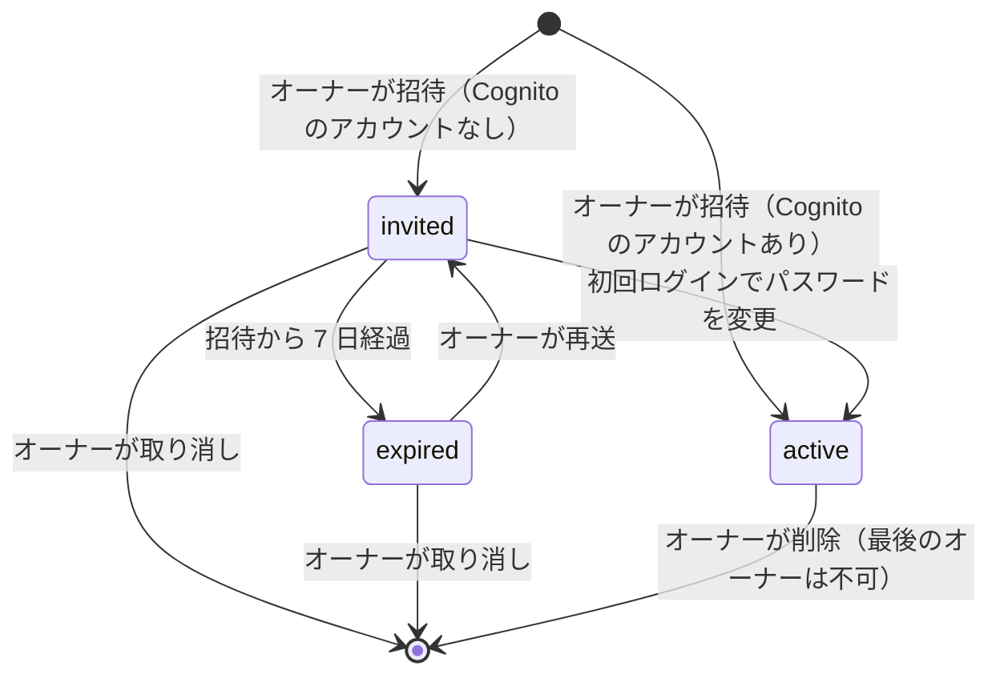

# 要件定義書: 事業者コンソール（Cognito ログインを含む）

| 項目 | 内容 |
|---|---|
| ステータス | Approved |
| 作成日 | 2026-10-26 |
| 最終更新 | 2026-10-26 |
| 関連ドキュメント | 上位：`docs/requirements/subscription-platform.md`（FR-001〜007・009・022・025、NFR-009）、`docs/design/subscription-platform.md`（SPA の配信：CloudFront＋S3、`web/console`）、`docs/poc/specs/identity.md`（ロールと権限の表 §3.4）、console API（`api/openapi/console/*.yaml`） |

## 1. 背景と課題（Why）

事業者が課金基盤を自前で作らずにサブスクリプションを販売できるようにするのが本システムの目的である（上位 §1）。しかし現状、事業者の操作（商品・プランの登録、契約の確認、回収方針・Webhook・スタッフの管理）は console API でしか行えず、画面がない。このため事業者は、販売を始めるだけでも API を呼ぶ開発が必要になり、上位のゴール「商品・プランの登録から申込受付開始まで、開発なしで完了できる」を満たせない。

事業者コンソールは、事業者のスタッフがブラウザから、自分のロールの範囲で安全にこれらを操作できるようにする。本番での利用を前提とし、ログインは Amazon Cognito の ID（メールアドレス）とパスワードで行う。

## 2. ゴールと成功指標

| ゴール | 成功指標 |
|---|---|
| 開発なしで販売を始められる | 新しい事業者のオーナーが、招待メールの受信から「プランの公開」まで、API を使わずに画面だけで完了できる（E2E で確認） |
| ロールの範囲で安全に操作できる | 権限のない操作は画面に出さないか無効にし、API でも拒否される（403）。他事業者のデータは一切表示されない |
| スタッフの受け入れを事業者が自分でできる | オーナーが運営者に頼らず、スタッフを招待・ロール変更・削除できる |
| 問い合わせに答えられる | 契約者 ID・メールアドレス・状態から契約を探し、状態・次回更新日・請求の履歴を確認できる |

## 3. ユーザーストーリー

| ID | 誰が | 何のために | 何をする |
|---|---|---|---|
| CS-01 | スタッフ（全ロール） | 自分の権限で安全に操作するために | メールアドレスとパスワードでログインし、所属する事業者を選ぶ（複数所属なら切り替える） |
| CS-02 | オーナー・管理者 | 販売を始めるために | 商品・プランを登録し、公開・価格改定・公開停止をする |
| CS-03 | オーナー・管理者 | 新規獲得を促すために | クーポンを発行・無効化する |
| CS-04 | スタッフ（全ロール） | 契約者の問い合わせに答えるために | 契約を絞り込み・検索し、詳細と請求の履歴を見る |
| CS-05 | オーナー・管理者 | 自社の回収方針に合わせるために | 支払い失敗時のリトライ方針を設定する |
| CS-06 | オーナー（再送は管理者も） | 自社システムと連携するために | Webhook の送信先・署名鍵・API キーを管理し、配信履歴を見て再送する |
| CS-07 | オーナー | 社内で運用を分担するために | スタッフを招待し、ロールを変更・削除する |

ロールごとの操作の可否は、identity.md §3.4 の権限の表（owner / admin / viewer）に従う。本書で新しく追加する操作（スタッフの招待）は `staff.manage`（オーナーのみ）とする。

## 4. 前提条件

- 事業者（テナント）の登録・審査・承認・停止は運営者が行う（上位 FR-001・FR-026）。事業者の最初のオーナーは、運営者が事業者を作るときにメールアドレスで招待する（ops API を本書の招待方式にそろえる。FR-006）。
- スタッフの認証は、スタッフ用の Cognito ユーザープール 1 つで行う。ユーザー名はメールアドレスとし、1 人の人は 1 つの Cognito アカウントで複数の事業者に所属できる。事業者への所属とロールは本システム（tenant モジュールの staff）が持ち、Cognito は持たない。
- 招待メール・パスワード再設定メールは Cognito から送る。本番では送信元に自社ドメインの SES を使う（Cognito の既定の送信機能は送信数の上限が低いため）。
- console API は実装済みで、画面はそれを呼ぶ。画面のために足りない API（招待、所属する事業者の一覧、契約者の氏名・メールアドレスの表示と検索、楽観ロック）は本書の要件として追加する。
- 認可の判定は API が行う（画面の表示の制御は使いやすさのためで、セキュリティの境界ではない）。
- ローカル・CI では MiniStack の Cognito を使う（ID・パスワードのログイン、トークンの発行、JWKS、Hosted UI は動作を確認済み）。

## 5. 機能要件

### FR-001: ログイン

- **概要**: スタッフはメールアドレスとパスワードでログインする。招待されたスタッフの初回ログインでは、仮パスワードから自分のパスワードへの変更を求める。ログインに成功したら事業者の選択（FR-004）に進む。
- **関連ストーリー**: CS-01
- **優先度**: Must

**受け入れ条件**:

```gherkin
Scenario: 正しいメールアドレスとパスワードでログインする
  Given 事業者 A に所属するスタッフのアカウントがある
  When メールアドレスとパスワードを入力してログインする
  Then 事業者 A のコンソールのトップ（契約一覧）が表示される

Scenario: 初回ログインで仮パスワードを変更する
  Given 招待メールで仮パスワードを受け取ったスタッフ
  When 仮パスワードでログインする
  Then 新しいパスワードの設定画面が表示され、ポリシー（NFR-003）を満たすパスワードを設定するまで先に進めない
  And 設定後はスタッフの状態が「招待中」から「有効」になる

Scenario: パスワードが誤っている
  Given 登録済みのメールアドレス
  When 誤ったパスワードでログインする
  Then 「メールアドレスまたはパスワードが正しくありません」と表示され、メールアドレスが登録済みかどうかは分からない

Scenario: 連続して失敗する
  Given 同じアカウントで短時間にログインを繰り返し失敗している
  When さらにログインを試みる
  Then Cognito の制限によりしばらくログインできず、「しばらく時間をおいてお試しください」と表示される
```

### FR-002: パスワードの再設定

- **概要**: パスワードを忘れたスタッフは、メールアドレスを入力して確認コードをメールで受け取り、新しいパスワードを設定する。
- **関連ストーリー**: CS-01
- **優先度**: Must

**受け入れ条件**:

```gherkin
Scenario: メールの確認コードでパスワードを再設定する
  Given 有効なスタッフのアカウント
  When 再設定を申し込み、メールで届いた確認コードと新しいパスワードを入力する
  Then 新しいパスワードでログインでき、古いパスワードではログインできない

Scenario: 登録されていないメールアドレス
  Given 登録されていないメールアドレス
  When 再設定を申し込む
  Then 登録済みの場合と同じ「確認コードを送信しました（登録されている場合）」が表示される（アカウントの有無を明かさない）

Scenario: 確認コードの誤り・期限切れ
  Given 再設定の確認コードが誤っている、または期限が切れている
  When 新しいパスワードを設定しようとする
  Then 「確認コードが正しくないか、期限が切れています」と表示され、コードを再送できる
```

### FR-003: セッションとログアウト

- **概要**: 最後の操作から 8 時間操作がなければ自動でログアウトする。操作が続いていても、ログインから 24 時間で再ログインを求める。スタッフは任意のときにログアウトできる。ログアウトしたら、そのブラウザの認証情報を消し、Cognito のリフレッシュトークンも失効させる。
- **関連ストーリー**: CS-01
- **優先度**: Must

**受け入れ条件**:

```gherkin
Scenario: 8 時間操作しないと自動でログアウトする
  Given ログイン中のスタッフ
  When 最後の操作から 8 時間が経過する
  Then 次の操作でログイン画面に移り、「一定時間操作がなかったためログアウトしました」と表示される

Scenario: ログアウトする
  Given ログイン中のスタッフ
  When ログアウトする
  Then ログイン画面に移り、ブラウザの戻る操作でもコンソールの画面・データは表示されない
  And ログアウト前のリフレッシュトークンでは新しいトークンを取得できない

Scenario: 編集中にセッションが切れる
  Given フォームに入力中のスタッフ
  When 保存の時点でセッションが切れている
  Then 入力内容は失われる可能性があることを示したうえでログイン画面に移る（自動で保存はしない）
```

### FR-004: 事業者の選択と切り替え

- **概要**: ログイン後、所属する事業者が 1 つならその事業者のコンソールを開く。複数なら選ぶ画面を出し、ヘッダーからいつでも切り替えられる。最後に選んだ事業者を次回の既定にする。停止中の事業者は閲覧だけでき、書き込みの操作は無効にしてその旨を常に表示する。
- **関連ストーリー**: CS-01
- **優先度**: Must

**受け入れ条件**:

```gherkin
Scenario: 複数の事業者に所属している
  Given 事業者 A（オーナー）と事業者 B（閲覧者）に所属するスタッフ
  When ログインする
  Then 事業者 A・B とそれぞれのロールが一覧に表示され、選んだ事業者のコンソールが開く
  And ヘッダーから B に切り替えると、B の閲覧者として画面が表示される（A のデータは表示されない）

Scenario: 所属する事業者がない
  Given すべての事業者から削除されたスタッフ
  When ログインする
  Then 「所属している事業者がありません。事業者のオーナーにお問い合わせください」と表示され、コンソールの画面には進めない

Scenario: 停止中の事業者
  Given 運営者に停止された事業者のスタッフ
  When その事業者のコンソールを開く
  Then 「この事業者は停止されています。閲覧のみ可能です」と常に表示され、作成・編集・削除の操作は無効になる

Scenario: 利用中に事業者から削除される
  Given 事業者 A のコンソールを開いているスタッフが、別のオーナーに A から削除された
  When 次の操作をする
  Then 「この事業者へのアクセス権がなくなりました」と表示され、事業者の選択に戻る
```

### FR-005: ロールに応じた表示

- **概要**: 画面は、選んだ事業者でのロールに応じて操作を出し分ける。権限のない操作のボタンは無効にし（理由をツールチップで示す）、権限のないメニュー（例：閲覧者には API キーの発行）は閲覧だけにする。ロールが変わった場合は次の操作で反映する。
- **関連ストーリー**: CS-01〜07
- **優先度**: Must

**受け入れ条件**:

```gherkin
Scenario: 閲覧者は変更操作ができない
  Given 閲覧者のスタッフ
  When プランの詳細を開く
  Then 編集・価格改定・公開のボタンは無効で、「この操作には管理者以上の権限が必要です」と示される

Scenario: 管理者は Webhook の送信先を変更できない
  Given 管理者のスタッフ
  When Webhook の画面を開く
  Then 送信先と配信履歴は閲覧でき、配信の再送はできるが、送信先の作成・編集・削除と鍵のローテーションは無効になる

Scenario: 利用中にロールが下がる
  Given 管理者として商品の編集画面を開いているスタッフが、閲覧者に変更された
  When 保存する
  Then 「権限がないため保存できませんでした」と表示され、画面は閲覧者の表示に切り替わる
```

### FR-006: スタッフの招待

- **概要**: オーナーは、メールアドレスとロールを指定してスタッフを招待する。Cognito にアカウントがなければ作成して仮パスワードを招待メールで送り、スタッフは「招待中」になる。すでにアカウントがある人（他の事業者のスタッフ）は招待メールを送らずに追加し、「事業者 ○○ に追加されました」という通知メールを送る（すぐに「有効」になる）。招待の有効期限は 7 日で、期限切れ・未着の場合はオーナーが再送できる。招待中のスタッフは取り消せる。運営者が事業者の最初のオーナーを登録するときも同じ招待の仕組みを使う。
- **関連ストーリー**: CS-07
- **優先度**: Must

**受け入れ条件**:

```gherkin
Scenario: 新しい人を招待する
  Given 事業者 A のオーナー
  When 未登録のメールアドレスを「管理者」として招待する
  Then スタッフ一覧に「招待中・管理者」で表示され、そのアドレスに仮パスワード入りの招待メールが届く
  And 監査ログに staff.create（または招待の操作）が記録される

Scenario: 他の事業者のスタッフを招待する
  Given 事業者 B のスタッフとして登録済みのメールアドレス
  When 事業者 A のオーナーがそのアドレスを「閲覧者」として招待する
  Then 招待メールではなく追加の通知メールが届き、本人は次のログインから事業者 A を選べる

Scenario: すでに所属しているメールアドレス
  Given 事業者 A に所属済みのスタッフのメールアドレス
  When 同じアドレスを事業者 A に招待する
  Then 「このメールアドレスのスタッフはすでに所属しています」と表示され、招待されない

Scenario: 招待の期限切れと再送
  Given 招待から 7 日が経過し、まだログインしていない招待中のスタッフ
  When 本人が仮パスワードでログインする
  Then 「招待の有効期限が切れています。事業者の管理者に再送を依頼してください」と表示される
  And オーナーが再送すると、新しい仮パスワードの招待メールが届き、有効期限は再送から 7 日になる

Scenario: 招待を取り消す
  Given 招待中のスタッフ
  When オーナーが招待を取り消す
  Then スタッフ一覧から消え、届いた仮パスワードではその事業者を選べない

Scenario: オーナー以外は招待できない
  Given 管理者のスタッフ
  When スタッフの画面を開く
  Then 招待のボタンは無効で、API で招待しても 403 になる
```

### FR-007: スタッフの管理

- **概要**: スタッフ一覧（氏名・メールアドレス・ロール・状態・最終ログイン日時）を全ロールが閲覧でき、オーナーはロールの変更と削除ができる。最後のオーナーは変更・削除できない（上位 FR-002）。自分自身のロールの変更・削除もでき、最後のオーナーでなければ許す。
- **関連ストーリー**: CS-07
- **優先度**: Must

**受け入れ条件**:

```gherkin
Scenario: ロールを変更する
  Given 事業者 A のオーナーと、管理者のスタッフ X
  When X を閲覧者に変更する
  Then 一覧の X のロールが閲覧者になり、X の次の操作から閲覧者として扱われる

Scenario: 最後のオーナーは変更・削除できない
  Given オーナーが 1 名だけの事業者
  When そのオーナーを管理者に変更、または削除しようとする
  Then 「オーナーが最低 1 名必要です」と表示され、変更されない

Scenario: 削除の確認
  Given 有効なスタッフ X
  When オーナーが X を削除する
  Then 確認ダイアログで「X は事業者 A のコンソールにアクセスできなくなります」と示し、確定すると一覧から消える
  And X の Cognito アカウントは削除しない（他の事業者への所属に影響しない）
```

### FR-008: 商品・プラン

- **概要**: 商品の一覧・登録・編集、プランの一覧・登録・編集（名称・説明・トライアル日数）、公開・公開停止、価格改定（新しい価格版の追加。即時に新規申込へ適用）、価格の履歴の表示を行う。公開中のプランは申込ページの URL（`/checkout?plan_id=…`）をコピーできる。課金周期と価格の方式は登録後に変更できない（上位 FR-003・FR-004）。
- **関連ストーリー**: CS-02
- **優先度**: Must

**受け入れ条件**:

```gherkin
Scenario: 商品とプランを登録して公開する
  Given 事業者 A の管理者
  When 商品を登録し、月額 980 円・トライアル 14 日のプランを登録して公開する
  Then プランの状態が「公開中」になり、申込ページの URL をコピーできる

Scenario: 価格を改定する
  Given 980 円で公開中のプラン
  When 価格を 1,280 円に改定する
  Then 価格の履歴に 980 円（旧）と 1,280 円（現在）が表示され、確認ダイアログで「既存の契約は次回の更新から新しい価格になります」と示される（適用の規則は上位 FR-004 に従う）

Scenario: 入力の誤り
  Given プランの登録画面
  When 金額に 0 円や上限を超える値を入力する
  Then 項目のそばに具体的な理由（例：「1 円以上 1,000,000 円以下で入力してください」）が表示され、登録されない

Scenario: 事業者が審査中で公開できない
  Given 承認前（審査中）の事業者
  When プランを公開しようとする
  Then 「事業者の承認後に公開できます」と表示され、公開されない
```

### FR-009: クーポン

- **概要**: クーポンの一覧（コード・割引・対象プラン・有効期限・利用上限と利用数・状態）と発行・無効化を行う。発行後に割引の内容は変更できない（上位 FR-005）。
- **関連ストーリー**: CS-03
- **優先度**: Should

**受け入れ条件**:

```gherkin
Scenario: 初回 50% のクーポンを発行する
  Given 事業者 A の管理者
  When コード WELCOME50、50% 割引、初回のみ、全プラン対象で発行する
  Then 一覧に「有効・利用 0 回」で表示される

Scenario: コードの重複
  Given 事業者 A に WELCOME50 が存在する
  When 同じコードで発行する
  Then 「このコードはすでに使われています」と表示され、発行されない

Scenario: 無効化する
  Given 有効なクーポン
  When 無効化する
  Then 確認ダイアログの後、状態が「無効」になり、以後の申込で使えない（すでに適用中の契約には影響しない旨を表示する）
```

### FR-010: 契約の一覧と詳細

- **概要**: 契約の一覧を、状態（複数選択）・プランで絞り込み、契約者 ID（`cus_…`）またはメールアドレス（完全一致）で検索して表示する（新しい順、ページング）。一覧と詳細には、事業者に渡してよい範囲の契約者情報（契約者 ID・氏名・メールアドレス）を表示する（上位 FR-009）。詳細では、状態・プラン・現在の期間・次回更新日・トライアル・予約中のプラン変更と解約・解約理由・請求の履歴（金額・状態・支払日・リトライの予定）を表示する。
- **関連ストーリー**: CS-04
- **優先度**: Must

**受け入れ条件**:

```gherkin
Scenario: 状態で絞り込む
  Given 有効・支払い遅延・解約済みの契約がある事業者
  When 状態「支払い遅延」で絞り込む
  Then 支払い遅延の契約だけが表示される

Scenario: メールアドレスで探す
  Given 契約者 X（x@example.com）が事業者 A と契約している
  When 事業者 A のコンソールで x@example.com を検索する
  Then X の契約だけが表示され、契約者 ID・氏名・メールアドレスが表示される

Scenario: 他の事業者の契約は表示されない
  Given 契約者 X が事業者 A と事業者 B の両方と契約している
  When 事業者 A のスタッフが X の契約の詳細を開く
  Then 事業者 B との契約・請求は一切表示されない

Scenario: 該当なし
  Given 条件に合う契約がない
  When 絞り込む
  Then 「条件に一致する契約はありません」と表示され、条件をクリアする操作が示される

Scenario: 退会した契約者
  Given 退会してマスキングされた契約者の解約済みの契約
  When 詳細を開く
  Then 氏名・メールアドレスは「退会済み」と表示され、契約と請求の履歴は表示される
```

### FR-011: リトライ方針

- **概要**: 支払い失敗時のリトライの間隔（失敗した日からの日数、最大 5 回）を表示・変更する。未設定なら既定値を「既定」と示して表示する。変更は以後に初めて失敗した請求から適用されることを示す（上位 FR-006）。
- **関連ストーリー**: CS-05
- **優先度**: Should

**受け入れ条件**:

```gherkin
Scenario: リトライ方針を変更する
  Given 既定のリトライ方針の事業者の管理者
  When 間隔を 1 日・3 日・7 日に変更する
  Then 保存後に 1・3・7 日と表示され、「既定」の表示が消える

Scenario: 不正な間隔
  Given リトライ方針の画面
  When 昇順でない間隔や範囲外の日数を入力する
  Then 項目ごとに理由が表示され、保存されない
```

### FR-012: Webhook の送信先

- **概要**: 送信先の一覧・登録・編集（URL・受け取るイベント・有効/無効・説明）・削除と、署名鍵のローテーション（移行期間 0〜168 時間、既定 24 時間）を行う。署名鍵は作成とローテーションの直後に一度だけ表示し、コピーできるようにする。閉じた後は二度と表示できない。
- **関連ストーリー**: CS-06
- **優先度**: Should

**受け入れ条件**:

```gherkin
Scenario: 送信先を登録して鍵を控える
  Given 事業者 A のオーナー
  When https の URL と受け取るイベントを指定して登録する
  Then 署名鍵（whsec_…）が一度だけ表示され、「この画面を閉じると再表示できません」と示される
  And 閉じた後の詳細画面には鍵が表示されない

Scenario: https 以外の URL
  Given 送信先の登録画面
  When http:// の URL や社内の IP アドレスを入力する
  Then 「https の公開 URL を指定してください」と表示され、登録されない

Scenario: 送信先の上限
  Given 削除していない送信先が 10 個ある
  When 11 個目を登録しようとする
  Then 「送信先は 10 個までです」と表示され、登録されない
```

### FR-013: Webhook の配信履歴と再送

- **概要**: 配信の一覧（イベント・送信先・状態・試行回数・最後の応答・次の再試行の予定）を送信先・状態・イベントで絞り込んで表示し、詳細で試行ごとの結果と送った本文を表示する。失敗・再試行待ちでない配信を手動で再送できる（オーナー・管理者）。
- **関連ストーリー**: CS-06
- **優先度**: Should

**受け入れ条件**:

```gherkin
Scenario: 失敗した配信を再送する
  Given 72 時間で打ち切られた（失敗）配信
  When 管理者が再送する
  Then 新しい配信が「送信待ち」で一覧に追加され、元の配信は失敗のまま残る

Scenario: 再試行待ちの配信は再送できない
  Given 再試行待ちの配信
  When 再送しようとする
  Then 再送のボタンは無効で、「自動の再試行を待っています（次回：○時○分）」と示される
```

### FR-014: API キー

- **概要**: API キーの一覧（名前・プレフィックス・状態・作成日時・最終利用日時）と発行・失効を行う（オーナーのみ）。キーの平文は発行の直後に一度だけ表示し、コピーできるようにする。
- **関連ストーリー**: CS-06
- **優先度**: Should

**受け入れ条件**:

```gherkin
Scenario: API キーを発行する
  Given 事業者 A のオーナー
  When 名前を付けて API キーを発行する
  Then キーの平文が一度だけ表示され、閉じた後の一覧にはプレフィックスだけが表示される

Scenario: API キーを失効させる
  Given 有効な API キー
  When 確認ダイアログの後に失効させる
  Then 状態が「失効」になり、以後そのキーでの事業者 API の呼び出しは 401 になる
```

### FR-015: 同時編集の検知

- **概要**: 2 人のスタッフが同じ対象（商品・プラン・リトライ方針・Webhook の送信先・スタッフのロール）を同時に編集した場合、後から保存した人に他人の変更があったことを知らせ、黙って上書きしない。知らせた後は最新の内容を読み込み直して編集し直す。
- **関連ストーリー**: CS-02・CS-05・CS-06・CS-07
- **優先度**: Should

**受け入れ条件**:

```gherkin
Scenario: 他のスタッフが先に保存した
  Given スタッフ X と Y が同じプランの編集画面を開いている
  When X が保存した後に Y が保存する
  Then Y に「他のスタッフがこの内容を更新しました。最新の内容を読み込み直してください」と表示され、Y の変更は保存されない
```

### FR-016: 共通の操作とエラーの表示

- **概要**: すべての画面で次の振る舞いをそろえる。(1) 送信中はボタンを無効にして二重送信を防ぐ。(2) 削除・無効化・失効・公開停止など取り消せない操作は確認ダイアログを出す。(3) 入力の誤りは項目のそばに理由を示す。(4) 通信エラー・サーバーエラーは画面上部に表示し、問い合わせ用に相関 ID を表示する。(5) 一覧は 20 件ずつのページングで、該当なしの状態を示す。(6) 成功した操作は短い通知で知らせる。
- **関連ストーリー**: CS-01〜07
- **優先度**: Must

**受け入れ条件**:

```gherkin
Scenario: 二重送信を防ぐ
  Given プランの登録画面
  When 登録ボタンを素早く 2 回押す
  Then プランは 1 つだけ登録される

Scenario: サーバーエラー
  Given API が 500 を返す
  When 保存する
  Then 「処理に失敗しました。時間をおいて再度お試しください（問い合わせ番号：<相関 ID>）」と表示され、入力内容は残る

Scenario: 通信が切れている
  Given ネットワークに接続していない
  When 一覧を開く
  Then 「通信できません。接続を確認してください」と表示され、再読み込みの操作が示される
```

## 6. 非機能要件

| ID | 分類 | 要件 | 測定基準 |
|---|---|---|---|
| NFR-001 | 性能 | 画面の初回表示と、一覧・詳細の表示が待たされない | 初回表示（ログイン画面）3 秒以内、一覧・詳細の表示は p95 2 秒以内（API の p95 は 500ms 以内）。契約が 100 万件の事業者でも一覧の表示時間が変わらない（カーソル方式のページング） |
| NFR-002 | 互換性 | 主要なブラウザと画面幅で使える | Chrome・Edge・Firefox・Safari の最新 2 版。PC（幅 1280px 以上）を主な対象とし、幅 1024px（タブレット横）まで操作に支障がない。スマートフォンは対象外 |
| NFR-003 | セキュリティ | 認証は Cognito、パスワードは一般的な強度の方針に従う | パスワードは 12 文字以上で英大文字・英小文字・数字・記号を含む（Cognito のパスワードポリシー）。連続失敗の制限は Cognito の標準。トークンを URL に載せない。署名鍵・API キーの平文は発行の直後だけ表示する。外部のスクリプトを読み込まない（CSP） |
| NFR-004 | セキュリティ | 認可は API が行い、画面は補助 | 画面の表示を迂回して API を直接呼んでも、ロール・事業者の範囲外の操作は 403/404 になる（既存の認可・テナント分離のテストに加え、コンソールの E2E で確認） |
| NFR-005 | 監査 | 変更の操作は既存の監査ログに残る | スタッフの招待・ロール変更・削除を含む変更操作が、上位 FR-025 の監査記録に記録される。ログインの成功・失敗は Cognito の記録で追える |
| NFR-006 | 可用性 | 事業者 API と同じ水準で使える | 月間 99.9%（上位 NFR-004 の事業者 API と同じ）。画面は CloudFront＋S3 の静的配信（設計書） |
| NFR-007 | アクセシビリティ | 基本的なアクセシビリティを満たす | WCAG 2.1 AA 相当の基本：キーボードだけで主要な操作ができる、入力欄にラベルがある、文字と背景のコントラスト比 4.5:1 以上、エラーを色だけで示さない |
| NFR-008 | 表示 | 日本語・日本時間・円で表示する | 文言は日本語のみ。日時は JST（`2026年10月26日 10:00`）、金額は円・3 桁区切り（`1,980円`） |
| NFR-009 | 運用 | 問い合わせ時に原因を追える | エラー表示に相関 ID を出し、API のログ（`task logs -- --corr <ID>`）と突き合わせられる。画面の JavaScript のエラーは収集する（収集の仕組みは設計で決める） |
| NFR-010 | テスト | 主要な流れを E2E で確認する | ログイン（初回のパスワード変更を含む）→ 事業者の選択 → 商品・プランの登録と公開 → 契約の検索、スタッフの招待、ロールによる出し分けを Playwright（ブラウザ）で確認する。認証は MiniStack の Cognito を使う |

## 7. 状態遷移

事業者への所属（staff）の状態。Cognito のアカウントの状態とは別に、本システムが持つ。



- ロールの変更は状態を変えない（invited・active のどちらでも可能。最後のオーナーの制約は active のオーナーで数える）。
- 削除・取り消しは事業者への所属だけを消し、Cognito のアカウントは残す（他の事業者への所属のため）。

## 8. スコープ外（やらないこと）

- 多要素認証（MFA）。上位 NFR-009 は「将来対応」に改めた
- ID・パスワード以外のログイン（SSO・SAML・Google などのソーシャルログイン）、スタッフのセルフサインアップ
- 基本指標のダッシュボード（CS-08、上位 FR-010）。集計（Reporting）の実装が必要なため別途
- スタッフによる契約の操作（解約・プラン変更の代行、返金、再決済の実行）。閲覧だけとする
- 契約者の個人情報の編集、CSV などの書き出し
- スマートフォン向けの表示、多言語、ダークモード
- 画面内の通知（お知らせ）、メールアドレスの変更（Cognito のアカウント情報の変更）
- 運営者の管理画面と契約者のマイページ（別の要件定義）

## 9. 未解決事項

| # | 論点 | 担当 | 期限 |
|---|---|---|---|
| 1 | ~~上位の要件定義書 NFR-009 を「将来対応」に改める~~ → **解決（2026-10-26）**：上位の NFR-009 を書き換えた | PdM | 済 |
| 2 | 本番の招待メール・再設定メールの送信元ドメインと文面（Cognito の SES 連携） | PdM・インフラ | 設計まで |
| 3 | ログイン画面を自前で作るか、Cognito の Hosted UI を使うか（見た目・初回のパスワード変更・期限切れの文言の自由度と、実装・保守の量のトレードオフ） | アーキテクト | 設計で決める |

## 10. 変更履歴

| 日付 | 変更内容 | 変更者 |
|---|---|---|
| 2026-10-26 | 初版（Review）。オーナーの決定：本番前提、ログインは ID・パスワードのみ（MFA は今回作らない）、招待はメール、複数の事業者への所属を想定、パスワードの再設定はメール、自動ログアウトは 8 時間、範囲は CS-01〜07。そのほかの細部は PdM が一般的な管理画面の標準で決定 | PdM（Claude） |
| 2026-10-26 | オーナーの承認によりステータスを Approved に変更。未解決事項 #1（上位 NFR-009 の書き換え）を解決 | PdM（Claude） |
