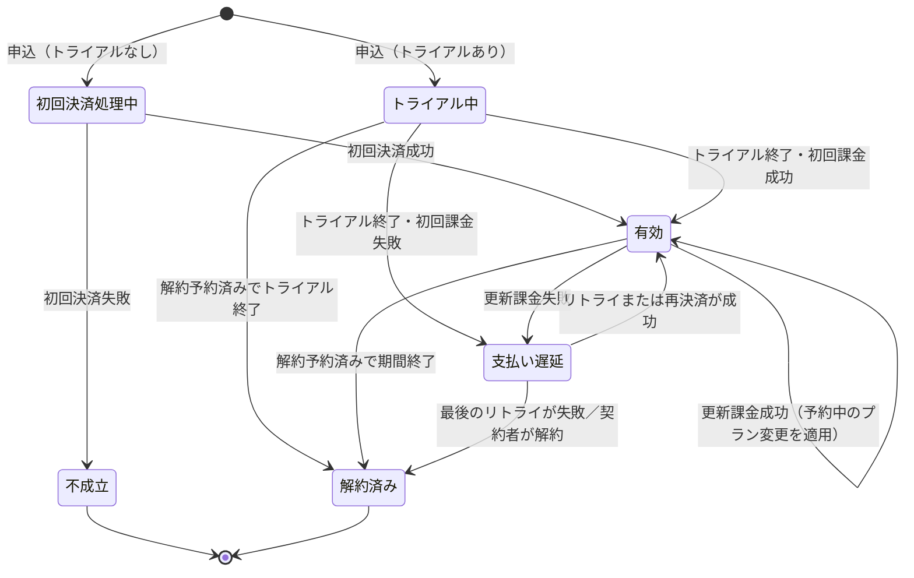
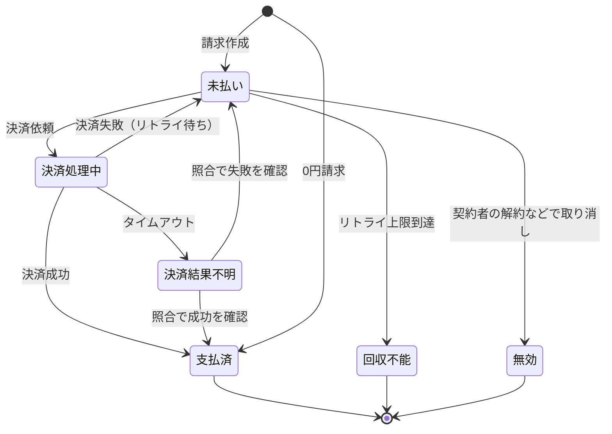

# 要件定義書: マルチテナント型サブスクリプション基盤

| 項目 | 内容 |
|---|---|
| ステータス | Approved |
| 作成日 | 2026-10-11 |
| 最終更新 | 2026-10-11 |
| 関連ドキュメント | 設計書: `docs/design/subscription-platform.md`（未作成） |

## 1. 背景と課題（Why）

B2C 向けにサブスクリプション商品を販売したい事業者が、定期課金・トライアル・クーポン・支払い失敗時の回収（ダニング）・契約状態の管理といった課金基盤を毎回自前で構築している。これは開発・運用コストが高く、二重課金や回収漏れといった事故のリスクも抱える。

本システムは、複数の事業者（テナント）が自社のサブスクリプション商品を登録・販売でき、契約者（個人）がプラットフォーム共通のアカウントで申込・管理できる基盤を新規に提供する。既存の「リンク決済プラットフォーム」とは独立したシステムとする。

## 2. ゴールと成功指標

| ゴール | 成功指標 |
|---|---|
| 事業者が課金基盤を作らずにサブスクリプションを販売できる | 事業者が商品・プランの登録から申込受付開始まで、開発なしで完了できる |
| 事業者のサービスが契約状態に即座に追従できる | 契約状態の変化から事業者への Webhook 送信開始まで p95 で 60 秒以内 |
| 課金の正確性 | 二重課金 0 件、課金漏れ 0 件（日次照合で検出・是正） |
| 回収率の最大化 | 支払い失敗の発生から自動リトライ・カード更新による回収率を指標として計測できる |
| 規模への対応 | 有効サブスクリプション 100 万件、1 日最大 10 万件の課金を処理できる |

## 3. ユーザーストーリー

| ID | 誰が | 何のために | 何をする |
|---|---|---|---|
| US-001 | 事業者 | 自社のサブスクリプションを販売するために | 商品・プラン（価格・課金周期・トライアル）を登録し公開する |
| US-002 | 事業者 | 新規獲得を促進するために | 初回割引クーポンを発行する |
| US-003 | 事業者 | 自社の回収方針に合わせるために | 支払い失敗時のリトライ回数・間隔を設定する |
| US-004 | 事業者 | 自社サービスの利用可否を契約状態に連動させるために | 契約状態の変化を Webhook で受け取り、API で最新状態を照会する |
| US-005 | 事業者 | 事業の状況を把握するために | 契約一覧と基本指標（MRR・解約数など）を確認する |
| US-006 | 事業者（オーナー） | 社内で安全に運用を分担するために | スタッフを招待し、役割に応じた権限を付与する |
| US-007 | 契約者 | 複数事業者のサブスクリプションをまとめて管理するために | プラットフォーム共通アカウントを作成しログインする |
| US-008 | 契約者 | サービスを継続利用するために | プランを選び、支払方法を登録して申し込む（トライアル・クーポン適用を含む） |
| US-009 | 契約者 | 利用状況に合わせるために | プラン変更・解約を予約し、必要なら取り消す |
| US-010 | 契約者 | 支払いを継続するために | 支払方法を変更し、未払いがあれば再決済する |
| US-011 | システム | 契約を維持するために | 更新日に自動課金し、失敗時はリトライ・猶予期間を経て自動解約する |
| US-012 | 運営者 | プラットフォームを健全に保つために | 事業者を審査・承認・停止し、障害時に課金を照合・是正する |

## 4. 前提条件

- **決済代行は fincode を利用する**。事業者ごとに売上を分けるプラットフォーム型の契約形態とする。事業者への売上入金は fincode が行う。
- **カード情報は自社で保持しない**。カード登録は fincode のトークン化（フロントエンドでのトークン取得）を使い、自社は fincode の顧客 ID・カード ID などの参照だけを持つ。
- **課金スケジュールは自社が管理する**。fincode のサブスクリプション機能は使わず、更新日の算出・請求の生成・課金の実行・リトライは自社の課金エンジンが行う。fincode には都度決済を依頼する。
- 通貨は日本円のみ、価格は**税込**で登録する。
- 日付の基準は**日本時間（JST）**とする。
- 事業者の審査は運営者が手動で行う。
- 契約者向けのメールは、外部のメール配信サービスを使って送る。
- 事業者は Webhook を受け取るための HTTPS エンドポイントを自前で用意する。

## 5. 機能要件

### FR-001: 事業者の登録と承認

- **概要**: 事業者が利用を申請し、運営者が審査して承認する。承認後に fincode 上のテナントショップと紐づけ、販売を始められるようにする。
- **関連ストーリー**: US-012
- **優先度**: Must

**受け入れ条件**:

```gherkin
Scenario: 運営者が事業者を承認する
  Given 事業者が利用申請を提出し、ステータスが「審査中」である
  When 運営者が審査画面で「承認」を実行する
  Then 事業者のステータスが「有効」になる
  And 事業者の管理画面で商品・プランを公開できるようになる

Scenario: 未承認の事業者は販売できない
  Given 事業者のステータスが「審査中」である
  When 事業者がプランを「公開」しようとする
  Then 公開は拒否され、「審査完了後に公開できます」と表示される
```

### FR-002: 事業者スタッフと権限

- **概要**: 1 つの事業者に複数のスタッフが所属できる。役割は次の 3 つとする。
  - オーナー：すべての操作、スタッフ管理、Webhook と API キーの管理
  - 管理者：商品・プラン・クーポン・リトライ方針の管理、契約の閲覧と操作
  - 閲覧者：閲覧のみ
- **関連ストーリー**: US-006
- **優先度**: Should

**受け入れ条件**:

```gherkin
Scenario: 閲覧者は変更操作ができない
  Given 「閲覧者」ロールのスタッフがログインしている
  When プランの価格を変更しようとする
  Then 操作は拒否され、変更ボタンは無効化表示される

Scenario: 最後のオーナーは削除できない
  Given 事業者にオーナーが 1 名だけ所属している
  When そのオーナーを削除またはロール変更しようとする
  Then 操作は拒否され、「オーナーが最低 1 名必要です」と表示される
```

### FR-003: 商品・プランの登録

- **概要**: 事業者が商品と、その下にぶら下がるプランを登録する。プランには次の項目を持たせる。
  - 価格（税込、1 円単位）
  - 課金周期（月額／年額）
  - 無料トライアル日数（0 日はトライアルなし）
  - 公開状態
- **拡張性**: 料金の計算方式は「固定額」のみ実装する。ただし将来「従量課金」「数量課金」を追加できるよう、料金計算方式をプランの属性として切り替えられる構造にする（NFR-010 を参照）。
- **関連ストーリー**: US-001
- **優先度**: Must

**受け入れ条件**:

```gherkin
Scenario: 月額プランを登録する
  Given 有効な事業者の管理者がログインしている
  When 価格 980 円・月額・トライアル 14 日のプランを登録する
  Then プランが「非公開」状態で作成される

Scenario: 不正な価格は登録できない
  Given 有効な事業者の管理者がログインしている
  When 価格に 0 円以下、または上限を超える金額を入力して登録する
  Then 登録は拒否され、許容範囲がエラーメッセージで示される
```

### FR-004: プランの公開・価格改定

- **概要**: プランを公開・非公開に切り替える。
  - 非公開にしたプランでは新規の申込を受け付けない。既存の契約は継続する。
  - 価格の改定は「新しい価格のバージョン」として扱う。既存の契約は、契約時の価格を維持する（据え置き）。
  - 課金の記録は、そのときに適用した価格バージョンを参照できるようにする。
- **関連ストーリー**: US-001
- **優先度**: Must

**受け入れ条件**:

```gherkin
Scenario: 価格改定は新規契約にのみ適用される
  Given プラン A（980 円）に既存契約者 X がいる
  When 事業者がプラン A の価格を 1,280 円に改定する
  Then 以後の新規申込は 1,280 円で契約される
  And 契約者 X の次回更新は 980 円で課金される

Scenario: 非公開プランには申し込めない
  Given プラン B が非公開である
  When 契約者がプラン B の申込 URL にアクセスする
  Then 申込は受け付けられず、「現在お申し込みいただけません」と表示される
```

### FR-005: クーポン

- **概要**: 事業者が初回割引クーポンを発行する。設定できる項目は次のとおり。
  - 割引の種類：定額割引／定率割引
  - 適用する回数：初回のみ、または先頭から N 回分
  - 対象のプラン
  - 有効期限
  - 利用できる総数の上限
  - 1 人あたり 1 回まで
  - 割引後の金額は 0 円未満にしない。0 円の請求は決済を行わず「支払済」として扱う。
- **関連ストーリー**: US-002, US-008
- **優先度**: Should

**受け入れ条件**:

```gherkin
Scenario: 定率クーポンを初回に適用する
  Given 980 円のプランに有効な「初回 50% 引き」クーポンがある
  When 契約者がクーポンを適用してトライアルなしで申し込む
  Then 初回の請求額は 490 円となる
  And 2 回目以降の請求額は 980 円となる

Scenario: 期限切れ・上限到達のクーポンは使えない
  Given クーポンの有効期限が過ぎている、または利用数が上限に達している
  When 契約者がそのクーポンを入力する
  Then 申込画面にエラーが表示され、割引は適用されない

Scenario: 同じ契約者は同じクーポンを 2 回使えない
  Given 契約者が過去にクーポン C を使用している
  When 同じ契約者がクーポン C を別の申込で入力する
  Then 「このクーポンは既にご利用済みです」と表示され、割引は適用されない

Scenario: 上限残り 1 枚のクーポンを同時に使用する
  Given クーポン C の残り利用可能数が 1 である
  When 2 人の契約者がほぼ同時にクーポン C を適用して申込を確定する
  Then 1 人だけに割引が適用され、もう 1 人にはエラーが表示される
```

### FR-006: リトライ方針の設定

- **概要**: 事業者は、支払いが失敗したときのリトライの回数と間隔を設定できる（例：1 日後・3 日後・7 日後）。
  - 回数は 0〜5 回とする。
  - 間隔は、最初の失敗日からの日数で指定する。
  - リトライ中は猶予期間としてサービスを使えるままにし、最後のリトライが失敗したら自動で解約する。
  - 事業者が設定していない場合は、プラットフォームのデフォルト（1・3・7 日後）を使う。
- 設定を変えても、すでにリトライ中の請求には影響しない。リトライが始まった時点の方針をそのまま使う。
- **関連ストーリー**: US-003
- **優先度**: Should

**受け入れ条件**:

```gherkin
Scenario: 事業者独自のリトライ方針が適用される
  Given 事業者がリトライ方針を「2 日後・5 日後」に設定している
  When 契約者の更新課金が失敗する
  Then 失敗日の 2 日後と 5 日後にリトライがスケジュールされる

Scenario: 方針変更は進行中のリトライに影響しない
  Given 契約者 X の請求が「1・3・7 日後」の方針でリトライ中である
  When 事業者が方針を「2 日後」のみに変更する
  Then 契約者 X の請求は引き続き「1・3・7 日後」でリトライされる
```

### FR-007: 事業者 Webhook エンドポイントの設定

- **概要**: 事業者は Webhook の送信先 URL（HTTPS 必須）と、受け取るイベントの種類を設定する。各配信には署名を付け、署名用の秘密鍵は事業者が再発行（ローテーション）できる。
- **関連ストーリー**: US-004
- **優先度**: Must

**受け入れ条件**:

```gherkin
Scenario: HTTPS 以外の URL は登録できない
  Given 事業者オーナーがログインしている
  When http:// で始まる URL を Webhook 送信先として登録する
  Then 登録は拒否される

Scenario: 署名鍵をローテーションする
  Given 事業者が署名鍵 K1 を使用している
  When オーナーが署名鍵をローテーションする
  Then 新しい鍵 K2 が発行され、一定の移行期間は K1 と K2 の両方で検証可能な署名が送られる
```

### FR-008: 事業者向けの契約照会 API

- **概要**: 事業者のシステムが、API キーを使って契約の状態を問い合わせる API。
  - 事業者ごとの契約者 ID で検索できる。
  - 返す内容は、契約状態・利用権の有無・現在の期間・予約中の変更。
  - 事業者は、自分の契約者のデータにしかアクセスできない。
- **関連ストーリー**: US-004
- **優先度**: Must

**受け入れ条件**:

```gherkin
Scenario: 猶予期間中も利用権ありと返す
  Given 契約者の契約が「支払い遅延」状態で、リトライ中である
  When 事業者が契約照会 API を呼ぶ
  Then 状態「支払い遅延」と、利用権「あり」が返る

Scenario: 他事業者の契約は参照できない
  Given 事業者 A の API キーを使用している
  When 事業者 B の契約 ID を指定して照会する
  Then 404 が返り、存在の有無も判別できない
```

### FR-009: 事業者の管理画面での契約一覧

- **概要**: 事業者は、自分の契約を検索し、状態・プラン・次回の更新日・請求の履歴を見られる。契約者の個人情報は、事業者に渡してよい範囲（事業者ごとの契約者 ID・氏名・メールアドレス）に限る。
- **関連ストーリー**: US-005
- **優先度**: Must

**受け入れ条件**:

```gherkin
Scenario: 状態で絞り込む
  Given 事業者に有効・支払い遅延・解約済みの契約が存在する
  When 管理画面で状態「支払い遅延」で絞り込む
  Then 支払い遅延状態の契約のみが表示される

Scenario: 他事業者での契約情報は表示されない
  Given 契約者 X が事業者 A と事業者 B の両方と契約している
  When 事業者 A が契約者 X の詳細を表示する
  Then 事業者 B との契約情報は一切表示されない
```

### FR-010: 基本指標の表示

- **概要**: 事業者の管理画面に、MRR・有効な契約数・新規の契約数・解約数・支払い遅延の件数を表示する。集計は日次でよい。
- **関連ストーリー**: US-005
- **優先度**: Could

**受け入れ条件**:

```gherkin
Scenario: 前日までの指標を表示する
  Given 日次集計が完了している
  When 事業者がダッシュボードを開く
  Then 前日終了時点の MRR・有効契約数・当月新規数・当月解約数が表示される
```

### FR-011: 契約者の共通アカウント

- **概要**: 契約者は、プラットフォーム共通のアカウント（メールアドレス＋認証）を作り、複数の事業者と契約できる。事業者には、事業者ごとに別の契約者 ID を発行して渡す（同じ人が別の事業者で契約していても、事業者同士で突き合わせられないようにする）。
- **関連ストーリー**: US-007
- **優先度**: Must

**受け入れ条件**:

```gherkin
Scenario: 事業者ごとに異なる契約者 ID が払い出される
  Given 契約者 X が事業者 A と契約済みである
  When 契約者 X が事業者 B と新たに契約する
  Then 事業者 B には事業者 A とは異なる契約者 ID が通知される

Scenario: 有効な契約がある状態では退会できない
  Given 契約者に「有効」または「支払い遅延」の契約が残っている
  When 契約者が退会しようとする
  Then 退会は拒否され、残っている契約の一覧と解約手順が表示される
```

### FR-012: 支払方法の登録と管理

- **概要**: 契約者がカードを登録する。カード番号は fincode のトークン化を通して登録し、自社のサーバーは扱わない。
  - 登録したカードは、別の事業者に申し込むときも選べる。
  - 契約ごとに、どの支払方法で払うかを持たせる。
  - 有効な契約に使われている支払方法は、別の支払方法に切り替えるまで削除できない。
- **関連ストーリー**: US-008, US-010
- **優先度**: Must

**受け入れ条件**:

```gherkin
Scenario: 登録済みカードを別事業者の申込で再利用する
  Given 契約者が事業者 A の申込時にカードを登録済みである
  When 契約者が事業者 B のプランに申し込む
  Then 支払方法の選択肢に登録済みカードが表示され、再入力なしで申込できる

Scenario: 使用中の支払方法は削除できない
  Given カード C が有効な契約の支払方法に設定されている
  When 契約者がカード C を削除しようとする
  Then 削除は拒否され、該当する契約と変更方法が表示される
```

### FR-013: 申込

- **概要**: 契約者がプランを選び、支払方法とクーポン（任意）を指定して申し込む。
  - トライアルなし：申込のときに初回の決済をし、成功したら契約が始まる。
  - トライアルあり：支払方法の登録を必須とし、トライアルが終わった時点で初回を課金する。
  - 申込は冪等とする。ダブルクリックやリトライで同じ申込が 2 回届いても、契約と課金は 1 回しか発生しない。
  - 同じ契約者が、同じプランに有効な契約を複数持ってもよい。重複の防止は冪等キーで行い、「同じプランかどうか」では判定しない。ただし、トライアルの利用制限（FR-014）は同じ商品で 1 回までのまま。
- **関連ストーリー**: US-008
- **優先度**: Must

**受け入れ条件**:

```gherkin
Scenario: トライアルなしで申し込む
  Given 980 円・月額・トライアルなしのプランが公開されている
  When 契約者が 2026-10-15 に有効なカードで申し込む
  Then 980 円の決済が成功し、契約が「有効」になる
  And 現在の期間は 2026-10-15 〜 2026-11-14、次回更新日は 2026-11-15 となる

Scenario: 初回決済が失敗した場合は契約が成立しない
  Given トライアルなしのプランが公開されている
  When 契約者の初回決済がカード会社に拒否される
  Then 契約は成立せず、申込画面に別のカードを促すエラーが表示される
  And 事業者への契約開始 Webhook は送信されない

Scenario: 二重送信しても契約・課金は 1 回
  Given 契約者が申込ボタンを押した
  When 同じ申込リクエストが短時間に 2 回送信される
  Then 契約は 1 件だけ作成され、決済も 1 回だけ実行される

Scenario: 決済結果が不明なまま応答がタイムアウトする
  Given 契約者が申し込み、fincode への決済依頼がタイムアウトした
  When 申込処理が結果を確定できない
  Then 契約者には「処理中」と表示され、結果確定まで同じ申込の再実行は既存処理の結果を返す
  And 照合処理（FR-024）により結果が確定した時点で契約が成立または不成立となる
```

### FR-014: トライアルの利用制限

- **概要**: 同じ契約者が無料トライアルを使えるのは、同じ商品につき 1 回までとする。2 回目以降の申込では、トライアルなしで即時に課金する。
- **関連ストーリー**: US-008
- **優先度**: Should

**受け入れ条件**:

```gherkin
Scenario: 2 回目の申込ではトライアルが付かない
  Given 契約者が商品 P のトライアルを過去に利用して解約済みである
  When 同じ契約者が商品 P のトライアル付きプランに再度申し込む
  Then 申込画面に「トライアル対象外」と明示され、申込時に初回決済が行われる

Scenario: トライアル中に解約すると課金されない
  Given 契約者がトライアル中である
  When 契約者が解約する
  Then トライアル終了日に契約は「解約済み」となり、課金は一切発生しない
```

### FR-015: プラン変更の予約

- **概要**: 契約者は、同じ商品の中の別のプランへの変更を予約できる。アップグレードもダウングレードも、**次の更新日から**新しいプランを適用する。日割りの計算はしない。
  - 予約は更新日の前日まで、取り消しと上書きができる。
  - 課金周期をまたぐ変更（月額から年額など）も、次の更新日から適用する。
- **関連ストーリー**: US-009
- **優先度**: Must

**受け入れ条件**:

```gherkin
Scenario: 次回更新日から新プランで課金される
  Given 契約者が月額 980 円プランを契約中で、次回更新日が 11-15 である
  When 契約者が 10-20 に月額 1,980 円プランへの変更を予約する
  Then 10-20 時点では課金は発生しない
  And 11-15 の更新で 1,980 円が課金され、契約のプランが切り替わる

Scenario: 変更予約と解約予約が衝突する
  Given 契約者がプラン変更を予約している
  When 契約者が解約を予約する
  Then プラン変更の予約は取り消され、解約予約のみが残る

Scenario: 更新処理中の変更予約
  Given 更新日の課金処理が開始されている
  When 契約者がプラン変更を予約しようとする
  Then その予約は次の更新日以降に適用されるものとして受け付けられ、画面に適用日が明示される
```

### FR-016: 解約の予約と取り消し

- **概要**: 契約者は解約を予約できる。現在の期間が終わるまではサービスを使え、期間が終わった時点で「解約済み」になる。期間が終わるまでは、予約を取り消せる。
- **関連ストーリー**: US-009
- **優先度**: Must

**受け入れ条件**:

```gherkin
Scenario: 解約予約後は期間終了まで利用できる
  Given 契約者の現在期間が 11-14 に終了する
  When 契約者が 10-20 に解約を予約する
  Then 11-14 までは利用権ありとして扱われる
  And 11-15 の更新課金は行われず、契約は「解約済み」になる

Scenario: 期間終了前なら解約を取り消せる
  Given 契約者が解約を予約している
  When 期間終了前に解約予約を取り消す
  Then 次回更新日に通常どおり課金される

Scenario: 支払い遅延中の解約
  Given 契約が「支払い遅延」状態でリトライ中である
  When 契約者が解約する
  Then 未払いの請求のリトライは停止し、契約は即時に「解約済み」となる
```

### FR-017: 支払方法の変更と未払いの再決済

- **概要**: 契約者は、契約に使う支払方法を変更できる。支払いが遅れている契約で支払方法を変えたときは、未払いの請求をその場で再決済する。
- **関連ストーリー**: US-010
- **優先度**: Must

**受け入れ条件**:

```gherkin
Scenario: 支払い遅延中にカードを更新すると即時再決済される
  Given 契約が「支払い遅延」状態で、未払い請求が 1 件ある
  When 契約者が新しいカードに支払方法を変更する
  Then 未払い請求が即時に再決済される
  And 成功すれば契約は「有効」に戻り、残りのリトライはキャンセルされる

Scenario: 即時再決済も失敗する
  Given 契約が「支払い遅延」状態である
  When 新しいカードでの即時再決済も失敗する
  Then 契約は「支払い遅延」のままで、元のリトライスケジュールは維持される
```

### FR-018: 契約者のマイページ

- **概要**: 契約者は、すべての事業者との契約を一覧で見て、それぞれについてプランの変更・解約・支払方法の変更・請求の履歴を確認できる。
- **関連ストーリー**: US-007, US-009, US-010
- **優先度**: Should

**受け入れ条件**:

```gherkin
Scenario: 複数事業者の契約を一覧表示する
  Given 契約者が事業者 A と事業者 B の両方と契約している
  When マイページを開く
  Then 両事業者の契約が、状態と次回更新日つきで一覧表示される
```

### FR-019: 定期課金（更新）

- **概要**: 更新日を迎えた契約について請求を作り、決済する。
  - 予約しているプラン変更、クーポンの残り回数、解約の予約は、請求を作る時点で反映する。
  - 更新日の計算は契約開始日を基準にする。その日がない月は月末日にする（例：1-31 開始なら 2-28 または 2-29、その後は 3-31）。
  - 年額プランで 2-29 に始めた契約は、うるう年でない年は 2-28 に更新する。
- **関連ストーリー**: US-011
- **優先度**: Must

**受け入れ条件**:

```gherkin
Scenario: 月末開始の契約の更新日
  Given 2027-01-31 に月額契約を開始した
  When 更新日を算出する
  Then 更新日は 2027-02-28、2027-03-31、2027-04-30 … となる

Scenario: トライアル終了時に初回課金する
  Given トライアルが 11-01 に終了する契約がある
  When 11-01 の課金処理が実行される
  Then 初回の請求が作成・決済され、成功すれば契約は「有効」になる

Scenario: 解約予約済みの契約は課金しない
  Given 解約が予約され、更新日を迎えた契約がある
  When 課金処理が実行される
  Then 請求は作成されず、契約は「解約済み」になる
```

### FR-020: 二重課金の防止

- **概要**: 1 つの請求について、成功する決済は最大 1 回とする。課金処理の再実行、ワーカーの重複起動、タイムアウト後の再試行があっても二重に課金しない。
- **関連ストーリー**: US-011
- **優先度**: Must

**受け入れ条件**:

```gherkin
Scenario: 課金バッチを再実行しても二重課金しない
  Given 11-15 の課金処理が途中で異常終了し、一部の請求は決済済みである
  When 課金処理を再実行する
  Then 決済済みの請求には再度課金されず、未処理の請求のみが決済される

Scenario: 同一請求を 2 つのワーカーが同時に処理しようとする
  Given 同じ請求が 2 つのワーカーに同時に割り当てられた
  When 両ワーカーが決済を試みる
  Then fincode への決済依頼は 1 回だけ成功し、もう一方は処理済みとしてスキップする
```

### FR-021: 支払い失敗時のリトライ・猶予期間・自動解約

- **概要**: 更新の課金に失敗したら、契約を「支払い遅延」にし、事業者のリトライ方針（FR-006）に沿ってリトライする。
  - 支払い遅延の間は猶予期間として、利用権ありのまま扱う。
  - 最後のリトライが失敗したら、契約を自動で「解約済み」にし、請求を「回収不能」にする。
  - 支払いが遅れている間も、次の期間の請求は作らない（仮定）。
  - リトライは、予定日の 10:00 JST に実行する。
- **関連ストーリー**: US-011
- **優先度**: Must

**受け入れ条件**:

```gherkin
Scenario: リトライで回収できた
  Given 更新課金が失敗し、契約が「支払い遅延」である
  When 2 回目のリトライで決済が成功する
  Then 契約は「有効」に戻り、事業者に回復の Webhook が送信される
  And 次回更新日は元の更新日を基準に算出される（回収日に合わせてずらさない）

Scenario: すべてのリトライが失敗して自動解約される
  Given 契約が「支払い遅延」で、最後のリトライを迎えた
  When 最後のリトライも失敗する
  Then 契約は「解約済み」、請求は「回収不能」になる
  And 事業者に解約 Webhook が、契約者に解約通知メールが送られる

Scenario: リトライ不能な失敗
  Given 支払方法が削除済みなど、リトライしても成功し得ない状態である
  When リトライ予定日を迎える
  Then 決済は試行せず失敗として記録し、契約者に支払方法の更新を促す通知を送る
```

### FR-022: 事業者への Webhook 配信

- **概要**: 契約や請求のイベントを事業者に Webhook で届ける。
  - 配信は**少なくとも 1 回**とし、重複して届くことがある。各イベントに一意のイベント ID と発生日時を付け、事業者が重複を除けるようにする。
  - 失敗したら指数バックオフで最大 72 時間リトライする。事業者は管理画面から配信履歴を見て、手動で再送できる。
  - 配信の順番は保証しない。事業者は発生日時、または照会 API の最新状態をもとに判断する。
  - 主なイベント：契約開始、トライアル終了予告（3 日前）、更新成功、支払い失敗、支払い遅延から回復、プラン変更の予約と適用、解約の予約と取り消し、解約済み。
- **関連ストーリー**: US-004
- **優先度**: Must

**受け入れ条件**:

```gherkin
Scenario: 事業者エンドポイント障害からの回復
  Given 事業者の Webhook エンドポイントが 2 時間ダウンしている
  When その間に契約イベントが発生する
  Then 配信はリトライされ、エンドポイント復旧後に配信される

Scenario: 72 時間で配信を諦める
  Given 事業者エンドポイントが 72 時間以上エラーを返し続けている
  When リトライ上限に達する
  Then 配信は「失敗」として記録され、事業者オーナーにメールで通知される
  And 管理画面から手動で再送できる

Scenario: Webhook 配信の遅延が課金処理を妨げない
  Given 多数の事業者エンドポイントが応答遅延している
  When 課金処理が実行される
  Then 課金処理の完了時間は Webhook 配信の遅延の影響を受けない
```

### FR-023: 契約者への通知メール

- **概要**: 契約者に次のメールを送る。
  - 申込の完了
  - トライアル終了の 3 日前の予告
  - 更新課金の成功
  - 支払いの失敗（支払方法の更新を促すリンク付き）
  - 解約予約の受付
  - 解約の完了
- **関連ストーリー**: US-008, US-010, US-011
- **優先度**: Should

**受け入れ条件**:

```gherkin
Scenario: 支払い失敗メール
  Given 更新課金が失敗した
  When 契約が「支払い遅延」になる
  Then 契約者に、事業者名・金額・支払方法更新ページへのリンクを含むメールが送られる

Scenario: メール送信の失敗は課金処理を巻き戻さない
  Given メール配信サービスが障害中である
  When 課金処理が成功する
  Then 課金結果は確定し、メール送信は後から再試行される
```

### FR-024: 決済結果の照合

- **概要**: タイムアウトなどで決済の結果がわからない請求について、fincode に問い合わせて結果を確定させる。
  - 日次で、自社の請求・決済の記録と fincode の決済記録を突き合わせ、ずれ（自社では未払いなのに fincode では成功している、など）を見つけて運営者に知らせる。
- **関連ストーリー**: US-012
- **優先度**: Must

**受け入れ条件**:

```gherkin
Scenario: 結果不明の決済を確定させる
  Given 決済依頼がタイムアウトし、請求が「決済結果不明」である
  When 照合処理が fincode に問い合わせ、決済成功を確認する
  Then 請求は「支払済」となり、二重に課金されない

Scenario: 日次照合で不整合を検出する
  Given 自社では「未払い」だが fincode では決済成功となっている請求がある
  When 日次照合が実行される
  Then 不整合がレポートされ、運営者にアラートが通知される
```

### FR-025: 監査ログ

- **概要**: 運営者・事業者スタッフ・API が行った変更操作（プランや価格の変更、強制解約、権限の変更、リトライ方針の変更、事業者の停止など）を、誰が・いつ・何を・どう変えたかとして記録する。記録は改ざんできないように追記のみとする。
- **関連ストーリー**: US-006, US-012
- **優先度**: Should

**受け入れ条件**:

```gherkin
Scenario: 価格改定が監査ログに残る
  Given 事業者の管理者がプランの価格を改定する
  When 改定が保存される
  Then 監査ログに操作者・日時・プラン・変更前後の価格が記録される
```

### FR-026: 運営者による事業者の停止

- **概要**: 規約違反などがあれば、運営者が事業者を「停止」にする。停止した事業者では、新規の申込を受け付けない。既存の契約は、すべて自動で解約する。
  - トライアル中・有効な契約：解約を予約した扱いにし、現在の期間が終わったら解約済みにする。以後の課金は行わない（返金機能がないため、支払い済みの期間は使えるようにする。仮定）。
  - 支払い遅延の契約：リトライを止めて、すぐに解約済みにする。
  - 解約は大量に発生しうるので、非同期で順に処理し、進み具合を運営者が確認できるようにする。
- **関連ストーリー**: US-012
- **優先度**: Should

**受け入れ条件**:

```gherkin
Scenario: 停止中の事業者は新規申込を受け付けない
  Given 事業者が「停止」状態である
  When 契約者がその事業者のプランに申し込もうとする
  Then 申込は受け付けられない

Scenario: 停止時に既存契約が自動解約される
  Given 事業者に「有効」の契約 X と「支払い遅延」の契約 Y がある
  When 運営者が事業者を「停止」にする
  Then 契約 X は解約予約状態となり、現在期間の終了時に「解約済み」になる
  And 契約 Y はリトライが停止され、即時に「解約済み」になる
  And 各契約者に解約通知メールが送られる
```

## 6. 非機能要件

| ID | 分類 | 要件 | 測定基準 |
|---|---|---|---|
| NFR-001 | 性能 | 更新課金の処理量 | 1 日最大 10 万件を 4 時間以内に処理し終える（fincode のレート制限内に収める） |
| NFR-002 | 性能 | API の応答時間 | 申込・決済を除く API は p95 500ms 以内。申込（fincode 呼び出しを含む）は p95 3 秒以内 |
| NFR-003 | 性能 | 規模 | 有効サブスクリプション 100 万件、事業者 1,000 社を想定して性能が落ちないこと |
| NFR-004 | 可用性 | 稼働率 | 申込・マイページ・事業者 API は月間 99.9%。課金バッチは遅れてもよいが、障害が起きてもその日のうちに処理を終える |
| NFR-005 | 可用性 | 障害の切り離し | fincode・メール配信・事業者エンドポイントのどれかに障害が起きても、ほかの機能（閲覧・照会 API・予約操作）は動き続ける |
| NFR-006 | 信頼性 | 二重課金の防止 | 二重課金 0 件。すべての決済依頼に冪等キーを付ける |
| NFR-007 | セキュリティ | カード情報の非保持 | カード番号は自社サーバーを通らず、保存もしない（PCI DSS の非保持を維持する） |
| NFR-008 | セキュリティ | テナントの分離 | すべての読み書きは事業者の範囲に限る。他の事業者のデータにアクセスできないことを自動テストで保証する |
| NFR-009 | セキュリティ | 認証・通信 | 通信は TLS 1.2 以上。事業者 API は API キーで認証する（ローテーション可能）。管理画面は多要素認証に対応する。Webhook には署名を付ける |
| NFR-010 | 拡張性 | 料金計算方式 | 従量課金・数量課金を追加するとき、契約・請求・課金スケジュールの中核ロジックを変更しなくてよい（料金計算方式を差し替えられる） |
| NFR-011 | 拡張性 | **決済手段** | カード以外の決済手段（口座振替、コンビニ払い、キャリア決済、QR コード決済など）や、fincode 以外の決済代行を追加するとき、契約・請求の中核ロジックを変更しなくてよい。決済結果が非同期で確定する手段（結果が数日後に確定する、外部画面にリダイレクトする）も扱えるよう、請求には「決済処理中」の状態を持たせる |
| NFR-012 | 拡張性 | 領収書・適格請求書 | 請求の確定をイベントとして外部に出し、領収書の発行機能を後から既存の処理を変えずに追加できる。請求には、税率と税額を計算するのに必要な情報を残しておく |
| NFR-013 | 運用 | 監視 | 課金の成功率・失敗率、課金バッチの進み具合と遅れ、Webhook 配信の失敗率、決済結果不明の件数、照合で見つかったずれの件数を監視し、しきい値を超えたら運用者に通知する |
| NFR-014 | 運用 | 手動での復旧 | 運営者が次の操作を管理ツールから行える。すべて監査ログに残す。<br>・特定の請求の再決済<br>・決済結果の手動確定<br>・Webhook の再送<br>・課金バッチの部分的な再実行 |
| NFR-015 | データ | 保持期間 | 請求・決済・監査ログは 7 年保持する。契約者が退会したら個人情報をマスキングし、取引の記録は残す |
| NFR-016 | データ | 時刻 | 日付の境界は JST とする。保存する時刻は UTC とタイムゾーン付きにする |
| NFR-017 | 運用・開発 | 調査用のログ | 開発・テスト・障害調査のときに、人とコーディングエージェントの両方がログを使って原因を特定できる。①すべてのプロセスが、共通の形式の構造化ログ（JSON）を出す。②1 件の操作（API リクエスト、E2E テスト 1 本、ジョブの 1 回の実行）に関係するログを、**相関 ID 1 つで、プロセスをまたいで時系列に取り出せる**（非同期のイベント処理も含む）。③ローカルと CI では、ログをコマンド 1 つで検索でき、E2E が失敗したときは、そのテストのログがレポートに添付される。④ログにカード番号・秘密情報・認証情報を含めない。個人情報はマスキングする |

## 7. 状態遷移

### 契約（Subscription）

「解約予約中」「プラン変更予約中」は状態ではなく、契約が持つ属性として扱う。



| 状態 | 利用権 | 備考 |
|---|---|---|
| 初回決済処理中 | なし | 決済結果が不明な場合も含む |
| トライアル中 | あり | |
| 有効 | あり | |
| 支払い遅延 | あり | 猶予期間 |
| 解約済み | なし | 終端の状態。再開はせず、新しく申し込む |
| 不成立 | なし | 終端の状態 |

### 請求（Invoice）



「決済処理中」は、非同期の決済手段（NFR-011）では数日続くことがある。

## 8. スコープ外（やらないこと）

- 従量課金・数量課金（NFR-010 で後から追加できるようにしておく）
- 領収書・適格請求書の発行（NFR-012 で後から追加できるようにしておく）
- 返金機能（必要な場合は、運用で fincode の管理画面から行う）
- 期間途中のプラン変更と日割り計算
- カード以外の決済手段（NFR-011 で後から追加できるようにしておく）
- 外貨・海外向けの課金
- 事業者への売上の入金処理（fincode に任せる）
- 事業者の審査（KYC）の自動化
- 会計ソフトとの連携、高度な分析ダッシュボード
- 解約済みの契約の再開（新しく申し込んでもらう）
- 災害対策（リージョン規模の障害からの復旧、別リージョンへのバックアップ）

## 9. 未解決事項

| # | 論点 | 担当 | 期限 |
|---|---|---|---|
| ~~1~~ | ~~価格改定時の既存契約の扱い~~ → 解決：据え置き（2026-10-11） | - | - |
| ~~2~~ | ~~事業者を停止したときの既存契約の扱い~~ → 解決：すべて自動解約（2026-10-11） | - | - |
| 3 | fincode のプラットフォーム型契約で、カード（顧客）を複数の事業者（テナントショップ）で共有できるか。できない場合の代わりの方法 | 開発 | 設計中 |
| 4 | fincode の API レート制限、冪等キーへの対応、最低決済金額、オーソリの有効期限の確認 | 開発 | 設計中 |
| ~~5~~ | ~~同じプランを重複して契約できるか~~ → 解決：重複して契約できる（2026-10-11） | - | - |
| ~~6~~ | ~~リトライ回数の上限~~ → 解決：5 回（2026-10-11） | - | - |

## 10. 変更履歴

| 日付 | 変更内容 | 変更者 |
|---|---|---|
| 2026-10-11 | 初版作成 | Claude（ヒアリングに基づく） |
| 2026-10-11 | 未解決事項 #1・#2・#5 を解決し、FR-004・FR-013・FR-026 に反映。ステータスを Approved に変更 | Claude |
| 2026-10-11 | リトライの実行時刻（10:00 JST）を FR-021 に追加。災害対策をスコープ外に追加 | Claude |
| 2026-10-11 | リトライの上限を 5 回に確定（FR-006） | Claude |
| 2026-10-24 | NFR-017（調査用のログ）を追加 | Claude（PdM） |
